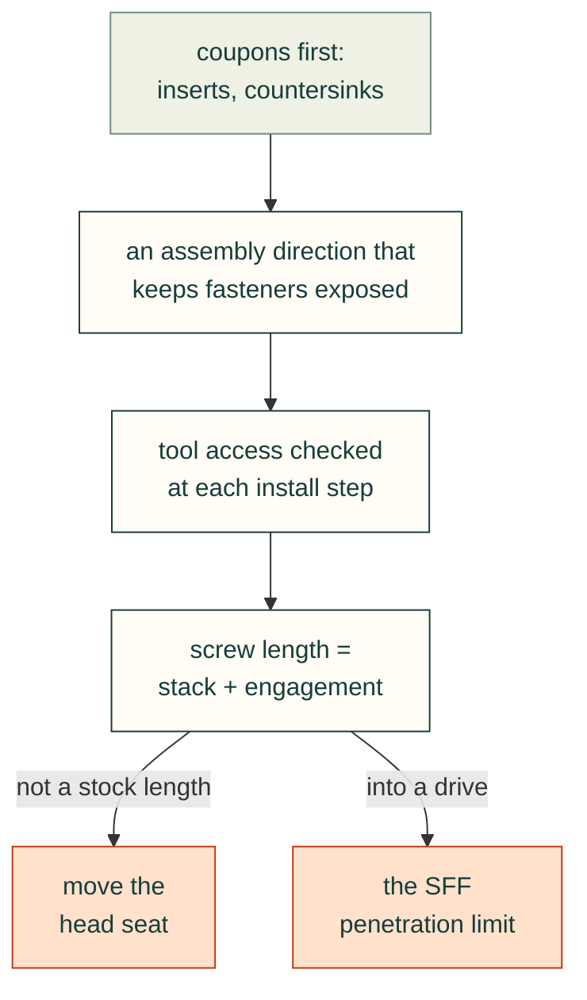

# Fasteners and assembly access

Bought hardware (screws, nuts, washers, inserts, pins, bearings, standoffs, rod ends) is chosen and placed with
[`skills/mcmaster-parts`](../../skills/mcmaster-parts/SKILL.md): a real McMaster-Carr part number, its STEP model
normalised into a known frame, and its specification table in the hardware catalogue, never an envelope.

### Check tool access for every fastener at the step where it is installed
- **Rule:** For each fastener, check that a real tool can reach it and turn it at the point in the assembly where it is
  fitted, not only in the finished assembly.
- **Incident:** The first storage-stack design needed standoffs to be turned "inside narrow bores where no tool fits".
  The 6.6 mm `column_bore` in `parameters.json` holds the 5.5 mm AF hex standoff (6.35 mm across corners), which
  leaves no room for a 5.5 mm nut driver (about 8 mm OD). In the redesign, the standoffs hang from the part above: the male
  end passes up through that part's 2 mm ledge, the hex bears in a 2 mm counterbore, and the female end takes the next
  tray. Every standoff is turned while fully exposed. Earlier, the wall-mount check found that a 20 mm driver envelope
  collided with a gusset; the fix was projection 24 → 26 mm and hole offset 13 → 15 mm.
- **Check:** Sweep a tool envelope (driver diameter or wrench across flats plus swing) to each fastener head at its
  assembly step. Any intersection with plastic fails. `mount-checks.json` records `driver_access` with a 20 mm tool.
- **Source:** 2026-10-24T08:35 (summary of the 07:00 work); 2026-10-25T00:36; `cad/parameters.json`
  (`interface_note`); `exports/mount-checks.json`.

### Choose the assembly direction that keeps fasteners exposed
- **Rule:** If a stack can only be fastened from one side, write the assembly order to match. Flipping the build
  (upside down) is acceptable.
- **Incident:** The storage stack is built upside down on the lid. Working from the top tray down: drive the drive
  screws in from below, route the leads, offer up the tray, and fit four M3 M-F standoffs through its ledges into the
  part above.
- **Check:** The README assembly steps state the order and which way up the assembly is. Each step names the tool and
  the access side.
- **Source:** 2026-10-25T00:36; `README.md` (Assembly step 10); `cad/parameters.json` (`interface_note`).

### Compute screw length from the stack plus thread engagement
- **Rule:** Length = distance from the head seat to the start of the mating thread, plus the required engagement.
  Then check the result against the depth of thread actually available.
- **Incident:** The user defined it: housing bottom to the top of the AGX, plus "something like 8 threads into the
  standoff". The standoff thread starts at Z 40.76, and 8 threads of M3 (0.5 mm pitch) is 4 mm, so a head flush with the
  floor would need 44.3 mm. The agent pointed out that an M3 × 45 only fits if the standoff thread is at least 5.2 mm
  deep.
- **Check:** A table per fastener: seat Z, thread-start Z, engagement in threads and mm, the stock length chosen, and
  the minimum thread depth that length requires.
- **Source:** 2026-10-25T00:34, 00:36; `cad/parameters.json` (`heatsink_thread_engagement_note`).

### Move the head seat to reach a standard screw length
- **Rule:** If the computed length is an uncommon size, move the seat (counterbore or countersink depth) so a stock
  length gives exactly the intended engagement.
- **Incident:** A 44.3 mm flat head is uncommon. The countersink seat was raised to Z 9.76 inside each Ø14 column, up a
  Ø7 pocket from the floor, so a standard M3 × 35 (DIN 7991 / ISO 10642) gives exactly 4.0 mm of engagement
  (9.76 + 35 = 40.76 + 4). This also puts the clamping cone in the solid column instead of the thin floor, and the base
  still sits flat.
- **Check:** Seat Z + stock length − thread-start Z = target engagement, within a stated tolerance. Recompute whenever a
  layer in the stack changes.
- **Source:** 2026-10-25T00:38; `README.md` (Assembly step 5); `cad/parameters.json` (`heatsink_seat_note`).

### Print coupons for inserts and countersinks before the big parts
- **Rule:** Give each process-sensitive fastener feature a small test coupon, printed in the intended filament and
  profile before the main part.
- **Incident:** P11 is the M3 heat-set insert pilot coupon (nominal pilot 3.9 mm). P14 is the countersink coupon,
  used to check that the flat head sits at or below the floor. P12/P13 test the plate channel and key. The filament is
  unspecified, so insert retention and fits are not qualified.
- **Check:** Every insert pilot and countersink in the design has a matching coupon in the part list, and the assembly
  steps say to print it first.
- **Source:** 2026-10-24T07:41; `README.md` (Parts, Assembly step 1); `cad/parameters.json` (`board_insert_pilot`,
  `lid_insert_pilot`).

### Limit screw penetration into drives to the SFF spec
- **Rule:** For screws into third-party devices, take the allowed thread penetration from the device spec. Pick the
  length so that (length − material under the head) falls inside that range.
- **Incident:** The drive hole patterns and penetration limits come from SFF-8301 Rev 1.9 and SFF-8201 Rev 3.4:
  - 3.5 in: a 6-32 × 3/16 in pan head through 1.9 mm of material, spec penetration 2.39–3.56 mm.
  - 2.5 in: an M3 × 4 button head through 2.3 mm, spec 0–2.5 mm.
  - 7 mm SSD side screws: penetration at most 2.0 mm (3.0 mm for thicker drives).

  By arithmetic (not stated in the session), the chosen screws penetrate about 2.86 mm (6-32) and 1.7 mm (M3 × 4),
  both inside the ranges.
- **Check:** `storage-checks.json` `drive_fastening` records the material under the head and the spec range per drive
  type. Add a computed-penetration field and assert that it is inside the range.
- **Source:** 2026-10-25T01:23; `cad/parameters.json` (`drives`, `ssd_clip`); `exports/storage-checks.json`.
