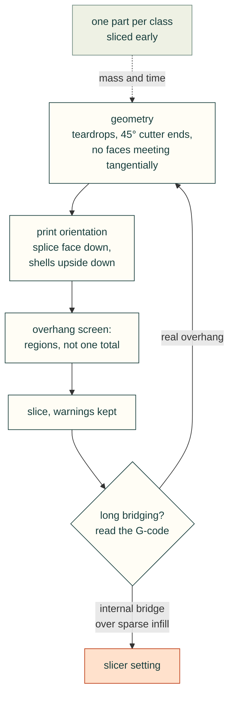

# Printing without supports, and reading slicer warnings

These lessons come from one Claude Code session on 2026-11-01 (session `47707e1e-b3c1-4114-b10e-9fc722a426bd`): a
1/8 Cat 323 excavator, 46 printed parts (178 pieces) for a Prusa XL 5T, designed in CadQuery with cad-agent and taken
to PrusaSlicer 2.9.4 slicing every part with no supports and no stability warning. Jeff Patrick contributed them
(#260); the project is in his private repository. Its file paths below are relative to that project. Nothing was printed or test-fitted in the
session, so these are rules for files that slice cleanly, not proof that a print succeeds.

Timestamps are UTC from the session transcript. The Check lines name the cad-agent work these lessons asked for:
#246 (keep PrusaSlicer's warnings), #247 (G-code bridge report and overhang regions), #249 (robust booleans and the
1 µm weld) and #251 (range-of-motion clearance sweep). In the session the project's own `tools/slice_all.py`,
`tools/bridges.py`, `tools/overhangs.py` and `tools/clearance.py` did those jobs. In cad-agent, #246 is `cad-agent
slice` with `cad.slicer.engine: prusa`, and #247 is `cad-agent overhangs` and `cadagent.manufacturing.gcode.bridge_report`.

## Geometry

### Cut horizontal holes as teardrops
- **Rule:** a hole whose axis lies flat in the print orientation gets a 45° roof (a teardrop) above its circle. If the
  part prints upside down, point the roof the other way. Make a slot the hull of two teardrops, not a box over them.
- **Incident:** the excavator's horizontal holes are all teardrops:
  - the track links' two pin holes (one free, one press fit);
  - the track frames' M4 roller axles and insert bores;
  - the final drive's 25.6 mm motor bore, which as a plain circle "creates an unsupported circular overhang that fails
    bridging".

  The idler yoke prints upside down, so its clamp-screw inserts are teardrops with the roof pointing down
  (`up=-1.0`). Its clamp slots were first a box between two circles, which left a flat ceiling between the two
  apexes. They became the hull of the two teardrops (`teardrop_slot_y`).
- **Check:** in the overhang screen, no region past 45° sits on the top of a horizontal hole. Overhang regions with
  position and angle (#247; `tools/overhangs.py` in the project) point at the hole directly; a single downward-area
  total does not.
- **Source:** 2026-11-01T20:26, 20:56, 21:18; `cad/cq_util.py` (`teardrop_y`, `teardrop_slot_y`); `cad/under.py`
  (track link, track frame, yoke). The J501 lid's antenna and jack holes used the same shape
  ([design rules](design-rules.md), "Build printable lead-ins into the cutter").

### End clearance cutters in 45° cones, not flat discs
- **Rule:** a cutter that clears room for a moving part (a swept cylinder, a bore, a channel) must not change radius
  in a flat step facing along its axis. Limit every radius change to 45° and end the cutter in a cone or a point. A
  flat end prints as a ceiling, and a step prints as a ring.
- **Incident:** the cylinders' clearance cuts are the volumes the barrels sweep through their stroke. The first
  version ended each sampled pose in a flat disc. In the standing print orientation, the sweep's flat end at the stick
  root read as a 1329 mm² ceiling. Where the barrel stepped down to the rod, each of the 11 sampled poses left a flat
  ring, a staircase of small ceilings beside the clevis slot. `_envelope_solid` now builds each pose as one revolved
  profile whose radius changes at no more than 45°, ending in cones. The boom and stick's hexagonal wiring channels
  end in 45° pyramids (`_hex_cap`), so they have no flat ceiling in any orientation.
- **Check:** an overhang region list (#247) after every new cutter, not only after new solids. The cutters' own
  slopes can be checked in the build: no profile step steeper than 45° along the axis.
- **Source:** 2026-11-01T20:27, 20:43; `cad/front.py` (`_envelope_solid`, `cylinder_sweep`, `channel`, `_hex_cap`).

### Print a section with a clevis slot standing on its splice face
- **Rule:** when a beam is printed in sections, look at each section's slots and forks in the print orientation. If a
  slot's upper cheek would be held at one end only, stand the section on its splice face, so the cheeks become walls
  that grow straight up.
- **Incident:** lying on its side, the boom nose's fork slot had an upper cheek supported at one end only, an
  unsupported cantilever. The boom nose, boom knee and stick root were turned to stand on their splice faces
  (`_stand_on_splice` rotates the channel direction at the splice to +z). The boom nose then stood about 250 mm
  tall, and the tall sections got a 10 mm brim.
- **Check:** a print-orientation table with a reason for each part (`PRINT` in `cad/build.py`), and the slicer's
  bed-adhesion warning kept (#246), since standing parts are tall and narrow.
- **Source:** 2026-11-01T19:36, 20:26; `cad/build.py` (`_stand_on_splice`); `tools/slice_all.py` (`TALL`).

### Fasten shells printed upside down with 45°-capped bosses, not inward flanges
- **Rule:** a shell open at the bottom and printed roof down has its bottom edge at the top of the print. An inward
  flange there is a ceiling. Put the screws in bosses that are columns tied into the wall with a 45° cone on their
  free end, which prints either way up.
- **Incident:** the cab, tank box and engine house are open-bottom shells printed upside down. The first design
  stood them on inward flanges, and "the inward flange near the door creates an overhang problem once flipped". The
  flanges also gave too little depth for an M3 insert. They became columns of radius 4.5 mm and 9 mm high with a
  45° cone, holding M3 heat-set inserts from below (`_bosses`). (The module's docstring still says flanges.)
- **Check:** for each part printed upside down, list the features at its bottom edge and check each is a column,
  cone or slope, never a shelf. The overhang screen in the print orientation confirms it.
- **Source:** 2026-11-01T19:36, 19:40; `cad/upper.py` (`_bosses`, `_boss_holes`).

### Open a shell's bottom without cutting away the walls' first millimetres
- **Rule:** when a cut opens a shell's bottom, keep the cut inside the walls on every side. A cut that spans the full
  length takes the bottom of the end walls with it, and those walls then start in mid-air.
- **Incident:** the shells' bottom cut ran the full x range and removed material up to 3 mm above the bottom between
  the side walls. So the engine house's front wall "now starts 3mm above the bed, creating an unintended overhang
  ceiling along its whole length", and the cab and tank box had the same fault. The overhang screen showed it as a
  ceiling at z = 3 mm. The fix insets the cut by the wall thickness in x as well as y (`_shell`).
- **Check:** after any cut that opens a part, every wall reaches the bed: no overhang region at a constant small
  height above it (#247 reports each region's height range).
- **Source:** 2026-11-01T20:27; `cad/upper.py` (`_shell`).

### Make long arch roofs steeper than 45°
- **Rule:** a face at exactly 45° is at the slicer's limit. On a long roof it can still print as overhang perimeters
  and raise a "long bridging" warning. Use about 40° from vertical for long arches and roofs, and lower anything above
  the arch below its apex, so no floor spans across it.
- **Incident:** the track frames' roller pockets have pointed-arch roofs. With 45° flanks, PrusaSlicer flagged
  "long bridging extrusions". The G-code showed the flanks running as overhang perimeters 58 mm long. The arch went to
  40° from vertical (`ARCH_DEG = 40.0`). The idler yoke's channel floor sat above the front pocket's apex and left a
  thin floor to bridge. It was lowered just below the apex, so it opens a 4 mm slot onto the pocket instead. Other
  shapes keep their 45° where nothing flagged: the final drive housing's flanks, the counterweight's tent roof.
- **Check:** after slicing, list the longest `Overhang perimeter` moves (#247; `tools/bridges.py`). Long runs on a
  45° face mean the face should be steeper.
- **Source:** 2026-11-01T21:17, 21:18; `cad/under.py` (`ARCH_DEG`, the `YOKE` note).

### Keep cutter tips off the faces they meet
- **Rule:** do not let a cutter meet another face tangentially, or end exactly on it. Offset it by a few tenths of a
  millimetre into the void, and give overlapping sampled solids distinct pointed tips.
- **Incident:** the sweep cones started at the clevis slot's half-width, 4.75 mm, so they touched the slot faces
  tangentially. The boom knee and stick root meshes were then not watertight: both open edges lay exactly on the slot
  faces (y = ±4.75). The union of the sampled sweep solids, which met tangentially near the pivot, was invalid too.
  Earlier, an invalid sweep had cut nothing from the boom, and only the clearance sweep caught it, as a constant
  4683 mm³ overlap across poses. The cone tips now start 0.4 mm inside the slot (`rs = SLOT - 0.4`), and the solids
  meet crosswise.
- **Check:** every boolean result is checked for validity, with a fallback that never returns a bad shape silently
  (#249; `union` and `cut` in `cad/cq_util.py`). The print mesh is welded at 1 µm before the watertight check
  (`_mesh` in `cad/build.py`), and a hole that survives the weld is a real fault. A range-of-motion clearance sweep
  (#251) catches a cutter that cut nothing.
- **Source:** 2026-11-01T21:34, 21:51, 21:52, 21:55; `cad/front.py` (`cylinder_sweep`); `cad/build.py` (`_mesh`).

## Slicing

### Find a "long bridging" warning in the G-code before changing the geometry
- **Rule:** keep the slicer's warnings, and then find what each one is about before redesigning. PrusaSlicer's
  "long bridging extrusions" and "floating bridge anchors" are often internal bridges: the first solid layer laid over
  sparse infill. Those are fixed with a slicer setting, not geometry.
- **Incident:** cad-agent's slice kept PrusaSlicer's output only when a slice failed, so successful slices hid their
  stability warnings. Once they were kept (`--loglevel 3`), 20 of 46 parts carried at least one. PrusaSlicer names
  the category but not the place. Listing the longest `Bridge infill` moves showed the cab's at z = 2.0 mm: 197.4 mm
  long, inside a 2.5 mm roof over a sparse core. The counterweight's top skin was anchored on sparse infill the same
  way, and `solid_infill_below_area: 400` fixed it. Two log lines that say nothing about the print appear for every
  part (the support-spot search on a five-tool printer, and Arachne re-running a Voronoi diagram). They are counted
  apart (`benign_log_lines`). At the end, all 46 parts sliced with no warning or error.
- **Check:** the slice report counts warnings and stability issues per part and fails on any (#246). For each long
  bridging warning, the longest bridge and overhang-perimeter moves with height and position (#247): a bridge inside a
  solid region is internal, and one at an outer face is real.
- **Source:** 2026-11-01T20:20, 21:13; `tools/slice_all.py` (`BENIGN`, `PART_OVERRIDES`); `tools/bridges.py`;
  `exports/slice-report.json` (`parts_with_flags` empty, `pass` true).

### Slice one part from each class before finishing the design
- **Rule:** slice one representative part of each kind (a shell, a structural beam, a link, a small part) as soon as
  it exists, with the real profile. Use the slicer's grams and hours to set the design's budget. A volume-based
  estimate is not a budget.
- **Incident:** the brief estimated "roughly 3 kg of plastic". The first full slice, after all 46 parts were designed,
  came to 8.75 kg, and the mass had to come out in a redesign and re-slice. Per-part overrides (2 perimeters and 10%
  for shells, 3 and 12% gyroid for structure, 4 and 40% for pin-loaded parts) brought it to the final 6.9 kg and
  about 354 hours, still more than double the estimate. The 100 track links alone are 1 kg.
- **Check:** a slice of each part class is in the project before the last parts are designed, and the README states
  the sliced total, not an estimate.
- **Source:** 2026-11-01T18:46, 20:20, 22:14; `README.md` (Print files); `exports/slice-report.json`
  (`total_grams_all_quantities` 6896.6, `total_hours_all_quantities` 353.7). See also
  [slicer grams](../simulation/simulation-and-material.md), "Judge material savings on slicer grams, not CAD volume".
