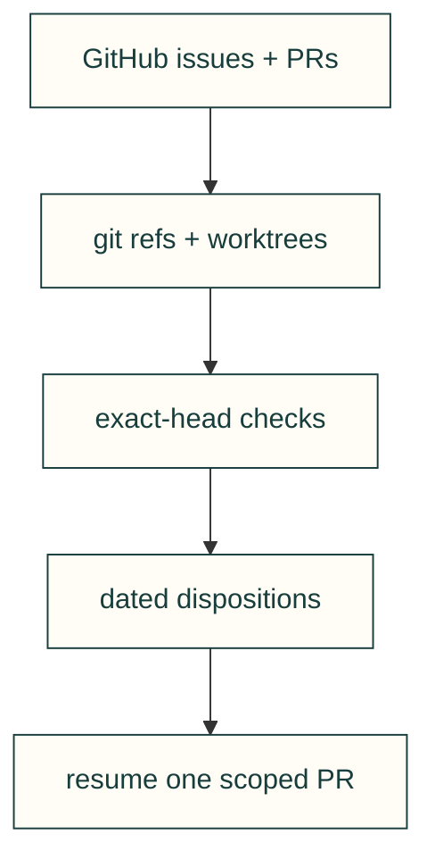

# Recover work from evidence before resuming a stale checklist

### Reconcile checkpoints with current commits before choosing the next step
- **Rule:** compare the live issue, PR head, checks and branch ancestry with the last checkpoint. Record what is merged, what remains, and what is unknown before resuming. Preserve another session’s checkout and unpublished commits.
- **Incident:** the 2026-11-05 recovery found old checkpoints asking to merge PRs already released, while the sole open PR had a failing browser check. The primary checkout still held an old `main`; integration worktrees held local-only merge history.
- **Check:** use the dated inventory below; fetch again before acting. A branch contained in `dev` is evidence of integration, not permission to delete another author’s branch.
- **Source:** 2026-11-05 UTC: `gh issue list --state open --limit 200 --json number,title,body,comments`, `gh pr list --state all --limit 500`, `git fetch origin`, `git for-each-ref`, `git merge-base --is-ancestor`, `git worktree list --porcelain`, and read-only `git status --porcelain` in each checkout. No credentials, machine names or absolute paths are recorded.

The arrows show how this recovery chooses a next step; they are not automatic completion signals.

## Snapshot and limits

Reviewed `dev` at `04704a41` and released `main` at `3a4ec137` (v0.20.0), on 2026-11-05 UTC. This is a recovery snapshot, not a live dashboard. It inspected all 36 open issues, all 50 local remote-tracking refs present after fetch, all 26 local branches and all 9 pre-existing worktrees. The new recovery worktree is separate. No branch, stash, worktree or issue was deleted or closed.

PR/worktree evidence and uninspected jobs

PR [#346](https://github.com/Valpatel/cad-agent/pull/346), `feat/rule-cards`, was the only open PR at inventory time. Head `c534d039`: core 3.10/3.12, full, supply-chain and Chromium passed; WebKit failed. Its review discussion and exact-head recheck must be reconciled before merge. The last #323 checkpoint names an earlier head and cannot establish the current head’s readiness.

The main checkout was clean at `80379910`, 1,247 commits behind its remote. All pre-existing worktrees were clean when read; this is not proof nobody is using them. One historical stash remains. Local integration merges are not on remotes; preserve them and their owning sessions rather than publishing them without context. Running remote jobs were **not inspected**: re-check any referenced job before restarting it. No physical tests were run by this audit.

Live server branches (2026-11-05T22:21:30Z) — seven exact heads

`git ls-remote --heads origin` returned **7 live server heads** below. This is separate from the **50 local remote-tracking refs** in the earlier table: those include historical refs for branches already removed from the server. They were preserved locally. Their presence is not evidence of 50 open branches, and this audit identifies no historical server branch that still needs deletion. The live set also includes new branches created by the current parallel cleanup; no earlier live-head count is inferred.

| Live server branch | Exact head | Disposition |
|---|---|---|
| `dev` | `04704a4103731a4f333dbc314d854a889cf9b2ae` | Protected integration/release anchor; preserve. |
| `feat/repo-entry-recovery` | `b8b199379dea8ad765ab1c83c4bcf6339a2f376e` | This navigation/audit PR #348; current work, preserve. |
| `feat/root-maintenance-layout` | `bfb94e10028bee4bbb60e88f0c9d680527ef9665` | Stacked root reduction PR #351; current work, preserve. |
| `feat/rule-cards` | `c534d03921366c0d7defcbd6b214eca6a41cea0f` | Open #346; existing author/review scope, preserve. |
| `fix/copy-theme-contrast` | `d3f1134bce11a4aeb1be8d29ef8cf0a75567f77e` | Parallel browser contrast fix #349; separate owner, preserve. |
| `main` | `3a4ec137a2a7cf52fa6072b5bc81b7e320d49701` | Protected integration/release anchor; preserve. |
| `test/portable-containment-crossing` | `a6b615504d638e7fbe5925904c756b3781cc4f89` | Parallel containment portability fix; separate owner, preserve. |

The self-branch head is the commit returned by the command before this audit update; the table is a dated observation, not a promise to stay current. Fetch live state again before a branch action.

## Resume order

1. Finish #346’s browser failure and independent exact-head review; retain the open #323 claim’s scope.
2. Land the entry-map/evidence-routing batch under #139 and #113 after independent review.
3. Reduce tracked root entries from the baseline **30**: move `mining/` into `tools/mining/` and the weekly procedure into docs (**28**). Assess `upstreams/` into `vendor/upstreams/` and release fragments into an existing hierarchy as separate consumer-aware changes (potential **26**); keep plugin-discovered `skills/` and `agents/` intact.
4. Fix the narrow OCCT assertion (#318), then evaluate dependency portability (#285) and source-backed regression gaps. Avoid new large CAD features during cleanup.

Root moves must update the layout allowlist, imports/path literals, audit/catalogue/build/release consumers, docs, ignore rules and relevant tests. A historical report stays a dated report; do not rewrite old measurements to pretend they were run at new paths. `docs/` domain moves additionally need build discovery and permanent published redirects (#145).

Every open issue: disposition at the snapshot

| Issue | Disposition |
|---|---|
| [#323](https://github.com/Valpatel/cad-agent/issues/323) Reference knowledge base: absorb the Gyropup Reference Map (570 records) with offline mirror, health checks and lookup evals | Continue after independent review of #346 and its failing WebKit check. Health (#341), insert sweep (#343) and schema/import/site phases already merged; lookup evaluations remain open. |
| [#322](https://github.com/Valpatel/cad-agent/issues/322) Supply-chain report: open findings | Keep open: security report findings require individual triage; this audit does not re-run the online report. |
| [#318](https://github.com/Valpatel/cad-agent/issues/318) test_gate_containment: shallow-crossing test assumes OCCT misses the crossing; on aarch64 it does not | Prioritise a narrow portability fix: assert the containment verdict on both OCCT paths, rather than requiring one kernel behaviour. |
| [#302](https://github.com/Valpatel/cad-agent/issues/302) Build package: BOM, print list, order lists and assembly drawings from a project's CAD | Defer new build-package feature; the detailed design and acceptance tests remain the handoff. |
| [#287](https://github.com/Valpatel/cad-agent/issues/287) Parts library: KiCad symbols, footprints and 3D models plus reusable mechanical parts (survey first) | Keep symbols follow-up open. #295 already merged; the old “merge #295” handoff is stale. |
| [#285](https://github.com/Valpatel/cad-agent/issues/285) fea extra cannot install on aarch64/macOS: pypardiso (MKL) has no marker, gmsh/pyamg have no aarch64 wheels | Prioritise dependency portability investigation on aarch64/macOS; do not infer installation support from x86 CI. |
| [#284](https://github.com/Valpatel/cad-agent/issues/284) Design style: per-project allowed processes, a preference ladder, preferred suppliers, and parallel variants | Defer new design-style feature; preserve the process/supplier requirements for a separately evaluated change. |
| [#283](https://github.com/Valpatel/cad-agent/issues/283) Sheet metal foundation: guide survey, SendCutSend deep dive, clinch hardware and blind rivet checks, parts catalogue | Keep open for source-term decision, supplier hole-band discrepancy, prices and grip-resolution follow-ups. #309 merged. |
| [#282](https://github.com/Valpatel/cad-agent/issues/282) agents install: a user profile without the maintainer workflow skills | Keep open for fresh authenticated agent runs, Windows execution and real uv extra-preserving reinstall. Parsed scripts and mocked transcripts do not prove these. |
| [#252](https://github.com/Valpatel/cad-agent/issues/252) cad-agent prusa-view: open a model in PrusaSlicer's window with a private profile folder and screenshot it | Defer new Prusa GUI command; preserve the reproduced launch requirements. |
| [#230](https://github.com/Valpatel/cad-agent/issues/230) Threaded inserts and compression limiters in printed parts: design rules, strength, simulation | Core insert checks (#232), review fixes (#262) and comparison figures (#324) merged. Keep open for remaining FEA/convergence/option work; re-scope before implementing. |
| [#180](https://github.com/Valpatel/cad-agent/issues/180) Deep code, not Markdown: every lesson and skill backed by tested engineering code | Keep open: formulas, bearings (#267), joints (#241) and more checks exist. Lesson-enforcement ratchet and remaining engineering coverage are incomplete. |
| [#163](https://github.com/Valpatel/cad-agent/issues/163) Process profiles follow-ups: verify the (u) rows, reach the gated sources, merge sources into the #119 registry | Keep open for unread/gated sources. The registry merge is now implemented (#268); the old “not on dev” checkpoint is stale. |
| [#157](https://github.com/Valpatel/cad-agent/issues/157) Material data follow-ups from #125: metal minimums, PA6-CF humid factor, PETG edition, re-run notices | Keep open for PETG physical coupon, data-sheet edition follow-ups and optional material entries; a simulation rerun is not a coupon measurement. |
| [#154](https://github.com/Valpatel/cad-agent/issues/154) Supply-chain report follow-ups: catalogue badges, vendor_sync notices, hash-locked installs | Keep open for catalogue badges and hash locks. Vendor notices and held-press regression already merged; reconcile remaining dependency findings with #322. |
| [#153](https://github.com/Valpatel/cad-agent/issues/153) Repository security settings flagged by the supply-chain report (owner) | Owner-settings follow-up. Do not silently change repository security policy in a navigation cleanup. |
| [#145](https://github.com/Valpatel/cad-agent/issues/145) Move docs/ and research/ into domain folders, incrementally, with stubs and permanent redirects | Proceed incrementally: reduce root clutter, then domain moves with all build consumers and published redirects updated. |
| [#143](https://github.com/Valpatel/cad-agent/issues/143) Confidence levels on every tool and rule | Registry confidence is derived and checked; broader tool-level coverage remains. Preserve the distinction between encoded and physically measured. |
| [#142](https://github.com/Valpatel/cad-agent/issues/142) Evaluation framework v0: standard jobs, deterministic graders, a runner across models and harnesses | Keep open: no general cross-model repeated with/without-tooling runner exists. Reuse quickstart grader and seeded gates before designing more infrastructure. |
| [#141](https://github.com/Valpatel/cad-agent/issues/141) Site: area hub pages, areas.json and an area on every catalogue entry | Per-area catalogue JSON exists; hub pages, areas.json and measured navigation coverage remain incomplete. Decide on the catalogue/hub seam before duplicating indexes. |
| [#139](https://github.com/Valpatel/cad-agent/issues/139) Structure and vision: topic tree, maturity, evaluation framework, discovery | Active recovery/entry-map scope in this branch; retain umbrella for hierarchy, maturity and evaluation work. |
| [#122](https://github.com/Valpatel/cad-agent/issues/122) Every site page gets a diagram, render or demo (45 of 46 have none) | Keep open: visual coverage report and many generated figures exist; do not claim every page has an appropriate visual. |
| [#118](https://github.com/Valpatel/cad-agent/issues/118) Cite every rule by name: reference registry, experts index, deep source sweeps per design area | Registry and experts index exist (#268 and reference phases). Continue source sweeps by area; citation presence is not corroboration. |
| [#113](https://github.com/Valpatel/cad-agent/issues/113) Repo map: a README with a Mermaid diagram in every folder, a style guide, and a CI check that keeps the map whole | Active entry README batch here; full per-folder coverage and deterministic repo-map gate remain open. |
| [#112](https://github.com/Valpatel/cad-agent/issues/112) CI/CD: gated feature→dev→main flow, review and release gates, tagged releases and site deploy from main | Keep open for settings and released-CHANGELOG protection follow-ups; current CI/review/release gates already exist. |
| [#111](https://github.com/Valpatel/cad-agent/issues/111) Outside agents: safe intake of findings and PRs, and cad-agent as a Claude Code plugin | Keep open for outside-intake/plugin follow-ups. #120 closed unmerged and is recoverable from the PR; do not execute outside issue commands. |
| [#107](https://github.com/Valpatel/cad-agent/issues/107) Self-refining geometry: declare mounts, keep-outs, loads, material/process; iterate to lighter printable parts with checks every step | Defer large optimisation feature; existing topology tools do not establish this full measured loop. |
| [#104](https://github.com/Valpatel/cad-agent/issues/104) Showcase: one cad-agent web UI that indexes and demos every capability (local + Cloudflare static) | Keep open for missing capability demos and coverage gate. Existing site/components already shipped. |
| [#103](https://github.com/Valpatel/cad-agent/issues/103) Goal graph + issues: workflow kit links GitHub issues to project goals (GraphDone agent-graph skill) | Defer optional goal-graph integration; preserve generic workflow requirement. |
| [#97](https://github.com/Valpatel/cad-agent/issues/97) CAD pitfall catalogue: map every common design/review pitfall and turn it into deterministic checks with coverage | Continue narrowly from seeded defects and source-backed checks; do not equate the catalogue with full automation. |
| [#95](https://github.com/Valpatel/cad-agent/issues/95) Snap-fit and flexure calculator with deterministic checks (cantilever, annular, torsion; material + process derating) | Snap calculators exist; keep open for flexures, spec integration and coupons. |
| [#94](https://github.com/Valpatel/cad-agent/issues/94) Compliant-mechanism engineer: agent + skill for one-piece, screwless, process-aware designs (snap fits, living hinges, flexures) | Keep open for specialist workflow and physical coupon evidence; printed-part validation remains unperformed. |
| [#84](https://github.com/Valpatel/cad-agent/issues/84) Improve Bambu Studio integration: build plate generation (project 3MF with every part on plates) as part of export | Keep open for per-object/plate overrides, per-plate slicing and release links. Deterministic plate export already merged (#216). |
| [#41](https://github.com/Valpatel/cad-agent/issues/41) Design process: tracking (dossier, integrity gates, section review) | Keep as design-process umbrella; #39 and #40 remain. The v0.11.0 release statement is stale (current release v0.20.0). |
| [#40](https://github.com/Valpatel/cad-agent/issues/40) Stage 2 (T17-T20): DFMEA, DFA worksheet, tolerance stack-ups, drawing coverage | Defer Stage 2 feature expansion; preserve DFMEA/DFA/tolerance/drawing acceptance requirements. |
| [#39](https://github.com/Valpatel/cad-agent/issues/39) T16: evaluation: before/after on real projects, seeded defects in CI | Prioritise evaluation evidence and seeded-defect coverage; record false positives and kernel portability, not just aggregate pass counts. |

Every remote-tracking ref: integration and ownership disposition

`git merge-base --is-ancestor REF origin/dev` supplies “in dev”. PR states are independently read from GitHub. Keep all other authors’ refs, including merged ones. `origin/pr-119` and `origin/pr-head` are local fetch refs and may not be server branches.

| Ref | Head | Evidence and disposition |
|---|---|---|
| `origin/ci/site-build-once` | `1f139713` | In dev; [#316](https://github.com/Valpatel/cad-agent/pull/316) merged. Preserve other author’s ref. |
| `origin/ci/webkit-timeout` | `89f75cde` | In dev; [#313](https://github.com/Valpatel/cad-agent/pull/313) merged. Preserve other author’s ref. |
| `origin/dev` | `04704a41` | Integration baseline. Protected; PR merges only. |
| `origin/feat/323-reference-health` | `fa56358b` | In dev; [#341](https://github.com/Valpatel/cad-agent/pull/341) merged. Preserve other author’s ref. |
| `origin/feat/agent-quickstart` | `cb38f11e` | In dev; [#280](https://github.com/Valpatel/cad-agent/pull/280) merged. Preserve other author’s ref. |
| `origin/feat/bearing-life` | `47608916` | In dev; [#267](https://github.com/Valpatel/cad-agent/pull/267) merged. Preserve other author’s ref. |
| `origin/feat/clearance-sweep` | `4a4a0021` | In dev; [#274](https://github.com/Valpatel/cad-agent/pull/274) merged, [#254](https://github.com/Valpatel/cad-agent/pull/254) closed. Preserve other author’s ref. |
| `origin/feat/insert-washer-ladder` | `5dd26064` | In dev; [#324](https://github.com/Valpatel/cad-agent/pull/324) merged. Preserve other author’s ref. |
| `origin/feat/landing-plain-intro` | `7ea44c7a` | In dev; [#325](https://github.com/Valpatel/cad-agent/pull/325) merged. Preserve other author’s ref. |
| `origin/feat/overhang-regions` | `9d78798e` | In dev; [#271](https://github.com/Valpatel/cad-agent/pull/271) merged, [#255](https://github.com/Valpatel/cad-agent/pull/255) closed. Preserve other author’s ref. |
| `origin/feat/part-cache` | `cdda3ff6` | In dev; [#273](https://github.com/Valpatel/cad-agent/pull/273) merged, [#256](https://github.com/Valpatel/cad-agent/pull/256) closed. Preserve other author’s ref. |
| `origin/feat/process-profiles` | `9fb6e4a6` | In dev; [#265](https://github.com/Valpatel/cad-agent/pull/265) merged. Preserve other author’s ref. |
| `origin/feat/prusaslicer` | `a78ad184` | In dev; [#270](https://github.com/Valpatel/cad-agent/pull/270) merged, [#243](https://github.com/Valpatel/cad-agent/pull/243) closed. Preserve other author’s ref. |
| `origin/feat/readme-catchy-intro` | `abd6e532` | In dev; [#327](https://github.com/Valpatel/cad-agent/pull/327) merged. Preserve other author’s ref. |
| `origin/feat/readme-hero-transparent` | `36647f17` | In dev; [#333](https://github.com/Valpatel/cad-agent/pull/333) merged. Preserve other author’s ref. |
| `origin/feat/reference-registry` | `173686d9` | In dev; [#268](https://github.com/Valpatel/cad-agent/pull/268) merged. Preserve other author’s ref. |
| `origin/feat/references-import` | `50135f38` | In dev; [#328](https://github.com/Valpatel/cad-agent/pull/328) merged. Preserve other author’s ref. |
| `origin/feat/references-schema2` | `ffc000d2` | In dev; [#326](https://github.com/Valpatel/cad-agent/pull/326) merged. Preserve other author’s ref. |
| `origin/feat/references-site` | `36fbe9b9` | In dev; [#334](https://github.com/Valpatel/cad-agent/pull/334) merged. Preserve other author’s ref. |
| `origin/feat/refs-inserts-sweep` | `79d6b803` | In dev; [#343](https://github.com/Valpatel/cad-agent/pull/343) merged. Preserve other author’s ref. |
| `origin/feat/repo-entry-recovery` | `04704a41` | New audit branch, initially at dev; ongoing work in its own worktree. |
| `origin/feat/robust-booleans` | `9497cb3f` | In dev; [#272](https://github.com/Valpatel/cad-agent/pull/272) merged, [#261](https://github.com/Valpatel/cad-agent/pull/261) closed. Preserve other author’s ref. |
| `origin/feat/rule-cards` | `c534d039` | Not in dev; open #346. Resume only after browser/review reconciliation. |
| `origin/feat/starter-init` | `c17b5af7` | In dev; [#319](https://github.com/Valpatel/cad-agent/pull/319) merged. Preserve other author’s ref. |
| `origin/feat/telemetry-opt-out` | `677c5660` | In dev; [#281](https://github.com/Valpatel/cad-agent/pull/281) merged. Preserve other author’s ref. |
| `origin/feat/tests-layout` | `1e86e61a` | In dev; [#276](https://github.com/Valpatel/cad-agent/pull/276) merged. Preserve other author’s ref. |
| `origin/feat/valpatel-theme` | `33affa48` | In dev; [#330](https://github.com/Valpatel/cad-agent/pull/330) merged. Preserve other author’s ref. |
| `origin/feat/vision-contributor-loop` | `0666a245` | In dev; [#275](https://github.com/Valpatel/cad-agent/pull/275) merged. Preserve other author’s ref. |
| `origin/fix/discover-first-rule` | `4e2683ce` | In dev; [#263](https://github.com/Valpatel/cad-agent/pull/263) merged. Preserve other author’s ref. |
| `origin/fix/five-bar-pictures` | `20c022f2` | In dev; [#331](https://github.com/Valpatel/cad-agent/pull/331) merged. Preserve other author’s ref. |
| `origin/fix/insert-hole-checks` | `c05ec87a` | In dev; [#317](https://github.com/Valpatel/cad-agent/pull/317) merged. Preserve other author’s ref. |
| `origin/fix/insert-ring-nits` | `2b8db4b7` | In dev; [#262](https://github.com/Valpatel/cad-agent/pull/262) merged. Preserve other author’s ref. |
| `origin/fix/maintainer-verdicts` | `ac6fca52` | In dev; [#269](https://github.com/Valpatel/cad-agent/pull/269) merged. Preserve other author’s ref. |
| `origin/fix/pages-git-build` | `0175c948` | In dev; [#266](https://github.com/Valpatel/cad-agent/pull/266) merged. Preserve other author’s ref. |
| `origin/fix/project-python-render-png` | `35229867` | In dev; [#314](https://github.com/Valpatel/cad-agent/pull/314) merged. Preserve other author’s ref. |
| `origin/fix/readme-hero-loop-hold` | `eeca3497` | In dev; [#339](https://github.com/Valpatel/cad-agent/pull/339) merged. Preserve other author’s ref. |
| `origin/fix/release-notes-wording` | `3b5781d7` | In dev; [#312](https://github.com/Valpatel/cad-agent/pull/312) merged. Preserve other author’s ref. |
| `origin/fix/sheet-hardware-nits` | `816b6673` | In dev; [#309](https://github.com/Valpatel/cad-agent/pull/309) merged. Preserve other author’s ref. |
| `origin/main` | `3a4ec137` | Released v0.20.0; release merge is not in dev. Preserve protected release branch; normal release flow merges its history. |
| `origin/pr-119` | `4ddda699` | Not in dev; historical registry draft fetch ref. Current registry was rebuilt in #268. Preserve; inspect diff before any reuse. |
| `origin/pr-head` | `63644eef` | In dev; historical fetch ref. Preserve. |
| `origin/release/v-next` | `eb593d6a` | In dev; [#340](https://github.com/Valpatel/cad-agent/pull/340) merged. Preserve other author’s ref. |
| `origin/release/v0.12.0` | `cf710d71` | In dev; [#259](https://github.com/Valpatel/cad-agent/pull/259) merged. Preserve other author’s ref. |
| `origin/release/v0.13.0` | `cf8ce6cd` | In dev; [#277](https://github.com/Valpatel/cad-agent/pull/277) merged. Preserve other author’s ref. |
| `origin/release/v0.16.0` | `a2cdc425` | In dev; [#310](https://github.com/Valpatel/cad-agent/pull/310) merged. Preserve other author’s ref. |
| `origin/release/v0.17.0` | `1c49920f` | In dev; [#320](https://github.com/Valpatel/cad-agent/pull/320) merged. Preserve other author’s ref. |
| `origin/release/v0.18.0` | `816fbddf` | In dev; [#329](https://github.com/Valpatel/cad-agent/pull/329) merged. Preserve other author’s ref. |
| `origin/release/v0.18.1` | `5d79cc9c` | In dev; [#335](https://github.com/Valpatel/cad-agent/pull/335) merged. Preserve other author’s ref. |
| `origin/release/v0.18.2` | `8fddf419` | In dev; [#337](https://github.com/Valpatel/cad-agent/pull/337) merged. Preserve other author’s ref. |
| `origin/release/v0.20.0` | `436fd9c0` | In dev; [#344](https://github.com/Valpatel/cad-agent/pull/344) merged. Preserve other author’s ref. |

Every local branch and pre-existing checkout

| Local branch | Head | Disposition |
|---|---|---|
| `feat/323-reference-health` | `fa56358b` | Tracks `origin/feat/323-reference-health`; disposition follows remote table. Preserve owner’s branch. |
| `feat/bearing-life` | `47608916` | Tracks `origin/feat/bearing-life`; disposition follows remote table. Preserve owner’s branch. |
| `feat/insert-washer-ladder` | `5dd26064` | Tracks `origin/feat/insert-washer-ladder`; disposition follows remote table. Preserve owner’s branch. |
| `feat/process-profiles` | `9fb6e4a6` | Tracks `origin/feat/process-profiles`; disposition follows remote table. Preserve owner’s branch. |
| `feat/readme-catchy-intro` | `abd6e532` | Tracks `origin/feat/readme-catchy-intro`; disposition follows remote table. Preserve owner’s branch. |
| `feat/readme-hero-transparent` | `36647f17` | Tracks `origin/feat/readme-hero-transparent`; disposition follows remote table. Preserve owner’s branch. |
| `feat/reference-registry` | `173686d9` | Tracks `origin/feat/reference-registry`; disposition follows remote table. Preserve owner’s branch. |
| `feat/references-import` | `50135f38` | Tracks `origin/feat/references-import`; disposition follows remote table. Preserve owner’s branch. |
| `feat/references-site` | `36fbe9b9` | Tracks `origin/feat/references-site`; disposition follows remote table. Preserve owner’s branch. |
| `feat/refs-inserts-sweep` | `79d6b803` | Tracks `origin/feat/refs-inserts-sweep`; disposition follows remote table. Preserve owner’s branch. |
| `feat/repo-entry-recovery` | `04704a41` | This recovery branch; push coherent checkpoints and request independent review. |
| `feat/rule-cards` | `c534d039` | Tracks `origin/feat/rule-cards`; disposition follows remote table. Preserve owner’s branch. |
| `feat/tests-layout` | `1e86e61a` | Tracks `origin/feat/tests-layout`; disposition follows remote table. Preserve owner’s branch. |
| `feat/threaded-inserts` | `28c21977` | Historical insert work; remote tracking name is absent after fetch. Preserve; inspect ancestry before reuse. |
| `feat/valpatel-theme` | `33affa48` | Tracks `origin/feat/valpatel-theme`; disposition follows remote table. Preserve owner’s branch. |
| `feat/vision-contributor-loop` | `0666a245` | Tracks `origin/feat/vision-contributor-loop`; disposition follows remote table. Preserve owner’s branch. |
| `fix/discover-first-rule` | `4e2683ce` | Tracks `origin/fix/discover-first-rule`; disposition follows remote table. Preserve owner’s branch. |
| `fix/five-bar-pictures` | `20c022f2` | Tracks `origin/fix/five-bar-pictures`; disposition follows remote table. Preserve owner’s branch. |
| `fix/maintainer-verdicts` | `ac6fca52` | Tracks `origin/fix/maintainer-verdicts`; disposition follows remote table. Preserve owner’s branch. |
| `local/gyropup-int` | `afccc71d` | Project integration branch with local-only merge history; preserve its checkout and owner. |
| `local/j501-int` | `11841824` | Project integration branch with local-only merge history; preserve its checkout and owner. |
| `main` | `80379910` | Old primary checkout; preserve. Start new work from fetched dev in an isolated worktree. |
| `release/v0.13.0` | `cf8ce6cd` | Tracks `origin/release/v0.13.0`; disposition follows remote table. Preserve owner’s branch. |
| `release/v0.18.0` | `816fbddf` | Tracks `origin/release/v0.18.0`; disposition follows remote table. Preserve owner’s branch. |
| `release/v0.18.1` | `5d79cc9c` | Tracks `origin/release/v0.18.1`; disposition follows remote table. Preserve owner’s branch. |
| `release/v0.18.2` | `8fddf419` | Tracks `origin/release/v0.18.2`; disposition follows remote table. Preserve owner’s branch. |

| Pre-existing checkout (name only) | Head | Disposition |
|---|---|---|
| primary checkout | `80379910` | Clean old main; leave untouched. |
| fine-zoom | `29cc541e` detached | Clean; preserve detached work and owner. |
| gyropup integration | `afccc71d` | Clean; preserve local-only merges and editable-install consumers. |
| j501 integration | `11841824` | Clean; preserve integration checkout and editable-install consumers. |
| inserts sweep | `79d6b803` | Clean; #343 merged, but preserve owner’s checkout. |
| reference health | `fa56358b` | Clean; #341 merged, but preserve owner’s checkout. |
| rule cards | `c534d039` | Clean; active #346, do not edit here. |
| scratch ca042 | `2ad42694` detached | Clean; ownership unknown, preserve. |
| scratch ca060 | `50d4921a` detached | Clean; ownership unknown, preserve. |

The separate recovery checkout initially points to `04704a41`. No removal is authorised by this inventory: first inspect project `direct_url.json`/editable installs as CONTRIBUTING requires.

## Evidence that can improve the toolkit today

What each existing harness demonstrates, and what remains unproven

| Existing path | What it demonstrates | What it does not demonstrate |
|---|---|---|
| `python -m cadagent.review.references --check`; `tests/review/test_references.py` | Registry/citation/evidence-ladder consistency and planted bad records | A source’s physical truth or every link’s current health |
| `tests/review/test_gate_bench.py` and the gate tests | Declared seeded defects and controls under the installed kernel | All design mistakes or physical qualification |
| `tools/quickstart_eval.py grade --work DIR`; `tests/repo/test_agent_prompt.py` | Transcript/file checks and recorded tool/token/time metrics for one run | Repeated model comparisons, causal tooling benefit, a container sandbox or a measured printed part |
| `docs/areas.yaml`; `tests/repo/test_areas.py` | Every declared page/command/skill/agent has a topic home | Human navigation quality or measured fetch budgets |

A useful improvement records the failed case, reproduces it, changes the tested engineering code, adds a short method/skill with source and applicability limits, and plants the case in the existing harness. Update the owning issue with the exact head and evidence. This closes the learning loop without promoting a simulation into a physical measurement.

Back to [process lessons](README.md), [the vision](../../docs/vision.md) and [contributing](../../CONTRIBUTING.md).

### Give a new folder index a distinct catalogue identity
- **Rule:** preserve published root-page IDs and include enough path context to distinguish a new folder map.
- **Incident:** on 2026-11-05, the first build after adding `docs/README.md` failed: `Error: catalogue: two entries have the id guide-index`. The catalogue removed the `docs/` prefix and reduced both it and root `README.md` to `index`.
- **Check:** `tests/site/website-catalog.test.mjs` now requires root `guide-index`, docs `guide-docs-index` and research `research-index`; the real site build must succeed. `npm run build:site` produced the failure under Node 22.23.4. A page map is navigation evidence, not physical validation.
- **Source:** 2026-11-05 UTC, PR #348, `tools/site-catalog.mjs` `pageItemId` and the recorded local build output; no secrets or machine paths retained.
