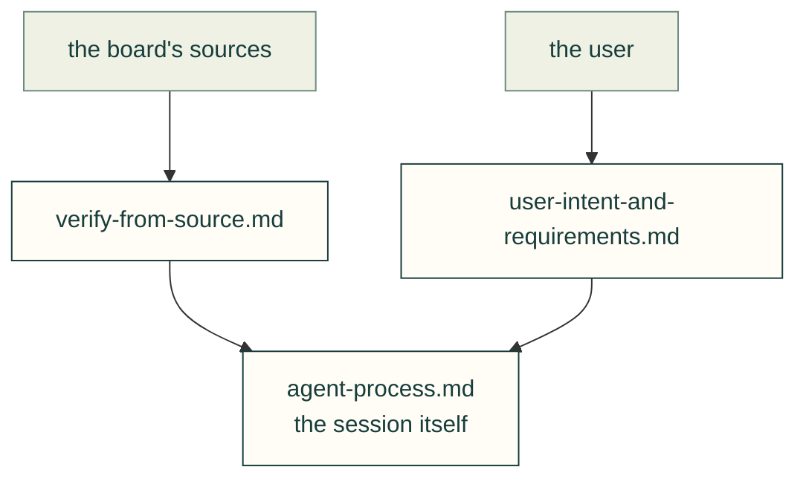

# Lessons — process

How the agent works with its sources, the user and a long session.

| File | Lessons on |
|---|---|
| [verify-from-source.md](verify-from-source.md) | Confirm board facts from schematics, photos and models, not from assumptions |
| [user-intent-and-requirements.md](user-intent-and-requirements.md) | How the requirements evolved, and the user's corrections |
| [agent-process.md](agent-process.md) | Mid-turn messages, status, consent, prior art, scope, delegation |

Each lesson follows the [lesson format](../README.md#lesson-format): a rule, the incident, a check and its source. Back to [all lessons](../README.md).
