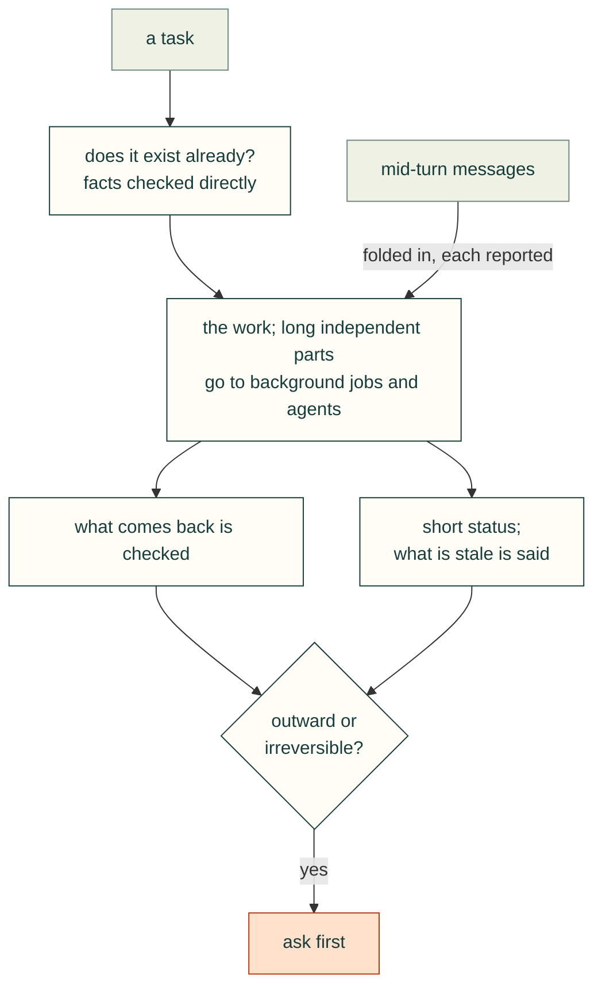

# Agent process

### Fold mid-turn messages into the current work and report on each
- **Rule:** Treat each mid-turn message as a requirement that joins the current plan. Acknowledge it, and account for it
  in the final report.
- **Incident:** Within five minutes the user sent several new requests in a row:
  - reset and flashing button cutouts;
  - RP-SMA positions "(2x each)", which are pigtails with nuts;
  - thumbnails;
  - STL and Bambu links;
  - fit-template standoffs.

  The report opened with "All four of your requests are now in Rev 0.5.2" and covered every item, including the open
  question.
- **Check:** The final report has one entry per user message since the last report, each with a status: done, partial
  or needs input.
- **Source:** 2026-10-24T16:34–16:39, 17:10.

### Give short status during long work, and say what is stale
- **Rule:** During long runs, post one-line status updates: what is running, what is waiting, and which outputs are
  out of date.
- **Incident:** The agent posted lines such as "The build is running in the background; I'll pick up when it finishes"
  and "Some images are still from earlier runs until the full rebuild finishes." The user still asked to see progress,
  which led to the on-page progress section (see [Review site UX](../review/review-site-ux.md)).
- **Check:** No silent gap longer than one pipeline stage. Every report says which artefacts are stale.
- **Source:** 2026-10-24T14:44, 16:46; 2026-10-25T00:36, 01:23.

### Ask before outward or irreversible actions
- **Rule:** Before committing, pushing, opening PRs, publishing repos or installing third-party plugins, ask and wait
  for a clear yes. Build locally first.
- **Incident:**
  - The first CAD report tooling stayed uncommitted in a separate worktree: "I'll ask before committing or opening a
    PR."
  - For the proposed public repo, the agent proposed building locally first and publishing only after review, because
    public content may be copied or indexed.
  - Installing text-to-cad or a KiCad MCP server "runs their code on your machine", so the agent asked for a go-ahead
    and had the survey install nothing.
  - The private repo was created only after the user asked for one.
- **Check:** A list of outward actions (git commit/push, repo create, PR, package or plugin install, public upload)
  that need explicit user approval in the current conversation.
- **Source:** 2026-10-25T00:36, 01:45, 02:18, 02:19, 02:20, 02:23.

### Check whether it already exists before building it
- **Rule:** Before scaffolding a new tool or framework, search for prior art. Record licence, activity and fit, and
  prefer adopting it and contributing the gaps.
- **Incident:** The agent had started planning a new cad-agent framework ("I'm starting Phase 0 now"). The user said:
  "I can almost 100% guarantee this already exists?" A search found text-to-cad (MIT, about 23,000 stars at the time),
  which already ships CAD and DFM skills for Claude Code, Codex and others, plus several KiCad MCP servers. The plan
  changed to: adopt the best tools, survey the field properly, test-drive them on this project, and contribute only the
  real gaps (designing an enclosure around a real board, cable bend radius, fastener stack length, evidence-backed
  review).
- **Check:** A landscape file (here `research/landscape.md`) exists before any new framework code. Each gap claimed is
  backed by a search result.
- **Source:** 2026-10-25T02:18, 02:19.

### Mine and handle only the data the user selects
- **Rule:** Limit history mining and data handling to the sources the user names. Write that scope down where future
  runs will see it.
- **Incident:** "You shouldn't mine -all- session histories, only this one", and "This one with J501 is important." The
  repo README and a saved standing preference record the scope. The extractor keeps only user and assistant prose and
  strips personal details.
- **Check:** The miner takes an explicit session ID, never a glob. Its output header names the single source.
- **Source:** 2026-10-25T02:22, 02:25.

### Diagnose desktop problems without disrupting the user's session
- **Rule:** For problems on the user's machine, diagnose first. Use the least disruptive fix, restore any setting you
  touch, and never log out, restart or kill the user's processes without asking.
- **Incident:** "my mouse cursor looks broken ... I can't click anything". A sub-agent was told to diagnose first and
  avoid anything that could log the user out. The X server's grab report showed that Bambu Studio held an active
  pointer grab from a stuck "Seam position" tooltip. Escape and clicking did not release it. The sub-agent briefly
  enabled the X keyboard grab-break option, sent the ungrab key, and then restored the keyboard options. No apps were
  closed, and the long-running CAD jobs were left alone. The user was told the project in Bambu was unsaved.
- **Check:** Before and after: grab report, keyboard options, pointer position. The final note lists every setting
  touched and confirms it was restored.
- **Source:** 2026-10-25T02:21, 02:23.

### Hand long, independent work to background jobs and agents, and check what comes back
- **Rule:** Run slow pipelines and separable sub-projects in the background or in isolated worktrees. Keep working on
  the main thread, resume agents after interruptions, and verify their claims before relaying them.
- **Incident:**
  - The roughly 15-minute build-and-check pipeline ran in the background while the agent edited docs and the site.
  - The user asked to standardize the report tooling for CAD designs inside an existing test repo. One sub-agent first
    mapped that repo's conventions read-only. A second built the CAD tooling in a separate worktree.
  - The second agent was cut off by a session restart before it wrote anything, and was restarted.
  - Its report included a fixed fallback-parser bug with a test that catches it, failing tests compared against a
    clean HEAD before being called pre-existing, and a tracked file the test suite had rewritten, which it restored.
- **Check:** Background agents work in a worktree or scratch copy, never the user's checkout with uncommitted changes.
  Their reports state what was not done. The parent re-runs at least the key check before reporting success.
- **Source:** 2026-10-24T17:35, 17:40, 17:58; 2026-10-25T00:36, 01:44.

### Check facts directly instead of answering from memory
- **Rule:** When the user asks a factual question about the current design or the outside world, inspect the artefact
  or primary source before answering.
- **Incident:** On "P1M and P! don't support stacking the drives right?" the agent said: "I'll check both parts directly
  rather than answer from memory." On prior art it said it was "checking the biggest one directly rather than relying on
  search snippets".
- **Check:** The answer cites the file, part or URL that was inspected.
- **Source:** 2026-10-25T01:30, 02:19.

### Never `pkill -f` or `pgrep -f` a pattern that is also in your own command line
- **Rule:** `pkill -f` and `pgrep -f` match the whole command line of every process, including the shell running
  the command. A pattern that appears in that command matches the agent's own shell, and the kill ends it. Match on
  the program's path with the bracket trick (`ps -eo pid,args | grep "[/]app/bin/..."`), or kill a PID you saved
  when you started the job.
- **Incident:** in the Cat 323 excavator session (2026-11-01, session `47707e1e-b3c1-4114-b10e-9fc722a426bd`), the
  agent ran `pkill -f "cad/build.py" ; ... sed -i ... cad/assembly.py` to stop a background build. The pattern was in
  its own command, so the shell died with exit code 144, and the agent had to check whether the `sed` had run. Later,
  `for p in $(pgrep -f "exports/slice/_gui/datadir"); do kill $p; done` to close a PrusaSlicer window killed the shell
  the same way (exit 144), with the relaunch in the same command.
- **Check:** before any `pkill -f`, `pgrep -f | kill` or `killall`, the pattern is not a substring of the command
  being run. A long-running job's PID is saved when it starts (`$!`), and that PID is what gets killed.
- **Source:** Cat 323 session 2026-11-01T20:30, 22:12, 22:36.

### When a check flags one part, test that part alone before rerunning the full pipeline
- **Rule:** a fix for one flagged part is tried on that part alone: build it, export it and slice or check it in
  seconds. Rerun the full pipeline once, when the local fixes pass. To find what a warning is about, slice the part in
  pieces.
- **Incident:** the excavator's full rebuild of 46 parts took about 13 minutes, and a round with the clearance sweep
  and slicing took up to about 40. When the track frame's roller-pocket arches were flagged, the agent built just the
  frame with the steeper arch, exported its sections and sliced those, "before doing a full rebuild". The track link's
  fix was tested by building and slicing one link. Slicing the frame in sections showed which one carried the
  warning. The project then cached the built parts as BREP under one hash of all its sources, so the clearance,
  render and slice steps share one build. Any source edit still rebuilds every part.
- **Check:** each fix's report names the single-part test that confirmed it, before the full run. Full runs are
  counted, and the final one is the run whose outputs are reported. A part cache (#250) keeps the full run short.
- **Source:** Cat 323 session 2026-11-01T19:54, 20:31, 21:17, 21:18, 22:36; the project's `cad/assembly.py`
  (`exports/.partcache/<source hash>/`).
