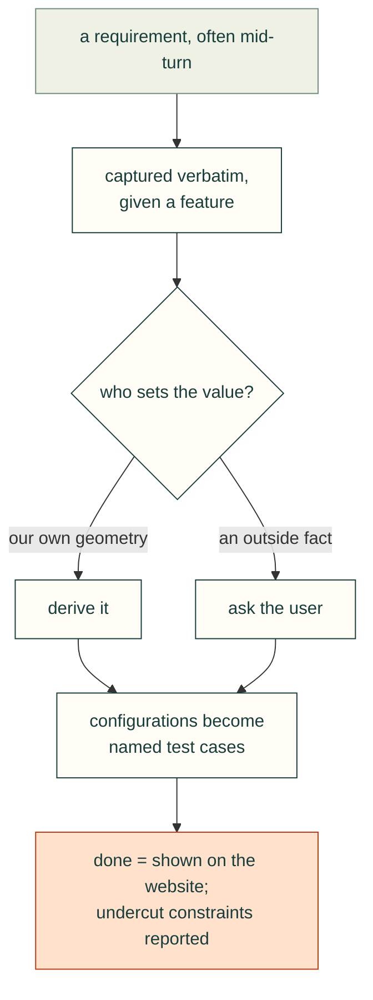

# User intent and requirements

The requirements arrived in pieces, often as short mid-turn messages, and were refined by later corrections. What
worked: capture each one in the user's own words, turn it into a named feature or check, and recompute anything that
depends on it.

### Capture each mid-turn requirement verbatim and give it a feature
- **Rule:** Record each user requirement word for word, map it to the feature that satisfies it, and carry it through
  every later revision.
- **Incident:** During the first review the user added: "we need counter-sunk holes under the heat sink hole location
  because the heat sink is most of the mass of the assembly... so the heatsink mass is attached to our housing". This
  became the cooler tie-down: four printed columns under the 92 × 79 cooler holes, with flat-head screws driven up from
  under the floor. It was also saved as a standing project memory.
- **Check:** A requirements table lists each quote, its feature, its check and its status. The final report names every
  requirement.
- **Source:** 2026-10-24T07:07, 07:41.

### Pin down what a screw threads into before computing its length
- **Rule:** For each fastener, identify the mating thread (part and feature) explicitly. Do not infer it from the
  part's general role.
- **Incident:** Rev 0.5 said that the tie-down screws thread "into the cooler", and asked the user to confirm the
  direction. The user corrected this: "the standoffs between the orin AGX and the heatsink have female threads. So our
  screw lengths ... need to go into those standoffs, that sets our lengths", and "(the screws through the base of the
  housing plastic go up into the standoffs)". The agent later listed "docs saying 'thread into the cooler'" as one of
  the session's mistakes.
- **Check:** The fastener table has a "threads into" column (for example "female standoff between AGX module and
  heatsink, thread starts at Z 40.76").
- **Source:** 2026-10-24T07:41; 2026-10-25T00:32, 02:18.

### Derive values your own geometry sets; ask the user only for outside facts
- **Rule:** If a value follows from the model (stack heights, screw lengths), compute it and decide. Ask the user only
  for facts the model cannot supply, such as part identity or a physical measurement.
- **Incident:** Rev 0.5 asked for "the original screw's length + 19.6 mm". Later the agent asked whether to keep the
  head flush or raise it. The user: "the screw length is basically set by the top of the AGX and the bottom of the
  housing, assuming we just go something like 8 threads into the standoff", then "I can't give you the screw lenght,
  that depends on your assembly." The agent then made the call itself (M3 × 35 with a raised seat; see [Fasteners and assembly access](../mechanical/fasteners-and-assembly-access.md)).
- **Check:** Before asking a question, test whether the answer is computable from `parameters.json` and the STEP. If it
  is, present a decision with its reasoning instead of a question.
- **Source:** 2026-10-24T07:41; 2026-10-25T00:34, 00:36, 00:37, 00:38.

### Model every interface layer the user mentions, and recompute what it moves
- **Rule:** Add every stack-up layer as a named parameter (thermal pads, gaskets, washers), then recompute both the
  fasteners and the clearances it affects.
- **Incident:** The user: "(also watching out for thermal interface pad, standard thickness between heatsink and AGX)".
  A 0.5 mm pad became `cooler.tim_thickness`. It lifts the heatsink but not the start of the standoff thread, so the
  screw length is unchanged. It does take 0.5 mm off the cooler-to-roof gap: `assembly-checks.json` now reports
  14.742 mm, where Rev 0.5.1 reported 15.24 mm.
- **Check:** Each layer has a nominal value and a "measure the fitted part" note. Dependent outputs (screw engagement,
  roof gap) are regenerated after any change to it.
- **Source:** 2026-10-25T00:34, 00:36; `cad/parameters.json` (`tim_note`); `exports/assembly-checks.json`.

### Treat "doesn't block disassembly" as a hard requirement
- **Rule:** Before placing anything that is tethered to the internals, decide which part never comes off and attach it
  there.
- **Incident:** The user asked "where can we have RPSMA connectors for wifi and cellular without blocking disassembly?",
  then added "(2x each)" and "those are not mounted on the PCB, they would be extension cables with a RPSMA sticking
  through the housing with a nut". All four bulkheads went into the fixed base side walls, so the lid, both I/O plates
  and the side door lift away with the antennas still fitted.
- **Check:** For each removable part, list what is attached to it. No removable part may hold a cable that runs to the
  board.
- **Source:** 2026-10-24T16:35, 16:36, 17:10.

### Turn a configuration list into named test cases
- **Rule:** When the user lists the configurations they want, make each one a named case in the check output.
- **Incident:** The user: "We want to be able to stack 1 or 2 of them and have them be 2.5" or 3.5" skinny 2.5" sata ssd
  or thick regular 3.5" hdd", then "(1 of each or 2 of each, or 1 total)", and "The cables can be exposed but need
  entry/exit points between the drives and the Orin carrier." `storage-checks.json` has seven named stacks, among them
  "1 total: 2.5 skinny SSDs on clips", "1 of each: 2.5 over 3.5, on plate" and "2 of each". Each one has its own
  plastic, hardware, chimney and bend-radius results.
- **Check:** Each case the user named appears in the check JSON with `pass: true`, and the review site shows it.
- **Source:** 2026-10-25T00:39, 00:40, 01:23; `exports/storage-checks.json`.

### Report constraints that undercut the request, with a recommendation
- **Rule:** When a hard limit makes part of a request impractical (ports, power), say so plainly and recommend a
  default.
- **Incident:** After the 5 V finding the user asked: "Ok so this can only support the ssd SATA drives realistically?"
  The answer: yes, 2.5 in drives (SSD or spinning) run from the board, while 3.5 in drives need an added 12 V source. The
  board has only two SATA ports, so "2 of each" only makes sense with an M.2 SATA adapter. The agent recommended the
  2.5 in tray as the standard option and offered to drop the 3.5 in tray.
- **Check:** Compare the number of drives in each configuration against the port count and the power budget (see [Enclosure features](../mechanical/enclosure-features.md)).
- **Source:** 2026-10-25T01:34, 01:36.

### Make "show it on the website" part of done
- **Rule:** For this user, a feature is not done until the review site shows it with evidence.
- **Incident:** Requests included "Also show them on the website..." (the drive options), "Launch the server again and
  show me how you are making progress", and "Where's the base for stacking with drives?". The last one was answered by
  stating that P1 is the stacking base and adding a "Which base do I print?" section. See [Review site UX](../review/review-site-ux.md).
- **Check:** Every change in the report links to the section or image on the site that shows it.
- **Source:** 2026-10-25T00:31, 00:40, 01:30, 01:36.
