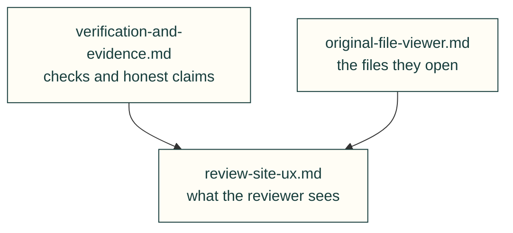

# Lessons — review

Evidence that holds up, and what reviewers need to see. Up: [all lessons](../README.md).

| File | Lessons on |
|---|---|
| [verification-and-evidence.md](verification-and-evidence.md) | Checks that caught bugs, false positives, honest claims, stale outputs |
| [review-site-ux.md](review-site-ux.md) | What the user wanted to see on the review site, and why (with a later CAN-project wheel-zoom follow-up, 2026-10-27) |
| [original-file-viewer.md](original-file-viewer.md) | Original-file identity, parser units and frames, cancellable loading, dependency and wheel evidence |

Each lesson follows the [lesson format](../README.md#lesson-format): a rule, the incident, a check and its source.
