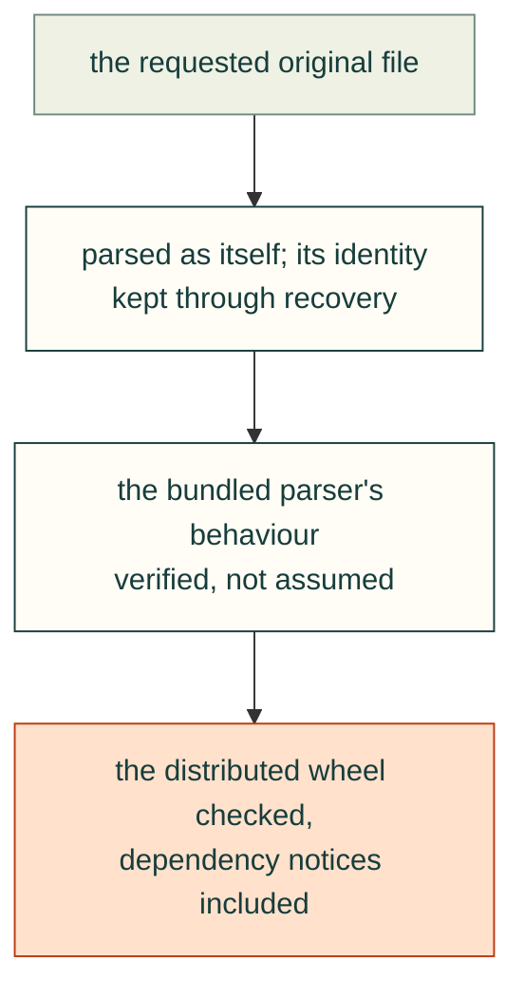

# Original-file previews

### Parse the requested original and preserve its identity during recovery
- **Rule:** A file preview must parse that file's actual bytes, units and component transforms. Do not substitute a companion with a similar name. If a failed replacement leaves an earlier model visible, name the retained file explicitly and keep the requested download clearly identified.
- **Incident:** On 2026-10-29, real barrel STL/3MF print exports had dimensions about 30 × 35 × 100 mm while the STEP was 100 × 35 × 30 mm. Those different export orientations were real; using a sibling would have hidden the difference. Independent review also identified a potential mismatch between candidate title/download and a retained older mesh during an error.
- **Check:** `node tests/webkit/webkit-file-viewer-browser.mjs` checks known-dimension originals, declared-inch 3MF, translated/reflected instances and `A→failedB→retry` identity. The remote 495-file parser receipt is in `docs/validation/file-viewer-corpus-results.json`; this does not replace browser visual checks.
- **Source:** 2026-10-29, PR 63 / issue 62; direct barrel probe and independent actual-parser review. No CAD geometry was changed.

### Verify bundled parser behavior rather than assuming a newer API
- **Rule:** Test the pinned parser's actual classifier, unit behavior and dependency recovery. Keep CPU work in a terminable worker and ensure the page can still respond to Cancel.
- **Incident:** Three r160's 3MF loader reads unit metadata without applying its scale. Its bundled fflate 0.6.9 ignores a modern unzip filter option, so the wrapper initially tried to validate relationship XML as a model. The STEP runtime internally retries a failed WASM fetch, requiring a sustained dependency failure in the error fixture. These were found using real originals and explicit failure injection.
- **Check:** The browser suite validates millimeter/inch conversion and reflected winding; worker wrappers filter actual model keys, preflight STL/ZIP admission, and validate finite indexed surfaces. A busy-worker fixture proves main-page animation frames continue and native Cancel calls worker termination. Failed WASM, stalled response body and failed entry-module fixtures all recover through native Retry.
- **Source:** 2026-10-29; `file-mesh-worker.js`, `file-step-worker.js`, `file-loader.js` and the dedicated browser/validator tests. Limits remain explicit: texture images omitted, required 3MF extensions rejected, capped input/triangles, parser deadlines.

### Check the distributed wheel, including dependency notices
- **Rule:** Inspect the built package for required runtime, license and source-reference files; a source-tree listing is insufficient. Use visible filenames for required metadata that packaging globs may omit.
- **Incident:** Independent review flagged that hidden `.gitmodules` could be absent from a wheel. The viewer supplies its exact upstream contents as `SUBMODULES.gitconfig`, alongside licenses, importer sources and pinned full-source/build/replacement links. The 7.6 MB WASM fits the static host's per-file limit.
- **Check:** `uv build --wheel --out-dir /tmp/cad-file-viewer-wheel`; compare every file in `vendor/file-viewer-sources.json` against the wheel's bytes and confirm all seven entry/parser files plus notices are present.
- **Source:** 2026-10-29, PR 63 packaging check. Source availability and replacement instructions apply to the pinned build and need fresh review when dependencies change.
