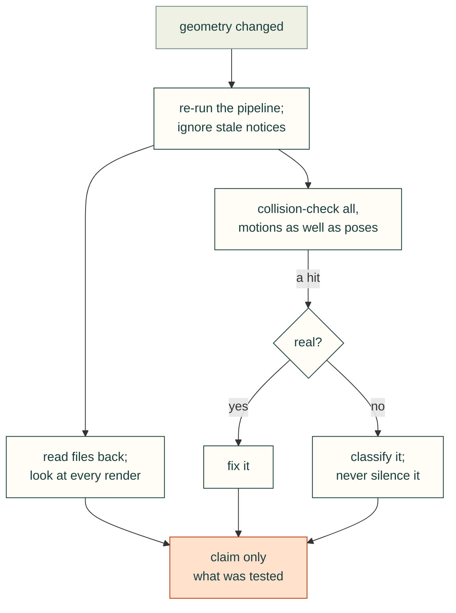

# Verification and evidence

### Collision-check everything and investigate every hit
- **Rule:** Check plastic against plastic, plastic against the vendor board, and plastic against the modelled hardware.
  Treat every non-zero overlap as a finding until it is explained, however small it is.
- **Incident:** Real defects caught this way:
  - The hatch tongues ran past the bottom V-groove (0.29 mm³, then 0.144 mm³ after the first fix).
  - The wall-mount driver envelope collided with a gusset.
  - A mount ear overlapped the panel channel.
  - The M.2 Key E card envelope clipped a support (74 mm³).
  - The hardware check reported 4 collisions because the RP-SMA thread cylinder in the visual model pointed vertically
    instead of through the wall. That was a bug in the agent's own hardware model, not in the enclosure.

  - The trays' rounded chimney corner (R3) clipped the SATA plug drop zone by 2.0 mm³ per tray. The fix was a narrower
    plug zone and an R2 corner moved to Y 27.5.
  - The storage mount plate's tab gussets (copied from P1M) intruded 3.3 mm³ into the lowest tray wall. They are now
    trimmed at the tray outline.
  - The data lead to a second 2.5 in bay ran through a tie anchor (7.5 mm³).

  False alarms, explained and then excluded on purpose:
  - Each drive's visual connector strip overlapping its own drive body.
  - The tie-down screws overlapping the P9 fit template (4 × 19.5 mm³). The template is used without those screws.
- **Check:** `assembly-checks.json` (all part pairs = 0 mm³), `carrier-clearances.json` (4902 pairs, 0 collisions),
  `storage-checks.json` (per stack). Each hit is triaged as a design defect, a model defect or intended.
- **Source:** 2026-10-24T07:25, 08:35 (summary), 16:53; 2026-10-25T00:36.

### Classify false positives explicitly; don't silence them
- **Rule:** When a check flags something that is not a defect, add a named exclusion or category. Do not loosen the
  check globally.
- **Incident:**
  - A drive's visual connector strip overlapped its own drive body. These strips were excluded from the drive-to-drive
    comparison.
  - The link validator reported JavaScript template strings as missing files. The regex was tightened to require a
    quote or `?` after the link.
  - Heat-set inserts overlap their holes by design. They are reported separately as `intended_insert_interference`
    (8 in the carrier check, 4 per stack).

  The brief also mentioned a fit-template false positive involving the tie-down screws. It does not appear in the
  transcript.
- **Check:** Each exclusion is listed in the check's JSON with its reason. Intended interferences have their own list
  and count.
- **Source:** 2026-10-24T07:40; 2026-10-25T00:44; `exports/carrier-clearances.json`.

### Check motions, not just final positions
- **Rule:** For parts that slide, swing or get driven, sweep the motion path and the tool envelope.
- **Incident:**
  - The plates' slide-in path was checked (0.37 mm front, 0.25 mm rear).
  - A sweep check was added for the button guide sleeves on the way down.
  - Wall-mount screws are checked with a 20 mm driver envelope.
  - The first stack design failed this kind of reasoning: its standoffs had no tool access (see [Fasteners and assembly access](../mechanical/fasteners-and-assembly-access.md)).
- **Check:** `assembly-paths.json`, `mount-checks.json` `driver_access`, and the sleeve sweep in the clearance run.
- **Source:** 2026-10-24T07:41, 16:40; 2026-10-25T00:36.

### Never claim what was not tested, and make the checks strict
- **Rule:** Every report states what was not verified (physical fit, slicer, thermal, airflow, loads). A check passes
  only on an explicit true. A missing file or key is a failure.
- **Incident:** The Rev 0.5 report opened with "nothing has been printed, run through a slicer, or test-fitted". The
  hex chamfer report said "the airflow gain is untested". The Bambu link was reported as found in the binary but not
  tested. `assembly-checks.json` carries `physical_fit_verified: false`. The shared `vptest cad` report "always records
  'physical fit not verified' and 'slicer not run', and nothing can set those to true". A missing file, a missing key or
  a value like "yes" counts as a failure.
- **Check:** The report schema has unverifiable flags that cannot be set to true, plus an explicit limits list (the
  README lists slicer, insert pullout, thermal, vibration, creep and mounting load).
- **Source:** 2026-10-24T07:41, 15:09, 17:10; 2026-10-25T01:44; `README.md` (Checks).

### Re-run the pipeline after geometry changes; ignore stale notifications
- **Rule:** When geometry changes, stop any run that is checking the old geometry and re-run everything downstream:
  checks, docs, renders and package. Match each completion notice to the run it belongs to.
- **Incident:**
  - The agent stopped runs whose results would go stale three times (interface change, screw-seat change, fillet
    change).
  - Twice it noticed that a completion notice belonged to an older run and kept waiting for the current one.
  - It found Rev 0.4 numbers left in the measurement list (roof Z 102 instead of 106, gap 11.24 instead of 15.24).
  - Drift remains in the project files: `README.md` is titled "Rev 0.5", but the exports say
    `revision: 0.6-storage-modules`. The README checks table says "4 stack combinations", while `storage-checks.json`
    has seven.
- **Check:** Every artefact carries the revision string. The validator fails when a doc's revision or counts disagree
  with the JSON it summarises.
- **Source:** 2026-10-24T15:09, 17:09, 18:02; 2026-10-25T00:38, 01:46, 01:51; `README.md`;
  `exports/storage-checks.json`.

### Look at every render before showing it
- **Rule:** Open each render and check that it is current, lit well enough, and shows the feature in question before
  linking it.
- **Incident:**
  - Renders being reviewed turned out to be old Rev 0.4 images; the new render pass had not started.
  - The hex-inlet close-up was too dark and its angle hid the chamfer, so it was re-rendered lighter and more square-on.
  - The user once pointed at a render made before the latest change, and the agent had to explain that it was stale.
- **Check:** Each render's modification time is later than the build that produced its geometry. A visual pass is
  logged for each new image.
- **Source:** 2026-10-24T07:33, 14:58, 15:09; 2026-10-25T02:04.

### Verify generated files by reading them back
- **Rule:** After exporting a fabrication file, read it back with an independent parser and compare it with the source
  mesh.
- **Incident:** trimesh's 3MF export needed networkx, so the agent wrote a small standalone exporter. Its self-check
  then failed, because the read-back also went through trimesh, and the pipeline stopped there. The read-back was
  switched to a plain XML parse. The check compares triangle count, watertightness and volume; the shared tool uses a
  0.1% volume tolerance and deletes any file that does not match.
- **Check:** For each 3MF: triangle count equal, closed surface, volume within 0.1%, otherwise delete the file and fail.
- **Source:** 2026-10-24T16:43, 16:54; 2026-10-25T01:44.
