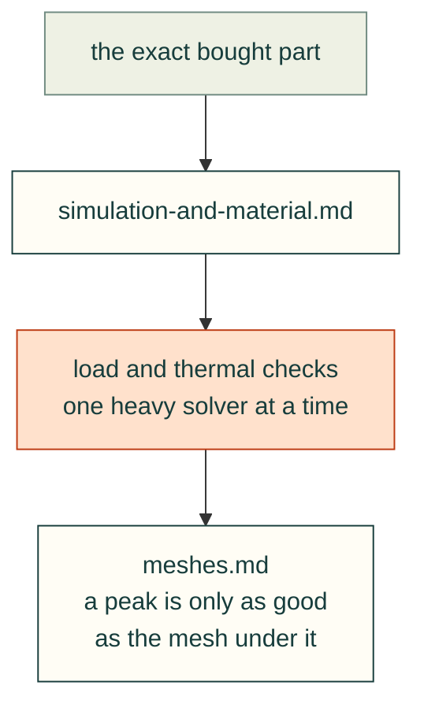

# Lessons — simulation

Bought parts, material, load and thermal checks, the meshes under them, and the compute they share.

| File | Lessons on |
|---|---|
| [simulation-and-material.md](simulation-and-material.md) | Exact bought parts, slicer grams, re-checking thinner shells, thermal models of printed enclosures, shared compute |
| [meshes.md](meshes.md) | Sharp corners that never converge, peaks in walls one or two elements thick, naming the mesher build, slivers and mesher refusals (Gyropup) |

Each lesson follows the [lesson format](../README.md#lesson-format): a rule, the incident, a check and its source. Back to [all lessons](../README.md).
