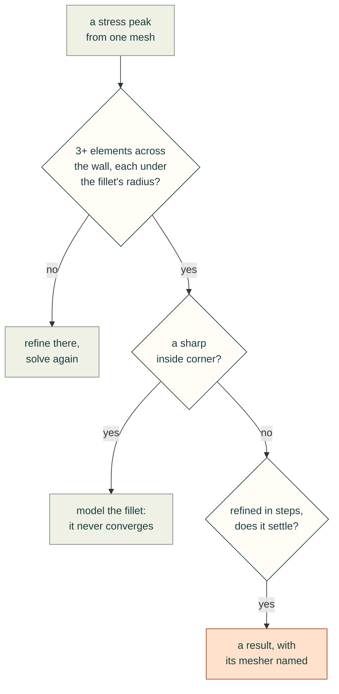
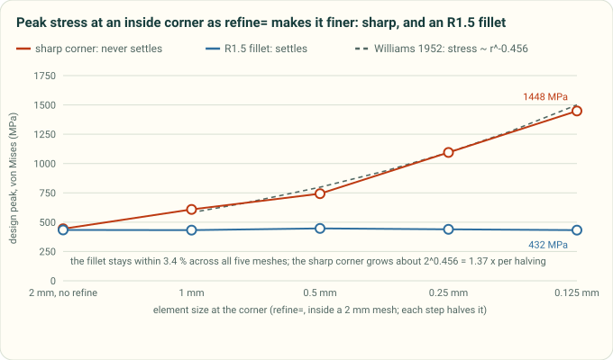

# Meshes: a peak is only as good as the mesh under it

These lessons come from Gyropup's hip frame and front link (Valpatel/gyropup#29), studied in October 2026 with
`cadagent.simulation.fea`. The tools they asked for are in the toolkit now (#144): `refine=`, `converge()`, the
`mesh` record in every result, the sliver check and `MeshRefusal`. See the
[toolkit's meshing section](../../docs/toolkit.md#stiffness-and-strength-cadagentsimulationfea).

### A sharp inside corner never converges: model the fillet
- **Rule:** before trusting a peak, see where it is. A peak at a sharp re-entrant corner is singular: it rises with
  every refinement. A finer mesh does not fix it. Model the fillet the part will have, then refine round it.
- **Incident:** the hip frame's flange roots were sharp. A sliver 0.1–0.2 mm thick there forced tiny elements into
  the root's corner, which sampled its singular stress more finely; moving the sliver along the root moved the
  safety factor. With the roots rounded, the optimiser's best trial peaked at the sharp wedge tip of a backing block.
  On one host it read E1 2.08 at the 4 mm gate and 1.81 at 3 mm, 13 % apart, so its lead was partly a mesh artefact.
- **Check:** `result['mesh']['peak']['where']` says "sharp inside corner", and its `note` says the corner is singular.
  The chart below is a real study of an L-bracket. Sharp, the peak grows about 1.34x for each halving of the elements
  there (1.22x to 1.47x step to step), close to the 1.37x of Williams' corner solution. With an R1.5 fillet it stays
  within 3.4 %.
- **Source:** Gyropup #29 study notes; `tools/fea_mesh_figure.py`.

### A peak in a wall one or two elements thick is not a result
- **Rule:** count the elements across the wall at the peak. Under 3, refine there and solve again before reading a
  safety factor, or comparing two designs, off it. At an inside fillet or a hole, the elements must also be smaller
  than its radius: the stress there changes over the radius, not the wall.
- **Incident:** at a 4 mm mesh, the front link's peak sat in the 6 mm wall of its apex bearing ring, one or two elements
  thick. It read SF 1.69 before a knee change and 1.53 after, which looked like a regression. At 3.5 and 3 mm the peak
  moved to the knee boss, and the change went the other way: 1.82 / 1.87 before, 2.04 / 1.96 after.
- **Check:** `result['mesh']['peak']` has `elements_across` 3 or more (`wall_resolved`), and at a fillet or a hole
  elements no larger than `radius_mm` (`radius_resolved`). Otherwise the study warns (`MeshWarning`).
  `Study.converge()` solves again at 0.75x the mesh. One step is a check, not a convergence study: a stepped bar's
  R0.5 fillet read 604 MPa at a 4 mm mesh and 590 MPa at 3 mm, only 2.3 % apart, and about 660 MPa refined. Both
  meshes had elements larger than the radius, so the radius check flags it and `converge()` does not call it
  converged. Refine the peak in steps until it settles.
- **Source:** Gyropup #29 study notes.

### Say which mesher made a result
- **Rule:** a gate read at one mesh size names the mesher build that made it. Before and after are compared on one
  build, and a close call is checked on a second.
- **Incident:** the same hip-frame study, on the same commit with gmsh 4.15.2, was meshed by the PyPI wheel on x86-64
  and by conda-forge's build on aarch64. That gave 151,459 and 151,136 tets. Where the peak sat at a sharp corner, the
  safety factors came out 6 % apart (1.59 and 1.50).
- **Check:** `result['mesh']['mesher']` records the gmsh and OpenCASCADE versions, the build's OS and date, a hash of
  the gmsh library and the platform. Two records from different builds are not a design change.
- **Source:** Gyropup #29 study notes.

### When the mesher refuses a part, look for slivers
- **Rule:** a CAD kernel's "valid solid" can still be unmeshable. Check for sliver faces and short edges before a long
  mesh, and read the faces near the point when gmsh refuses.
- **Incident:** a revolved fillet round a block's foot, clipped to an outline, gave a solid that OpenCASCADE called
  valid. gmsh stopped with "PLC Error: A segment and a facet intersect at point" in all three runs, after the CAD build,
  and named no faces. The cause was slivers where the fillet ring met the outline almost tangentially. The variant
  was dropped as a failed trial.
- **Check:** `Study.slivers` lists faces under (mesh_mm/10)² in area, long faces under mesh_mm/10 in width (2 ×
  area / perimeter), and edges under mesh_mm/10. `slivers='raise'` fails the trial in seconds. It reads the CAD's faces one at
  a time, so it misses two faces that are each fine but come closer than the mesh size: then gmsh refuses, and
  `MeshRefusal` gives the point and the nearest faces and their areas.
- **Source:** Gyropup #29 study notes (the `ear_boss_fillet` variant).

Back to the [simulation lessons](README.md) or [all lessons](../README.md).
