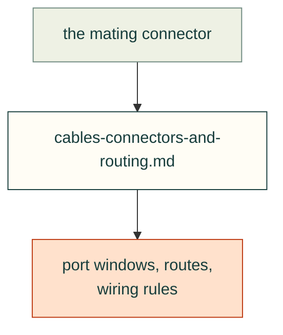

# Lessons — wiring

Connectors, cables and the routes between them. Up: [all lessons](../README.md).

| File | Lessons on |
|---|---|
| [cables-connectors-and-routing.md](cables-connectors-and-routing.md) | Mated-plug port windows (standard practice), SATA routing, plug lengths, bend radius, wiring rules |

Each lesson follows the [lesson format](../README.md#lesson-format): a rule, the incident, a check and its source.
