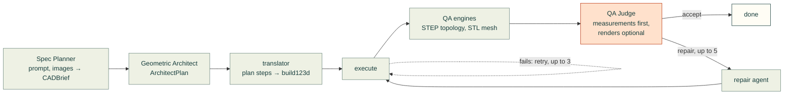
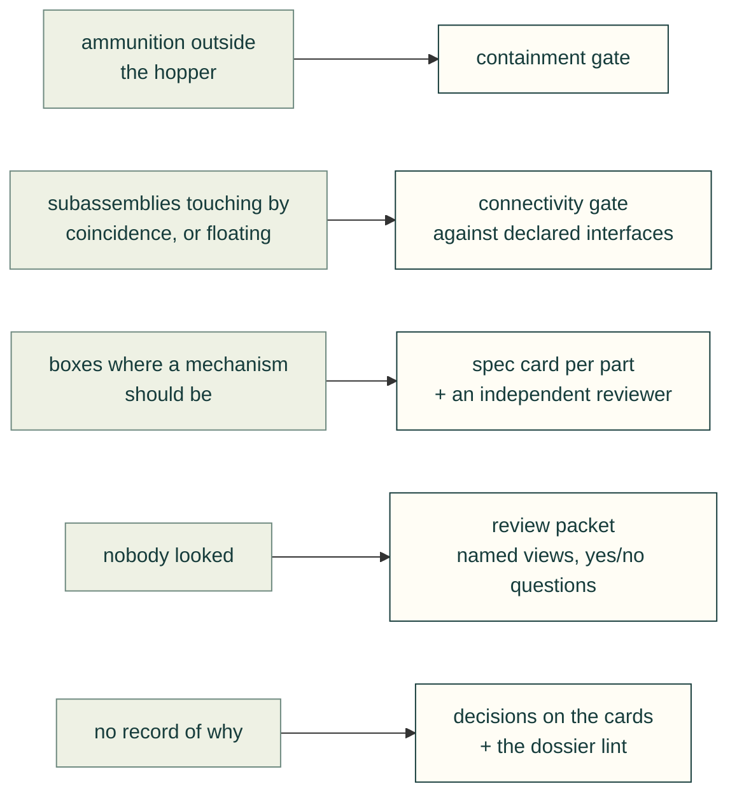

# Design workflows for CAD agents: what works, with evidence (verified 2026-10-27)

Scope: how the best agentic CAD systems, professional mechanical-design practice and model-integrity verification
can be turned into a process that a CAD agent executes. [`landscape.md`](landscape.md) covers tool *features*; this
survey covers *workflow and method*. The plan that applies it is
[`docs/design-process-plan.md`](../docs/design-process-plan.md).

Method: papers were read on arXiv (abs and HTML, version and date noted); repositories through the GitHub API and raw
files; vendored upstreams (`vendor/`) from their pinned source. **(V)** = verified from the primary source;
**(u)** = README, vendor page or third-party claim not checked further. Licences are noted before any idea or code is
borrowed (§7). Machine-readable copy: [`design-workflows.json`](design-workflows.json).

Motivating incident, stated generically: a turret assembly in a robot project rendered its ammunition outside the
hopper that should hold it, with subassemblies that read as boxes stuck on the side. Every per-part check passed. §6
says which practices would have caught it.

## 1. Summary: the practices that have evidence

Twelve practices, numbered as the rest of this page cites them, grouped by the kind of evidence behind them.

**Measured in papers** (an ablation or a controlled comparison):

| # | Practice | Evidence grade | Source |
|---|---|---|---|
| 1 | **Kernel checks and a hard validity gate before any render** (invalid solid = fail, score 0), with the judge reading measurements before images | strong: the largest gains in every ablation that separates them | CADSmith Table I (median IoU 0.81→0.96 with the judge given kernel metrics and no render; the render adds 0.96→0.963); CADGenBench scoring; Embodied CAD; CAD-Coder RL reward (§2.4) |
| 2 | **Decide interfaces, joints and connectors before geometry** (assembly-level decomposition) | strong for assemblies: the largest single ablation effect found | ArtiCAD (late assembly prediction: motion 3.82→3.16, success −11 pt); AssemCAD typed spec, text-to-CAD setting: assembly preservation 87.5 % vs 66.7 % for the best code-centric baseline (§2.4) |
| 6 | **Visual review as diagnosis, not proof**: few views chosen for the question, specific yes/no questions, "unclear" allowed, every visual concern converted to a deterministic check | moderate: +18 % point-cloud distance in CADCodeVerify, removes catastrophic outliers in CADSmith, no gain in median accuracy; documented failure modes on gaps and hidden interiors | CADCodeVerify Tables; CADSmith; CADReview; text-to-cad snapshot policy; MAC judge prompt (§2.5, §5) |

**Practice in open tools** (no ablation; the tools that do it are named):

| # | Practice | Evidence grade | Source |
|---|---|---|---|
| 3 | **Containment and interpenetration as first-class relations** (`apart / touching / containing / interpenetrating`), not only overlap volume | practice, no ablation; it is exactly the incident's missing check | build123d-mcp `clearance`; AssemCAD port checks via `BRepClass3d_SolidClassifier` (§2.2, §4.2) |
| 4 | **Author-declared structure expectations** (expected solid count, parts allowed to float, named intended fits) diffed against the built geometry | practice; vendored, Apache-2.0 | agentcad `expect_solids` / `floating`; text-to-cad "intended fits must be named" (§2.2, §4.6) |
| 5 | **Spec-driven conformance with evidence tiers** (measured / structural / recognised / unverified; a spec that verifies nothing never conforms) | practice; vendored, Apache-2.0 | build123d-mcp `verify_spec` (§2.2) |
| 7 | **A judge that did not write the code, given measurements first and images second, with anti-hallucination rules** (accept/halt need a hard data point; hedged language is not evidence; no image ⇒ `unverified`) | practice; MIT | MAC `qa_judge.md`; CADSmith's stronger-model validator (§2.1) |
| 11 | **Assembly-sequence and tool-access checks at the step that installs each part** | practice; already partly in cad-agent ([Fasteners and assembly access](../lessons/mechanical/fasteners-and-assembly-access.md)) | §3.9 |
| 12 | **Sign-off invalidated by a geometry hash** (review bound to the bytes it reviewed) | practice; cad-agent already does it for PCB evidence | `cadagent.review.evidence`, text-to-cad `document_hash` (§2.2) |

**Professional standards:**

| # | Practice | Evidence grade | Source |
|---|---|---|---|
| 8 | **Interface control documents and requirement traces** (requirement → feature → verification method) | professional standard; automatable as a lint | NASA SE Handbook, INCOSE, 29148 (§3.1–§3.2) |
| 9 | **Decision records with alternatives rejected**, written with the design | professional standard (ADR/MADR, QOC); evidence on use is thin but the artefact is cheap | §3.4 |
| 10 | **DFMEA rows and the DFA part-count questions** as the review checklist for each part | professional standard | AIAG-VDA, Boothroyd-Dewhurst (§3.5–§3.6) |

## 2. Agentic and AI CAD systems: workflow and method

### 2.1 Pan-Chera/Multi-Agent-CAD (MAC): the judge agent

- [github.com/Pan-Chera/Multi-Agent-CAD](https://github.com/Pan-Chera/Multi-Agent-CAD), **MIT (V, API)**, last push
  2026-10-17, 1,055 stars. Vendors text-to-cad's runtime under MIT.
- **Pipeline (V, `multi_agent_cad/README.md`, `WORKFLOW.md`, `prompts/qa_judge.md`):** Spec Planner (prompt and
  reference images → `CADBrief`) → Geometric Architect (`ArchitectPlan`) → a deterministic translator from plan
  steps to build123d (unsupported steps become `TODO` markers for a repair agent) → execution → two QA engines (STEP
  topology; STL mesh) → **QA Judge** → Aider-based repair. Outer loop of 5 retries; the judge engages only after one
  blind repair; inner loop of 3 for execution failures.

*Diagram of MAC's pipeline as its `README.md` and `WORKFLOW.md` describe it (V), drawn here in Mermaid. The judge
(orange) is the step this survey borrows from.*

- **What the judge sees (V):** the user request as ground truth, the planner's `special_features`, per-feature
  bounding boxes measured *before* booleans (white-box instrumentation), the QA engines' error list, the retry count,
  and, only with `JUDGE_MULTIMODAL`, four 512×512 isometric renders covering all octants. The prompt says: *"You never
  see the raw 3D mesh, STEP file, or Python source"* and *"When view evidence conflicts with feature_measurements,
  trust the measurements."*
- **Decision schema (V):** `{action: accept|repair|halt, reason, confidence, evidence[], disputed_errors[],
  semantic_verification: verified|failed|unverified, modification_suggestions}`. Accept or halt requires at least one
  hard data point in `evidence`, otherwise the pipeline downgrades to repair; hedged words are not evidence; without
  images `semantic_verification` must be `unverified`, and lack of vision cannot trigger a repair.
- **Own evaluation (V, `docs/quantified_quality.md`):** 10 prompts, 141 binary features read off the prompts. A
  single-agent skill baseline scored 138/141 at 104 M tokens; MAC v1 140/141 at 0.9 M tokens (116× fewer); MAC v2 with
  visual and geometric judging 140/141 at 1.4 M tokens. The document itself says who judged is unstated, the comparison
  is "controlled but not isolated", and assembly outputs are curated. **The robust finding is cost, not quality**; 3 vs
  1 failures on 141 items is noise.

### 2.2 earthtojake/text-to-cad `cad` skill, build123d-mcp and agentcad (vendored, pinned)

- **text-to-cad** ([repo](https://github.com/earthtojake/text-to-cad), **MIT (V, `vendor/text-to-cad/LICENSE`)**,
  pinned at `2f79365`, imported 2026-10-24; upstream released 0.8.1 on 2026-10-27). Workflow (V,
  `skills/cad/SKILL.md`, `references/`): a model is a parameterless decorated function; the rebuild is the script run;
  user-given dimensions are checked by an `assert` in the model or a measurement, *"never read off a picture."*
  Snapshot policy (V, `snapshot-review.md`): one reviewed snapshot per visible change, views chosen for the feature,
  *"No fixed set of views proves every face or feature is correct"*, *"Do not loop on snapshots"*, every visual concern
  becomes a deterministic check (asymmetric holes → measure centres; floating boss → solid count and contact distance;
  wrong bore → clipped view then measure). Inspection recipes (V, `inspection-and-validation.md`): `overlap_volume`
  (zero means at most touching; *intended fits must be named*), `closest_points` (does not measure penetration),
  cheap bounding boxes as a pre-filter, `is_valid`, `self_intersections`, `boundary_edges`; a check that cannot decide
  raises and *"has shown nothing about the design"*. A scene is bound to a `document_hash`; selector ids are
  revision-scoped. **No plan-before-build step exists (V)**: the brief says a simple part may need a sentence and a
  complex assembly a dimension/interface checklist, with no required format.

<!-- the site places a figure here (docs/pages.yaml) -->

- **build123d-mcp** ([repo](https://github.com/pzfreo/build123d-mcp), **Apache-2.0 (V, LICENSE)**). Its system prompt
  (V, `default_prompt.md`) orders the loop: `measure` after every `execute` (faces and volume must change as expected
  after a boolean), `clearance` between mates before any render (`touching` or `apart`, never `interpenetrating`),
  render only after those pass, `design_audit` (±10 % nudges of every named parameter; `brittle`/`coupling` verdicts)
  before finishing, `validate` then test-export. Tools (V, `llms.md`): `clearance` returns one of
  `apart | touching | containing | interpenetrating` with `intersection_volume`, `a_volume_outside_b` and, for
  `containing`, the worst-direction wall thickness; `verify_spec` (experimental) checks a declared spec with evidence
  tiers `measured | structural | recognised | unverified`, and *"conforms = no FAILs and ≥1 requirement actually
  checked"*; `lint_drawing` must return zero violations before a drawing is done. CADGenBench: a build123d-MCP entry
  leads the leaderboard at 86.9 % (u, via a 2026-10-25 third-party snapshot; the HF Space did not render).

<!-- the site places a figure here (docs/pages.yaml) -->

- **agentcad** ([repo](https://github.com/jdilla1277/agentcad), **Apache-2.0 (V, LICENSE)**). Validation layers (V,
  `validation.py`): BRepCheck, shell closure (free edges), mesh manifold, structure, advisory (sliver faces, loose
  tolerances). Authors declare `expect_solids`, `expect_shells` and `floating: true` per shown object (V,
  `validation_guidance.py`); a disconnected body that is not declared floating is reported with its nearest part and
  distance. `edit_risk.py` classifies imported B-reps (face/edge counts, free edges, severe validity errors) before an
  agent commits to editing them. Shared human/agent review comments live in `.agentcad/reviews/comments.json` with
  statuses `draft | open | addressed | resolved` (V, `reviews.py`). Its CADGenBench claim (48 % higher score, 2.5×
  valid outputs with GPT-5 Nano) is a single uncontrolled run by its own README (V, README caveat).

### 2.3 Commercial systems

- **Zoo Zookeeper** ([press release 2026-02-05](https://zoo.dev/press/zoo-introduces-zookeeper), V): researches,
  proposes constraints and parameters and *"generates a clear design plan before producing a CAD model"*; has
  engine-level tools to inspect, snapshot and debug geometry; output is an inspectable feature tree. No verification
  method or metrics published.
- **Autodesk Assistant (Fusion)**: autodesk.com refused the fetch (403). Trade press (u): assistant GA at AU 2026; an
  agentic version that can "flag problems, trace knock-on effects" previewed for 2027; Fusion MCP servers released
  June 2026. No published method.
- **Onshape AI Advisor** ([feature page](https://www.onshape.com/en/features/ai-advisor), V): documentation Q&A only;
  *"does not generate designs, predict errors in real time, or make complex engineering decisions."*
- **Leo AI** ([vendor page](https://www.getleo.ai/ai-for-cad), V as a claim, u as fact): finds guidelines and formulas,
  runs calculations, asks clarifying questions, outputs an editable assembly with a part and feature tree. No accuracy
  data.

### 2.4 Academic systems with verification or decomposition

| System | Source, date, licence | Technique | Measured effect |
|---|---|---|---|
| **CADCodeVerify** (ICLR'25) | [arXiv 2410.05340](https://arxiv.org/abs/2410.05340) v2 2025-02-28; code repo **no licence file (V)** | compile-repair loop, then the VLM writes 2–5 yes/no questions from the spec and answers them on 4 renders (0/90/180/270°), "Unclear" allowed; only non-yes answers feed back; 2 iterations (no gain beyond) | CADPrompt, GPT-4 few-shot medians: point-cloud distance 0.155→0.127, Hausdorff 0.494→0.419, compile 96.0→96.5 %; CodeLlama compile 67→73.5 %. Ablation on 100 samples: removing the renders 0.126→0.153. A solver with ground-truth access reaches 0.103 (upper bound) |
| **CADFusion** (ICML'25) | [arXiv 2501.19054](https://arxiv.org/abs/2501.19054) v3; [microsoft/CADFusion](https://github.com/microsoft/CADFusion) **MIT (V)**, archived | training-time visual feedback: a 7B VLM scores one render 0–10, ~1,500 DPO pairs per round, alternated with sequence learning | Table 1: CD 19.89 vs Text2CAD 30.23; Table 2: visual score 7.69→8.96 but invalidity 4.84→6.20 %; visual feedback alone collapses (invalidity 88.87 %) |
| **From Idea to CAD** (Honda RI) | [arXiv 2503.04417](https://arxiv.org/abs/2503.04417) v1 2025-03; no code | requirements engineer / CAD engineer (numbered plan, AST check, exec) / QA agent renders 7 views and lists the 2 most relevant discrepancies | **no numbers**: 5 designs, a qualitative figure; authors note variability and failure on complex parts |
| **CADSmith** | [arXiv 2603.26512](https://arxiv.org/abs/2603.26512) 2026-03-27 (V); code licence not stated | planner (JSON plan: components, target bbox, constraints) → coder (RAG over API docs) → sandboxed executor → validator = a stronger model given prompt, code, kernel metrics (volume, bbox, centre of mass, face/edge counts, validity) and 3 renders → refiner; 5 iterations; invalid solid = hard fail | Table I, 100 prompts (IoU and the second CD are medians): zero-shot exec 95 %, IoU 0.8085, mean CD 28.37 / median 0.55; **no-vision** (the LLM judge reads kernel metrics, no render): exec 99 %, IoU 0.9563, mean CD 18.19 / median 0.48; **full** (judge also sees the renders): exec 100 %, IoU 0.9629, mean CD 0.74, **median CD unchanged** (0.48). The render removed catastrophic outliers, not fine error |
| **CADDesigner** | [arXiv 2508.01031](https://arxiv.org/abs/2508.01031) v2; licence not stated | ReAct agent; 6-view renders → 0/1 checker drives regeneration; case library | Text2CAD 1k subset: IoU 0.277 / success 100 % vs CADCodeVerify 0.235 / 86.1 %. **No with/without-vision ablation** |
| **CAD-Assistant** | [arXiv 2412.13810](https://arxiv.org/abs/2412.13810) v3 2025-08-26; [repo](https://github.com/dimitrismallis/CAD-Assistant) custom licence (NOASSERTION) | VLLM planner emits plan plus Python per step into FreeCAD; observes JSON or renders | SGPBench CQA GPT-4o 0.686/0.782→0.791/0.857 (2D/3D); autoconstrain F1 0.693→0.979; tool-use validity 98.5 %; most residual errors are reasoning or *misreading renders* |
| **CAD-Coder** (Doris et al., MIT) | [arXiv 2505.14646](https://arxiv.org/abs/2505.14646); [repo](https://github.com/anniedoris/CAD-Coder) **Apache-2.0 (V)** | fine-tuned VLM image→CadQuery; no loop | 100 % valid syntax; beats GPT-4.5 and Qwen2.5-VL-72B on IoU |
| **CAD-Coder** (CoT + geometric reward) | [arXiv 2505.19713](https://arxiv.org/abs/2505.19713) | SFT, CoT cold start, GRPO with a CD-based reward that is 0 for non-executing code | mean CD 6.54 vs Text2CAD 29.29; invalid 1.45 %; w/o CoT 17.34 |
| **CADReview / ReCAD** (ACL'25) | [arXiv 2505.22304](https://arxiv.org/abs/2505.22304); [repo](https://github.com/Gary-code/CADReview) **no licence (V)** | trained reviewer: 3 reference views + numbered program + 1 render → feedback generator (DPO) + code editor | error-localisation accuracy GPT-4o 41.5 %→71.8 % (machine-made), 31.8→63.6 % (human-made); CD 4.34→1.43. Accuracy drops on programs with **hidden internal components** |
| **ArtiCAD** | [arXiv 2604.10992](https://arxiv.org/abs/2604.10992) v2 2026-04-14 (V); licence not stated | Design agent sets connectors (attachment points, joint parameters) *before* geometry; per-part generation agents; assembly agent; review agent on multi-view renders plus motion keyframes; cross-stage rollback separating code errors from design errors | ArtiCAD-Bench (120 tasks, 1–5): single VLM geo 3.31 / detail 2.82 / motion 3.67 → 3.57 / 3.14 / 3.91. **Ablation: predicting assembly late drops motion 3.82→3.16 and success 100→89.2 %**; w/o rollback 95 %. No ablation removing the review agent |
| **AssemCAD** | [arXiv 2607.05123](https://arxiv.org/abs/2607.05123) 2026-07-06 (V) | an axiomatic spec first: typed parts, geometry-backed ports verified by `BRepClass3d_SolidClassifier` point sampling (bore, shaft, flat-face), closed-form mate transforms, mate-aware clash check; then deterministic execution | AssemBench Table 3 (V, HTML), **text-to-CAD setting**: AssemCAD success 89.17 %, assembly preservation (APR) 87.50 %; baselines: Claude-4.8 85.00 % / 0.83 %, GPT-5.5 79.17 % / 66.67 % (the best baseline APR), Qwen3.7-Max 78.33 % / 39.17 %. Image-text setting: AssemCAD 84.17 % / 82.50 %. The paper's Table 4 lists AssemCAD's text APR as 82.50, which disagrees with Table 3 (the paper is inconsistent). The abstract gives no numbers. Appendix H, Proposition 3: Chamfer distance is non-identifiable for assemblies (the page truncated before the proof) |
| **Embodied CAD** | [arXiv 2606.31252](https://arxiv.org/abs/2606.31252) 2026-06-30 | step-wise skills; the kernel accepts or rejects each op; GRPO on solver rewards | executable 100 %; exact-policy 93.1→93.2 % only; authors: solver feedback *"necessary but not sufficient"* |
| **AADvark** (CAIS'26) | [arXiv 2604.15184](https://arxiv.org/abs/2604.15184) v2 | FreeCAD renders with unique per-face colours and labels; a joint solver as the verification signal | scissors with a revolute joint by iteration 4; 468 LLM calls, 4.1 h, $15.85; qualitative |
| **CADGenBench** | [huggingface/cadgenbench](https://github.com/huggingface/cadgenbench) **Apache-2.0 (V)**, data ODC-BY; 81 fixtures | validity gate (watertight manifold, else 0), then 0.4 shape (F1 + IoU) + 0.4 interface (keep-in/keep-out IoU) + 0.2 topology (Betti) | leaderboard (u, third-party snapshot 2026-10-25): build123d-MCP + Opus 5.5 86.9 %, MCP + Opus 5 59.6 %, single-shot baselines 16–36 %, Claude Code + text-to-cad skill 28.0 % vs bare model 27.4 %. Tool-using agents with validity gates dominate; entries are not controlled |
| Others (abs only, V) | Text2CAD NeurIPS'24 ([2409.17106](https://arxiv.org/abs/2409.17106), custom licence); CAD-Recode ICCV'25 ([2412.14042](https://arxiv.org/abs/2412.14042), custom); FlexCAD ICLR'25 ([2411.05823](https://arxiv.org/abs/2411.05823), MIT); CAD-Editor ([2502.03997](https://arxiv.org/abs/2502.03997), MIT); CAD-Llama ([2505.04481](https://arxiv.org/abs/2505.04481)); IterCAD ([2606.13368](https://arxiv.org/abs/2606.13368), compiler + runtime + orthographic-render feedback with RL); BenchCAD ([2605.10865](https://arxiv.org/abs/2605.10865), code MIT); survey Zhang et al. ([2505.08137](https://arxiv.org/abs/2505.08137), ACM CSUR 2026) | mostly fine-tuned generators without inference loops | no verification-loop ablations |

### 2.5 What the evidence says

- **Kernel feedback is the most reliable signal.** CADSmith's no-vision configuration (an LLM judge reading kernel
  metrics and validity, no render) gives most of the total gain (median IoU 0.81→0.96); CADCodeVerify's compile loop; Embodied CAD and AssemCAD get 100 % / 89 %
  executability by gating every op on the kernel; CAD-Coder's zero reward for non-executing code cut invalidity to
  1.45 %. CADGenBench's hard validity gate is why tool-using entries dominate. Caveat (Embodied CAD): solver acceptance
  does not prove intent.
- **Assembly-level decomposition (interfaces first) has the largest measured effect.** ArtiCAD's "late assembly"
  ablation and AssemCAD's typed spec (text-to-CAD APR 87.5 % vs 66.7 % for the best baseline; one baseline, Claude-4.8,
  scores 0.83 % APR at 85 % success, which shows how little a high success rate says about assembly structure). For single parts, planners appear in CADSmith, Idea-to-CAD, MAC and Zookeeper but
  **no paper ablates the planner alone**; MAC's 99.3 % vs 97.9 % is within noise.
- **Render plus VLM self-critique helps modestly and mainly catches gross errors.** CADCodeVerify −18 % distance and
  +21 % without images; CADSmith's judge moved the mean, not the median; CADFusion's visual preference raised the
  score but also the invalidity rate; ArtiCAD, CADDesigner and Idea-to-CAD never ablate the reviewer. The survey
  (2505.08137 §7) concludes LLMs *"can generally determine whether the design is satisfactory, but they often lack the
  necessary information to understand how it should be improved."*
- **Documented visual-review failure modes.** CADCodeVerify's VQA answers are only 64.6–68.2 % correct with 19–27 %
  "Unclear"; its metrics miss *"small gaps between a desk's legs and top"*. CADSmith passed a quadcopter with arm-hub
  gaps on the first try (fixed 3 views, render scale). CADReview drops on **hidden internal components**. BenchCAD: a
  target render *replacing* text scores near zero (renders carry no numbers); adding one to text barely helps and hurts
  the strongest thinking model. CADFusion uses one view because *"LVMs perform worse with multiple images."*
  [2607.05573](https://arxiv.org/abs/2607.05573): a VLM critic diverges most on rotationally symmetric parts (u, abs).
  CAD-Assistant: most failures were reasoning or *"misreading tool-generated renderings."* Both MAC's judge prompt and
  text-to-cad's policy encode the same lesson: renders are for relative shape; dimensions, interference and containment
  come from measurements.

## 3. Professional mechanical design practice an agent can execute

For each practice: the canonical reference, the artefact, what an agent can produce or verify from a parametric
model plus a YAML dossier, and the honest limit. NPR 7123.1D was read from the published PDF. Paywalled standards are cited, not read. Access failures: DTIC
(MIL-STD-1472 tables), ANSI previews, ecss.nl (ESA outage), PTC and FreeCAD wiki pages; values from those are (u).

The eleven practices: canonical reference, artefact, what an agent produces or verifies, and what it cannot

| § | Practice | Canonical reference | Artefact | Agent produces / verifies | Not automatable |
|---|---|---|---|---|---|
| 3.1 | Top-down, skeleton and interface control documents | NASA SE Handbook SP-2016-6105 Rev 2 App. L, [IRD outline](https://www.nasa.gov/reference/appendix-l-interface-requirements-document-outline/) (V): interface description, responsibilities, coordinate systems, units and tolerances, mass, structural/mechanical (attachment, stiffness, envelope), fluid, power, signal, data, environments; ECSS-E-ST-10-24C ICD DRD (V listing); Onshape *modelling in context*: contexts are snapshots, never auto-updated (V); PTC skeleton models (V, Toolkit docs) | a skeleton part (datums, axes, envelopes, layout dimensions) and one ICD row per interface pair: id, parties, owner, frame, units, pattern, envelope, loads, change authority | every ICD row has a named entity in the skeleton; child parts reference the skeleton, never each other; the mating envelope lies inside the ICD envelope; "ICDs ready to baseline" is a literal PDR entrance item (NPR 7123.1D G-6 6.m, V) | what counts as an interface and who owns it |
| 3.2 | Requirements traceability | NASA SE Handbook §5.3 [verification](https://www.nasa.gov/reference/5-3-product-verification/) (V): methods analysis, demonstration, inspection, test; a matrix with bidirectional trace, method, pass/fail and the *versions* verified; NPR 7123.1D PDR criterion 2 (V); ISO/IEC/IEEE 29148:2018 characteristics (u, paywalled) | the verification matrix: `id, text, parent, rationale, method ∈ {I,A,D,T}, success criterion, feature, evidence, status, version verified` | unique ids; every requirement has a parent or is marked derived; every leaf has a method and evidence; every analysis/inspection requirement binds to an executable check; suspect links when parent text changes (Doorstop's fingerprint, V); coverage | whether a requirement is correct or necessary; the method choice |
| 3.3 | Design reviews (PDR/CDR) | NPR 7123.1D (2023) App. G Tables G-6, G-7 (V, read from the PDF): PDR entrance includes a preliminary drawing tree, ICDs ready to baseline, single-point-failure list; success includes complete traceable flow-down, margins, manufacturability, FMEA maturity; CDR: technical data package with ICDs, analyses, material tests, manufacturability; ECSS-M-ST-10C / 10-01C (cited) | the review package and checklist with per-criterion status; a RID/RFA log with disposition and closure | a gate script: drawing tree nodes resolve to files; ICD count equals interface count at status ≥ ready; every TBD has an owner and date; margins numeric; FMEA has a row per function; all prior RIDs closed | risk acceptance, margin adequacy, the board |
| 3.4 | Design rationale | Nygard ADR 2011 (V): context, decision, status, consequences, never renumber, superseded kept; [MADR](https://github.com/adr/madr) (V, MIT or CC0): decision drivers, considered options, outcome, **confirmation**, pros and cons; IBIS (Kunz & Rittel 1970), QOC (MacLean et al. 1991); evidence: Burge 2008 (V abstract) says most rationale systems had little or no empirical evaluation; the AI EDAM special issue reports consensus on value and equal concern about capture cost | a decision record per decision with ≥ 2 options and a confirmation naming the check that proves it still holds | lint: status, date, ≥ 2 options, outcome, successor for superseded, confirmation resolves to a passing check; orphan-parameter report (named dimensions no decision or requirement mentions) | which decisions deserve a record; honest context |
| 3.5 | DFMEA | AIAG-VDA FMEA Handbook 2019 seven steps (V via secondary): planning, structure, function, failure, risk, optimisation, documentation; Action Priority replaces RPN; SAE J1739_202101 (V listing). The 1000-cell AP table is copyrighted; open implementations reconstruct the band structure (V, Schematex docs) | one row per focus element: function, failure effect / mode / cause, S, prevention control, O, detection control, D, AP, action, owner, status | structure tree from the assembly tree; function rows seeded from the trace; completeness (every element a function, every function a mode, S/O/D 1–10, AP from a versioned table); geometric prevention controls ("clearance", "captive", "keyed") resolve to CAD checks | realistic modes and causes; ratings |
| 3.6 | DFM/DFA (Boothroyd-Dewhurst) | Boothroyd, Dewhurst, Knight 2011 (u); the three criteria for a theoretically necessary part (V via two secondaries): relative motion, different material for a fundamental reason, separate for assembly or service; DFA index = N_min × 2.93 s / T_total (V secondary); handling and insertion penalty tables are proprietary | the DFA worksheet: part, qty, handling and insertion codes and times, necessary (criterion), notes; N_min, T, index | part and fastener counts; symmetry classes from principal inertia; insertion directions (fraction from above); lead-ins on mating cylinders; criterion 1 from mate DOF, 2 from material, 3 flagged for a human; **no open-source Boothroyd implementation exists (V, negative search)**, so a simplified declared table is needed | criterion 3 and real times |
| 3.7 | Tolerance stack-ups | PTC EZ Tolerance summary (V): worst case all contributors at limits; RSS statistical; ASME Y14.5-2018 (R2024) (V listing); ISO 2768-1 class m: ±0.1 (0.5–6), ±0.2 (6–30), ±0.3 (30–120), ±0.5 (120–400) (V secondary); FDM accuracy: Hubs desktop FDM ±0.5 % with a ±0.5 mm floor, industrial ±0.15 % / ±0.2 mm (V); Prusa FAQ 0.1 mm Z, 0.3 mm XY (V) | the stack table per loop: dimension, nominal, ± tolerance, sensitivity, source, contribution; worst-case and RSS results against the requirement | build the loop along a named direction from the mate graph; nominals from the model; tolerances from the dossier, else a general class, else the process table; WC and RSS; flag loops that pass RSS but fail WC; **no open-source stack-up tool found (V)** | datums and loop choice; capability data |
| 3.8 | Drawings and GD&T | ASME Y14.5-2018, Y14.100-2017, Y14.1-2020 (V listings); ISO 1101, ISO 7200 (cited); open tools: FreeCAD TechDraw (LGPL, limited GD&T, u), [draftwright](https://github.com/pzfreo/draftwright) (**AGPL-3.0**, V: auto views and sections, ISO 7200 title block, `lint()`), build123d drafting helpers (Apache-2.0), text-to-cad `engineering-drawing` (MIT); build123d-mcp's rule "a drawing is done when `lint_drawing` returns zero violations" (V) | views and sections, title block from the dossier, datums, FCFs on functional features, critical dimensions, revision block | title block from the dossier (rev = tag); every critical dimension appears; every FCF references a declared datum; drawing revision equals model revision; lint zero | datum scheme and which dimensions are critical |
| 3.9 | Assembly access and serviceability | MIL-STD-1472 access-opening tables and MIL-HDBK-470A §2.4, §2.11 (V listings; tables **not read**, DTIC 403); ISO 15534-2 / EN 547-2 openings sized for the 95th percentile, reach for the 5th (V listing); ISO 2936 hex-key dimensions (paywalled); Unbrako Engineering Guide counterbore and clearance table: M3 Ø6.5, M4 Ø8.25, M5 Ø9.75, M6 Ø11.25 (V) | the serviceability matrix: item, task, opening, body part, tool, sweep ok, swing available, fastener visible, removal order, captive | the strongest area: sweep a modelled tool along the fastener axis and through its swing arc; line of sight from the opening; opening size against the body-part table; removal-order graph from the contact graph; [Fasteners and assembly access](../lessons/mechanical/fasteners-and-assembly-access.md) already does the driver sweep | which tasks are service tasks; posture and strength |
| 3.10 | Configuration management | SAE/ANSI EIA-649C (V listing); five functions (V, NDIA slides): planning, identification, change management, status accounting, verification and audit; functional / allocated / product baselines | configuration index (CI, part number, revision, baseline, change id, approver), change log, as-built audit | baseline = annotated tag; revision string stamped in every artefact (cad-agent does this); PR template lists affected items; CI re-exports from the tag and diffs hashes; LFS for binaries with locks (u) | what is a CI; the change board |
| 3.11 | Part numbers, BOM, assembly tree, mates | ASME Y14.34-2013 associated and indentured lists (V listing); Onshape mates: fastened 0 DOF, slider 1 translation, revolute 1 rotation, planar, cylindrical, pin slot, ball, parallel, tangent, width (V) | indented BOM: level, item, part number, revision, description, qty, material, make/buy, vendor PN, mass, parent; assembly tree; mate list with DOF | BOM ↔ bodies bijective; qty = instance count; mass roll-up against budget; every bought part has a vendor PN and a STEP matching the fitted geometry (the McMaster skill); every instance fully constrained unless declared a mechanism with the declared joint type | numbering policy, make/buy |

## 4. Model-integrity verification: algorithms, APIs, licences, performance

### 4.1 Contact graphs and interference

- **Commercial reference behaviour (V, vendor help pages).** SolidWorks Interference Detection reports a B-rep
  interference *volume* per pair and has *Treat coincidence as interference* (touching faces reported), *Create
  fasteners folder* (thread overlaps segregated) and *Include multibody part interferences*; the help warns that
  faceted curved faces can touch falsely. Onshape's tool reports the interfering region's bounding box, not a volume,
  and excludes standard content (fasteners) by default. Fusion's `Design.analyzeInterference()` returns interference
  bodies with volume and can include coincident faces (zero-volume hits). The Fusion 360 Gallery assembly dataset
  defines a *contact* as two B-rep faces coincident or within 0.1 mm (V, `docs/assembly.md`).
- **Liaison graphs.** Bourjault (1984) and De Fazio & Whitney, *Simplified generation of all mechanical assembly
  sequences*, IEEE J. Robotics & Automation 3(6):640–658, 1987 (V bibliographic; the IEEE page did not serve the
  abstract): nodes are parts, edges are mating contacts; two precedence questions per liaison give the feasible
  assembly sequences (u for the question count). This is the graph the connectivity gate builds.
- **OCCT primitives** ([OCCT](https://github.com/Open-Cascade-SAS/OCCT), **LGPL-2.1 with the OCCT exception (V)**;
  CadQuery and build123d use it through OCP):
  `BRepExtrema_DistShapeShape(a, b)` → `Value()`, witness points and support shapes, `InnerSolution()` true when one
  shape is a solid and the other lies wholly or partly inside it, `SetMultiThread(true)` (V, refman);
  `BRepAlgoAPI_Common` plus `BRepGProp::VolumeProperties` for exact overlap volume; `BRepAlgoAPI_Section` for
  touching faces with zero common volume (u, standard usage); `BOPAlgo_CheckerSI` for self-interference of one
  compound with `SetLevelOfCheck(0–9)` (V); `BRepClass3d_SolidClassifier.Perform(p, tol).State()` → IN/OUT/ON (V);
  `BRepCheck_Analyzer` for validity. Distance 0 cannot distinguish touching from overlapping: combine with Common.
- **Mesh-level**: trimesh `CollisionManager` (MIT, V `collision.py`) wraps python-fcl (BSD, V PyPI; FCL 0.7 with
  `DynamicAABBTreeCollisionManager` broad phase, `continuousCollide` giving a time of contact);
  manifold3d (Apache-2.0, V) for fast robust mesh booleans that error on non-manifold input.
- **Measured here (throwaway experiment, 2026-10-27, CadQuery/OCP on a loaded workstation):** 100 synthetic solids
  (boxes, cylinders, spheres): AABB broad phase over 4,950 pairs → 100 candidates in 3 ms; `DistShapeShape` on the
  candidates 9.9 ms per pair; exact Common volume 3.4 ms per pair; `SolidClassifier` 24 points in 7 ms; contact graph
  and components trivial; **1.35 s total**. Real parts with hundreds of faces cost 10–100× more per pair, which keeps a
  100-part assembly within minutes cold (an estimate, not measured: `DistShapeShape` on freeform or heavily filleted
  faces and `Common` on shelled parts can take seconds per pair); a cache keyed by content hashes of the two shapes
  makes a rebuild that changes one part re-query only its pairs. Script: [`bench/gate_timing.py`](bench/gate_timing.py).

### 4.2 Containment

No published "components must lie inside their cavity" validator was found (gap); the primitives are all there:

1. **Exact volume test on the B-rep:** `vol(A ∩ cavity) == vol(A)` within tolerance ⇒ inside; `0 < vol < vol(A)` ⇒
   straddling the wall; `0` with positive distance ⇒ outside. build123d-mcp's `clearance` returns exactly this as
   `containing | interpenetrating | apart | touching` with `a_volume_outside_b` and, for containing, the worst-direction
   wall thickness (V, `llms.md`). The cavity must be a solid: register it from the build, or derive it (hull minus part)
   and say so.
2. **Point sampling** with `BRepClass3d_SolidClassifier` on the item's vertices and centre: cheap, misses thin
   protrusions between samples; `DistShapeShape.InnerSolution()` is a one-bit hint. AssemCAD verifies ports this way (V).
3. **Meshes:** `trimesh.Trimesh.contains(points)` casts rays in a direction and its negative with parity, accepts only
   when both agree, retries disagreements once at random, raises on non-watertight meshes (V, source).

### 4.3 Mates and joints

- **Vocabularies (V):** Onshape mates (fastened, revolute, slider, planar, cylindrical, pin slot, ball, parallel,
  tangent, width; limits on the moving ones). build123d joints `RigidJoint`, `RevoluteJoint(axis, range)`,
  `LinearJoint`, `CylindricalJoint`, `BallJoint` with `connect_to()`; values outside range raise; no solver (joints are
  explicit transforms), so consistency means a tree rooted at a fixed part where every `connect_to` succeeded.
  CadQuery assembly constraints (`Plane, Point, Axis, PointInPlane, PointOnLine, Fixed, FixedPoint, FixedAxis,
  FixedRotation`) are solved by CasADi/IPOPT as squared residuals (V, `solver.py`); a non-zero residual after solving
  is an inconsistent or over-constrained mate.
- **JoinABLe / Fusion 360 Gallery assembly-joint** (Willis et al., CVPR 2022; [repo](https://github.com/AutodeskAILab/JoinABLe)):
  code MIT, **dataset "non-commercial research purposes only" (V, LICENSE.md)**. A joint is two occurrences, the B-rep
  entity pair that defines the axis, offset, angle, flip, and `joint_type ∈ {Rigid, Revolute, Slider, Cylindrical,
  PinSlot, Planar, Ball}` with limits. Useful as a vocabulary; the data cannot be used commercially.
- **URDF/MJCF:** URDF must be a tree (V, spec; `check_urdf`); inertia must be positive definite with the triangle
  inequality (common practice, u as a single source); cad-agent's `robot.check_urdf` already does this.
- **Consistency rules an agent can run (synthesis; no published spec found):** the joint graph is connected and every
  part reaches a grounded part; loops close within tolerance; mated axes coincide (angle and point-to-line distance
  under tolerance); pin/hole diameters compatible with positive overlap length; after placement, every joint's two
  parts are in contact or within the declared clearance, otherwise it is a floating joint.

### 4.4 Kinematic interference

- **Exact swept volumes** exist (Sellán, Aigerman, Jacobson, *Swept Volumes via Spacetime Numerical Continuation*, ACM
  TOG 2021; [code](https://github.com/sgsellan/swept-volumes) MIT but **patent-pending per its README (V)**; maintained
  in gpytoolbox `swept_volume`, MIT). They are mesh methods, seconds per part, and only needed when the envelope
  geometry itself is wanted (to cut a clearance pocket).
- **Sampled poses are the practice.** MoveIt's Setup Assistant builds the allowed-collision matrix from 10,000 random
  configurations and a 2025 paper notes undersampling can wrongly disable pairs (V, arXiv 2512.23140). FCL's
  `continuousCollide` does conservative advancement between two poses (V). MuJoCo: sweep-and-prune broad phase, per-body
  AABB trees, parent–child filtering, meshes collide as convex hulls (V, docs). SolidWorks *Collision Detection* stops
  a drag at the first collision; Onshape animates mates and interference stays a static tool (u).
- **Recommendation for ~100 parts × N poses:** tessellate once into a `CollisionManager`; per pose, `set_transform`
  the moving subtree and query `in_collision_internal` and `min_distance_internal`; pick the pose step from the
  smallest clearance and the largest surface speed between samples (step ≤ d/v misses nothing, the conservative-
  advancement argument); confirm any mesh hit on the exact B-rep with Common at that pose (facet chord error gives
  false positives, the SolidWorks caveat). Report the sample density; never claim an exact sweep.

### 4.5 Minimum wall and feature size

- **Ray casting along the inward normal** is what text-to-cad's `dfam-check` (MIT, V `SKILL.md`: "fact-only, never
  pass/fail", mesh only) and Casys `mcp-dfm` (MIT) do; the documented weakness is that thin *diagonal* walls are
  undersampled when the ray follows the normal (V, mcp-dfm). libigl's `shape_diameter_function` (MPL-2.0) averages a cone
  of rays, which mitigates it.

<!-- the site places a figure here (docs/pages.yaml) -->

- **Medial-axis / inscribed-sphere** methods are exact: Attene et al., *ε-shapes*, Computers & Graphics 2017
  ([arXiv 1704.08049](https://arxiv.org/abs/1704.08049), V): finds thin walls *and* thin gaps; O(n²) worst case per
  vertex (2,720 s complete vs 45 s thresholded map in the paper); no code release found.
- **Slicers** check per layer only: PrusaSlicer's "detect thin walls" offsets by half an extrusion width and takes a
  Voronoi medial axis (V, OrcaSlicer mirror); Arachne replaces it with adaptive widths.
- **B-rep probes:** build123d-mcp `verify_spec` has `wall_thickness_at(point, direction)` (exact ray through the
  solid) and an approximate global `min_wall_mm` (V); OCCT negative offset (`BRepOffsetAPI_MakeOffsetShape`) and
  comparison is possible but negative offsets fail on some geometry (V, tracker issues).

### 4.6 Existing open-source assembly validators and CAD lint

| Tool | Licence | What it checks | Status |
|---|---|---|---|
| [CADCLAW](https://github.com/sunnyday-technologies/CADCLAW) | MIT (V); deps OCCT LGPL, CasADi LGPL-3 | gate chain on CadQuery/OCCT: inventory, **interference** (bbox pre-filter → boolean), **floating** (parts isolated from labelled structure beyond a max gap), adjacency, dimensional, orientation, PMI presence, AP242 round-trip, BOM, parity | the closest thing to an assembly lint; MIT, so its structure can be borrowed with attribution |
| [build123d-mcp](https://github.com/pzfreo/build123d-mcp) | Apache-2.0 (V, vendored) | `interference`, `clearance` (four states), `validate`, `verify_spec` (`wall_thickness_at`, `min_wall_mm`, `material_at_point`), `design_audit` | vendored and pinned |
| [Casys mcp-build123d](https://jsr.io/@casys/mcp-build123d) | MIT (V) | `observe_assembly_integrity(STEP)`: per-pair contact, intersection volume, min distance, validity, free edges; limited to 32 occurrences | |
| [agentcad](https://github.com/jdilla1277/agentcad) | Apache-2.0 (V, vendored) | part-level build/measure/check-spec/diff; `expect_solids`, `floating` declarations; **no assembly checks** | vendored and pinned |
| cadpilot (LBurny) | not stated (u) | FreeCAD `verify_assembly`: floating (gap > 1 mm), interferences, anchor distances | ideas only |
| [text-to-cad](https://github.com/earthtojake/text-to-cad) | MIT (V, vendored) | `dfam-check`, URDF validator | vendored and pinned |
| NIST STEP File Analyzer | free, NIST disclaimer (V) | Part 21 syntax, CAx-IF validation properties, PMI | Windows + Excel |
| [STEPcode](https://github.com/stepcode/stepcode) | BSD-3 (V) | schema parsing only | |

**Gaps (V, by absence after search):** no open tool checks *joint-graph* consistency; none checks "part inside its
cavity" beyond build123d-mcp's pairwise `clearance`; none ties checks to a design dossier; none evaluates section or
exploded renders as judge inputs. That is the space the plan fills.

## 5. Visual review of renders by a vision model

What the measurements say (details and citations in §2.4–§2.5):

- **Works:** a few *named* views chosen for the question (CADCodeVerify's four orthogonal views; CADSmith's iso, high
  rear and front); specific yes/no questions written from the spec with "unclear" allowed; a judge stronger than the
  generator; kernel metrics given to the judge first with the validity gate as a hard fail; measurements trusted over
  images when they conflict (MAC).
- **Does not work:** counting many features (VLMCountBench: Gemini 2.5 Flash 0.58→0.30 as compositional difficulty
  rises, V); small gaps and clearances (CADCodeVerify, CADSmith); interior and hidden parts (CADReview); orientation
  and unusual viewpoints (3DSRBench ICCV'25: GPT-4o 44.2 %, Claude 3.5 Sonnet 48.2 %, human 95.7 %; orientation
  21.6 % / 31.4 %; uncommon viewpoints −13.5 %, V); multi-view reasoning (BLINK ECCV'24: GPT-4V 51.3 % vs humans
  95.7 %, specialists +34.6 points, V).
- **Unmeasured (gap):** no paper evaluates section cuts, exploded views or per-section colour coding as judge inputs.
  They are the obvious mitigations for the interior and counting failures (AADvark colours faces uniquely, V, but reports
  no numbers), so the plan uses them and measures them (plan §6).

## 6. The incident, and what would have caught it

Stated generically: a turret assembly in a robot project rendered its ammunition outside the hopper that should
hold it; subassemblies read as boxes stuck on the side; every per-part check (valid solid, watertight, within the bed,
no plastic-on-plastic overlap) passed.

| Symptom | Practice that catches it | Where it comes from |
|---|---|---|
| ammunition outside the hopper | a declared `contains` relation and a containment gate (`vol(item ∩ cavity) == vol(item)`) | §1 row 3; §4.2; build123d-mcp `clearance(status=containing)` |
| subassemblies that only touch by coincidence, or float | author-declared interfaces diffed against the contact graph; floating components flagged unless declared free | §1 row 4; §4.1; agentcad `floating`; CADCLAW floating gate |
| boxes with no features where a mechanism should be | interfaces and joints decided before geometry, with a card per part that names its function and mates; a reviewer that did not write it answering "does any part appear as a plain box?" | §1 rows 2, 7; ArtiCAD; MAC judge |
| nothing in the pipeline looked | a render packet per section with named views and section cuts through each cavity, reviewed against yes/no questions, with the answers and the geometry hash recorded; sign-off invalidated when the hash changes | §1 rows 6, 12; §5; CADCodeVerify; text-to-cad snapshot policy |
| no record of why the design is as it is | spec cards with decisions and alternatives rejected; a lint that fails a part without a card | §1 row 9; §3.4 |

## 7. Licences before borrowing

Each project's licence and what may be taken from it, and the code not to copy

| Project | Licence | What may be taken |
|---|---|---|
| earthtojake/text-to-cad (vendored, pinned) | MIT (V) | snapshot policy wording, inspection recipes, dfam-check approach, with attribution |
| pzfreo/build123d-mcp (vendored, pinned) | Apache-2.0 (V) | the four-state `clearance` semantics, `verify_spec` evidence tiers, `design_audit` idea, with attribution and NOTICE |
| jdilla1277/agentcad (vendored, pinned) | Apache-2.0 (V) | structure expectations (`expect_solids`, `floating`), review-comment store shape, edit-risk classification |
| Pan-Chera/Multi-Agent-CAD | MIT (V) | judge prompt rules (evidence requirement, measurements over images, `unverified` without images) |
| sunnyday-technologies/CADCLAW | MIT (V); depends on CasADi LGPL-3 | gate-chain structure (inventory, interference, floating, adjacency); do not import its CasADi path |
| Casys mcp-build123d / mcp-dfm | MIT (V) | assembly-integrity report shape; ray-thickness caveat |
| huggingface/cadgenbench | Apache-2.0 code, ODC-BY data (V) | the validity-gate-then-score pattern; a regression eval |
| microsoft/CADFusion, anniedoris/CAD-Coder, FlexCAD, CAD-Editor, BenchCAD code | MIT / Apache-2.0 (V) | ideas; none needed as code |
| OCCT (through OCP) | LGPL-2.1 with exception (V) | already a dependency via CadQuery |
| trimesh, python-fcl, manifold3d, gpytoolbox | MIT, BSD, Apache-2.0, MIT (V) | collision manager for the motion gate; mesh containment fallback |
| MADR | MIT or CC0 (V) | the decision-record template |
| **Do not copy code from:** CADCodeVerify and CADReview repos (no licence file, V); CAD-Assistant, Text2CAD, CAD-Recode (custom or NC licences); JoinABLe *dataset* (non-commercial research only, V); draftwright (AGPL-3.0, V: run as a separate program only); CADSmith, ArtiCAD, AssemCAD, CADDesigner, Idea-to-CAD (no code licence stated); the swept-volumes code (MIT but patent-pending per its README); the AIAG-VDA AP table and Boothroyd penalty tables (copyrighted: declare simplified tables of our own) | | |

Standards (NASA SP-2016-6105, NPR 7123.1D) are US government works and may be quoted; ASME, ISO, SAE, AIAG and
ECSS documents are cited by number only.
