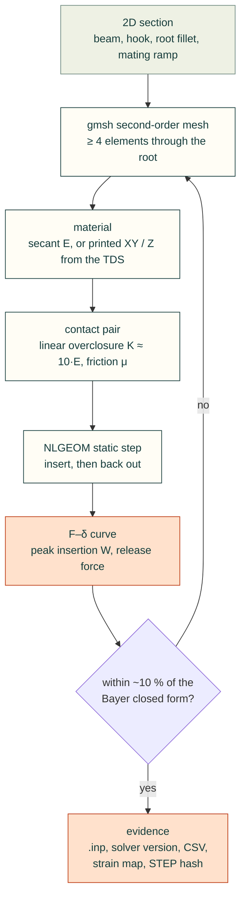

# FOSS large-deflection + contact FEA, orientation, sheet metal and DFM checklists (2026-10-31)

For Valpatel/cad-agent #96 (items 3–5), #94 (FEA step), #97 (pitfall catalogue), #99 (process profiles). Extends
`research/simulation-tools.md` (2026-10-26), which covers topology optimisation, CFD/CHT, post-processing and slicer
CLIs. Notation: **(s)** search snippet only · **(u)** unverified · **[derived]** my calculation · "read" = text read on
this date.

## 0. What `cadagent.fea` does today

From the module docstring, read from `origin/dev:src/cadagent/fea.py`:
- gmsh tetrahedra and scikit-fem P2 linear elasticity.
- Solvers: PARDISO, SciPy direct, or CG with pyamg.
- "linear and small-deflection; isotropic", with weak-direction strengths for printed materials.
- "Contact, bolt preload and buckling are not modelled."

A snap engagement needs geometric nonlinearity, contact with friction, and preferably an orthotropic printed material,
so the current module cannot model one. Closed-form checks (compliant-mechanisms.md §2) cover sizing. FEA is needed for
force-vs-travel curves, U/L shapes, ring segments, both parts flexing, and checking the root fillet.

## 1. Solvers for nonlinear geometry + contact

| Solver | Licence | Version / install on our hosts | Large deflection | Contact | Orthotropic (layer frame) | Python driving | Fit for snap engagement |
|---|---|---|---|---|---|---|---|
| **CalculiX ccx** | GPL-2.0 ([dhondt.de](http://www.dhondt.de/)) | **2.23**, manual dated 2025-10-19 ([ccx_2.23.pdf](http://www.dhondt.de/ccx_2.23.pdf), read). Ubuntu apt `calculix-ccx` **2.21** (checked on this workstation: noble); conda-forge `calculix` **2.23** | `*STEP, NLGEOM` (44 hits in the manual) | `*CONTACT PAIR` NODE TO SURFACE, SURFACE TO SURFACE (penalty), **MORTAR**; `*SURFACE BEHAVIOR` LINEAR / EXPONENTIAL / TABULAR / TIED; `*FRICTION`; `*RIGID BODY` (manual) | `*ELASTIC, TYPE=ENGINEERING CONSTANTS` + `*ORIENTATION` (manual) | Write `.inp` text; read `.frd`/`.dat` (e.g. [ccx2paraview](https://pypi.org/project/ccx2paraview/) 3.2.0, licence (u)) | **Best fit**: mature contact, small binary, apt/conda, Abaqus-like syntax that LLMs know. Run as a subprocess (GPL) |
| **FreeCAD FEM** (CalculiX writer) | LGPL-2.1 | FreeCAD **1.1.4** (2026-09-28); 26.3 RC2 (2026-10-18) ([releases](https://github.com/FreeCAD/FreeCAD/releases)) | `GeometricalNonlinearity` adds `, NLGEOM` ([write_step_equation.py](https://github.com/FreeCAD/FreeCAD/blob/main/src/Mod/Fem/femsolver/calculix/write_step_equation.py), read) | Writes `*CONTACT PAIR … TYPE=SURFACE TO SURFACE`, LINEAR (slope) / HARD / TIED, `*FRICTION µ, stick slope`, optional ADJUST ([write_constraint_contact.py](https://github.com/FreeCAD/FreeCAD/blob/main/src/Mod/Fem/femsolver/calculix/write_constraint_contact.py), read) | Material cards (isotropic in the GUI) (u) | `freecadcmd` scripts; the FreeCAD wiki is behind Anubis bot protection | Good for humans and for reading `.inp` examples. Heavier than writing `.inp` ourselves |
| **Elmer** | GPL-2+/LGPL mix (simulation-tools.md) | release-26.2 | ElasticSolve, nonlinear elasticity (u) | Mortar contact in `ContactUtils.F90`; **26 contact regression tests** incl. `ContactFriction`, `ContactFrictionNonlin`, `ContactBlunt2D*`, `ContactPatch3D*` ([fem/tests](https://github.com/ElmerCSC/elmerfem/tree/devel/fem/tests), read) | (u) | `.sif` text | Second choice; good docs-by-tests |
| **Code_Aster** | GPL-3.0 (+ CeCILL-C/Apache/LGPL parts) | conda-forge `code-aster` **18.1.11** (read via the anaconda API) | STAT_NON_LINE (u) | DEFI_CONTACT (u) | yes (u) | `.comm` Python-like | Most capable; heaviest to learn. Use for difficult validation cases |
| **FEniCSx** | LGPL-3.0 (dolfinx 0.11) | Docker/conda (simulation-tools.md) | Native (UFL hyperelastic, Newton) | Core has none; [dolfinx-contact](https://github.com/Wells-Group/asimov-contact) (MIT) is "under heavy development and highly experimental", needs dolfinx 0.11 | Custom UFL | Pure Python/UFL | Not now; penalty contact against a rigid plane is easy to hand-write |
| **scikit-fem** | BSD-3-Clause | **12.0.2**, already in cad-agent | Hyperelastic examples ex36, ex43, **ex55 (updated Lagrangian)** | Mortar contact ex04 and **ex51** (2D, linear elastic) ([docs/examples](https://github.com/kinnala/scikit-fem/tree/master/docs/examples), read) | Write our own | In-process | No ready nonlinear-contact example. Writing a 2D total-Lagrangian + penalty contact is feasible later (BSD, in-process) |
| **SfePy** | BSD-3-Clause | PyPI **2026.3** | Total-Lagrangian hyperelastic (u) | Penalty contact terms: `elastic_contact_planes.py`, `elastic_contact_sphere.py`, `two_bodies_contact.py` ([examples](https://github.com/sfepy/sfepy/tree/master/sfepy/examples/linear_elasticity), read) | yes (u) | Python | Viable permissive in-process option; worth a spike against ccx |
| **Kratos** | BSD-4-clause-style with an advertising clause ([kratos/license.txt](https://github.com/KratosMultiphysics/Kratos/blob/master/kratos/license.txt), read; GitHub shows NOASSERTION) | PyPI `KratosMultiphysics` + `KratosContactStructuralMechanicsApplication` **10.4.4** | yes (u) | Mortar contact app (u) | (u) | `pip`, JSON + Python | Watch; wheels make it the easiest permissive 3D contact install |
| MOOSE | LGPL-2.1 | Source/conda build | yes (u) | contact module (u) | yes (u) | `.i` files | Skip (build weight) |
| [PyChrono](https://github.com/projectchrono/chrono) / [PyElastica](https://github.com/GazzolaLab/PyElastica) | BSD-3 / MIT | active | Beams, shells / Cosserat rods | Chrono FEA contact (u) | no | Python | Fast large-deflection beam checks only |

**Recommendation.**
- Add `cadagent.fea_nl`, which writes CalculiX `.inp` from our gmsh mesh and runs `ccx` as a subprocess (GPL boundary as
  in simulation-tools.md). Validate it on the three Bayer gold cases first.
- Keep scikit-fem for the linear checks.
- Spike SfePy or Kratos only if we need contact in-process.
- Use Elmer or Code_Aster as independent cross-checks on one case.

## 2. Minimal snap-engagement run (CalculiX)

Settings verified in the ccx 2.23 manual:
- Linear pressure-overclosure K "5 to 50 times the E-modulus of the adjacent materials".
- Stick slope "about 100 times smaller than the spring constant"; μ "usually 0.1–0.5".
- Convergence advice: try without NLGEOM first, SMALL SLIDING first, and a linear pressure-overclosure. Base the slave
  surface on faces, especially with quadratic elements. The slave mesh must be at least as fine as the master.
- Plane-stress elements are expanded to 3D internally and "must have a small thickness".

| Item | Choice for a cantilever-hook engagement |
|---|---|
| Geometry | The 2D section of the beam with its hook and root fillet, plus the mating ramp or edge. Use 3D only for ring segments, U shapes or annular snaps |
| Mesh | gmsh second-order triangles (CPS6) or quads (CPS8), at least 4 elements through the root thickness, refined at the fillet and the contact faces |
| Material | Secant E at the design strain (Bayer Fig. 16 for PC), or the printed XY/Z E from TDS (compliant-mechanisms.md §5). For printed beams: `*ELASTIC, TYPE=ENGINEERING CONSTANTS` with E₁ = E₂ = E_XY, E₃ = E_Z, G and ν estimated (u), and `*ORIENTATION` taken from the part's print rotation (`cad/build.py` table) |
| Mating part | Rigid: `*RIGID BODY, NSET=…, REF NODE=…` driven by `*BOUNDARY` displacement. Or elastic if both parts flex (Bayer "both mating parts elastic") |
| Contact | `*CONTACT PAIR, INTERACTION=SI, TYPE=SURFACE TO SURFACE` with hook faces as slave; `*SURFACE BEHAVIOR, PRESSURE-OVERCLOSURE=LINEAR` K ≈ 10·E; `*FRICTION` μ from Bayer Table 3, λ = K/100 |
| Step | `*STEP, NLGEOM, INC=…` + `*STATIC` with a small initial increment. Drive the mate through insertion, then back out for the release force |
| Outputs | `*NODE PRINT, TOTALS=ONLY` RF on the reference node, giving the F–δ curve, peak insertion force W and release force; `*EL FILE` S, E giving peak strain at the root; `*CONTACT FILE` CDIS, CSTR |
| Acceptance | (1) At small strain, ccx P and W within about 10 % of Bayer closed form (Example I: P = 32.5 N, W = 58.5 N) [target, derived]. (2) The result changes < 5 % on mesh halving (or a GCI study, as NovaSolver does). (3) The F–δ curve returns to ≈ 0 after release. (4) Peak strain in the print frame ≤ the derated allowable: ε_XY in the layer plane, ε_ZZ across layers |
| Evidence to store | `.inp`, solver version, F–δ CSV, a strain map PNG, the hash of the STEP it came from (binding as `cad-agent` already does for other checks) |
| Run cost | 2D: about 10³–10⁴ elements, seconds to minutes (u). 3D annular: minutes to an hour; use the cad-remote-runs skill for long runs |

## 3. Print-orientation optimisers

| Tool / method | Licence | What it optimises | Anisotropy-aware | Use |
|---|---|---|---|---|
| [ChristophSchranz/Tweaker-3](https://github.com/ChristophSchranz/Tweaker-3) | GPL-3.0 | Overhang/support area, bottom area, contour; evolutionary-tuned weights; 110★, push 2026-03-24 | No | External comparator (subprocess) |
| Slicer auto-orient: Bambu/Orca CLI `--orient` (simulation-tools.md §5); Orca 2.5 MCP (agent-toolkits note) | AGPL | Support/overhang | No | Cross-check |
| [b123d-print `suggest_orientation`](https://github.com/KD5RYN/b123d-print/blob/main/src/b123d_print/orient.py) | MIT | Overhang plus the tip-over measure (Orca auto-brim formula) ([checks.md](https://github.com/KD5RYN/b123d-print/blob/main/docs/using/checks.md)) | No | Borrow ideas |
| Umetani & Schmidt 2013, cross-sectional structural analysis ([Autodesk Research](https://www.research.autodesk.com/publications/cross-sectional-structural-analysis-for-3d-printing-optimization)) | paper / patents (US10239258) | Weakest cross-section under bending, then the orientation | Assumes isotropy (s) | Method idea |
| Ulu et al., build orientation for maximum safety factor ([ITU record](https://research.itu.edu.tr/en/publications/enhancing-the-structural-performance-of-additively-manufactured-o/)) | paper | Orientation maximising the minimum FoS with anisotropic properties from coupons, using a surrogate | **Yes** (s) | The method to copy for loaded parts |
| Anisotropic multi-component TO with build orientation ([arXiv 1911.10393](https://arxiv.org/abs/1911.10393)) | paper | Joint topology and orientation | Yes | Research only |
| pyMOTO `OverhangFilter` (simulation-tools.md §1) | MIT | Topology under a fixed build direction | n/a | Already recommended |

**Gap and proposal.** No FOSS tool scores orientation against the *strain direction of declared compliant features*.
Proposed deterministic scorer [derived]: for each of the 6 axis-aligned orientations (plus slicer suggestions), compute
- overhang area (`cadagent.geometry.downward_area`, already exists);
- support volume;
- the tip-over measure;
- for each declared flexing feature, the fraction of peak bending strain whose direction has a Z component across
  layers.

Reject any orientation that puts a snap or flexure's bending across layers (Klahn 2016, Hubs; compliant-mechanisms.md
§5).

## 4. Sheet metal: unfold and bend tables

| Tool | Licence | Status | Bend model / tables | Headless | Use |
|---|---|---|---|---|---|
| **build123d `BuildSheet` + `unfold`** | Apache-2.0 | dev branch only (not in v0.13.0); commits 2026-07-21 → 2026-10-21 | Neutral radius from thickness, K-factor and reference surface; flange, bend/corner relief, hem, jog, miter, thicken ([docs](https://github.com/gumyr/build123d/tree/dev/docs/sheet_metal), read) | yes (Python) | **Adopt on release**: same kernel as text-to-cad, permissive |
| [shaise/FreeCAD_SheetMetal](https://github.com/shaise/FreeCAD_SheetMetal) | LGPL-2.1 | 350★, push 2026-10-17 | K-factor ANSI or DIN; a "material definition" spreadsheet mapping R/T → K per bend; example `MDS/mild_steel.csv` (K = 0.40 for 1–6 mm); `tools/calc-unfold.py`; unattended unfold and DXF/SVG export; `SMTests/testKfactor.py` (README and files read) | via `freecadcmd` (u) | Fallback (external process) |
| [alexneufeld/YouCanNotUnfold](https://github.com/alexneufeld/YouCanNotUnfold) | LGPL-2.1 | 22★, push 2026-10-09 | "Fast robust sheet metal unfolding tools for FreeCAD" | (u) | Watch |
| SendCutSend specs JSON (landscape.md §5) | vendor data | live | 178 materials: K-factor, bend radius, bend deduction, minimum hole and bridge | fetch | Source for the K and R tables (fetch and cite, don't redistribute) |
| text-to-cad #614 `cadgen.unfold` | MIT | open proposal | — | — | Contribute or reuse build123d's |

Bend allowance BA = θ·(R + K·T); flat length = Σ flats + Σ BA [derived; this is the neutral-axis model the build123d
docs describe].

## 5. Published checklists whose items can become deterministic checks (#97)

Sources: the DuPont design manual [DUP]; the Boothroyd Dewhurst DFM checklist [BD]; Protolabs moulding [PL-IM] and
sheet-metal [PL-SM] guidelines; Hubs FDM [HUBS-FDM] and snap-fit [HUBS-SF] guides; the UF design-lab checklist [UF] and
common-mistakes list [UF-M]; b123d-print checks [B123]; Bayer [BAY]; the Klahn paper [KLA]; Boothroyd DFA criteria
[DFA].

"Exists" means cad-agent already has a check, according to `docs/common-issues.md` on origin/dev.

| ID | Check | Rule / threshold | Source | Process | Implementation hint | Status |
|---|---|---|---|---|---|---|
| G1 | Holes and countersinks clear of later features (cylinders **and cones**) | Probe material inside each hole and countersink cone | common-issues.md; #98 | all | Extend `cad-agent holes` to `Cone` faces | partly exists (#98) |
| G2 | Tool/driver access along the fastener axis | Swept tool envelope collision-free | [UF] "fastener head types allow adequate motion with tools" | all | Sweep a hex-key or driver cylinder along the axis | exists (assembly-access gate) |
| G3 | Thread engagement | ≥ 5 threads (UF lab rule) or project rule | [UF] | all | Stack length vs pitch | exists (fastener gate) |
| G4 | Rib/boss ends on air | Every rib end face touches a wall solid | common-issues.md | all | Face adjacency after the boolean | new |
| M1 | Rib thickness vs wall | rib ≤ 60 % of the adjacent wall | [BD] (DuPont plots 60 % ribs [DUP]) | moulding | Medial thickness ratio | new |
| M2 | Rib base fillet | ≈ ½ rib thickness | [DUP] | moulding | Fillet radius at the rib root | new |
| M3 | Draft | ≥ 0.5° on vertical faces, 2° typical, ≥ 3° light texture, ≥ 5° heavier texture (PM-T2), ≥ 3° on shut-offs | [PL-IM]; resin table [DUP] | moulding | Face normal · pull direction | new (cf. text-to-cad `mold_tool.py`) |
| M4 | Wall thickness range per resin | e.g. PC 1.016–3.81 mm, PP 0.889–3.81 mm, nylon 0.762–2.921 mm | [PL-IM] | moulding | Ray-cast thickness histogram | new |
| M5 | Boss OD | 2–2.5 × hole diameter | [DUP] | moulding / FDM | Annulus measure on bosses | new |
| M6 | Blind cored hole | depth ≤ 2 × core-pin diameter; floor ≥ d/6 | [DUP] | moulding | Hole depth vs diameter | new |
| M7 | Sharp internal corners | radius ≥ 0.5 mm (0.020 in); fillet ≈ t/2 | [DUP][BD] | moulding | Concave edge radius | new |
| M8 | Undercut needs a side action | Faces not visible from ±pull | [BD]; dfm-agent approach | moulding | Visibility per pull direction | new |
| C1 | Snap/flexure strain | ε(y, l, h, taper) ≤ derated allowable(material, process, orientation, cycles) | [BAY][DUP]; compliant-mechanisms.md §6 | all | Calculator from #95 on declared features | new (#95) |
| C2 | Snap root fillet | R ≥ max(0.38 mm, 0.5·h) | [BAY][HUBS-SF] | all | Fillet at the beam root | new |
| C3 | Flexing member bends across layers | Strain direction in the print frame must not cross layers | [KLA][HUBS-SF] | FDM | Beam axis and bending normal vs print Z | new |
| C4 | Print-in-place gap | gap ≥ pip_clearance (0.3–0.5 mm FDM; 0.3 mm SLS/MJF); Z gaps = n·layer height | [HUBS-SF][B123] | AM | Minimum distance between the solids of one part | new |
| C5 | Snap min width / base (MJF) | width ≥ 5 mm; base ≥ 1 mm | [HUBS-SF] | MJF | Section measure | new |
| P1 | Overhang | > 45° from vertical needs support | [HUBS-FDM][B123] | FDM / SLA | `downward_area` | exists |
| P2 | Bridge length | warn > 5 mm (Hubs) or > 10 mm (b123d-print default) | [HUBS-FDM][B123] | FDM | Flat downward faces resting on walls on two sides | new |
| P3 | Round horizontal hole sags | Use a teardrop or flat roof | [B123] | FDM | Horizontal cylinder with a round top | new |
| P4 | Bed-edge fillet flares | Use a chamfer on edges at the bed | [HUBS-FDM][B123] | FDM | Curved faces touching z = 0 | new |
| P5 | Tip-over | brim = tip_speed·H²·W/(1920·I) ≥ 5 mm warns | [B123] | FDM | Footprint second moment of area | new |
| P6 | Thin wall vs line width | < 1 line width fails | [B123] | FDM | Section scans | exists (wall gate) |
| P7 | Small pins | < 5 mm diameter is weak; fillet the base | [HUBS-FDM] | FDM | Cylinder radius + fillet | new |
| S1 | Minimum flange | ≥ 4T | [PL-SM][BD] | sheet | Flange length per bend | new |
| S2 | Hole diameter | ≥ T | [PL-SM] | sheet / laser | Hole radius | new |
| S3 | Hole to edge | ≥ 2T [BD]; Protolabs 1.574 mm (T ≤ 0.914) / 3.175 mm | [BD][PL-SM] | sheet / laser | Edge distance | new |
| S4 | Hole to bend | ≥ 2T + R [BD]; features within about 4T of a bend distort [PL-SM] | [BD][PL-SM] | sheet | Distance to the bend line in the flat pattern | new |
| S5 | Bend radius | ≥ T [BD]; one radius for all bends [PL-SM] | [BD][PL-SM] | sheet | Radius list | new |
| S6 | Bend relief present | relief at every bend that ends inside the blank (sizing from SendCutSend/Protolabs (u)) | [BD] | sheet | Notch at bend ends | new |
| S7 | Hems | inside diameter ≥ T; return ≥ 6T | [PL-SM] | sheet | Hem geometry | new |
| S8 | Tabs and notches | tab ≥ max(2T, 3.2 mm), length ≤ 5 × width; notch ≥ max(T, 1.016 mm) | [PL-SM] | sheet / laser | Slot widths | new |
| A1 | DFA part count | Each part must pass ≥ 1 of: moves relative to its neighbours; must be a different material; must be separate to assemble or service the others. Otherwise it is a candidate for merging, e.g. into a compliant feature | [DFA] | all | BOM + assembly graph prompt (with #40) | new (review prompt) |
| A2 | Every fastener modelled; clearance check run on the full assembly | — | [UF] | all | BOM vs solids | exists (gates) |
| R1 | Claims backed by evidence | No feature called validated without a coupon (#94 item 5) | common-issues.md | all | Dossier lint | exists (partly) |

Checks C1–C5 are the compliant-feature checks for #94; S1–S8 and M1–M8 need process metadata per part (#99).

**References**
- [DUP] https://www.emcoplastics.com/assets/pdf/acetal/General%20Design%20Principles%20for%20Engineering%20Polymers.pdf
- [BD] https://www.dfma.com/resources/pdf/dfm-design-review-checklist.pdf
- [PL-IM] https://www.protolabs.com/services/injection-molding/plastic-injection-molding/design-guidelines/
- [PL-SM] https://www.protolabs.com/services/sheet-metal-fabrication/design-guidelines/
- [HUBS-FDM] https://www.hubs.com/knowledge-base/how-design-parts-fdm-3d-printing/
- [HUBS-SF] https://www.hubs.com/knowledge-base/how-design-snap-fit-joints-3d-printing/
- [UF] https://web.mae.ufl.edu/designlab/Lab%20Assignments/EML2322L%20Final%20Design%20Checklist.pdf
- [UF-M] https://web.mae.ufl.edu/designlab/TA/Common%20Design%20Review%20Mistakes.pdf (e.g. "not considering room for
  tools", "less than 5 threads of engagement")
- [B123] https://github.com/KD5RYN/b123d-print/blob/main/docs/using/checks.md
- [BAY] https://cdn.sparkfun.com/assets/home_page_posts/1/4/1/0/Plastic_Snap_fit_design.pdf
- [KLA] https://publikationen.bibliothek.kit.edu/1000142464
- [DFA] Boothroyd–Dewhurst minimum-part criteria as summarised at
  https://www.wevolver.com/article/dfma-design-for-manufacturing-and-assembly-explained and
  https://www.dfma.com/design-for-assembly.asp (s)

**Could not verify:**
- Code_Aster, Kratos, MOOSE and Chrono keyword- and feature-level claims (marked (u)).
- Elmer ElasticSolve large deformation.
- ccx run times.
- FreeCAD wiki pages (bot-blocked).
- ccx2paraview licence.
- Bend-relief sizing numbers.
- Whether FreeCAD SheetMetal unfold runs under `freecadcmd` without the GUI.
