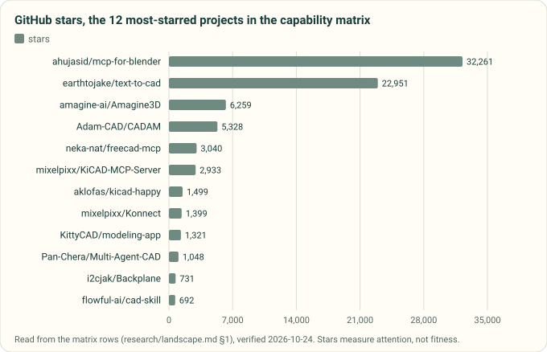

# Agentic hardware-design landscape (verified 2026-10-24)

> **Refreshed 2026-10-31** (issue #96): [agent toolkits since 10-24](agent-toolkits-2026-10.md) (text-to-cad 0.8 break,
> OrcaSlicer 2.5 MCP, build123d sheet metal, snap-fit skills), [compliant mechanisms](compliant-mechanisms.md) (snap
> fits, flexures, allowable strains, FDM anisotropy from datasheets) and [FEA and process tools](fea-and-process-tools.md)
> (large-deflection contact solvers, orientation optimisers, sheet metal, 37 candidate deterministic checks).

Scope: public tools that let frontier-model agents (Claude Code first; Codex, Cursor, Gemini) design 3D-printed,
sheet-metal, laser-cut, CNC and molded parts, enclosures around real PCBs, and KiCad boards.
Method: stars, SPDX licence and last push come from `gh api repos/OWNER/REPO` on this date; capabilities come from each
repo's README, manifests or source as read. **(u)** = unverified (README claim or third-party page not checked in source).
Machine-readable copy: [`landscape.json`](landscape.json).

## 1. Capability matrix

*Drawn from the matrix below by `tools/research_figures.py`. Stars measure attention, not fitness: the matrix decides.*

Clients: **CC** = Claude Code plugin/skill, **MCP** = MCP server, **Cx** = Codex, **Cu** = Cursor, **Ge** = Gemini, **App** = standalone app.

| Project | Licence | Stars | Push | Clients | Kernel / tool | Processes | DFM rules cited | Materials / cost | Render loop | Drawings | Vendor / slicer | Evals |
|---|---|---|---|---|---|---|---|---|---|---|---|---|
| [earthtojake/text-to-cad](https://github.com/earthtojake/text-to-cad) | MIT | 22,951 | 10-25 | CC, Cx, Cu, Ge, Grok, MCP, skills.sh | build123d 0.11 / OCP 7.9 | FDM, SLA, SLS, MJF, metal PBF (mesh); sheet, CNC, molding (review); laser (DXF); URDF/SDF | Yes: Hubs, Protolabs, ISO/ASTM 52910 | No (SendCutSend specs fetched live) | Yes (headless snapshots + viewer) | Yes, PDF | OrcaSlicer, Bambu Connect/Studio, SendCutSend, step.parts | None in repo |
| [amagine-ai/Amagine3D](https://github.com/amagine-ai/Amagine3D) | Apache-2.0 | 6,259 | 10-22 | App (OpenAI-compatible key, Codex SDK) | build123d, OCP, Manifold | FDM enclosures, multi-part | (u) | (u) | Yes (5-view) | (u) | none seen | none |
| [Adam-CAD/CADAM](https://github.com/Adam-CAD/CADAM) | GPL-3.0 | 5,328 | 10-15 | App (web) | OpenSCAD | general | No | No | Yes | No | none | Showcase prompts only |
| [KittyCAD/modeling-app](https://github.com/KittyCAD/modeling-app) + [KittyCAD/mcp](https://github.com/KittyCAD/mcp) | MIT / MIT | 1,321 / 10 | 10-25 | App; MCP (needs `ZOO_API_TOKEN`) | KCL on Zoo's closed cloud engine | general | (u) | (u) | Yes | (u) | none | none |
| [Pan-Chera/Multi-Agent-CAD](https://github.com/Pan-Chera/Multi-Agent-CAD) (MAC) | MIT | 1,048 | 10-17 | App + web UI | build123d | FDM parts, assemblies, URDF | No | No | Yes + judge agent | No | none | Own 10-prompt / 141-feature set |
| [OzAILabs/Claude-To-Print](https://github.com/OzAILabs/Claude-To-Print) | MIT | 4 | 08-15 | CC skills (from MAC) | build123d | FDM, multicolour 3MF | No | No | Yes | No | Bambu | none |
| [jdilla1277/agentcad](https://github.com/jdilla1277/agentcad) | Apache-2.0 | 173 | 10-23 | CLI, MCP, skill | build123d (CadQuery mode) | general | No | No | Yes, diffing | No | none | CADGenBench runs |
| [pzfreo/build123d-mcp](https://github.com/pzfreo/build123d-mcp) | Apache-2.0 | 130 | 10-15 | MCP | build123d | general | No | No | Yes | SVG/DXF export | none | CADGenBench ([pipeline](https://github.com/pzfreo/cadgenbench-build123d)) |
| [flowful-ai/cad-skill](https://github.com/flowful-ai/cad-skill) | **PolyForm-Noncommercial-1.0.0** | 692 | 07-14 | CC skill | CadQuery | FDM | No | No | Yes | No | Prusa/Bambu mentions | none |
| [Svetlana-DAO-LLC/cad-agent](https://github.com/Svetlana-DAO-LLC/cad-agent) (was clawd-maf) | Custom "CAD Agent License" | 53 | 02-17 | MCP | build123d | FDM | No | No | Yes | No | none | none |
| [MikeSuiter/claude-build123d-starter](https://github.com/MikeSuiter/claude-build123d-starter) | MIT | 1 | 06-08 | CC template | build123d | FDM, CNC, laser (u) | No | No | Live preview | No | none | none |
| [neka-nat/freecad-mcp](https://github.com/neka-nat/freecad-mcp) | MIT | 3,040 | 10-25 | MCP | FreeCAD (LGPL, external) | general, FEM (u) | No | No | Screenshots | (u) | none | none |
| [jhacksman/OpenSCAD-MCP-Server](https://github.com/jhacksman/OpenSCAD-MCP-Server) | MIT | 208 | 09-07 | MCP | OpenSCAD | FDM | No | No | Preview images | No | none | none |
| [altendky/onshape-mcp](https://github.com/altendky/onshape-mcp) | Apache-2.0 | 20 | 10-24 | MCP | Onshape (closed SaaS) | general | No | No | (u) | (u) | none | none |
| [faust-machines/fusion360-mcp-server](https://github.com/faust-machines/fusion360-mcp-server) | MIT | 131 | 10-06 | MCP (CC, Cu, Cx docs) | Fusion (closed) | general | No | No | (u) | (u) | none | none |
| [ahujasid/mcp-for-blender](https://github.com/ahujasid/mcp-for-blender) | MIT | 32,261 | 10-24 | MCP, Cx plugin | Blender (mesh, not B-rep) | visual only | No | No | Yes | No | Poly Haven, Sketchfab, paid generators | none |
| [mixelpixx/KiCAD-MCP-Server](https://github.com/mixelpixx/KiCAD-MCP-Server) | MIT | 2,933 | 10-01 | MCP | KiCad 9+ (kicad-python + SWIG `pcbnew`) | PCB | KiCad DRC | JLCPCB parts + prices | Snapshots | No | JLCPCB, DigiKey, Freerouting | none |
| [mixelpixx/Konnect](https://github.com/mixelpixx/Konnect) ([obhox/kicad-mcp](https://github.com/obhox/kicad-mcp) is a fork) | **AGPL-3.0** | 1,399 | 10-25 | KiCad plugin + MCP, CC skills | KiCad 10 IPC (Rust) | PCB | design-review audits (u) | (u) | (u) | No | Freerouting | none |
| [oaslananka/kicad-mcp-pro](https://github.com/oaslananka/kicad-mcp-pro) | MIT | 149 | 10-25 | MCP, CC plugin skills, Cx/VS Code config | KiCad 10.0.x (kicad-cli/IPC; no SWIG) | PCB | 8 fab profiles with source URLs | Fab pricing coefficients | 3D render PNG | No | JLCPCB; Nexar/DigiKey/Mouser with keys | `evals/`, `benchmarks/` dirs |
| [Seeed-Studio/kicad-mcp-server](https://github.com/Seeed-Studio/kicad-mcp-server) | **No LICENSE file** (MIT only in pyproject) | 168 | 10-22 | MCP | KiCad 8-10 (`pcbnew`) | PCB analysis, device tree | KiCad ERC/DRC | PartReel registry | No | No | PartReel | none |
| [lamaalrajih/kicad-mcp](https://github.com/lamaalrajih/kicad-mcp) | MIT | 529 | 2025-10-17 | MCP | KiCad 9 | PCB | DRC | BOM | (u) | No | none | none; stale |
| [aklofas/kicad-happy](https://github.com/aklofas/kicad-happy) | MIT | 1,499 | 10-25 | CC plugin, Cx, Copilot, Gemini/Antigravity, GitHub Action | KiCad file parsing, SPICE | PCB review, EMC, Gerber | EMC rules ref | BOM, distributors | No | No | JLCPCB, PCBWay, DigiKey, Mouser, LCSC, element14 | none |
| [American-Embedded/kistack](https://github.com/American-Embedded/kistack) | MIT text (GitHub: NOASSERTION) | 411 | 10-24 | skills.sh | KiCad | schematic, layout, Gerber review | prose | No | No | No | none | none |
| [i2cjak/Backplane](https://github.com/i2cjak/Backplane) | MIT (ships a KiCad fork) | 731 | 10-25 | App; multi-harness agents | KiCad fork + FreeCAD viewers | PCB + case | No | No | Yes | No | none | none |
| [copperheadhq/copperhead](https://github.com/copperheadhq/copperhead) | Apache-2.0 | 627 | 10-24 | CLI, agent-install prompt | KiCad s-expr + kicad-cli | PCB | ERC/DRC | parts (u) | (u) | No | none | none |
| [punkfab/circuit-skills](https://github.com/punkfab/circuit-skills) | **No licence** | 10 | 10-06 | CC skills, Cx plugin | kipy, build123d, ngspice | PCB + `pcb-enclosure-fit` | No | No | Blender renders | No | Freerouting | PCBWorld harness |

Building blocks: [gumyr/build123d](https://github.com/gumyr/build123d) (Apache-2.0, 3,519),
[CadQuery](https://github.com/CadQuery/cadquery) (Apache-2.0 in LICENSE file; GitHub shows NOASSERTION, 5,990),
[gumyr/bd_warehouse](https://github.com/gumyr/bd_warehouse) (Apache-2.0, ISO fasteners and threads),
[partcad/partcad](https://github.com/partcad/partcad) (Apache-2.0, 509),
[sargo-devel/Cables](https://github.com/sargo-devel/Cables) (LGPL-3.0 FreeCAD cable-routing workbench),
[wireviz/WireViz](https://github.com/wireviz/WireViz) (GPL-3.0, 2D harness documents).
[rjwalters/kicad-tools](https://github.com/rjwalters/kicad-tools) (MIT) keeps a long, licence-annotated survey of KiCad and agent tools in its README.

## 2. Deep dive: earthtojake/text-to-cad (v0.7.26, 2026-10-20)

**What it is.** A plugin monorepo. `skills/` holds the product. `packages/cadgen` is the PyPI runtime, MIT, with
build123d, OCP, a build daemon, STEP/GLB/3MF/DXF output, a viewer backend and an MCP server. `apps/` holds the
viewer, the MCP app, the docs site and `api.texttocad.dev`. It is mostly one maintainer: earthtojake has 1,136
commits, then bots and a few contributors.

**Skills** (each is MIT and carries its own `LICENSE`):

| Skill | What it does | Code it runs |
|---|---|---|
| cad | build123d models with `@step/@stl/@threemf/@glb` decorators; `read_step`/`read_scene`; face/edge refs; snapshots; viewer | cadgen via pinned `uvx` |
| step-parts | Search and download catalog STEP files (screws, bearings, standoffs, boards), with sha256 check | `download_step_part.py` → `api.step.parts` |
| engineering-drawing | Third-angle views, hidden lines, measured dimensions, hole callouts, ISO title block → PDF | `cadgen.eng_drawing` |
| dxf | 2D profiles, flat pattern of *already flat* plates, kerf offset | `cadgen.flatten` |
| dfam-check | Mesh wall thickness (ray-cast), overhang, support volume, 6 axis orientations; limits table per FDM/SLS/SLA/PBF/MJF | `dfam_tool.py` (trimesh) |
| dfm | Guided sheet/CNC/molding review with a cited rule per finding; only molding is measured (draft, undercuts, projected area) | `mold_tool.py` |
| sendcutsend | Preflight of DXF/STEP against SendCutSend's live catalog and specs JSON | fetches `cdn.sendcutsend.com` |
| gcode | Writes complete OrcaSlicer presets and slices headless | `orca_presets.py` (stdlib) |
| bambu-labs | Hands off to Bambu Connect (`bambu-connect://` link) or Bambu Studio; never controls the printer | none |
| urdf / srdf / sdf | Robot and simulator descriptions, with validation | cadgen |

**Install (Claude Code):** `claude plugin marketplace add earthtojake/text-to-cad#latest` then
`claude plugin install text-to-cad@earthtojake`. The `latest` branch holds only the plugin, one commit per release.

**Security review.**
- `.claude-plugin/plugin.json` declares only `skills` and `mcpServers`. It has **no hooks, commands or agents**.
  `.githooks/pre-commit` is for development only.
- Claude Code starts the MCP server with `uvx --no-config --managed-python --python 3.13 --from cadgen==0.7.26 cadgen mcp`.
  The first start downloads a managed CPython and cadgen. cadgen is pinned exactly, but its dependencies are ranges
  with no hash lock: build123d <0.12, cadquery-ocp-novtk 7.9, ezdxf, matplotlib, pillow, shapely, playwright==1.64.0.
  The wheel bundles Node/browser JS and a native file tracer (`filetrace.c`). The first snapshot downloads a
  Playwright browser.
- **Telemetry is on by default.** It sends counts, a random install ID, the OS and agent app, and crash types to
  `api.texttocad.dev`, which stores them in PostHog; the server derives country from IP. The README says names,
  paths, contents and prompts are never sent; I did not audit the payload code line by line. Turn it off with
  `uvx cadgen telemetry off`, `DO_NOT_TRACK=1` or `CADGEN_TELEMETRY=0`.
- **Daily update check** to `api.texttocad.dev/v1/versions`. Turn it off with `CADGEN_UPDATE_CHECK=0`.
- The viewer binds 127.0.0.1 with **no authentication** (per its SECURITY.md). Any local process can read files under
  the opened folder and trigger builds.
- The dfam-check and dfm skills `pip install` unpinned `requirements.txt` files into the *active project environment*.
- Model scripts are arbitrary Python run by the daemon, which is normal for code-CAD.

**Coverage of our J501 workflow:**

| J501 capability | text-to-cad today |
|---|---|
| Vendor STEP ingestion | Yes (`read_step`, `read_scene`, refs). Viewer fails on large PCB STEP: open [#626](https://github.com/earthtojake/text-to-cad/issues/626), "exceeds viewer memory envelope" |
| Clearance vs 5000+ carrier solids | Primitives only: `cadgen.geometry.closest_points` and `overlap_volume`. The `interference` module was retired; the caller writes pair selection. No broad-phase or report |
| Schematic ingestion | No. PCB support is open PR [#518](https://github.com/earthtojake/text-to-cad/pull/518) (KiCad 11 nightly, vendored kipy) |
| Enclosure around a real board | Generic examples only (`electronics_enclosure_base.py`) |
| Connector windows from board STEP | No |
| Standoffs / fastener stack length | Catalog parts via step-parts. Stack-length checks exist only as model-specific scripts in `models/tendon_hand`, not as a skill |
| Cable routing, bend radius | No |
| Renders | Yes |
| PDF check sheet | Drawings yes; no check-sheet or evidence PDF |
| Review / evidence site, STL/3MF/Bambu links | Local unauthenticated viewer; 3MF export and Bambu handoff yes; no publishable evidence page |
| DfAM | Walls and overhangs measured; hole size, min feature and bridge are "not checked" (per `process-limits.md`) |
| Sheet-metal unfold | No; proposal [#614](https://github.com/earthtojake/text-to-cad/issues/614) |

Kernel note: text-to-cad uses build123d. Our J501 code is CadQuery. Both use OCP, so shapes interoperate through `.wrapped`.

## 3. KiCad MCP servers: install and security, then a recommendation

| | kicad-mcp-pro | mixelpixx KiCAD-MCP-Server | Seeed kicad-mcp-server | kicad-happy (skills) |
|---|---|---|---|---|
| Install | `uvx kicad-mcp-pro`. The shipped `.mcp.json` is **unpinned**, so each launch runs latest PyPI | `git clone`; `npm install` runs `prepare` → `npm run build`; pip requirements | `pip install -e .` into KiCad's Python | CC marketplace plugin |
| KiCad | 10.0.x primary (10.0.7 verified), 8.x deprecated, 9 dropped, 11 preview; SWIG forbidden by test | 9.0+; mixes kicad-python IPC and SWIG `pcbnew` | 8-10, `pcbnew` | file parsing |
| Tools | 387 public; default profile = 24 read-only; writes need a profile | 244 registered | analysis, ERC/DRC, device-tree code | review scripts |
| Network | JLCPCB public catalog by default; other distributors only with keys; telemetry **off** by default (opt-in OpenTelemetry) | JLCPCB, DigiKey; README advertises paid "Nimrod" service | PartReel downloads (host allowlist) | datasheets, distributors |
| Hygiene | CodeQL, OpenSSF Scorecard, gitleaks, SECURITY.md; one maintainer (1,029 commits), repo created 2026-05-31 | active; new development moved to AGPL Konnect | no LICENSE file | plugin.json declares no hooks |
| Deps of note | — | pymupdf (AGPL) at runtime | fastmcp | — |

**Recommendation:** use **kicad-happy** for review and **kicad-mcp-pro** for edits and exports. Both are MIT.
kicad-mcp-pro targets KiCad 10 with no SWIG, is read-only by default, ships cited fab profiles, and is the most
active. Pin its version (`kicad-mcp-pro==4.4.0`) and keep the default profile until edits are needed. Use mixelpixx
only if KiCad 9 is required. Treat Seeed as all-rights-reserved until it commits a LICENSE file. Konnect and
obhox/kicad-mcp are AGPL: run them only as external programs.

## 4. Mechanical + PCB co-design (ECAD to MCAD)

- **KiCad itself:** `kicad-cli pcb export step` takes `--board-only`, `--no-components`, `--component-filter` and
  `--no-dnp`. There are also `brep`, `glb`, `stl`, `xao`, `dxf` (use Edge.Cuts for the outline) and `ipc2581`.
  KiCad 10's CLI has **no IDF export**. The KiCad 9/10 IPC API needs the GUI and cannot plot or export; KiCad 11 adds
  headless operation ([KiCad dev docs](https://dev-docs.kicad.org/en/apis-and-binding/ipc-api/for-addon-developers/),
  [CLI docs](https://docs.kicad.org/10.0/en/cli/cli.html)). kicad-python on PyPI is MIT, version 0.8.0, KiCad 9+.
- **text-to-cad:** PR [#518](https://github.com/earthtojake/text-to-cad/pull/518) (open) adds `@pcb` boards-as-code
  with DRC on every build. #616 (`pcb-dfm` skill) merged into a feature branch stacked on #518. PR #345 (closed, not merged) was a KiCad 10
  fixture in which a USB-C connector is blocked by an enclosure wall and then fixed by a source-level cutout. That is
  exactly our pattern.
- **punkfab/circuit-skills:** a `pcb-enclosure-fit` skill co-registers the board STEP with a build123d shell and gates
  placement on connectors, cutouts and holes. It has no licence, so ideas only.
- **Backplane:** KiCad and FreeCAD viewers that show a case assembly beside the agent. MIT; install is `curl | sh`.
- **Amagine3D:** designs the enclosure around internal components from requirements. It does not read KiCad files.
- **kicadStepUp** (AGPL per its README): FreeCAD workbench that syncs board outlines and models both ways. External only.
- **Gap:** no project closes the loop from KiCad outline, connectors and holes, to enclosure, to clearance report, and
  back-annotation onto the board.

## 5. Knowledge sources

| Domain | Source | Licence / terms | Already embedded in |
|---|---|---|---|
| DfAM | ISO/ASTM 52910 / 52911-1 | paid standard: cite, don't copy | text-to-cad `process-limits.md` (MIT summary citing Hubs, Formlabs, HP MJF, EOS) |
| Sheet / laser | [SendCutSend specs JSON](https://cdn.sendcutsend.com/specs/sendcutsend-specs.json) + catalog: 178 materials, k-factor, bend radius, bend deduction, minimum hole and bridge (inches) | vendor data, no licence stated: fetch live and cite | text-to-cad `sendcutsend` |
| Sheet / CNC / molding | [Hubs](https://www.hubs.com/guides/sheet-metal-fabrication/) and [Protolabs](https://www.protolabs.com/services/sheet-metal-fabrication/design-guidelines/) guides | copyrighted pages: cite | text-to-cad `dfm` references |
| PCB fab | JLCPCB, PCBWay, Eurocircuits, OSH Park, NextPCB capability pages | vendor terms | kicad-mcp-pro `dfm_profiles/*.json` (MIT, with source URLs and pricing coefficients); kicad-happy jlcpcb/pcbway skills |
| PCB design | IPC-2221/2222, IPC-7351 | paid: cite only | text-to-cad PR #518 skill cites IPC-2221 widths |
| Materials | FreeCAD `.FCMat` cards | CC-BY-3.0 (some older cards LGPL) | FreeCAD |
| Polymers | OpenPoly | CC BY 4.0 (research data) | none |
| Fasteners | bd_warehouse | Apache-2.0 | none |
| Cost | kicad-mcp-pro `dfm_calculate_manufacturing_cost` (area, layers, vias); slicer time and grams from OrcaSlicer G-code | MIT; OrcaSlicer AGPL (external) | kicad-mcp-pro |

No open, cited cost model for FDM, sheet metal or CNC turned up in any agent tool (gap). MatWeb has no bulk export;
MakeItFrom's terms are (u).

## 6. Benchmarks and evals

| Benchmark | What it measures | Licence / access |
|---|---|---|
| [CADGenBench](https://github.com/huggingface/cadgenbench) (Hugging Face, 2026) | Drawing → STEP generation, plus STEP editing; validity gate, shape, interface and topology scores; 81 fixtures (per pzfreo submission); ground truth private | Apache-2.0 code; [HF leaderboard](https://huggingface.co/spaces/HuggingAI4Engineering/CADGenBench). Best fit for measuring our agent |
| [Text2CAD](https://github.com/SadilKhan/Text2CAD) (NeurIPS'24) | Text → sequential CAD | CC BY-NC-SA 4.0 |
| [CADPrompt / CADCodeVerify](https://arxiv.org/abs/2410.05340) (ICLR'25) | 200 prompts → CadQuery; point-cloud distance, compile rate | repo has no licence |
| [CAD-Recode](https://github.com/filaPro/cad-recode) (ICCV'25) | point cloud → CadQuery | CC BY-NC 4.0 |
| [cadrille](https://github.com/col14m/cadrille) | multimodal reconstruction | Apache-2.0 |
| [Text2CAD-Bench](https://arxiv.org/abs/2605.18430) | 600 examples, 4 levels, novice and expert prompts | paper CC BY 4.0; data licence (u) |
| P3D-Bench (arXiv 2606.11152), CADBench (2605.10873), BenchCAD (2605.10865), RealCADBench (2609.03773), [CAD Arena](https://cadarena.dev/) | various | (u) |
| [PCBWorld](https://github.com/LGAI-Research/PCBWorld) (arXiv 2607.05915) | KiCad-grounded routing for agents and RL; 679 real boards; 8 engine-checked metrics | BSD-3-Clause |
| PCB-Bench (ICLR'26), OmniRouting (2608.04434) | LLM placement and routing | (u) |

No benchmark covers **enclosure fit around a real board**, DFM correctness or fastener/cable checks. Our J501 session
could seed one: the vendor STEP is fetched by URL and hash, never committed.

## 7. Recommendation

**Adopt now**
1. text-to-cad plugin pinned to a release, with `CADGEN_TELEMETRY=0`, `DO_NOT_TRACK=1` and `CADGEN_UPDATE_CHECK=0` in
   the environment. It provides the CAD runtime, drawings, DfAM, slicing, Bambu and SendCutSend.
2. kicad-happy (review) plus kicad-mcp-pro pinned (edits and exports), and `kicad-cli pcb export step` for the board model.
3. build123d-mcp or agentcad as an optional inspection loop; both are Apache-2.0 and have CADGenBench evidence.
4. CADGenBench as the regression eval for generic CAD skill.

**Thin add-on repo (cad-agent, MIT)**
- `enclosure-around-board` skill: board STEP/KiCad → keep-outs, connector windows, standoffs.
- Scalable vendor-assembly clearance report: bounding-box/BVH broad phase, then `closest_points`.
- Fastener stack length (bd_warehouse) and cable route with bend-radius check.
- Evidence site and PDF check sheet.
- `knowledge/` with cited rules, materials and cost.
Upstream does not cover any of these. Their contract favours caller-written checks, and their roadmap is PCB, FEA
and CAM.

**Contribute upstream to text-to-cad**
- DfAM hole, min-feature and bridge measurement (documented as unmeasured).
- Help with sheet-metal unfold (#614).
- Large-PCB-STEP viewer memory fix (#626); our J501 carrier is a reproducer.
- A PCB-to-enclosure fit fixture and recipe once #518 lands (successor to #345).
- An `inspection-and-validation.md` recipe for many-body clearance with a broad phase.

**Licence constraints**
- Incorporate code only from MIT, BSD or Apache-2.0 projects, with attribution: text-to-cad, build123d, CadQuery,
  bd_warehouse, agentcad, build123d-mcp, MAC, kicad-mcp-pro, kicad-happy, KiStack, kicad-python, PCBWorld, CADGenBench.
- Never copy code from: flowful-ai/cad-skill (PolyForm Noncommercial), Svetlana cad-agent (custom licence),
  circuit-skills and Seeed (no LICENSE file), or Text2CAD and CAD-Recode data (NC).
- External programs only: CADAM (GPL-3.0); Konnect and obhox/kicad-mcp (AGPL-3.0); kicadStepUp, OrcaSlicer and
  pymupdf (AGPL); FreeCAD and Cables (LGPL); WireViz and freerouting (GPL); KiCad (GPL).
- Vendor data (SendCutSend JSON, fab capability pages) is fetched and cited at run time, not redistributed.
