# Manufacturing-process profiles: design rules by process, and the experts behind them (2026-10-31)

For Valpatel/cad-agent #99 (process profiles), #118 (cite every rule by name), #97 (pitfall checks) and #95
(calculators). The machine-readable twin of this page is [`process-profiles.yaml`](process-profiles.yaml): every rule
below is a row there, with an id, a value or an expression, units, its source and the date it was read.

What the part is made by decides what it may look like. This page collects the design rules that manufacturers,
fabricators, standards bodies and named engineers publish for FDM, resin and powder printing, injection moulding,
sheet metal and CNC, says where they disagree, and credits each one to the person or company behind it. We are
highlighting experts, not taking credit for their tips: every rule names its source and links to it, and nothing is
copied.

**How this was checked.** "Read" means the number was seen in the source's own text on 2026-10-31 (the page's HTML,
the PDF through `pdftotext`, an Internet Archive copy where the live page blocks scripts, or, for two DuPont figures
with no text layer, the rendered figure; the YAML says which).
**(u)** marks anything not verified, and the YAML gives it `status: u` so no check enforces it. **[derived]** means we
calculated it from cited numbers; the method is stated. Inches are converted at 25.4 mm and the printed value kept in
the YAML (`as_printed`). Paid standards are cited by number and title only.

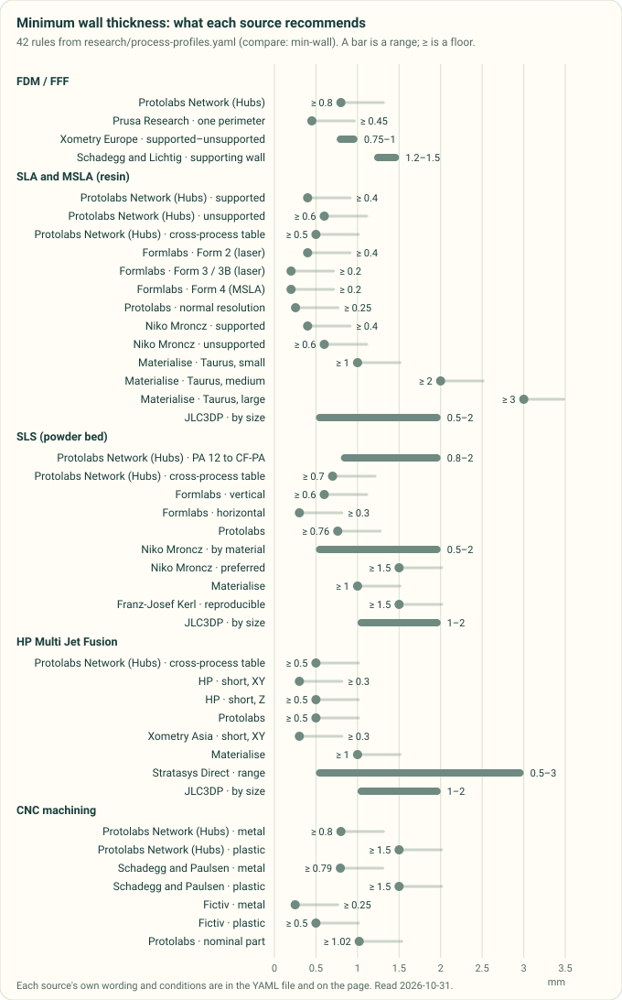

*Diagram drawn by `tools/process_profile_figures.py` from the `compare: min-wall` rules in [`process-profiles.yaml`](process-profiles.yaml), on published sources read 2026-10-31. A test redraws it and fails if the committed chart differs.*

## 1. Reading the rules

- **A shop's own table beats every generic rule.** Sheet-metal radius, K-factor and minimum flange come from the
  shop's tooling (§7); a printer's walls come in whole perimeters (§2). The generic rules are the fallback when the
  shop or machine is not chosen yet, and a check should say which one it used.
- **A rule is only as good as its datum.** Hole-to-bend distances are measured from the bend line, the tangent, the
  inside face or the hole's edge, depending on who wrote them (§7). The YAML has a `datum` field for this.
- **Limits are written once, as numbers or expressions.** `min: "2*T + R"` means at least twice the thickness plus the
  bend radius; `value: "max(0.005*L, 0.5)"` is ±0.5 % of the dimension with a ±0.5 mm floor.
  `tools/process_profile_figures.py` has the evaluator, and the tests evaluate every expression.
- **Rules that compare** share a `compare` key (`min-wall`, `sm-hole-to-bend`, …). The charts on this page are drawn
  from those keys, so a rule added to the YAML appears in its chart on the next run.

## 2. FDM / FFF (material extrusion)

### Orientation and anisotropy

The data is already on [compliant-mechanisms.md §5–6](compliant-mechanisms.md) (13 filaments from Bambu Lab and
Polymaker data sheets, and HP's MJF data), and is not repeated here. In short: across the layers, strength is
0.40–0.90 of the in-plane value but strain to failure only 0.10–0.61, so anything that flexes (snap arms, clips,
springs, hinges) lies in the build plate's plane, and bending across the layers is avoided.

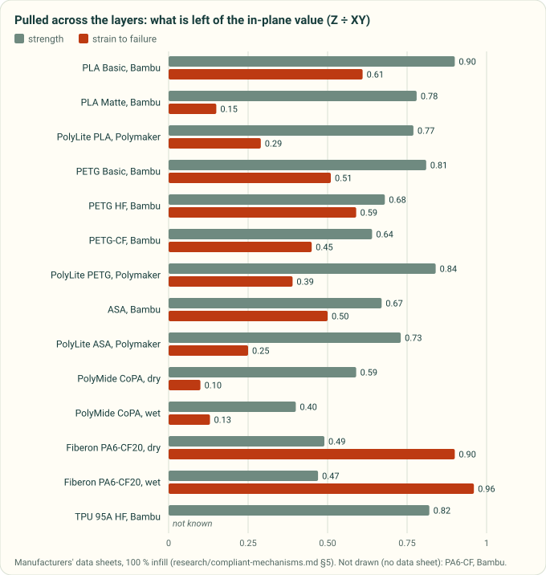

*Diagram drawn by `tools/research_figures.py` from the data-sheet table in [compliant-mechanisms.md §5](compliant-mechanisms.md) (Bambu Lab and Polymaker data sheets, published sources); a test keeps the two in step.*

| Rule | Value | Applies when | Source |
|---|---|---|---|
| Lay flexing and brittle features parallel to the build plate | Z strength 0.40–0.90 × XY; Z strain 0.10–0.61 × XY | Data sheets, 100 % infill | [compliant-mechanisms.md §5](compliant-mechanisms.md) |
| A cantilever snap built along Z is poor; the stair-step adds notches | qualitative | Printed snap fits | Christoph Klahn, Daniel Singer and Mirko Meboldt, [Procedia CIRP 2016][klahn-2016-am-snapfit] |
| FDM parts are weakest along Z; layer joints are small valleys that concentrate stress | qualitative | All FDM | [Protolabs Network][hubs-fdm-design] |

### Overhangs and bridges

| Rule | Value | Applies when | Source |
|---|---|---|---|
| Steepest unsupported overhang, from vertical | ≤ 45° | Most materials | [Protolabs Network][hubs-fdm-design]; [Xometry Europe][xometry-eu-fdm-design-tips] |
| Steepest clean overhang, from vertical | 45–60° | 0.4 mm nozzle, by settings; a 0.25 mm nozzle may manage less | [Prusa Research][prusa-modeling-for-3dp] |
| Steepest overhang with 360° part cooling | ≤ 75° | Prusa's Nextruder printers (MK4S, CORE One family) | [Prusa Research][prusa-modeling-for-3dp] |
| Longest bridge without sag or support marks | ≤ 5 mm | Horizontal bridges and roofs | [Protolabs Network][hubs-fdm-design]; [Xometry Europe][xometry-eu-fdm-design-tips] |
| Chamfer rather than fillet an edge facing the bed | qualitative | A fillet facing down is a steep overhang | [Prusa Research][prusa-modeling-for-3dp] |

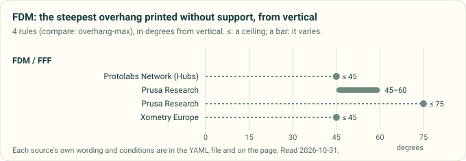

*Diagram drawn by `tools/process_profile_figures.py` from the `compare: overhang-max` rules in [`process-profiles.yaml`](process-profiles.yaml), on published sources read 2026-10-31. A test redraws it and fails if the committed chart differs.*

### Walls, holes, pins and corners

| Rule | Value | Applies when | Source |
|---|---|---|---|
| Minimum wall | ≥ 0.8 mm | Any printer in the network | [Protolabs Network][hubs-3dp-geometry-limits] |
| Thinnest printable wall: one perimeter | 0.45 mm (2: 0.9, 3: 1.35, 4: 1.8 mm) | 0.4 mm nozzle in PrusaSlicer; a wall thinner than one perimeter does not print | [Prusa Research][prusa-modeling-for-3dp] |
| Minimum wall | 0.75 mm supported, 1.0 mm unsupported, or 3 × nozzle | Xometry Europe's service | [Xometry Europe][xometry-eu-fdm-design-tips] |
| Minimum supporting wall | 1.2–1.5 mm (0.047–0.06 in) | Xometry's industrial FDM | Joel Schadegg and Aaron Lichtig, [Xometry][xometry-fdm-mini-guide] |
| Smallest hole that stays round | ≥ 1 mm (0.04 in) | Axis vertical prints best; critical holes drilled after | Joel Schadegg and Aaron Lichtig, [Xometry][xometry-fdm-mini-guide] |
| Vertical holes print undersize | measured 0.25 mm under CAD | One printer and PLA; print a coupon for yours. Drill critical holes | Stefan Hermann, [CNC Kitchen][cnckitchen-heat-set-hole-size]; [Protolabs Network][hubs-fdm-design] |
| Vertical pins below this are perimeters only and weakly joined | 5 mm | Smaller: fillet the base, or a hole and a bought pin | [Protolabs Network][hubs-fdm-design] |
| Minimum pin; minimum column | 1 mm; 2–3 mm | Keep pins short | [Xometry Europe][xometry-eu-fdm-design-tips] |
| Outside corners in the layer plane | radius = nozzle diameter | Never sharp | [Protolabs Network][hubs-fdm-design] |
| Minimum rib | ≥ 1.5 mm (0.06 in) | Several extrusions per rib | Joel Schadegg and Aaron Lichtig, [Xometry][xometry-fdm-mini-guide] |
| Embossed text stroke / engraved text stroke | ≥ 0.8 mm (0.5 mm high) / ≥ 1.0 mm (0.5 mm deep) | Top faces read best | [Xometry Europe][xometry-eu-fdm-design-tips] |

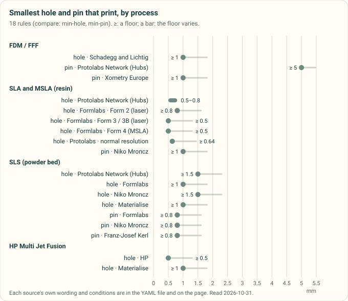

*Diagram drawn by `tools/process_profile_figures.py` from the `compare: min-hole` and `compare: min-pin` rules in [`process-profiles.yaml`](process-profiles.yaml), on published sources read 2026-10-31. A test redraws it and fails if the committed chart differs.*

### Elephant's foot and warping

| Rule | Value | Applies when | Source |
|---|---|---|---|
| First-layer inset (elephant-foot compensation) | about 0.2 mm | 0.4 mm nozzle, PrusaSlicer; on in Prusa's profiles | [Prusa Research][prusa-elephant-foot] |
| Chamfer (or radius) on edges touching the bed | 45° | Where fit or overall size matters; eases removal too | [Protolabs Network][hubs-fdm-design] |
| Typical shrinkage | 0.2–1 % | By material; hotter materials warp more (bottom radius or brim) | [Protolabs Network][hubs-3dp-dimensional-accuracy] |

### Tolerances and clearances

| Rule | Value | Applies when | Source |
|---|---|---|---|
| Expected tolerance | ±0.5 %, floor ±0.5 mm | Desktop (prototyping) FDM | [Protolabs Network][hubs-3dp-dimensional-accuracy] |
| General tolerance | ±0.5 % (±0.5 mm), as printed; the YAML reads the ±0.5 mm as a floor, which Xometry Europe's page does not state | Xometry Europe's standard and industrial machines (up to 900 × 600 × 900 mm) | [Xometry Europe][xometry-eu-fdm-design-tips] |
| Expected tolerance | ±0.15 %, floor ±0.2 mm | Industrial FDM | [Protolabs Network][hubs-3dp-dimensional-accuracy] |
| Tolerance the service holds | ±0.127 mm (±0.005 in) | Xometry's industrial FDM; no size dependence stated | Joel Schadegg and Aaron Lichtig, [Xometry][xometry-fdm-mini-guide] |
| Clearance between mating parts (snap fits) | 0.5 mm | Protolabs Network FDM | [Protolabs Network][hubs-snapfit-3dp] |
| Clearance for parts that move or snap | ≥ 0.3 mm to start | Original Prusa printers, accurate to at least 0.2 mm; test-print | [Prusa Research][prusa-modeling-for-3dp] |
| Clearance for a sliding fit | 0.2–0.3 mm | Mating faces printed vertical | [Xometry Europe][xometry-eu-fdm-design-tips] |

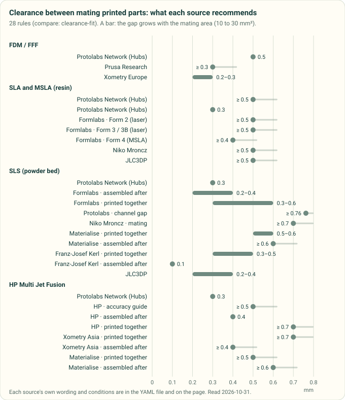

*Diagram drawn by `tools/process_profile_figures.py` from the `compare: clearance-fit` rules in [`process-profiles.yaml`](process-profiles.yaml), on published sources read 2026-10-31; Formlabs' Fuse rules step with the mating area and are drawn from 10 to 30 mm². A test redraws it and fails if the committed chart differs.*

### Threads and inserts

| Rule | Value | Applies when | Source |
|---|---|---|---|
| Smallest thread worth printing | M5 | Below that: insert, tap or self-tapping screw | [Protolabs Network][hubs-3dp-threaded-fasteners] |
| Wall around a thread or insert | ≥ the fastener diameter (M5: 5 mm) | Rule of thumb | [Protolabs Network][hubs-3dp-threaded-fasteners] |
| Offset around an embedded nut | 0.2 mm total (0.1 per side) | Loose fit; more above M12 | [Protolabs Network][hubs-3dp-threaded-fasteners] |
| Self-tapping pilot hole | for 75–80 % thread engagement | When the screw maker gives no size | [Protolabs Network][hubs-3dp-threaded-fasteners] |
| M3 heat-set insert hole, as built | 4.0 mm; pull-out falls sharply above 4.1–4.2 mm | CNC Kitchen's M3 insert | Stefan Hermann, [CNC Kitchen][cnckitchen-heat-set-hole-size] |
| Add to the insert hole in CAD | 0.2–0.3 mm (M3 in PLA: 4.2 mm kept about 90 % of the best pull-out) | Small inserts; size so the insert pre-seats with slight resistance | Stefan Hermann, [CNC Kitchen][cnckitchen-heat-set-hole-size] |
| Blind insert hole depth | insert length + about 1 mm; straight, not tapered, normally no chamfer | Through holes no longer than the insert | Stefan Hermann, [CNC Kitchen][cnckitchen-heat-set-tips] |
| Iron temperature | printing temperature + 10–20 °C; melt 90 % in, press the rest | Resin parts: glue into a stepped hole instead | Stefan Hermann, [CNC Kitchen][cnckitchen-heat-set-tips] |

*A still of the [screw-boss explorer](../docs/screw-bosses.md), a kit demo, drawn by `tools/printed-boss-still.mjs` from the demo's own code (`cadagent.formulas`), on a worked example: a self-tapping DELTA PT 30 screw in a printed PLA boss. The page's explorer changes the screw, the boss and the filament.*

### Where the FDM sources disagree

- **Minimum wall: 0.45 to 1.5 mm.** Prusa's 0.45 mm is one perimeter, the physical floor; Protolabs Network's 0.8 mm
  and Xometry Europe's 0.75–1.0 mm are what a service will accept; Xometry's US guide asks 1.2–1.5 mm for a wall that
  carries load. They measure different things: printable, accepted, and strong. Design walls as whole perimeters.
- **Overhang: 45° to 75°.** 45° is the conservative service rule. Prusa says 45–60° on a 0.4 mm nozzle and up to 75°
  with 360° cooling. The machine decides; the profile should carry the printer.
- **Tolerance: ±0.127 mm to ±0.5 mm.** Xometry's US guide claims ±0.005 in flat. Protolabs Network gives ±0.5 % with
  a ±0.5 mm lower limit for desktop machines. Xometry Europe's table prints "±0.5 % (±0.5 mm)" for its standard and
  industrial machines without saying which governs; the YAML reads it as the same floor, which is our reading, not
  their text. At 50 mm the ±0.5 mm floor against Xometry's US figure is a factor of four [derived].
- **Clearance: 0.2 to 0.5 mm.** Sliding fit 0.2–0.3 mm (Xometry Europe), moving parts from 0.3 mm (Prusa), snap fits
  0.5 mm (Protolabs Network). Xometry Europe's page also gives "0.5 mm clearance for an interference fit", which reads
  as a slip (a clearance cannot make an interference fit); the YAML does not use it.
- **Insert holes.** CNC Kitchen's own data sheet hole (4.0 mm for M3) is right for the hole as built; printed holes
  come out smaller, so the CAD hole is larger. Stefan Hermann published the test that shows this.

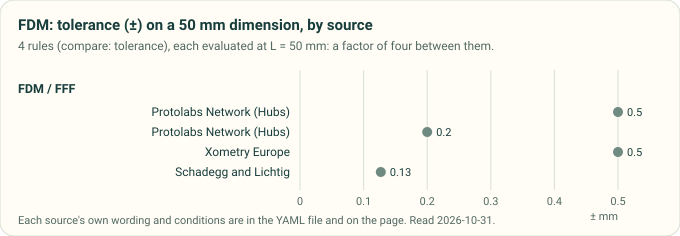

*Diagram drawn by `tools/process_profile_figures.py` from the FDM `compare: tolerance` rules in [`process-profiles.yaml`](process-profiles.yaml), on published sources read 2026-10-31, each evaluated at 50 mm. A test redraws it and fails if the committed chart differs.*

## 3. SLA and MSLA (resin)

This covers laser SLA (Formlabs Form 2 and Form 3, Protolabs, Materialise) and masked SLA on an LCD (Formlabs Form 4,
Prusa SL1, and printers sliced in ELEGOO SatelLite or Lychee). Formlabs runs the same tests on three printers, which
shows how much a resin rule depends on the machine:

| Formlabs test | Form 2 (laser) | Form 3 / 3B (laser) | Form 4 (MSLA) |
|---|---|---|---|
| Minimum wall, supported or unsupported | 0.4 mm | 0.2 mm | 0.2 mm |
| Unsupported overhang: angle from level; length | ≥ 19°; ≤ 3.0 mm | ≥ 10°; ≤ 5.0 mm | ≥ 10°; ≤ 5.0 mm |
| Span between supports (beam 5 mm wide, 3 mm thick) | ≤ 21 mm | ≤ 29 mm | ≤ 29 mm |
| Embossed detail; engraved detail | 0.1 mm; 0.4 mm | 0.1 mm; 0.15 mm | 0.1 mm; 0.15 mm |
| Clearance between parts of one print | 0.5 mm | 0.5 mm | 0.4 mm |
| Hole; drain hole for an enclosed cavity | 0.8 mm; 3.5 mm | 0.5 mm; 2.5 mm | 0.5 mm; 0.75 mm |
| Test resin and layer | Clear, 100 µm | Clear, 100 µm | Grey, 50 µm |
| Source | [Formlabs, Form 2][formlabs-form2-design-specs] | [Formlabs, Form 3][formlabs-form3-design-specs] | [Formlabs, Form 4 guide][formlabs-form4-design-guide] |

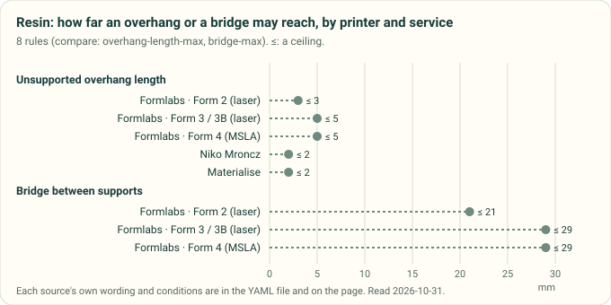

*Diagram drawn by `tools/process_profile_figures.py` from the `compare: overhang-length-max` and `compare: bridge-max` rules in [`process-profiles.yaml`](process-profiles.yaml), on published sources read 2026-10-31. A test redraws it and fails if the committed chart differs.*

| Rule | Value | Applies when | Source |
|---|---|---|---|
| Tolerance, by feature size | ±0.15 % to 30 mm (floor ±0.02 mm); ±0.2 % to 80 mm (floor ±0.06); ±0.3 % to 150 mm (floor ±0.15) | Form 4 generation, Grey resin at 100 µm, three printers | [Formlabs][formlabs-form4-design-guide] |
| LCD pixel size (the XY resolution) | 50 µm | Form 4 is masked SLA; the Form 3 family is laser SLA | [Formlabs][formlabs-form4-technology] |
| Drain holes per hollow cavity | ≥ 2, one as close to the build platform as possible | Hollowing in PreForm or Meshmixer | [Formlabs][formlabs-hollowing-blog] |
| Minimum wall; hole; X-Y feature | 0.254 mm; 0.635 mm; 0.254 mm (Z 0.406) | Protolabs normal resolution; micro resolution goes to 0.0635 mm walls and 0.381 mm holes | [Protolabs][protolabs-sla-guidelines] |
| X/Y tolerance | ±0.05 mm + 0.1 % (Z ±0.127 mm + 0.1 %) | Well-designed parts | [Protolabs][protolabs-sla-guidelines] |
| Minimum wall, supported / unsupported | 0.4 / 0.6 mm | | Niko Mroncz, [Xometry Asia][xometry-sla-design-tips] |
| Pin; slot | ≥ 1 mm; ≥ 0.5 mm | | Niko Mroncz, [Xometry Asia][xometry-sla-design-tips] |
| Clearance, moving parts and assemblies | ≥ 0.5 mm (snug fit about 0.1 mm) | | Niko Mroncz, [Xometry Asia][xometry-sla-design-tips] |
| Hollow wall; drain hole | ≥ 2 mm; ≥ 3.5 mm, one per hollow section | | Niko Mroncz, [Xometry Asia][xometry-sla-design-tips] |
| Unsupported overhang | ≤ 2 mm long, ≥ 30° | | Niko Mroncz, [Xometry Asia][xometry-sla-design-tips] |
| Corner radius | ≥ 0.5 mm; inside ≥ half the wall, outside ≥ 1.5 × the wall | | Niko Mroncz, [Xometry Asia][xometry-sla-design-tips] |
| Embossed; engraved; text | 0.5 high × 0.4 wide; 0.5 × 0.5 mm; ≥ 1 mm tall, 2 mm better | | Niko Mroncz, [Xometry Asia][xometry-sla-design-tips] |
| Tolerance | ±0.5 % (±0.2 mm) standard, ±0.15 mm industrial | The YAML reads it as 0.5 % with a 0.2 mm floor | Niko Mroncz, [Xometry Asia][xometry-sla-design-tips] |
| Minimum wall, by size | 1 mm (x + y + z under 200 mm), 2 mm (200–400 mm), 3 mm (larger) | Taurus | [Materialise][materialise-taurus-sla-guidelines] |
| Surfaces that need no support; ledges | ≥ 30° (the rule of 30°); ≤ 2 mm | Inside and outside | [Materialise][materialise-taurus-sla-guidelines] |
| Hole for removing internal supports | ≥ 10 mm | Hollow parts | [Materialise][materialise-taurus-sla-guidelines] |
| Text line and depth; accuracy | ≥ 0.5 mm; ±0.2 %, floor ±0.2 mm | | [Materialise][materialise-taurus-sla-guidelines] |
| Minimum wall, by footprint | 0.5 mm (5 × 5 mm) to 2.0 mm (200 × 200 mm) | Resin | [JLC3DP][jlc3dp-design-guideline] |
| Clearance, moving / assembled; escape hole | 0.5 / 0.2 mm; ≥ 2.5 mm, two if under 3 mm | | [JLC3DP][jlc3dp-design-guideline] |
| Embossed or engraved; tolerance | 0.8 × 0.8 mm; ±0.2 mm to 100 mm, ±0.3 % above | Parts drift a further 0.15–0.2 mm in the first week | [JLC3DP][jlc3dp-design-guideline] |
| Hollow shell; drain holes | ≥ 1 mm (the tool's floor); ≥ 2 | SL1, SL1S (MSLA) | [Prusa Research][prusa-hollowing-kb] |
| Hollow wall; drain hole | 1–3 mm; 2–6 mm across, ≥ 2 at the lowest point | ELEGOO SatelLite | [ELEGOO][elegoo-satellite-hollowing] |
| Hollow wall | 2.5 mm default; 1.5–2 mm miniatures; 3–4 mm strong parts | Lychee Slicer | [Mango3D (Lychee Slicer)][lychee-voxels-hollowing] |

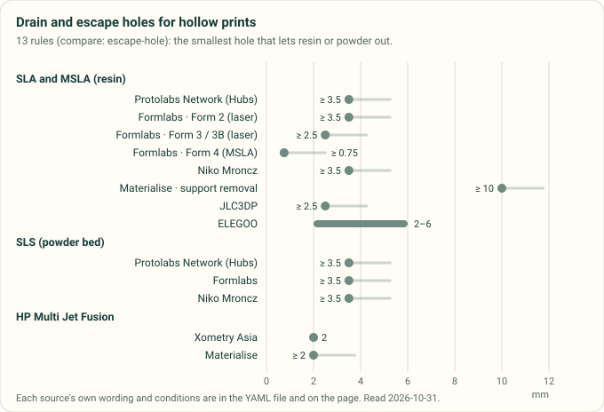

*Diagram drawn by `tools/process_profile_figures.py` from the `compare: escape-hole` rules in [`process-profiles.yaml`](process-profiles.yaml), on published sources read 2026-10-31. A test redraws it and fails if the committed chart differs.*

From Protolabs Network's [SLA guide][hubs-sla-design]:

Protolabs Network's SLA rules: walls, holes, hollowing, clearance, detail, bridges and tolerance

| Rule | Value | Applies when | Source |
|---|---|---|---|
| Minimum wall, supported / unsupported | ≥ 0.4 mm / ≥ 0.6 mm (fillet the base) | Supported: joined on at least two sides | [Protolabs Network][hubs-sla-design] |
| Minimum wall | ≥ 0.5 mm | SLA/DLP, cross-process table | [Protolabs Network][hubs-3dp-geometry-limits] |
| Unsupported overhang | ≤ 1.0 mm long and at least 19° from level | Only without supports (not advised) | [Protolabs Network][hubs-sla-design] |
| Minimum hole | 0.5 mm (table) or 0.8 mm (text) | The guide gives both; use 0.8 mm | [Protolabs Network][hubs-sla-design] |
| Hollow wall; drain hole | ≥ 2 mm; ≥ 3.5 mm, one per hollow section | Trapped resin causes cupping and cracks | [Protolabs Network][hubs-sla-design] |
| Clearance: moving / assembly / snug | 0.5 / 0.2 / 0.1 mm | Protolabs Network SLA | [Protolabs Network][hubs-sla-design] |
| Clearance between mating parts (snap fits) | 0.3 mm | Also SLS, MJF | [Protolabs Network][hubs-snapfit-3dp] |
| Embossed detail; engraved detail | ≥ 0.1 mm high; ≥ 0.4 mm wide and deep | | [Protolabs Network][hubs-sla-design] |
| Longest wide bridge | < 21 mm | Wide bridges peel harder | [Protolabs Network][hubs-sla-design] |
| Expected tolerance | ±0.5 %, floor ±0.10 mm (desktop); ±0.15 %, floor ±0.01 mm (industrial) | | [Protolabs Network][hubs-3dp-dimensional-accuracy] |

### Where the resin sources disagree

- **Protolabs Network's numbers are Formlabs' Form 2 numbers.** Its 19° overhang, 21 mm bridge, 0.4 mm engraving and
  0.8 mm hole all match the Form 2 sheet (and so do its 3.5 mm drain hole and 0.4 mm supported wall); Form 3 and
  Form 4 are finer on almost every line. That may also explain its own 0.5 against 0.8 mm hole. A profile should
  carry the printer, not just "SLA".
- **Drain hole: 0.75 to 3.5 mm.** 0.75 mm on Form 4, 2.5 mm on Form 3 and JLC3DP, 3.5 mm on Form 2, at Xometry and at
  Protolabs Network; ELEGOO says 2–6 mm. Materialise's 10 mm is for pulling supports out, not draining.
- **Minimum wall: 0.2 to 0.6 mm, or by size.** Formlabs 0.2 mm (Form 3, Form 4), Protolabs 0.254 mm, Xometry and
  Protolabs Network 0.4 supported and 0.6 unsupported. Materialise (1–3 mm) and JLC3DP (0.5–2 mm) scale the wall with
  the part, which none of the others do.
- **Overhang: 1 to 5 mm, 10° to 30°.** Formlabs 5 mm at 10°; Xometry 2 mm at 30°; Materialise a 2 mm ledge and the
  rule of 30°; Protolabs Network 1 mm at 19°.
- **Tolerance at 50 mm: ±0.1 to ±0.25 mm** [derived]: Formlabs Form 4 ±0.1, Protolabs ±0.1, Materialise ±0.2,
  JLC3DP ±0.2, Xometry ±0.25 (and Protolabs Network ±0.25 desktop, ±0.075 industrial).
- **Formlabs against itself.** The Form 3 support page gives a 2.5 mm drain hole and 0.5 mm clearance; the Form 4
  guide's Form 3 column gives 0.75 mm and 0.4 mm and says the values "did not change". The tests differ (Clear resin at
  100 µm against Grey at 50 µm); the YAML keeps both, each with its test.
- **Protolabs' high-resolution X-Y feature** prints 0.005 in beside 0.1016 mm; 0.005 in is 0.127 mm. The YAML uses
  the normal-resolution row only.

## 4. SLS (polymer powder bed)

| Rule | Value | Applies when | Source |
|---|---|---|---|
| Pin; hole | ≥ 0.8 mm; ≥ 1.0 mm (most accurate with the axis along Z) | Fuse, Nylon 12 | [Formlabs][formlabs-fuse-sls-design-guide] |
| Unsupported wall | ≥ 0.6 mm vertical; ≥ 0.3 mm horizontal | Fuse, Nylon 12 | [Formlabs][formlabs-fuse-sls-design-guide] |
| Escape holes | ≥ 3.5 mm, at least two per cavity | | [Formlabs][formlabs-fuse-sls-design-guide] |
| Embossed; engraved, on a horizontal face | 0.15 deep × 0.35 wide; 0.1 × 0.3 mm (vertical faces 0.35 × 0.4; 0.15 × 0.35) | | [Formlabs][formlabs-fuse-sls-design-guide] |
| Clearance, assembled after / printed together | 0.2 / 0.3 mm for features under 20 mm², 0.4 / 0.6 mm above | ≥ 1 mm printed together in Nylon 11 and TPU 90A | [Formlabs][formlabs-fuse-sls-design-guide] |
| Lattice gap; space between parts | ≥ 8 mm; ≥ 5 mm (tilt flat parts about 20°) | Depowdering in Fuse Sift; packing | [Formlabs][formlabs-fuse-sls-design-guide] |
| Minimum wall; minimum feature | 0.762 mm; 0.762 mm nylons, 1.01 mm PP and TPU | | [Protolabs][protolabs-sls-guidelines] |
| Tolerance | ±0.25 mm + 0.1 % | Well-designed parts | [Protolabs][protolabs-sls-guidelines] |
| Uniform thickness against warp | 3.175 mm | Parts over 178 mm are most at risk | [Protolabs][protolabs-sls-guidelines] |
| Channel gap; shell for a thick feature | ≥ 0.762 mm; 2.54–3.175 mm | SLS and MJF | [Protolabs][protolabs-nylon-design-tip] |
| Minimum wall | 0.5 mm (PA 12) to 2.0 mm by material; 1.5 mm for repeatable results | | Niko Mroncz, [Xometry Asia][xometry-sls-design-tips] |
| Escape hole; hole | ≥ 3.5 mm; ≥ 1.5 mm | | Niko Mroncz, [Xometry Asia][xometry-sls-design-tips] |
| Clearance: mating / press fit / articulated | 0.7 / 0.5 / 0.6 mm | | Niko Mroncz, [Xometry Asia][xometry-sls-design-tips] |
| Pin; text | ≥ 0.8 mm (1 mm better); 1 mm high or deep, font ≥ 2 mm | | Niko Mroncz, [Xometry Asia][xometry-sls-design-tips] |
| Shrinkage to allow; tolerance | 3–4 %; ±0.3 mm | | Niko Mroncz, [Xometry Asia][xometry-sls-design-tips] |
| Tolerance | ±0.381 mm or ±0.2 %, the greater (Nylon 12); ±0.508 mm or ±0.3 % (Nylon 11) | US service | [Xometry][xometry-sls-service] |
| Minimum wall; living hinge | ≥ 1 mm; 0.3 mm | PA 12 | [Materialise][materialise-pa12-sls-guidelines] |
| Clearance, printed together / assembled after | 0.5–0.6 / 0.6 mm | | [Materialise][materialise-pa12-sls-guidelines] |
| Hole; internal channel | ≥ 1 mm; ≥ 3 mm | | [Materialise][materialise-pa12-sls-guidelines] |
| Walls the service may hollow; accuracy | above 9 mm (by default above 20 mm); ±0.3 %, floor ±0.3 mm | | [Materialise][materialise-pa12-sls-guidelines] |
| Wall | 0.45 mm (Formiga P100) to 0.7 mm possible; 1.5 mm for reproducible properties | XY | Franz-Josef Kerl, [EOS (2011)][eos-design-rules-overview-ls] |
| Pin | ≥ 0.8 mm; 1.8 mm for reproducible properties | | Franz-Josef Kerl, [EOS][eos-design-rules-overview-ls] |
| Gap: hinge printed in place / loose connection | 0.3–0.5 mm in XY (Z at least three layers) / 0.1 mm | | Franz-Josef Kerl, [EOS][eos-design-rules-overview-ls] |
| Faces to keep off the XY plane | angles under 20° show layer steps | | Franz-Josef Kerl, [EOS][eos-design-rules-overview-ls] |
| Smallest gap or hole, rising with the wall **(u)** | 0.5–0.8 mm for walls 0.3–6 mm | Read from a chart | Franz-Josef Kerl, [EOS][eos-design-rules-overview-ls] |
| Minimum wall, by footprint; clearance | 1.0–2.0 mm; 0.2–0.4 mm | Nylon SLS | [JLC3DP][jlc3dp-design-guideline] |

From Protolabs Network:

Protolabs Network's SLS rules: walls, holes, clearance, detail, radii, living hinges and tolerance

| Rule | Value | Applies when | Source |
|---|---|---|---|
| Minimum wall | 0.8 mm (PA 12) to 2.0 mm (carbon-filled PA) | | [Protolabs Network][hubs-sls-design] |
| Minimum wall | ≥ 0.7 mm | Cross-process table | [Protolabs Network][hubs-3dp-geometry-limits] |
| Minimum hole; escape hole | > 1.5 mm; ≥ 3.5 mm | Hollow parts and enclosed clearances | [Protolabs Network][hubs-sls-design] |
| Clearance | 0.3 mm; 0.2 mm ball in socket; 2 mm round a running axle | So the powder can be cleared | [Protolabs Network][hubs-sls-design] |
| Minimum feature; engrave and emboss | 0.8 mm; 1 mm, text at least 2 mm high | | [Protolabs Network][hubs-sls-design] |
| Edge and corner radius as printed | 0.4 mm; more than 2 mm where stress matters | | [Protolabs Network][hubs-sls-design] |
| Living hinge | 0.3–0.8 mm thick, at least 5 mm long; anneal and flex | SLS nylon | [Protolabs Network][hubs-sls-design] |
| Scale applied before printing | 3–3.5 % | Done by the service | [Protolabs Network][hubs-sls-design] |
| Expected tolerance | ±0.3 %, floor ±0.3 mm | SLS and MJF | [Protolabs Network][hubs-3dp-dimensional-accuracy] |

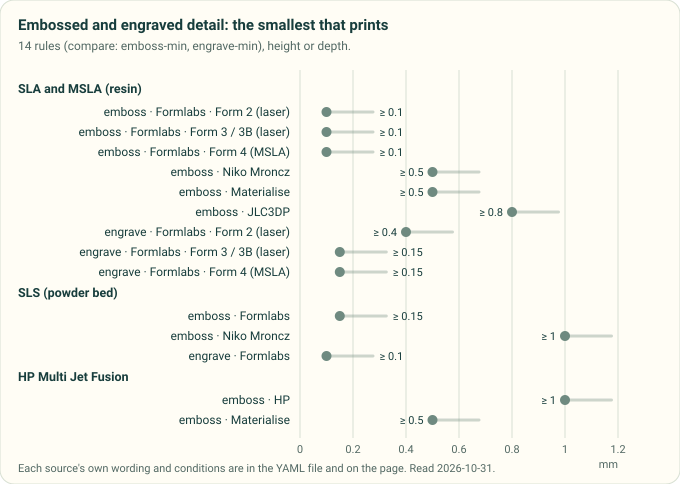

*Diagram drawn by `tools/process_profile_figures.py` from the `compare: emboss-min` and `compare: engrave-min` rules in [`process-profiles.yaml`](process-profiles.yaml), on published sources read 2026-10-31. A test redraws it and fails if the committed chart differs.*

### Where the SLS sources disagree

- **Minimum wall: 0.3 to 2 mm.** Formlabs 0.3 mm horizontal and 0.6 mm vertical; Protolabs Network 0.7–0.8 mm;
  Protolabs 0.762 mm; Materialise 1 mm; JLC3DP 1–2 mm by size; Xometry 0.5–2 mm by material. Xometry (1.5 mm) and
  EOS (1.5 mm) give a second, thicker number for walls that must be repeatable or carry their full properties. As
  with FDM, these are printable, accepted and reliable.
- **Clearance printed together: 0.3 to 0.76 mm.** Formlabs 0.3 or 0.6 mm by area, EOS 0.3–0.5 mm, Materialise
  0.5–0.6 mm, Xometry 0.6 mm articulated, Protolabs 0.762 mm channel gaps. **Assembled after printing: 0.1 to 0.7 mm**:
  EOS 0.1 mm "loose", Formlabs 0.2–0.4, Materialise 0.6, Xometry 0.7 mm for mating parts.
- **Hole: 1.0 mm** (Formlabs, Materialise) against **1.5 mm** (Xometry, Protolabs Network). **Escape hole: 3.5 mm**
  (Formlabs, Xometry, Protolabs Network) against **2.5 mm** (JLC3DP).
- **Tolerance agrees** at about ±0.3 mm at 50 mm [derived]: Protolabs ±0.30, Materialise ±0.3, Protolabs Network ±0.3,
  JLC3DP ±0.3, Xometry US ±0.381.

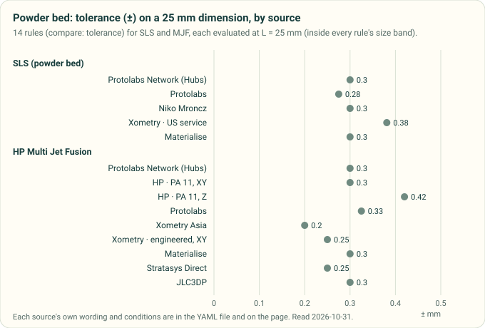

*Diagram drawn by `tools/process_profile_figures.py` from the SLS and MJF `compare: tolerance` rules in [`process-profiles.yaml`](process-profiles.yaml), on published sources read 2026-10-31, each evaluated at 25 mm. A test redraws it and fails if the committed chart differs.*

## 5. HP Multi Jet Fusion

| Rule | Value | Applies when | Source |
|---|---|---|---|
| Hole through a 1 mm wall; shaft 10 mm tall | ≥ 0.5 mm; ≥ 0.5 mm | X, Y and Z | [HP, MJF handbook][hp-mjf-handbook-design-for-accuracy] |
| Clearance at 1 mm thickness; slit between walls | ≥ 0.5 mm | | [HP][hp-mjf-handbook-design-for-accuracy] |
| Detail width; embossed or engraved height | ≥ 0.1 mm (letters ≥ 6 pt); ≥ 1 mm for the best result | | [HP][hp-mjf-handbook-design-for-accuracy] |
| Long, thin, flat parts | length ≤ 10 × width | Warpage | [HP][hp-mjf-handbook-design-for-accuracy] |
| Short wall, XY / Z | ≥ 0.3 / ≥ 0.5 mm | PA 12, PA 12 GB, PA 11 | [HP][hp-learning-design-3d-print-model] |
| Gap, assembled after / printed together | 0.4 mm (±0.2 on each part) / ≥ 0.7 mm (0.3 mm if walls are under 3 mm) | | [HP][hp-learning-design-3d-print-model] |
| Hollow wall | ≥ 2 mm | | [HP][hp-learning-design-3d-print-model] |
| Printed threads; tolerance machining adds | ≥ M6 (else self-tapping screws or inserts); ±0.05 mm | | [HP][hp-learning-joint-design] |
| Tolerance at Cpk 1.33, up to 30 mm | XY ±0.30, Z ±0.42 mm (up to 80 mm: ±0.44, ±1.18) | Jet Fusion 5200, PA 11, default settings | [HP][hp-5200-dimensional-capability] |
| Wall; minimum feature | ≥ 0.5 mm | | [Protolabs][protolabs-mjf-guidelines] |
| Tolerance | ±0.30 mm + 0.1 % | Well-designed parts | [Protolabs][protolabs-mjf-guidelines] |
| Wall that keeps tolerance and warp in check | 2.5–12.7 mm | | [Protolabs][protolabs-mjf-design-tip] |
| Knife edge | ≥ 0.508 mm | | [Protolabs][protolabs-nylon-design-tip] |
| Short wall, XY | ≥ 0.3 mm (0.4 mm in Z) | | [Xometry Asia][xometry-mjf-design-guidelines] |
| Clearance, printed together / assembled after | 0.7 / 0.4 mm | More for walls over 50 mm | [Xometry Asia][xometry-mjf-design-guidelines] |
| Drain holes; lattice gap | 2 mm, at least two; ≥ 1 mm | | [Xometry Asia][xometry-mjf-design-guidelines] |
| Tolerance | ±0.2 mm to 100 mm, 0.2 % above | After sand-blasting | [Xometry Asia][xometry-mjf-design-guidelines] |
| Minimum feature | 0.508 mm (1.016 mm recommended) | US service | [Xometry][xometry-mjf-service] |
| Tolerance under 30 mm | XY ±0.25, Z ±0.42 mm after engineering review; ±0.70 mm without | HP 5200, rigid materials | [Xometry][xometry-mjf-service] |
| Wall; living hinge | ≥ 1 mm; 0.5 mm, at most 10 mm long held at one end (25 mm at both) | PA 12 | [Materialise][materialise-pa12-mjf-guidelines] |
| Escape holes; hollowing | ≥ 2 mm, at least two; hollow walls over 20 mm to 2–3 mm | | [Materialise][materialise-pa12-mjf-guidelines] |
| Hole; internal channel | ≥ 1 mm (2 mm recommended); ≥ 3 mm | | [Materialise][materialise-pa12-mjf-guidelines] |
| Clearance, printed together / assembled after | 0.5 / 0.6 mm | | [Materialise][materialise-pa12-mjf-guidelines] |
| Text; accuracy | 0.5 mm line, 1 mm deep, 2.5 mm tall; ±0.3 %, floor ±0.3 mm | | [Materialise][materialise-pa12-mjf-guidelines] |
| Wall | 0.5–3.0 mm | Thicker walls sink and warp | [Stratasys Direct][stratasys-direct-mjf-design-guide] |
| Interior fillet; knife edge; living hinge | ≥ 0.4 mm; ≥ 0.5 mm; ≥ 0.5 mm, annealed for more than a few cycles | | [Stratasys Direct][stratasys-direct-mjf-design-guide] |
| Bonded lap overlap; boss round an insert | 3–5 × the wall; 2–3 × the insert diameter | Heat staking preferred | [Stratasys Direct][stratasys-direct-mjf-design-guide] |
| Tolerance | ±0.25 mm or ±0.1 %, the greater | | [Stratasys Direct][stratasys-direct-mjf-design-guide] |
| Minimum wall, by footprint; tolerance | 1.0–2.0 mm; ±0.3 mm to 100 mm, ±0.4 % above | Nylon MJF | [JLC3DP][jlc3dp-design-guideline] |
| Minimum wall | ≥ 0.5 mm | Cross-process table | [Protolabs Network][hubs-3dp-geometry-limits] |
| Snap-fit base thickness and hook depth; clip width | ≥ 1 mm; ≥ 5 mm | | [Protolabs Network][hubs-snapfit-3dp] |
| Strain to failure across the layers | 0.53–0.70 of XY (strength the same) | PA 12, PA 11, PP on the Jet Fusion 5200 | [HP][hp-mjf-5200-properties] |
| Expected tolerance | ±0.3 %, floor ±0.3 mm | SLS and MJF | [Protolabs Network][hubs-3dp-dimensional-accuracy] |

### Where the MJF sources disagree

- **Thinnest wall: 0.3 to 2 mm.** HP and Xometry 0.3 mm, but for short walls; Protolabs, Stratasys Direct and the
  Protolabs Network table 0.5 mm; Materialise 1 mm; JLC3DP 1–2 mm by size. **And a ceiling:** Stratasys Direct keeps
  walls at or under 3 mm, while Protolabs calls 2.5–12.7 mm ideal.
- **Clearance printed together: 0.5 or 0.7 mm, from HP itself.** HP's accuracy chapter and Stratasys Direct say
  0.5 mm at 1 mm thickness; HP's design page and Xometry say 0.7 mm; Materialise 0.5 mm. Assembled after printing:
  0.4 mm (HP, Xometry) or 0.6 mm (Materialise).
- **Minimum detail: 0.1 mm** (HP) against **0.5 mm** (Protolabs, Stratasys Direct, Xometry).
- **Tolerance under 30 mm: ±0.2 to ±0.3 mm in XY, and Z is worse.** HP's own Cpk 1.33 figures for PA 11 are ±0.30
  XY and ±0.42 mm Z; Xometry Asia states ±0.2 mm and Stratasys Direct ±0.25 mm without an axis. At 80 mm, HP's Z
  tolerance (±1.18 mm) is 2.7 times its XY one [derived], so a tight fit belongs in the XY plane.
- **Stratasys Direct's conversions:** 0.015 in is printed as 0.4 mm (it is 0.381 mm), and 0.010 in as both 0.4 and
  0.3 mm (it is 0.254 mm). The YAML keeps the printed inch values.

## 6. Injection moulding

The sources here are resin makers (DuPont, Covestro), a moulder that publishes its tooling limits (Protolabs) and two
online bureaus (Fictiv, and the Boothroyd Dewhurst checklist for screening). T below is the nominal wall.

### Wall

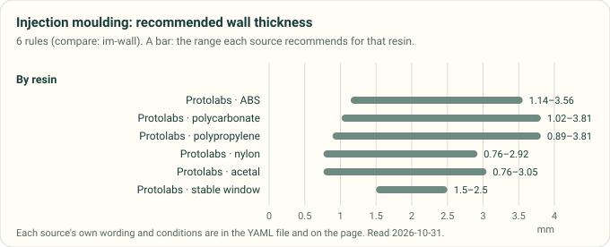

*Diagram drawn by `tools/process_profile_figures.py` from the `compare: im-wall` rules in [`process-profiles.yaml`](process-profiles.yaml), on published sources read 2026-10-31. A test redraws it and fails if the committed chart differs.*

| Rule | Value | Applies when | Source |
|---|---|---|---|
| Recommended wall, by resin | ABS 1.14–3.56; PC 1.02–3.81; PP 0.89–3.81; nylon 0.76–2.92; acetal 0.76–3.05 mm | Protolabs' table, which it credits to manufacturingcenter.com | [Protolabs][protolabs-injection-molding] |
| Wall that moulds stably | 1.5–2.5 mm; small parts 1 mm, hand-sized 2 mm; sections near 3.8 mm start to sink | Thermoplastics in general | [Protolabs][protolabs-im-ribs-gussets] |
| Thin-walled part | main walls under 1.5 mm need high-performance moulding | | [Covestro][covestro-part-mold-design] |
| Variation of the nominal wall | up to about 25 % | Low-shrinkage resins (most amorphous and filled grades) | [Covestro][covestro-part-mold-design] |
| Critical thickness of polycarbonate | about 4.76 mm (3/16 in); thicker walls can fail brittle on impact | Medium-viscosity PC at room temperature; less when cold | [Covestro][covestro-part-mold-design] |

### Draft

| Rule | Value | Applies when | Source |
|---|---|---|---|
| Draft | 0.5° vertical faces; 2° most situations; 3° shut-offs and light texture (PM-T1); 5° or more PM-T2 | | [Protolabs][protolabs-injection-molding] |
| Draft | ≥ 0.5°, 1° preferred; 3–5° for Apec high-heat PC and TPU | Covestro resins | [Covestro][covestro-part-mold-design] |
| Draft | 1–2° smooth; 3° light texture; 5° or more heavy texture | | [Fictiv][fictiv-im-design-guide] |
| Draft, Table 3.01 | Delrin 0–¼° under 25.4 mm deep (½° deeper); reinforced nylons ¼–½° (½–1° deeper) | DuPont resins, smooth finish | [DuPont][dupont-design-module-1] |
| Extra draft for texture | 1° per 0.001 in of depth (DuPont); 1° plus 1° per 0.001 in (Covestro); 1.5° per 0.001 in (Fictiv) | | [DuPont][dupont-design-module-1]; [Covestro][covestro-part-mold-design]; [Fictiv][fictiv-im-design-guide] |

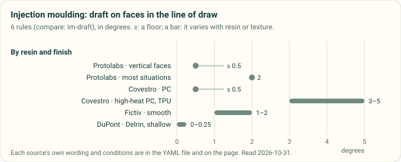

*Diagram drawn by `tools/process_profile_figures.py` from the `compare: im-draft` rules in [`process-profiles.yaml`](process-profiles.yaml), on published sources read 2026-10-31. A test redraws it and fails if the committed chart differs.*

### Ribs and gussets

| Rule | Value | Applies when | Source |
|---|---|---|---|
| Rib or gusset thickness | ≤ 0.6 T | Avoids sink where the rib meets the wall | [Protolabs][protolabs-im-ribs-gussets]; [Boothroyd Dewhurst][dfma-dfm-checklist] |
| Rib thickness | 0.5–0.6 T | | [Fictiv][fictiv-im-design-guide] |
| Rib base thickness (Table 2-1) | 0.5 T for minimal sink (0.4 T on high gloss; filled grades 0.55–0.6 T); 0.66 T if slight sink is acceptable | Covestro PC, PC/ABS, PC/PET and TPU | [Covestro][covestro-part-mold-design] |
| Rib thickness | 0.4 T for appearance to 0.6 T for structure | Figure 4.07, read from the rendered figure (no text layer) | [DuPont][dupont-design-module-1] |
| Rib height | ≤ 2.5 T | Several short ribs if taller | [Fictiv][fictiv-im-design-guide] |
| Rib height | ≤ 3 × the rib base | Fill, venting and ejection | [Covestro][covestro-part-mold-design] |
| Rib spacing; rib draft | ≥ 2 T between short ribs; ≥ 0.5° per side | | [Covestro][covestro-part-mold-design] |
| Fillet at the rib base | 0.5 × the rib (DuPont); 0.125 T (Covestro); 0.25–0.5 T but at most 0.254 mm (Fictiv) | | [DuPont][dupont-design-module-1]; [Covestro][covestro-part-mold-design]; [Fictiv][fictiv-im-design-guide] |
| Gusset thickness | 0.5–0.67 T where sink matters | | [Covestro][covestro-part-mold-design] |

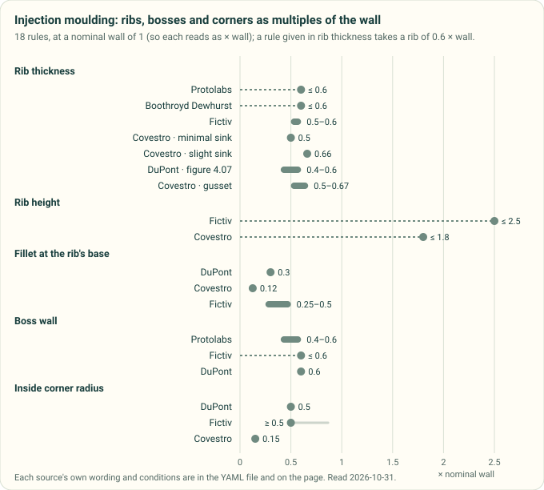

*Diagram drawn by `tools/process_profile_figures.py` from the rib `compare` rules in [`process-profiles.yaml`](process-profiles.yaml), on published sources read 2026-10-31, at a nominal wall of 1 so each reads as a multiple of it. A test redraws it and fails if the committed chart differs.*

### Bosses and inserts

| Rule | Value | Applies when | Source |
|---|---|---|---|
| Boss wall | 0.4–0.6 × the wall it rises from | Add gussets rather than thicken | [Protolabs][protolabs-im-bosses] |
| Boss wall | ≤ 0.6 T | | [Fictiv][fictiv-im-design-guide] |
| Boss wall | 0.6 T under 3.175 mm walls, 0.4 T above | Figure 3.10, read from the rendered figure (no text layer) | [DuPont][dupont-design-module-1] |
| Boss outside diameter | 2–2.5 × the hole (DuPont); 2.0–2.4 × the screw or insert (Covestro) | | [DuPont][dupont-design-module-1]; [Covestro][covestro-part-mold-design] |
| Boss draft | 0.5–3°, by height; or mould solid and drill | | [Protolabs][protolabs-im-bosses] |
| Boss height | over 5 × its outside diameter is tall (thick base, sink) | | [Covestro][covestro-part-mold-design] |
| Pilot hole for a thread-cutting screw | 0.88 × the screw's outside diameter | Polycarbonate | [Covestro][covestro-part-mold-design] |
| Material under a moulded-in insert | ≥ 1/6 of the insert diameter | Limits sink | [DuPont][dupont-design-module-1] |

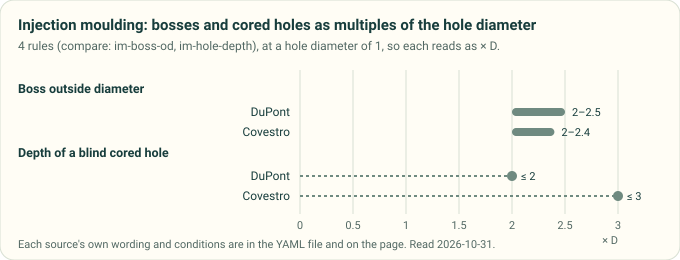

*Diagram drawn by `tools/process_profile_figures.py` from the `compare: im-boss-od` and `compare: im-hole-depth` rules in [`process-profiles.yaml`](process-profiles.yaml), on published sources read 2026-10-31, at a hole diameter of 1 so each reads as a multiple of it. A test redraws it and fails if the committed chart differs.*

### Corners, holes, gates and undercuts

| Rule | Value | Applies when | Source |
|---|---|---|---|
| Inside corner radius | 0.5 T (DuPont; Fictiv as a minimum); 0.15 T (Covestro); outside = inside + T (Fictiv, Covestro) | | [DuPont][dupont-design-module-1]; [Fictiv][fictiv-im-design-guide]; [Covestro][covestro-part-mold-design] |
| Smallest corner radius | 0.508 mm (0.020 in) | Even where a sharp edge is wanted | [DuPont][dupont-design-module-1] |
| Blind cored hole depth | ≤ 2 × D (DuPont); ≤ 3 × D, 5 × D only with symmetric slow filling (Covestro) | D the core pin | [DuPont][dupont-design-module-1]; [Covestro][covestro-part-mold-design] |
| Core supported at both ends; floor under a blind hole | 6 × D (up to 10 × D); ≥ D/6 | | [Covestro][covestro-part-mold-design]; [DuPont][dupont-design-module-1] |
| Gate thickness | ≥ 0.5 T unfilled; 2/3 T cosmetic parts; down to 1/3 T for filled polyamides; ≥ 0.8 T for walls under 1.5 mm | | [Covestro][covestro-part-mold-design] |
| Fan-gate land | ≤ 1.524 mm (0.060 in) | | [Covestro][covestro-part-mold-design] |
| Strippable undercut | ≤ 5 % of the diameter, bevelled (Delrin); 6–10 % (Zytel); 1 % glass-reinforced (2 % from a hot mould) | | [DuPont][dupont-design-module-1] |
| Strippable undercut | ≤ 2 % (Apec high-heat PC, filled grades); TPU about 5 %, up to 10 %; avoid in stiff PC and PC/ABS | | [Covestro][covestro-part-mold-design] |
| Tolerance | ±0.08 mm machining, plus at least ±0.002 mm/mm for the resin | Protolabs aluminium tooling | [Protolabs][protolabs-injection-molding] |
| Part depth from the parting line | ≤ 101.6 mm (203.2 mm if the parting line runs through the middle) | Protolabs | [Protolabs][protolabs-injection-molding] |

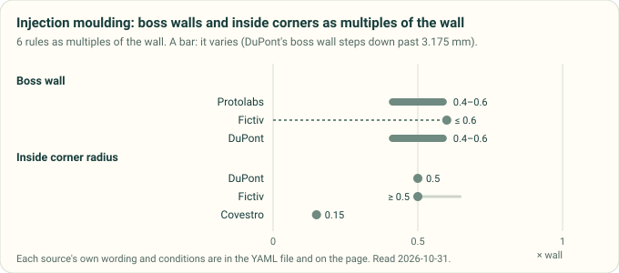

*Diagram drawn by `tools/process_profile_figures.py` from the `compare: im-boss-wall` and `compare: im-corner` rules in [`process-profiles.yaml`](process-profiles.yaml), on published sources read 2026-10-31, as multiples of the nominal wall. A test redraws it and fails if the committed chart differs.*

### Where the moulding sources disagree

- **Rib thickness: 0.4 T to 0.66 T.** ≤ 0.6 T (Protolabs, Boothroyd Dewhurst), 0.5–0.6 T (Fictiv), 0.5 T for
  minimal sink or 0.66 T for slight sink (Covestro), 0.4–0.6 T (DuPont, from a figure). They agree once the cosmetic
  goal is stated: high gloss wants 0.4 T, hidden faces can take 0.66 T.
- **Rib height: 2.5 T against 3 × the rib.** With a 0.5 T rib, Covestro's limit is 1.5 T, so Fictiv allows ribs 1.7
  times taller [derived].
- **Fillet at the rib base.** At T = 2.5 mm and a 1.25 mm rib: DuPont 0.63 mm, Covestro 0.31 mm, Fictiv
  0.63–1.25 mm [derived]. Fictiv's own 0.254 mm cap is below its range for any wall over about 1 mm, and below
  DuPont's 0.508 mm smallest radius; it reads as a slip.
- **Inside corners: 0.5 T** (DuPont, Fictiv) **against 0.15 T** (Covestro, which calls it a compromise between
  strength and appearance).
- **Texture draft at 0.05 mm depth: 2° to 3°** [derived]: DuPont adds 2°, Covestro gives 3° in all, Fictiv adds 3°.
  Covestro counts its 1° base inside the rule; DuPont and Fictiv add to the smooth-face draft.
- **Blind hole depth: 2 × D** (DuPont) **against 3 × D** (Covestro).
- **Standards.** Tolerances for moulded parts are set by ISO 20457. Its 2018 edition was withdrawn on 2026-08-06 and
  replaced by ISO 20457:2026; DIN 16742 (which followed DIN 16901) is withdrawn. Both are paid and were not read; no
  rule here takes a value from them.

## 7. Sheet metal

Symbols: T thickness, R inside bend radius, K K-factor. The deep sheet-metal sweep, with more sources (OSH Cut, Fictiv,
PEM, the CAD tools), is in #119; the rows here are the profile values, with the same source ids. A shop's own table
beats all of them: SendCutSend publishes its tooling per stock size, and ten 5052 and mild-steel rows are in the YAML
(`shop_tables`).

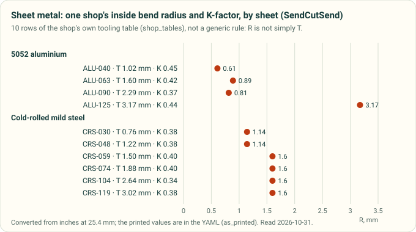

*Diagram drawn by `tools/process_profile_figures.py` from the SendCutSend tooling table in [`process-profiles.yaml`](process-profiles.yaml) (`shop_tables`), read 2026-10-31. A test redraws it and fails if the committed chart differs.*

### Bend radius and K-factor

| Rule | Value | Applies when | Source |
|---|---|---|---|
| Minimum inside bend radius | R ≥ T | Generic | [Protolabs Network][hubs-sheet-metal]; Greg Paulsen, [Machine Design][paulsen-2017-machine-design-sheet-metal]; [Boothroyd Dewhurst][dfma-dfm-checklist] |
| Minimum inside bend radius | R ≥ T; coining nearly 0; air bending 1–2T, set by the V-die | Mild steel 0.02–0.13 in; 3003 and 5052 about the same | Gerald Davis, [The FABRICATOR][davis-2001-fabricator-design-tips] |
| Minimum inside bend radius | 4–8T | 6061 and 2024; aluminium cracks most bending along the grain | Gerald Davis, [The FABRICATOR][davis-2001-fabricator-design-tips] |
| Standard radii; one radius for every bend | 0.76, 1.52, 2.29, 3.05 mm (0.030–0.120 in) | Protolabs' 3-day tooling | [Protolabs][protolabs-sheet-metal] |
| K-factor | 0.3–0.5 (average 0.4468); 3–5 test bends for a real value | Generic | [Protolabs Network][hubs-sheet-metal] |
| K-factor, air bending, R ≤ T / T–3T / > 3T | soft 0.33 / 0.40 / 0.50; steel 0.38 / 0.43 / 0.50; stainless 0.40 / 0.45 / 0.50 | Generic table (bottoming and coining rows in the guide) | [Protolabs Network][hubs-sheet-metal] |
| K-factor | 0.33–0.50, per SKU in the specs file | SendCutSend's tooling | [SendCutSend][sendcutsend-ordering-guide], [specs][sendcutsend-specs] |
| Bend allowance | BA = π(R + K·T)·A/180, K from the inside face | Any CAD | [SOLIDWORKS help][solidworks-k-factor] |

### Flanges, holes and the bend

| Rule | Value | Applies when | Source |
|---|---|---|---|
| Minimum flange | ≥ 4T | Shorter: tool marks, a backup strip, or milling after | [Protolabs][protolabs-sheet-metal]; Gerald Davis, [The FABRICATOR][davis-2001-fabricator-design-tips] |
| Minimum flange | ≥ 3.5 × (T + R) | | [Century Tywood][century-tywood-sheet-metal-reference] |
| Minimum bend height | ≥ 2T + R | | [Protolabs Network][hubs-sheet-metal] |
| Hole to bend | ≥ 2T from the start of the bend radius | Davis: to the hole's edge | [Protolabs Network][hubs-sheet-metal]; Gerald Davis, [The FABRICATOR][davis-2001-fabricator-design-tips] |
| Hole to bend | ≥ 2T + R (datum not stated) | Screening question | [Boothroyd Dewhurst][dfma-dfm-checklist] |
| Hole to bend; slot to bend | ≥ 2.5T + R; ≥ 4T + R | "From any bends" | Greg Paulsen, [Machine Design][paulsen-2017-machine-design-sheet-metal] |
| Punched hole to bend | ≥ 1.5 × (T + R), inside face to hole edge | | [Century Tywood][century-tywood-sheet-metal-reference] |
| Features at risk of distortion | within about 4T of a bend | Fix with relief cuts or a different radius | [Protolabs][protolabs-sheet-metal] |
| Minimum hole | ≥ T | Punching (the punch breaks below it); lasers go smaller | [Protolabs][protolabs-sheet-metal]; Gerald Davis, [The FABRICATOR][davis-2001-fabricator-design-tips] |
| Hole to edge | 1.574 mm for T ≤ 0.914 mm, else 3.175 mm | Inserts follow the hardware maker | [Protolabs][protolabs-sheet-metal] |
| Hole to edge | ≥ 2T; ≥ T | | [Boothroyd Dewhurst][dfma-dfm-checklist]; [Protolabs Network][hubs-sheet-metal] |
| Hole to edge | 1/16 in for T ≤ 1/32 in, else max(2T, 1/8 in) | Punched holes | [Century Tywood][century-tywood-sheet-metal-reference] |
| Hole spacing | ≥ 2T; ≥ 6T | | [Protolabs Network][hubs-sheet-metal]; Greg Paulsen, [Machine Design][paulsen-2017-machine-design-sheet-metal] |

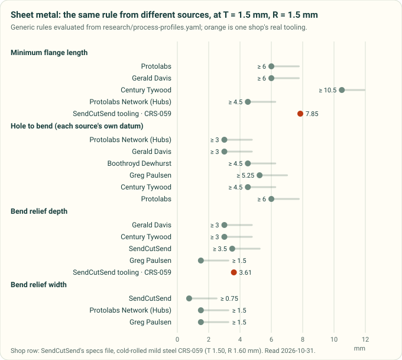

*Diagram drawn by `tools/process_profile_figures.py` from the sheet-metal `compare` rules in [`process-profiles.yaml`](process-profiles.yaml), on published sources read 2026-10-31, with SendCutSend's tooling table in orange. A test redraws it and fails if the committed chart differs.*

### Reliefs, hems and small features

| Rule | Value | Applies when | Source |
|---|---|---|---|
| Bend relief depth | ≥ T + R; cut with curves so cracks do not start | | Gerald Davis, [The FABRICATOR][davis-2001-fabricator-design-tips]; [Century Tywood][century-tywood-sheet-metal-reference] |
| Bend relief depth and width | ≥ T + R + 0.5 mm from the bend line; width ≥ T/2 | CAD tools measure depth from different datums | [SendCutSend][sendcutsend-bend-relief] |
| Bend relief width and length | width ≥ T, length > R | | Greg Paulsen, [Machine Design][paulsen-2017-machine-design-sheet-metal]; width also [Protolabs Network][hubs-sheet-metal] |
| Corner gap between flanges | ≥ 0.4 mm (0.015 in) | | [SendCutSend][sendcutsend-bend-relief] |
| Hem: inside diameter; return | ≥ T; ≥ 6T | Open and closed hems | [Protolabs][protolabs-sheet-metal] |
| Hem: inside diameter; return | ≥ T; ≥ 4T (tear-drop opening ≥ T/4); avoid flat hems | | Greg Paulsen, [Machine Design][paulsen-2017-machine-design-sheet-metal] |
| Tab width; notch width | ≥ max(2T, 3.2 mm); ≥ max(T, 1.016 mm); both ≤ 5 × width long | | [Protolabs][protolabs-sheet-metal] |
| Countersink to bend; to edge; to each other | ≥ 3T; ≥ 4T; ≥ 8T | | Greg Paulsen, [Machine Design][paulsen-2017-machine-design-sheet-metal] |
| Curl outside radius | ≥ 2T | | Greg Paulsen, [Machine Design][paulsen-2017-machine-design-sheet-metal] |
| Bend angle tolerance | ±1° | Protolabs; SendCutSend up to 24 in, ±2° above, bends at most 120–130° | [Protolabs][protolabs-sheet-metal]; [SendCutSend][sendcutsend-ordering-guide] |
| Bend-to-hole tolerance | ±0.38 mm under 0.13 in stock, ±0.635 mm above | Across 3+ bends ±0.76 / ±1.016 mm | [Protolabs][protolabs-sheet-metal] |
| Laser kerf | about 0.3 mm (waterjet 0.5–1 mm); split it between mating parts | | [Protolabs Network][hubs-sheet-metal] |

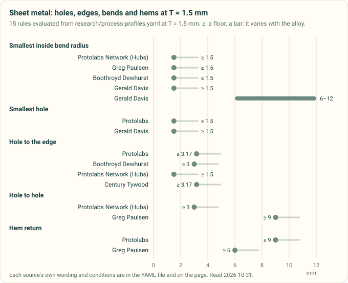

*Diagram drawn by `tools/process_profile_figures.py` from the sheet-metal hole, edge, bend and hem `compare` rules in [`process-profiles.yaml`](process-profiles.yaml), on published sources read 2026-10-31, at a sheet thickness of 1.5 mm. A test redraws it and fails if the committed chart differs.*

### Where the sheet-metal sources disagree

At T = R = 1.5 mm (the chart above) [derived]:
- **Minimum flange: 4.5 to 10.5 mm.** 2T + R (Protolabs Network) gives 4.5 mm, 4T (Protolabs, Gerald Davis) 6 mm,
  3.5 × (T + R) (Century Tywood) 10.5 mm. SendCutSend's real tooling for 1.5 mm mild steel needs 7.85 mm, longer than
  the 4T rule. Thin stock is worse: on 0.76 mm steel SendCutSend needs 7.26 mm, 9.5T [derived from `shop_tables`].
- **Hole to bend: 3 to 6 mm, on four different datums.** 2T from the tangent (Protolabs Network, Davis), 2T + R with
  no datum (Boothroyd Dewhurst), 2.5T + R "from any bends" (Paulsen), 1.5 × (T + R) from the inside face to the hole
  edge (Century Tywood), and Protolabs' warning zone of 4T. A check must state its datum.
- **Relief width: T/2 (SendCutSend) against T (Protolabs Network, Paulsen).** Depth agrees at about T + R, with
  SendCutSend adding 0.5 mm.
- **Hem return: 6T (Protolabs) against 4T (Paulsen).**
- **R ≥ T is not a safe test either way.** SendCutSend bends 5052 at 0.36–0.60T on stock up to 2.3 mm and at
  1.0–1.34T from 2.5 mm up (eight thicknesses in its [specs JSON][sendcutsend-specs]; the four in `shop_tables` give
  0.36–1.0T), and mild steel at 0.53–0.85T from 1.9 mm. Davis asks 4–8T for 6061 and 2024, and SendCutSend's file
  backs him: it publishes bend specs for no 6061 or 7075 stock, and bends its one 2024 sheet (0.64 mm) at R = 2.8T
  [all derived from `bending_specs`]. #118 already records this for the planned check S5.

## 8. CNC machining

D below is the tool or hole diameter. Two pages here are by named engineers at Xometry: Joel Schadegg and Greg Paulsen
([10 tips][xometry-cnc-10-tips]) and Dean McClements and Aaron Lichtig ([internal corner radii][xometry-cnc-corner-radii]).

### Corners, pockets and tool reach

| Rule | Value | Applies when | Source |
|---|---|---|---|
| Inside vertical corner radius | ≥ 1/3 of the cavity depth; about 1 mm over the tool radius cuts a better finish; a T-bone undercut if it must be sharp | Pockets | [Protolabs Network][hubs-cnc-design] |
| Inside corner radius | 1.3 × the tool radius | | Joel Schadegg and Greg Paulsen, [Xometry][xometry-cnc-10-tips] |
| Inside corner radius | tool radius + 0.5–1.27 mm (0.02–0.05 in) | So the tool does not stop and pivot in the corner | Dean McClements and Aaron Lichtig, [Xometry][xometry-cnc-corner-radii] |
| Inside corner radius | ≥ 0.8 mm where possible, a little over the tool | | [Fictiv][fictiv-cnc-design-guide] |
| Floor radius | 0, 0.5 or 1 mm (flat or bull-nose end mills); others with ball end mills | | [Protolabs Network][hubs-cnc-design] |
| Cavity depth | ≤ 4 × its width | | [Protolabs Network][hubs-cnc-design]; [Boothroyd Dewhurst][dfma-dfm-checklist] |
| Cavity depth | ≤ 3–5 × its width (the YAML keeps 3) | | Joel Schadegg and Greg Paulsen, [Xometry][xometry-cnc-10-tips] |
| Cavity depth that machines cheaply | 2–3 × D; 4 × D and deeper costs more | | [Protolabs Network][hubs-cnc-cost-tips] |
| End-mill depth of cut | ≤ 15 × D plastics, 10 × D aluminium, 5 × D steel | | [Fictiv][fictiv-cnc-design-guide] |
| Deep cavity; deepest with special tools | from 6 × D; up to 30 × D | | [Protolabs Network][hubs-cnc-design] |
| End-mill cutting length | 3–4 × D standard | | [Protolabs Network][hubs-cnc-design] |
| Length of cut, long-reach miniature end mills | 3 × D standard flute; ≥ 5 × D long flute | A tool maker's catalogue, for comparison | [Harvey Tool][harvey-tool-long-reach] |
| Deepest milled feature from each side | ≤ 50.8 mm (2 in) | Protolabs | [Protolabs][protolabs-cnc-milling] |

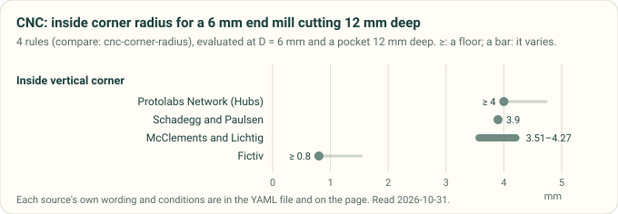

*Diagram drawn by `tools/process_profile_figures.py` from the `compare: cnc-corner-radius` rules in [`process-profiles.yaml`](process-profiles.yaml), on published sources read 2026-10-31, for a 6 mm end mill in a pocket 12 mm deep. A test redraws it and fails if the committed chart differs.*

### Walls and small features

| Rule | Value | Applies when | Source |
|---|---|---|---|
| Minimum wall, metal / plastic | 0.8 / 1.5 mm (0.5 / 1.0 mm feasible case by case) | Plastics warp and soften | [Protolabs Network][hubs-cnc-design] |
| Minimum wall, metal / plastic | 0.794 / 1.5 mm | | Joel Schadegg and Greg Paulsen, [Xometry][xometry-cnc-10-tips] |
| Minimum wall, metal / plastic | 0.25 / 0.5 mm | Milled | [Fictiv][fictiv-cnc-design-guide] |
| Feature thickness; nominal part thickness | > 0.51 mm; > 1.02 mm | Milling | [Protolabs][protolabs-cnc-milling] |
| Turned wall; smallest turned diameter | ≥ 0.51 mm; ≥ 0.76 mm (points steeper than 30°) | Turning | [Protolabs][protolabs-cnc-turning] |
| Slender feature | height ≤ 4 × width | | [Protolabs Network][hubs-cnc-cost-tips] |
| Smallest tool or cavity | 2.5 mm on most machines; 0.05 mm with micro-machining tools (printed beside 0.005 in, which is 0.127 mm) | | [Protolabs Network][hubs-cnc-design]; Joel Schadegg and Greg Paulsen, [Xometry][xometry-cnc-10-tips] |
| Engraved text stroke | ≥ 0.457 mm, 0.3 mm deep | Plastics and soft metals | [Protolabs][protolabs-cnc-milling] |

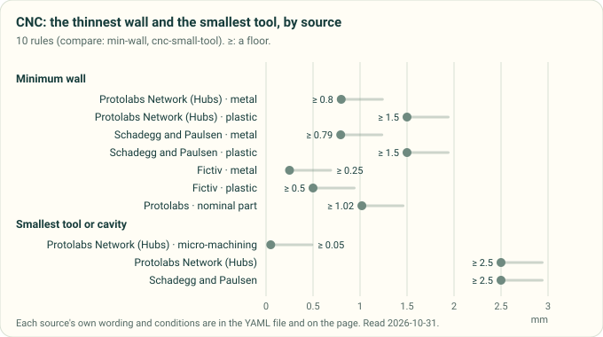

*Diagram drawn by `tools/process_profile_figures.py` from the `compare: min-wall` (CNC) and `compare: cnc-small-tool` rules in [`process-profiles.yaml`](process-profiles.yaml), on published sources read 2026-10-31. A test redraws it and fails if the committed chart differs.*

### Holes and threads

| Rule | Value | Applies when | Source |
|---|---|---|---|
| Hole | ≥ 1 mm; standard drill sizes | | [Protolabs Network][hubs-cnc-design] |
| Hole depth | ≤ 4 × D; 10 × D typical, 40 × D with special drills | | [Protolabs Network][hubs-cnc-design] |
| Hole depth | ≤ 4 × D; up to 10 × D at extra cost | | Joel Schadegg and Greg Paulsen, [Xometry][xometry-cnc-10-tips] |
| Drilling depth; blind hole | ≤ 12 × D; drill 25 % deeper than the depth needed | | [Fictiv][fictiv-cnc-design-guide] |
| Turned holes | ≥ 1 mm on the axis; radial 2 mm (1 mm in aluminium and brass) | | [Protolabs][protolabs-cnc-turning] |
| Thread length | 1.5–3 × D, 3 × D recommended | | [Protolabs Network][hubs-cnc-design] |
| Thread length | ≤ 2 × D | | Joel Schadegg and Greg Paulsen, [Xometry][xometry-cnc-10-tips] |
| Thread engagement | 1–1.5 × D; a tap deeper than 3 × D is deep | | [Fictiv][fictiv-cnc-design-guide] |
| Unthreaded length at the bottom of a blind hole | 1.5 × D for tapped threads (below M6) | | [Protolabs Network][hubs-cnc-design] |
| Unthreaded length at the bottom of a blind hole | ≥ 0.5 × D | | Joel Schadegg and Greg Paulsen, [Xometry][xometry-cnc-10-tips] |
| Thread size | M6 or larger recommended (M1 possible) | | [Protolabs Network][hubs-cnc-design] |
| Thread range | M2–M12 (UNC and UNF #2 to 1/2 in); do not model internal threads | Protolabs' automated factory | [Protolabs][protolabs-cnc-milling] |
| Clearance round an internal undercut | ≥ 4 × the undercut depth to the next wall | T-slot cutters 3–40 mm wide | [Protolabs Network][hubs-cnc-design] |

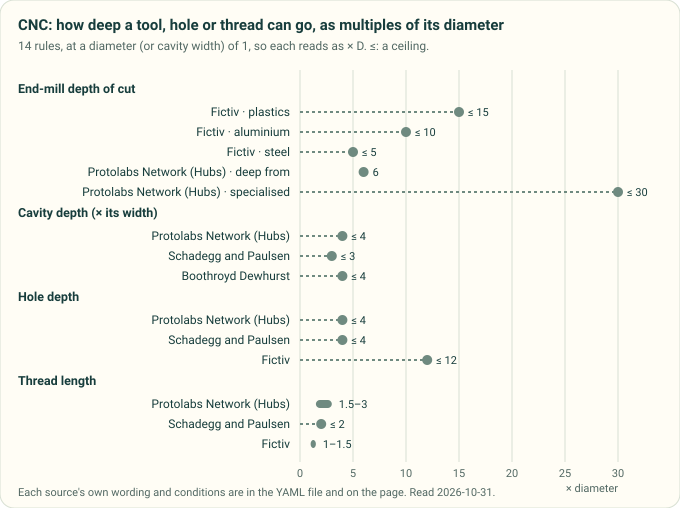

*Diagram drawn by `tools/process_profile_figures.py` from the CNC depth `compare` rules in [`process-profiles.yaml`](process-profiles.yaml), on published sources read 2026-10-31, at a diameter of 1 so each reads as a multiple of it. A test redraws it and fails if the committed chart differs.*

### Tolerances

| Rule | Value | Applies when | Source |
|---|---|---|---|
| General tolerance | ±0.1 mm typical; ±0.02 mm feasible | | [Protolabs Network][hubs-cnc-design] |
| Default tolerance | ±0.125 mm or better | When none is given | [Protolabs Network][hubs-cnc-cost-tips] |
| Machining tolerance | ±0.13 mm (±0.005 in), otherwise ISO 2768-1 medium or fine | Protolabs' automated milling | [Protolabs][protolabs-cnc-milling] |
| Tolerance the shop may loosen | tighter than ±0.05 mm | | [Fictiv][fictiv-cnc-design-guide] |

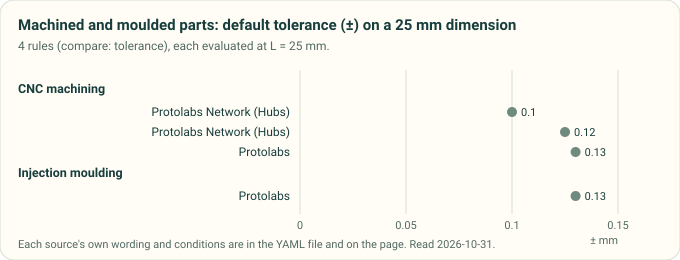

*Diagram drawn by `tools/process_profile_figures.py` from the CNC and moulding `compare: tolerance` rules in [`process-profiles.yaml`](process-profiles.yaml), on published sources read 2026-10-31, each evaluated at 25 mm. A test redraws it and fails if the committed chart differs.*

### Where the CNC sources disagree

- **Inside corner radius: the rules agree.** For a 12 mm deep pocket cut with a 6 mm end mill [derived]: depth/3 gives
  4 mm (Protolabs Network), 1.3 × the tool radius 3.9 mm (Schadegg and Paulsen), tool radius + 0.02–0.05 in
  3.5–4.3 mm (McClements and Lichtig). Fictiv's 0.8 mm is a floor, not a target.
- **Minimum wall in metal: 0.25 to 0.8 mm.** Fictiv 0.25 mm; Xometry 0.794 mm; Protolabs Network 0.8 mm (0.5 mm
  feasible). In plastic: 0.5 mm (Fictiv) to 1.5 mm (Protolabs Network, Xometry). The chart at the top shows them.
- **Hole depth: 4 × D** (Protolabs Network, Xometry) **against 12 × D** (Fictiv); Protolabs Network calls 10 × D
  typical and 40 × D feasible, so 4 × D is "cheap", not "possible".
- **Thread length: 3 × D recommended** (Protolabs Network) **against at most 2 × D** (Xometry) and 1–1.5 × D of
  engagement (Fictiv). The run-out at the bottom of a tapped blind hole is 1.5 × D (Protolabs Network) or 0.5 × D
  (Xometry).
- **Protolabs Network against itself:** holes are feasible above 1 mm in one row and features down to 0.05 mm with
  micro tools in another. That 0.05 mm is printed beside 0.005 in, which is 0.127 mm, so one of the two is a slip;
  the YAML keeps the mm value and says so.
- **Standards.** Protolabs names ISO 2768-1 (general tolerances) as its default. It is paid and was not read.

## 9. What this changes in cad-agent

What reads the YAML today (solid) and what is planned to (dashed):

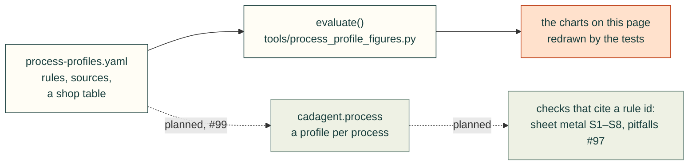

- **`cadagent.process` (#99)** can load `process-profiles.yaml` as it stands: rules by process and feature, the
  evaluator in `tools/process_profile_figures.py`, and the SendCutSend shop table. The acceptance in #99 (FDM PETG,
  PLA, ASA, PA-CF and sheet-metal 5052 and mild-steel profiles) needs the material rows from compliant-mechanisms §5
  joined to the FDM rules here, and the shop table for sheet metal.
- **Planned sheet-metal checks S1–S8** (`research/fea-and-process-tools.md` §5): every check should name its datum and
  its source, and read a shop table first. See #118's comment on S1 and S5.
- **Pitfall checks (#97)** can cite a rule id from the YAML in their report rows, which gives the credit by name.

## 10. Sources

People and organisations whose published rules this page uses. Each entry in the YAML says what was read and when.

Every source, by process: the articles, guides, data sheets and standards behind the rules

**3D printing**
- Protolabs Network (formerly Hubs): [How to design parts for FDM 3D printing][hubs-fdm-design];
  [3D printing geometry limitations][hubs-3dp-geometry-limits]; [Dimensional accuracy in 3D printing][hubs-3dp-dimensional-accuracy];
  [Threads and screws for 3D printing][hubs-3dp-threaded-fasteners]; [Snap-fit joints for 3D printing][hubs-snapfit-3dp];
  [How to design parts for SLA 3D printing][hubs-sla-design]; [How to design parts for SLS 3D printing][hubs-sls-design].
- Prusa Research, Prusa Knowledge Base: [Modeling with 3D printing in mind][prusa-modeling-for-3dp];
  [Elephant foot compensation][prusa-elephant-foot]; [Hollowing][prusa-hollowing-kb].
- Xometry Europe: [FDM 3D Printing Design Tips][xometry-eu-fdm-design-tips] (the page quotes Nikolaus Mroncz, Head of
  Sales Engineering).
- **Niko Mroncz**, Xometry Asia: [SLA 3D Printing Design Guidelines: 8 Essential Tips][xometry-sla-design-tips] (2025);
  [8 Essential Design Tips for SLS 3D Printing][xometry-sls-design-tips] (2025). Xometry Asia: [HP MJF design
  guidelines][xometry-mjf-design-guidelines] (2020). Xometry: [MJF service][xometry-mjf-service];
  [SLS service][xometry-sls-service].
- **Joel Schadegg** (written by) and **Aaron Lichtig** (updated by), Xometry: [FDM Mini-Guide][xometry-fdm-mini-guide].
- **Stefan Hermann**, CNC Kitchen: [Tips & Tricks for Heat-Set Inserts][cnckitchen-heat-set-tips] (2021);
  [Are Our Heat-Set Insert Datasheets Wrong?][cnckitchen-heat-set-hole-size] (2026).
- **Christoph Klahn, Daniel Singer, Mirko Meboldt**: [Design Guidelines for Additive Manufactured Snap-Fit Joints][klahn-2016-am-snapfit],
  Procedia CIRP 50 (2016).
- Formlabs: [Form 4 Design Guide][formlabs-form4-design-guide]; [the technology behind Form 4][formlabs-form4-technology];
  design specifications for [Form 3/3B][formlabs-form3-design-specs] and [Form 2][formlabs-form2-design-specs];
  [How to hollow out 3D models][formlabs-hollowing-blog]; [Fuse Series SLS Design Guide][formlabs-fuse-sls-design-guide] (2023).
- HP: [Jet Fusion 5200 mechanical properties, 4AA7-7084ENW][hp-mjf-5200-properties] (2020);
  [MJF Handbook, Design for accuracy][hp-mjf-handbook-design-for-accuracy] (2019);
  [How to design a 3D print model for MJF][hp-learning-design-3d-print-model]; [Designing 3D printed joints][hp-learning-joint-design];
  [Jet Fusion 5200 dimensional capability, 4AA7-7166ENW][hp-5200-dimensional-capability] (2020).
- Protolabs: [SLA design guidelines][protolabs-sla-guidelines]; [SLS design guidelines][protolabs-sls-guidelines];
  [MJF design guidelines][protolabs-mjf-guidelines]; [Nylon 3D printing tips][protolabs-nylon-design-tip];
  [Multi Jet Fusion for functional parts][protolabs-mjf-design-tip].
- Materialise: design guidelines for [Taurus (SLA)][materialise-taurus-sla-guidelines], [PA 12 (SLS)][materialise-pa12-sls-guidelines]
  and [PA 12 (MJF)][materialise-pa12-mjf-guidelines].
- Stratasys Direct: [Multi Jet Fusion design guide][stratasys-direct-mjf-design-guide] (2019).
- **Franz-Josef Kerl**, EOS: [Design Rules Overview LS][eos-design-rules-overview-ls] (2011).
- JLC3DP: [3D printing design guidelines][jlc3dp-design-guideline].
- ELEGOO: [Hollowing and holes in ELEGOO SatelLite][elegoo-satellite-hollowing] (2026).
- Mango3D (Lychee Slicer): [Voxels hollowing][lychee-voxels-hollowing] (2026).

**Injection moulding**
- Protolabs: [Injection molding design guidelines][protolabs-injection-molding]; [Ribs, gussets and materials][protolabs-im-ribs-gussets];
  [Plastic boss design][protolabs-im-bosses].
- DuPont: [General Design Principles, Module I][dupont-design-module-1] (2000; a distributor's copy).
- Covestro: [Part and Mold Design, a design guide][covestro-part-mold-design] (2015).
- Fictiv: [Injection molding design guide][fictiv-im-design-guide] (2025).

**CNC machining**
- Protolabs Network (formerly Hubs): [How to design parts for CNC machining][hubs-cnc-design];
  [14 tips to reduce the cost of CNC machining][hubs-cnc-cost-tips].
- Protolabs: [CNC milling][protolabs-cnc-milling] and [CNC turning][protolabs-cnc-turning] design guidelines.
- Fictiv: [CNC machining design guide][fictiv-cnc-design-guide] (2021).
- **Joel Schadegg** (written by) and **Greg Paulsen** (updated by), Xometry: [10 tips to improve your CAD designs for
  CNC machining][xometry-cnc-10-tips] (2022).
- **Dean McClements** (written by) and **Aaron Lichtig** (updated by), Xometry: [Optimizing internal corner
  radii][xometry-cnc-corner-radii] (2020).
- Harvey Tool: [long-reach miniature end mills][harvey-tool-long-reach].

**Sheet metal**
- Protolabs: [Design Guidelines for Sheet Metal Fabrication][protolabs-sheet-metal].
- Protolabs Network (formerly Hubs): [Sheet metal fabrication design guide][hubs-sheet-metal].
- **Greg Paulsen** (then Director of Applications Engineering, Xometry): [Tips for Making Sheet-Metal Parts][paulsen-2017-machine-design-sheet-metal],
  Machine Design (2017).
- **Gerald Davis**: [Design tips for sheet metal][davis-2001-fabricator-design-tips], The FABRICATOR (2001).
- Century Tywood: [Manufacturing Reference for Sheet Metal Products][century-tywood-sheet-metal-reference].
- Boothroyd Dewhurst, Inc.: [DFM Design Review Checklist][dfma-dfm-checklist] (also used for moulding and CNC).
- SendCutSend: [Bend reliefs and corner reliefs][sendcutsend-bend-relief] (2024); [ordering guide][sendcutsend-ordering-guide];
  [engineering specs JSON][sendcutsend-specs].
- Dassault Systèmes: [SOLIDWORKS help, K-Factor][solidworks-k-factor].

**Standards** (paid; cited by number and title only, not read, and no rule takes a value from them; listed in the
YAML under `standards`)
- [ISO 2768-1:1989][iso-2768-1] General tolerances, Part 1: linear and angular dimensions.
- [ISO 20457:2026][iso-20457] Plastics moulded parts: tolerances and acceptance conditions (the 2018 edition is
  withdrawn); [DIN 16742:2013][din-16742], the same title, withdrawn.
- [ISO/ASTM 52910:2018][iso-astm-52910] Additive manufacturing, design: requirements, guidelines and recommendations
  (its abstract says it gives no process- or material-specific data).
- [ISO/ASTM 52911-2][iso-astm-52911-2] Additive manufacturing, design, Part 2: laser-based powder bed fusion of
  polymers.

## 11. Not verified, and next

- The Protolabs Network design-rules poster that compares every printing process is an image in perspective; it was
  not read, and none of its numbers are used.
- Xometry's FDM quick design guide (a 10 mm bridge, among others) returned HTTP 403 to every fetch and has no archive
  copy; not used. Xometry's US MJF guide is an e-mail-gated e-book, and its European MJF pages returned 403.
- HP's MJF Handbook chapters other than "Design for accuracy" (best practices, design for cleaning, tolerancing,
  hinges) sit behind a sign-up form; HP's own escape-hole size was not found.
- EOS's gap-against-wall chart is an image; its row is marked **(u)**. DuPont's rib and boss proportions (Figures
  4.07 and 3.10) have no text layer either, so they were read from the rendered figures and are marked read.
- VDI 3405 Blatt 3 (design rules for laser sintering and melting) could not be opened; it is not cited.
- Next, filed as issues: a `cadagent.process` loader with one check that reads this file, and re-reading the **(u)**
  row from EOS's chart.

[hubs-fdm-design]: https://www.hubs.com/knowledge-base/how-design-parts-fdm-3d-printing/
[hubs-3dp-geometry-limits]: https://www.hubs.com/knowledge-base/3d-printing-geometry-restrictions/
[hubs-3dp-dimensional-accuracy]: https://www.hubs.com/knowledge-base/dimensional-accuracy-3d-printed-parts/
[hubs-3dp-threaded-fasteners]: https://www.hubs.com/knowledge-base/how-assemble-3d-printed-parts-threaded-fasteners/
[hubs-snapfit-3dp]: https://www.hubs.com/knowledge-base/how-design-snap-fit-joints-3d-printing/
[prusa-modeling-for-3dp]: https://help.prusa3d.com/article/modeling-with-3d-printing-in-mind_164135
[prusa-elephant-foot]: https://help.prusa3d.com/article/elephant-foot-compensation_114487
[prusa-hollowing-kb]: https://help.prusa3d.com/article/hollowing_117285
[xometry-eu-fdm-design-tips]: https://xometry.pro/en/articles/fdm-design-tips/
[xometry-fdm-mini-guide]: https://www.xometry.com/resources/3d-printing/mini-guide-fdm-3d-printing/
[cnckitchen-heat-set-tips]: https://cnckitchen.com/blog/tips-and-tricks-for-heat-set-inserts
[cnckitchen-heat-set-hole-size]: https://cnckitchen.com/blog/are-our-heat-set-insert-datasheets-wrong
[klahn-2016-am-snapfit]: https://publikationen.bibliothek.kit.edu/1000142464
[hubs-sla-design]: https://www.hubs.com/knowledge-base/how-design-parts-sla-3d-printing/
[hubs-sls-design]: https://www.hubs.com/knowledge-base/how-design-parts-sls-3d-printing/
[hp-mjf-5200-properties]: https://info.sculpteo.com/hubfs/Material%20documentation/PA11%20HP/TDS%20HP%20pa12%20pa12gb%20pa11%20pp%20(1).pdf
[formlabs-form4-design-guide]: https://formlabs.com/white-papers/form-4-design-guide/
[formlabs-form4-technology]: https://formlabs.com/blog/technology-behind-form-4/
[formlabs-form3-design-specs]: https://formlabs.com/support/Design-specifications-for-3D-models-form-3/
[formlabs-form2-design-specs]: https://formlabs.com/support/Design-Specs/
[formlabs-hollowing-blog]: https://formlabs.com/blog/how-to-hollow-out-3d-models/
[formlabs-fuse-sls-design-guide]: https://formlabs-media.formlabs.com/rs/060-UIG-504/images/WP-EN-fuse-series-sls-design-guide.pdf
[hp-mjf-handbook-design-for-accuracy]: https://images.marketingcontent.ext.hp.com/Web/HPMartech/%7B4ad48959-344d-47d0-8bbc-066708df7dbd%7D_1_2.pdf
[hp-learning-design-3d-print-model]: https://www.hp.com/us-en/printers/3d-printers/learning-center/how-to-design-3d-print-model.html
[hp-learning-joint-design]: https://www.hp.com/us-en/printers/3d-printers/learning-center/3d-printed-joint-design.html
[hp-5200-dimensional-capability]: https://xometry-marketing.cdn.prismic.io/xometry-marketing/648ab46b-2162-4f28-9540-dab79a07e399_DimensionalAccuracy_PA11_PA12GB_PP_Sept2020.pdf
[protolabs-sla-guidelines]: https://www.protolabs.com/services/3d-printing/stereolithography/
[protolabs-sls-guidelines]: https://www.protolabs.com/services/3d-printing/selective-laser-sintering/
[protolabs-mjf-guidelines]: https://www.protolabs.com/services/3d-printing/multi-jet-fusion/
[protolabs-nylon-design-tip]: https://www.protolabs.com/resources/design-tips/how-to-design-for-nylon-3d-printing/
[protolabs-mjf-design-tip]: https://www.protolabs.com/resources/design-tips/how-to-use-multi-jet-fusion-for-functional-3d-printed-parts/
[xometry-sla-design-tips]: https://xometry.asia/en/sla-3d-printing-design-guidelines-8-essential-tips/
[xometry-sls-design-tips]: https://xometry.asia/en/8-essential-design-tips-for-sls-3d-printing/
[xometry-mjf-design-guidelines]: https://xometry.asia/en/hp-mjf-3d-printing-design-guidelines/
[xometry-mjf-service]: https://www.xometry.com/capabilities/3d-printing-service/hp-multi-jet-fusion/
[xometry-sls-service]: https://www.xometry.com/capabilities/3d-printing-service/selective-laser-sintering/
[materialise-taurus-sla-guidelines]: https://www.materialise.com/en/academy/industrial/design-am/taurus
[materialise-pa12-sls-guidelines]: https://www.materialise.com/en/academy/industrial/design-am/pa12-sls
[materialise-pa12-mjf-guidelines]: https://www.materialise.com/en/academy/industrial/design-am/pa12-mjf
[stratasys-direct-mjf-design-guide]: https://www.stratasys.com/siteassets/sdm/content---website-storage/design-guides/dg_mjf_stratasys_direct_03062023.pdf
[eos-design-rules-overview-ls]: https://www.3dimpuls.com/sites/default/files/download/design_rules_overview_ls_-_formiga_p100-v1_1.pdf
[jlc3dp-design-guideline]: https://jlc3dp.com/help/article/3d-printing-design-guideline
[elegoo-satellite-hollowing]: https://www.elegoo.com/blogs/3d-printer-user-guide/mastering-hollowing-and-adding-holes-in-elegoo-satellite
[lychee-voxels-hollowing]: https://lychee.co/whats-new/new-feature-voxels-hollowing-3-d-we-made-hollowing-way-better
[protolabs-injection-molding]: https://www.protolabs.com/services/injection-molding/plastic-injection-molding/design-guidelines/
[protolabs-im-ribs-gussets]: https://www.protolabs.com/resources/design-tips/design-stronger-molded-parts/
[protolabs-im-bosses]: https://www.protolabs.com/resources/design-tips/plastic-boss-design-on-molded-parts/
[dupont-design-module-1]: https://www.emcoplastics.com/assets/pdf/acetal/General%20Design%20Principles%20for%20Engineering%20Polymers.pdf
[covestro-part-mold-design]: https://solutions.covestro.com/-/media/covestro/solution-center/brands/downloads/imported/1557214249.pdf
[fictiv-im-design-guide]: https://www.fictiv.com/articles/injection-molding-design-guide
[hubs-cnc-design]: https://www.hubs.com/knowledge-base/how-design-parts-cnc-machining/
[hubs-cnc-cost-tips]: https://www.hubs.com/knowledge-base/reducing-cnc-machining-costs-design-tips/
[protolabs-cnc-milling]: https://www.protolabs.com/services/cnc-machining/cnc-milling/design-guidelines/
[protolabs-cnc-turning]: https://www.protolabs.com/services/cnc-machining/cnc-turning/design-guidelines/
[fictiv-cnc-design-guide]: https://www.fictiv.com/articles/fictiv-cnc-machining-design-guide
[xometry-cnc-10-tips]: https://www.xometry.com/resources/machining/10-tips-improve-cad-cnc-design/
[xometry-cnc-corner-radii]: https://www.xometry.com/resources/machining/cnc-machining-optimizing-internal-corner-radii/
[harvey-tool-long-reach]: https://www.harveytool.com/products/miniature-end-mills---square---long-reach-standard-flute
[protolabs-sheet-metal]: https://www.protolabs.com/services/sheet-metal-fabrication/design-guidelines/
[hubs-sheet-metal]: https://www.hubs.com/guides/sheet-metal-fabrication/
[paulsen-2017-machine-design-sheet-metal]: https://www.machinedesign.com/mechanical-motion-systems/article/21835979/tips-for-making-sheet-metal-parts
[davis-2001-fabricator-design-tips]: https://www.thefabricator.com/article/bending/design-tips-for-sheet-metal-bend-relief-small-holes-hole-distortion-near-bends-and-minimum-flange-widths
[century-tywood-sheet-metal-reference]: https://www.pblprojects.org/wp-content/uploads/2019/03/Manufacturing-Reference-Guide_for_Sheet_Metal_Products.pdf
[dfma-dfm-checklist]: https://www.dfma.com/resources/pdf/dfm-design-review-checklist.pdf
[sendcutsend-bend-relief]: https://sendcutsend.com/blog/guide-to-designing-bend-reliefs/
[sendcutsend-ordering-guide]: https://cdn.sendcutsend.com/specs/sendcutsend-ordering-guide.md
[sendcutsend-specs]: https://cdn.sendcutsend.com/specs/sendcutsend-specs.json
[solidworks-k-factor]: https://help.solidworks.com/2022/English/SolidWorks/sldworks/c_K_Factor.htm
[iso-2768-1]: https://www.iso.org/standard/7748.html
[iso-20457]: https://www.evs.ee/en/iso-20457-2018
[din-16742]: https://www.dinmedia.de/en/standard/din-16742/192658755
[iso-astm-52910]: https://www.iso.org/standard/67289.html
[iso-astm-52911-2]: https://store.astm.org/f3281-19r25.html
