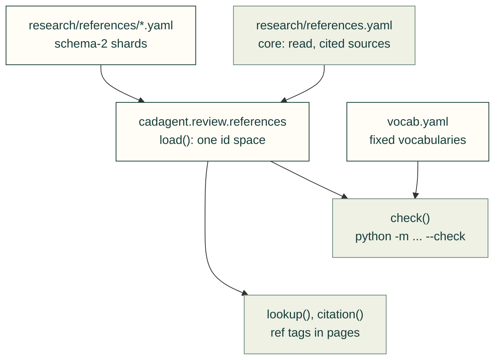
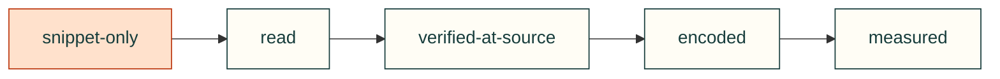

# research/references

The reference registry's schema-2 shards (#323): outside projects, guides, standards and data sheets that cad-agent
lists, links and, once someone has read them, cites. It grows the one-file registry of #118 into a folder without
splitting its id space. `research/references.yaml` stays the core of read and cited sources. The records here share
its ids, and `cadagent.review.references` reads both.

## What's here

| File | What it holds |
|---|---|
| `vocab.yaml` | The fixed vocabularies every schema-2 field is checked against: kinds, licence and reuse classes, the evidence ladder, confidence levels, processes, project domains and the objective assessment questions. |
| `projects-<domain>.yaml` | Open projects from the Reference Map, one shard per project domain (`vocab.yaml` `domain`): drive 39, drone 30, esc 56, general 6, legged 67, motor 31, pantilt 21, turret 38, wheel 78. |
| `guides-<group>.yaml` | Manufacturing and design guides, one shard per process group of the guide's first process: cnc 41, general 23, inserts 17, mould 30, pcb 13, print 37, sheet 40. Of these, 21 records are `extends: true` additions to guides already read in `research/references.yaml`. |
| `coverage.yaml` | The map's coverage table: what cad-agent enforced per topic (16 rows), where, its gaps, and the issue drafted for each gap, never posted (`posted: false`). `wanted` lists the sources each process group still lacks. |

Every shard is at most 150 records and 150 KB. The shards and `coverage.yaml` come from the Reference Map, through
[`tools/import_refmap.py`](../../tools/import_refmap.py), which takes the map's `data.json` by path. The data file
stays out of the repo. The import is deterministic, and its rules are in the tool's docstring:

- every new record is `snippet-only`, and every licence is unread;
- numbers are the authors' claims unless measured;
- the map's per-project verdicts stay out, and only its project-neutral `role` comes in.

Two guides that `research/references.yaml` lists as `unverified` were left there.

## A record

A shard record has the core entry's fields (`id`, `title`, `authors`, `org`, `year`, `url` or `isbn`, `access`,
`terms`, `areas`, `used_for`, `verified`), plus these:

| Field | What it says |
|---|---|
| `kind` | project, guide, standard, datasheet, paper, article, vendor-table, forum-thread, video, patent |
| `licence` | Of the source: `spdx` (or null), `class` (open, share-alike, non-commercial, unclear, proprietary), `read` (true only when the licence text itself was read), `note` |
| `reuse` | `text: cite-only`; `geometry`: copy, adapt-with-attribution, study-only or none. Share-alike, non-commercial, unclear and proprietary sources are study-only: study, never copy files, cite in the decision |
| `areas` | Slugs of [`docs/areas.yaml`](../../docs/areas.yaml): an area, a topic, or `area/topic` |
| `processes`, `process_groups`, `domains`, `category` | From `vocab.yaml` |
| `evidence` | `class` (the ladder below), `numbers`, `tested`, `authority` |
| `claims` | The rules a source states: `text`, `status` (unconfirmed, corroborated, conflicting, encoded), `evidence`, `corroborated_by` (ids of other records) |
| `confidence` | Optional, and only as `confidence()` derives it (#143); check() rejects a typed value that differs |
| `assessment` | For a project, objective answers only: `built`, `supply`, `cost`, `make`, `docs`, `activity`, `role`, `cad`, `answers`, `caveat`, `assessed`. `role` (leader, reference, lessons, context) names no project. It was scored while surveying for one kind of build (a printed two-wheeled, legged balancing robot), so it is not a quality grade (`vocab.yaml` says more) |
| `projects` | Optional join: a `docs/areas.yaml` project key mapped to that project's mechanism slugs |
| `rules`, `checks` | The profile rules and cad-agent checks that encode the record |
| `archive` | A pointer for the offline mirror: `sha256`, `kind`, `fetched`, `redistribute`. Never a path or a host |
| `summary` | One or two plain sentences, in our words |
| `extends: true` | The record adds these fields to the core *read source* with the same id, instead of being a record of its own |

Link health is not kept here. The checker's artifacts and the site JSON hold it, and only evidence-class changes land
in git.

## The evidence ladder

- **snippet-only:** a record below `read` is *catalogued*. It may be listed and linked. A code table, a profile rule,
  a check or a `[ref:<id>]` tag outside `research/` may not cite it, and `check()` warns on such a tag in `research/`.
- **read:** someone opened the source and wrote the dated `verified` note, as every core entry has.
- **verified-at-source:** an independent record corroborates a claim, named in `claims[].corroborated_by`.
- **encoded:** a profile rule or a check with tests encodes the claim (`rules` or `checks`). A secondary source
  needs a corroborating record first. A primary one (the maker's own, or an independent test) may stand alone, which
  is #143's "one primary source with reproduced examples".
- **measured:** a physical result on a real project backs the claim.

## Rules check() enforces

- One id across the core file and every shard. An id in two files is a problem, unless the shard's record says
  `extends: true`.
- A shard holds at most 150 records and 150 KB. Past either, split it by topic slug.
- Every vocabulary value and every area slug resolves. The licence class decides geometry reuse. The ladder's rules
  hold, and a stored `confidence` equals the derived one.

`python -m cadagent.review.references --check` runs all of these, and `tests/review/test_references.py` plants one
mistake of each kind.

## On the site

`tools/site-references.mjs` publishes the records with the site build:

- `/references` charts every area;
- `/references/<area>` has charts by evidence, confidence, kind, licence and process, a table you can filter, and the
  coverage rows; each has a `.md` twin;
- `catalog/references/index.json` and `<area>.json` hold the same records for agents;
- `[ref:<id>]` in any page links to the record's row and to the source;
- `docs/experts.md` is generated from the read sources.

After changing a record, run `node tools/site-references.mjs --experts` and commit `docs/experts.md`
(`tests/site/website-references.test.mjs` fails until it is current). A record whose `areas` match no slug is listed on
`/references/unplaced`. That count may only fall.

## Related

- [`research/references.yaml`](../references.yaml): the core registry and its field notes.
- [`src/cadagent/review/references.py`](../../src/cadagent/review/references.py): the loader and the checks.
- [`docs/areas.yaml`](../../docs/areas.yaml): the topic tree records are placed in.
- #118 (cite every rule by name), #143 (confidence levels), #323 (this knowledge base).
