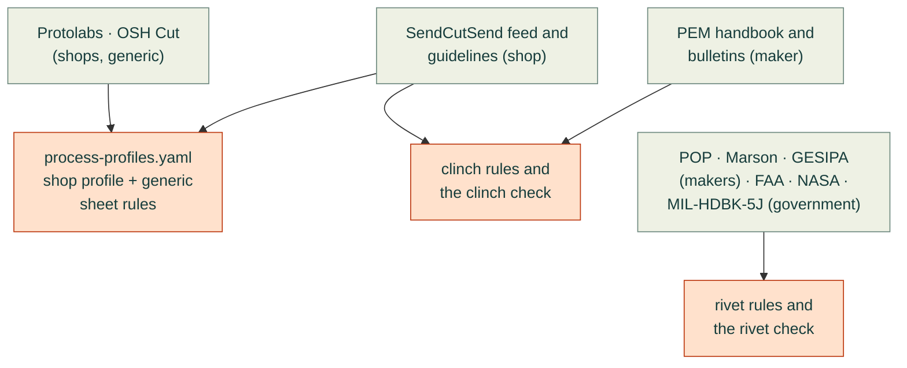
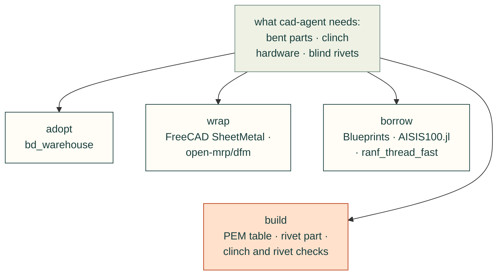

# Sheet metal, clinch hardware and blind rivets: the guides cad-agent builds from (2026-11-01)

For Valpatel/cad-agent#283. Before any rule is written down or any check is coded, this page finds the best existing
design guides for bent sheet metal, self-clinching (PEM-type) hardware and blind rivets. It ranks them and picks one
primary source per topic. Every later rule in `research/process-profiles.yaml` and every check in the domain packages is
built from the guides chosen here and credits them by name. Where an open-source tool already does the job, cad-agent
adopts or wraps it instead of writing its own.

How to read it:
- Every source is in `research/references.yaml` and is cited here as `[ref:<id>]`. That entry records what was opened
  and on which date.
- A source marked **unread** was named, but cad-agent has not opened it. That may be because it sits behind a form, is
  paid, or could not be reached. Nothing is taken from it. Such sources are listed under `unverified:` in the registry.
- Values are cited and condensed, never copied. No vendor PDF, table or figure is kept in this repo.
- All sources were read on 2026-11-01 unless the registry entry says otherwise.

## The answer: which guide leads each topic

Each arrow below means "its rules are written down in". Each box names its kind (shop, maker, government), so the
colours only repeat what the words say.

| Topic | Primary source | Then | Why this one leads |
|---|---|---|---|
| Bend radius, K-factor, minimum flange, relief (for a named shop) | The shop's own data. For SendCutSend: its specification feed [ref:sendcutsend-specs] and bending guidelines [ref:sendcutsend-bending-service] | Protolabs guidelines [ref:protolabs-sheet-metal]; DIN 6935 [ref:din-6935] for the steel radius floor | Bend results depend on the shop's tooling, so the shop's numbers are what gets checked when the order is placed. Standards give only the material limit. |
| Bend rules when no shop is chosen | Protolabs design guidelines [ref:protolabs-sheet-metal] | OSH Cut [ref:oshcut-bending-rules]; The Fabricator articles [ref:davis-2001-fabricator-design-tips] | The clearest free generic numbers, all scaled to T (flange 4T, features 4T from a bend, hems, offsets), with no form to fill in. |
| Cut features (smallest hole, web, slot) | The shop's rules: SendCutSend cutting guidelines [ref:sendcutsend-sheet-cutting] | Protolabs [ref:protolabs-sheet-metal] | Cut limits depend on the laser, waterjet or router, and on the gauge. |
| Tolerances, including across bends and to hardware | Protolabs tolerance one-pager [ref:protolabs-sheet-metal-tolerances] | SendCutSend's published cut and bend tolerances; ISO 2768-1 [ref:iso-2768-1] as the drawing default | The only free source found that gives feature-to-feature tolerances on one surface, across 1, 2 and 3+ bends, and to hardware. That is what a tolerance-stack check needs. |
| Self-clinching nuts, studs and standoffs | PEM *Self-Clinching Fastener Handbook* [ref:pem-handbook] with the PEM bulletins CL, FH, SO and F [ref:pem-bulletin-cl] [ref:pem-bulletin-fh] [ref:pem-bulletin-so] [ref:pem-bulletin-f] and tech sheets [ref:pem-tech-sheet-cl-to-edge] [ref:pem-tech-sheet-stainless] | SendCutSend's hardware guidelines and catalogue [ref:sendcutsend-hardware-service] [ref:sendcutsend-catalog] for what one shop will install | PEM is the maker, and every fabricator defers to its catalogue for edge distance. The rules on hardness, finish order and installing after bending are found only there. |
| Blind rivets: hole, grip, edge distance, strength per rivet | Stanley POP catalogue [ref:pop-rivet-catalog] | Marson [ref:marson-rivet-catalog], Avdel [ref:avdel-breakstem-catalog], GESIPA's assessed values [ref:gesipa-eta-13-0255] | POP has the fullest free design section. The others are used to cross-check the per-rivet strengths. |
| Rivet edge distance and pitch | FAA AC 43.13-1B [ref:faa-ac-43-13-1b] and NASA RP-1228 [ref:nasa-1228] | POP [ref:pop-rivet-catalog] | Both are US government works, free to quote, and they agree on 2D for edge distance. FAA also says where blind rivets must not be used. |
| Joint strength: shear, bearing, tear-out, pull-out | NASA RP-1228 [ref:nasa-1228] for the method; makers' tables for the capacities | MIL-HDBK-5J [ref:mil-hdbk-5j] for blind-rivet allowables and their validity limits | The only free, licence-clean source that gives both the formulas and the spacing rules. |
| Galvanic pairing | MIL-STD-889C [ref:mil-std-889c] | PEM's finish tech sheet [ref:pem-tech-sheet-finish]; the POP galvanic chart [ref:pop-rivet-catalog] | It is public, and it says which way round a fastener and sheet pair may go. Its successor, 889D, is unread. |

## How the guides were rated

Each guide's **authority** is one of:
- **Maker:** the company that makes the fastener (PEM, Stanley, Howmet, GESIPA).
- **Shop:** a fabricator's own process rules (SendCutSend, Protolabs, OSH Cut).
- **Government:** a US government publication (NASA, FAA, DoD). These are free to quote.
- **Standard:** a consensus standard (ISO, DIN, ASTM, ANSI, SMACNA). These are paid, and are cited by number and title
  only.
- **Handbook:** a reference book.

A maker or a government source outranks a shop's rule of thumb on the physics of the part. A shop outranks everyone on
what that shop's machines can do.

The **terms** column says how cad-agent may use each guide:
- *cite* means summarise it and cite it as facts with page references, but do not reproduce it;
- *public* means a US government work;
- *by number* means a paid standard, cited by number and title only.

## 1. Sheet-metal design guides

| Guide | Authority | Covers | Terms | Date | Read |
|---|---|---|---|---|---|
| SendCutSend specification feed [ref:sendcutsend-specs] and ordering catalogue [ref:sendcutsend-catalog] | Shop | Per-SKU thickness and tolerance, bend radius, K, minimum flange, relief, cut limits, hardware per sheet, prices | cite | feed generated 2026-04-29 | yes |
| SendCutSend ordering guide [ref:sendcutsend-ordering-guide] | Shop | How to read the feed | cite | undated | yes |
| SendCutSend guidelines: cutting [ref:sendcutsend-sheet-cutting], bending [ref:sendcutsend-bending-service], bend deformation [ref:sendcutsend-bend-deformation], tapping [ref:sendcutsend-tapping], countersinks [ref:sendcutsend-countersinking-service] [ref:sendcutsend-countersink], dimples [ref:sendcutsend-dimple-forming], finishes [ref:sendcutsend-finishing] [ref:sendcutsend-finish-thickness] | Shop | Every process SendCutSend runs, with the limits it enforces when quoting | cite | modified 2025-12 to 2026-10 | yes |
| SendCutSend bend relief and tab-and-slot posts [ref:sendcutsend-bend-relief] [ref:sendcutsend-tab-slot] | Shop | Relief shapes, tab-and-slot assembly | cite | 2023–2024 | yes |
| SendCutSend bending calculator [ref:sendcutsend-bending-calculator] and pricing [ref:sendcutsend-pricing] | Shop | The bend-allowance formulas it uses; price drivers | cite | 2026 | yes |
| text-to-cad `sendcutsend` skill [ref:text-to-cad] | Open source (MIT, vendored) | An agent skill that reads the same feed | MIT | 2026 | yes |
| Protolabs design guidelines [ref:protolabs-sheet-metal] | Shop | Sizes, bends, hems, offsets, holes, notches, tabs, countersinks, hardware notes | cite | undated | yes |
| Protolabs tolerance one-pager [ref:protolabs-sheet-metal-tolerances] | Shop | Hole, hardware-hole, one-surface and across-bend tolerances | cite | 2023 | yes |
| OSH Cut bending design rules [ref:oshcut-bending-rules] | Shop | Flange support, relief, tool collisions; mostly qualitative | cite | undated | yes |
| Protolabs Network (Hubs) guide [ref:hubs-sheet-metal] | Shop | Generic sheet-metal rules | cite | undated | yes (2026-10-31); its old knowledge-base URL now returns 404 |
| Xometry manufacturing standards [ref:xometry-manufacturing-standards] | Shop | General tolerances | cite | undated | yes. Its sheet-metal design guide is behind a form: **unread** |
| Fictiv tabs-and-slots article [ref:fictiv-tabs-slots] | Shop | Tab-and-slot assembly | cite | 2025 | yes. Its sheet-metal eBook is behind a form: **unread** |
| Approved Sheet Metal resources [ref:approved-sheet-metal-resources] | Shop | Lists hardware hole-size and forming-tolerance charts | cite | 2026 | index only; downloads not opened |
| The Fabricator and Machine Design articles [ref:davis-2001-fabricator-design-tips] [ref:benson-2015-fabricator-inside-radius] [ref:paulsen-2017-machine-design-sheet-metal] | Trade press, by named engineers | Relief, holes near bends, flange widths, inside radius on a press brake | cite | 2001–2017 | yes |
| FAA AC 43.13-1B, chapter 4 [ref:faa-ac-43-13-1b] | Government | Bend allowance and setback for aircraft sheet | public | 1998, Change 1 2001 | yes |
| DIN 6935 [ref:din-6935] | Standard | Cold bending of flat steel: least radius and the compensation value | by number | 2011 | catalogue page only |

**Choice.** A named shop's own data comes first: for SendCutSend, its feed and guidelines. The generic default when no
shop is chosen is Protolabs, cross-checked against OSH Cut and The Fabricator. The Protolabs one-pager sets the tolerances.
SendCutSend's figures sit in `research/process-profiles.yaml` as a named shop profile. A project's `style.suppliers`
(cad-agent#284) can select it later, and the generic rules stay supplier-neutral.

## 2. Self-clinching hardware (PEM and its equivalents)

| Guide | Authority | Covers | Terms | Date | Read |
|---|---|---|---|---|---|
| *The Self-Clinching Fastener Handbook* [ref:pem-handbook] | Maker | How clinching works; sheet hardness; hole prep; punch side; finish order; edge, bend and spacing rules; minimum sheet | cite (PEM terms: personal, non-commercial use [ref:pem-terms-of-use]) | 2025 | yes, all 20 pages |
| Bulletin CL: nuts S, SS, CLS, CLSS, SP [ref:pem-bulletin-cl] | Maker | Per-size sheet, hole, edge distance, hardness, push-out and torque-out | cite | 2026 | yes |
| Bulletin FH: studs FH, FHS, FHA [ref:pem-bulletin-fh] | Maker | The same for studs, plus pull-through and nut torque | cite | 2026 | yes |
| Bulletin SO: standoffs SO, BSO [ref:pem-bulletin-so] | Maker | The same for standoffs | cite | 2026 | yes |
| Bulletin F: flush nuts [ref:pem-bulletin-f] | Maker | Flush nuts from 1.5 mm sheet | cite | 2026 | yes (only the inch rows of its metric table can be trusted) |
| Tech sheets: C/L to edge [ref:pem-tech-sheet-cl-to-edge], stainless sheet [ref:pem-tech-sheet-stainless], fastener finish [ref:pem-tech-sheet-finish], surface finishing [ref:pem-tech-sheet-surface-finishing] | Maker | One edge only; holes near bends; stainless hardness groups; galvanic and finish order | cite | 2019 | yes |
| Mating-screw torque [ref:pem-mating-screw-torque] | Maker | Screw tightening torque into S, CLS and SP nuts | cite | 2021 | yes (inch sheet; the metric sheet was not found) |
| PEM online catalogue [ref:pem-catalog-self-clinching-nuts] | Maker | Per-part spec tables; CAD through TraceParts | cite | live | one part page |
| *Design Engineer's Fastener Guide* [ref:pem-fastener-guide] | Maker | A general overview, not a rule source | cite | 2022 | skimmed |
| SendCutSend hardware guidelines, catalogue and PEM posts [ref:sendcutsend-hardware-service] [ref:sendcutsend-hardware-catalog] [ref:sendcutsend-pem-guide] | Shop | Which 151 hardware SKUs it installs, in which sheet, with hole, edge, bend and spacing limits and unit prices | cite | 2024–2026 | yes |
| Protolabs and Protocase hardware notes [ref:protolabs-sheet-metal] [ref:protocase-design-resources] | Shop | Both defer to PEM | cite | — | yes |

**Choice.** The PEM handbook and bulletins are primary for every clinch rule. SendCutSend's catalogue is primary only for
what it will install, and where; its K/N values per sheet are sometimes stricter than PEM's, and then the stricter one
applies. PEM's terms allow personal, non-commercial use and forbid republishing. So cad-agent records the rules and a
cited subset of common sizes as facts with page numbers. It never copies whole tables, and never commits PEM's PDFs or
CAD models.

## 3. Blind rivets

| Guide | Authority | Covers | Terms | Date | Read |
|---|---|---|---|---|---|
| POP catalogue P3100 Rev. D [ref:pop-rivet-catalog] | Maker | Design guidelines (edge 2D, thinnest sheet, sealing, large flange), galvanic chart, hole, grip, shear and tensile for open, closed and multi-grip rivets | cite | 2012 | yes |
| Avdel breakstem catalogue [ref:avdel-breakstem-catalog] | Maker | Avex, Monobolt and Interlock structural rivets: grip, hole, strength | cite | 2015 | yes |
| Marson catalogue [ref:marson-rivet-catalog] | Maker | Design information, drill sizes, strengths to IFI-114 grades | cite | 2018 | yes |
| GESIPA ETA-13/0255 [ref:gesipa-eta-13-0255] | Assessment body (DIBt) | Characteristic shear and tension per rivet and sheet; design value Rd = α·Rk/γM with γM = 1.25 | cite (no table reproduction) | 2022 | yes |
| GESIPA rivet length [ref:gesipa-rivet-length] | Maker | Length = grip + diameter | cite | undated | yes |
| FAA AC 43.13-1B, 4-57 and 4-58 [ref:faa-ac-43-13-1b] | Government | Edge 2D, pitch 3D, rows; where blind rivets must not go; a worked splice | public | 1998/2001 | yes |
| NASA RP-1228 [ref:nasa-1228] | Government | Edge 2D nominal and 1.5D minimum, pitch 4D; a rivet section; blind-rivet requirements | public | 1990 | yes |
| MIL-HDBK-5J, chapter 8 [ref:mil-hdbk-5j] | Government | Blind-rivet joint allowables, valid only for e/D ≥ 2 and t/D ≥ 0.18 | public | 2003 (superseded by MMPDS) | yes |
| ISO 15977 to 15984 [ref:iso-15977-15984], ISO 14588 [ref:iso-14588], ISO 14589 [ref:iso-14589] | Standard | Metric open-end blind rivets by body and mandrel material; terms; test methods | by number | 2000–2002, confirmed 2023–2026 | catalogue pages |

**Choice.** POP is primary for industrial, non-structural rivets. Marson, Avdel and GESIPA cross-check the strength per
rivet. FAA and NASA set the edge distance and pitch, and MIL-HDBK-5J sets when its allowables hold. A rivet check
labels its result "typical values, not certified", because POP, NASA and FAA all say that pop rivets are not for
critical structure.

## 4. Joint strength, tolerance and corrosion references

| Reference | Authority | Use in cad-agent | Terms | Read |
|---|---|---|---|---|
| NASA RP-1228 [ref:nasa-1228] | Government | Method for shear, bearing and pull-out; spacing rules | public | yes |
| NASA-STD-5020B [ref:nasa-std-5020b] | Government | Threaded-joint analysis; more than a clinch or rivet check needs | public | catalogue page |
| MIL-HDBK-5J [ref:mil-hdbk-5j] and its successor MMPDS [ref:mmpds] | Government / Handbook | Blind-rivet allowables (5J, free); certified allowables (MMPDS, paid) | public / by number | 5J yes; MMPDS catalogue only |
| MIL-STD-889C [ref:mil-std-889c] | Government | Galvanic pairing; a stainless screw into aluminium is acceptable only with sealed faying edges | public | yes |
| Protolabs tolerances [ref:protolabs-sheet-metal-tolerances] | Shop | Tolerance stacks across bends and to hardware | cite | yes |

## 5. Paid standards and handbooks (cited by number and title)

These are recorded so that a reader with access can check cad-agent's rules against them. Nothing is taken from their
contents.

- **DIN 6935** [ref:din-6935]: cold bending of flat steel.
- **ISO 2768-1** [ref:iso-2768-1]: general tolerances.
- **ASTM B209** [ref:astm-b209]: aluminium sheet and plate.
- **ANSI H35.2**: aluminium mill-product tolerances. Its edition was not read, so it is listed under `unverified`.
- **Aluminum Design Manual 2020** [ref:aa-adm-2020]: aluminium structural connections, including bolts and rivets.
- **SMACNA HVAC Duct Construction Standards** [ref:smacna-duct]: seams and locks for ducts. It is off target for
  enclosures.
- **ISO 15977–15984 and ISO 14588/14589** (above).
- **MMPDS** [ref:mmpds].

The following were named, but not even their catalogue pages could be read. They are **unread** and sit under
`unverified` in the registry:
- the Aluminum Association's *Aluminum Standards and Data*;
- ASM Handbook vol. 14B;
- *Machinery's Handbook*, 32nd edition;
- the IFI fastener standards, including IFI-114;
- NAS1398 and NAS1399;
- the Cherry process manuals;
- MIL-STD-889D.

## 6. Where the sources disagree

Where two sources give different numbers, cad-agent records both, with the spread, and states which one it applies.

| Topic | One source | Another | Spread | What cad-agent does |
|---|---|---|---|---|
| Rivet edge distance | 2D: POP p. 11, FAA 4-57c, NASA nominal | 1.5D minimum: NASA RP-1228 | 0.5D | Uses 2D as the default. Below 2D down to 1.5D it warns, and MIL-HDBK-5J's allowables no longer apply. Below 1.5D it fails. |
| Rivet pitch | 3D minimum, single row: FAA 4-57c | 4D nominal: NASA RP-1228 | 1D | Fails below 3D and warns between 3D and 4D. |
| Strength of a 1/8 in rivet (lbf, shear/tensile) | Al/Al: POP 155/235, Marson 155/240. Stainless: POP 550/700, Marson 520/600 | McMaster's ratings for the same rivets: Al/Al 120/150, stainless 420/530 | up to 36 % | Uses the lowest value printed for the part actually bought. POP and Avdel call their values typical; MIL-HDBK-5J and the GESIPA assessment give minimum or characteristic values. |
| Which side a PEM part goes in from | PEM: into the punch side of the hole, required at 2.29 mm and up (handbook HB-9, CL-18) | A common assumption, also in this issue's brief: the side away from the punch | opposite | Follows PEM. |
| Powder coat and PEM parts | PEM: never install after paint or powder coat (HB-12) | SendCutSend: installs before powder and masks the hardware with caps | opposite order | Each rule is kept with its source. The SendCutSend profile follows SendCutSend's order, because it does the coating. |
| 304 stainless sheet hardness | SendCutSend lists 304 at HB 123 | PEM: "304 annealed HRB 80+"; ASTM A240 allows 304 up to HRB 92, while SP nuts are rated to HRB 90 | about 10 HRB | Checks against the sheet's stated hardness, not just the alloy name. |
| Hardness limit for an aluminium PEM part | HRB 50 = HB 82 (bulletins CL, FH, SO) | HRB 50 = HB 89 (CL-9 header, handbook HB-6) | 7 HB | Uses HRB 50 and keeps both HB values with their sources. |
| Hardware C/L to edge in thin aluminium | SendCutSend per sheet: 0.382 in for 0.063 in 5052 | SendCutSend per part (K) and PEM: 0.25 in for S-440-1 | 0.13 in | Uses the larger value for that shop. |
| Bend relief depth | SendCutSend feed: a value per thickness | SendCutSend bend-relief post: T + R + 0.02 in; deformation page: R + 0.020 in | per gauge | Uses the feed, which is the newest and the one checked when an order is placed. |
| Thinnest sheet SendCutSend will tap | Tapping page (2026): 0.059 in | Blog (2023): 1/8 in | 0.066 in | Uses the newer page. |

The data errors found in the feeds are listed with the rules that use them, in the sheet-metal and joining pages.
For example, SendCutSend's feed labels SP-440-1 as #6-32, and prints "A236" where A286 is meant.

## 7. Open-source tools: adopt, wrap, borrow or build

The recommendation key follows CONTRIBUTING step 1:
- **adopt**: depend on it;
- **wrap**: call it as a separate process, for GPL or LGPL code or another language;
- **borrow**: take its ideas, structure or test cases, with credit;
- **pass**: not useful, or it has no licence;
- **build**: write it ourselves, because nothing fits.

| Tool | Licence | What it covers | Decision |
|---|---|---|---|
| build123d sheet metal [ref:build123d-sheet-metal] | Apache-2.0 | Bent parts and unfolding; still only on `dev`, not in release v0.13.0 | Adopt once it is released. Until then, cad-agent's own bend maths stays. |
| FreeCAD SheetMetal [ref:freecad-sheetmetal] | LGPL-2.1 | Bent parts and unfolding, version 0.8.26 | Wrap (as today). |
| FreeCAD Fasteners workbench [ref:freecad-fasteners-wb] | GPL-2.0+ | Geometry for PEM nuts (M2–M12), SO and BSO standoffs, and FH studs. It has no hole, sheet, edge or hardness rules, cites no source, and has no rivets | Pass on its code and data. Use it only as an independent cross-check of cad-agent's own cited table. |
| bd_warehouse [ref:bd-warehouse] | Apache-2.0 | Screws, nuts, heat-set inserts and holes; no PEM parts, no rivets | Adopt (already vendored). Build PEM parts and a rivet part on its `Nut` and `*Hole` patterns, and offer them upstream. |
| open-mrp/dfm [ref:open-mrp-dfm] | Apache-2.0 (Go) | A deterministic DFM engine for laser and press brake, with checks for hardware near an edge or a bend, cited machine presets and 229 golden fixtures | Wrap its CLI as a second opinion, and borrow its finding codes and fixtures. It is two weeks old, so pin a version. |
| Blueprints [ref:blueprints-structural] | MIT | EN 1993-1-8 bolt and rivet shear, bearing with edge distance and pitch; one tested class per printed equation | Borrow its structure and test style. Not adopted: its dependencies are heavy, and it does not cover thin-sheet blind rivets (EN 1993-1-3) or aluminium. |
| ranf_thread_fast [ref:ranf-thread-fast] | MIT | NASA-STD-5020B bolted joints | Borrow golden vectors for any bolted-joint check; too young to adopt. |
| AISIS100.jl [ref:aisis100-jl] | MIT (Julia) | AISI S100 bolt bearing in cold-formed steel; no screws or rivets | Borrow its test values. |
| OpenSCAD libraries, KiCad footprints, FreeCAD-library, cq_warehouse | various | None has PEM parts or blind rivets | Pass. |

**Gaps that cad-agent must build:**
- There is no open dataset of PEM specifications. cad-agent's table is built from the PEM bulletins, with a citation on
  every row.
- No open CAD library models a blind rivet.
- No open calculator checks a blind-rivet joint in thin sheet.

So the clinch check and the rivet check are both build work. Their golden vectors come from the PEM bulletins, NASA
RP-1228, MIL-HDBK-5J and published worked examples.

## 8. Sources for a second supplier profile: Protocase

These pages could build a second named shop profile next to SendCutSend [ref:protocase-design-resources]. Each page
was opened to confirm its title, but its rules were not read.
- **Public pages:**
  - bend radii and minimum flange and hole distances;
  - bend types, including hems, jogs and offsets;
  - manufacturing tolerances;
  - self-clinching fasteners (PEM brand);
  - blind threaded fasteners, countersinking and inserts;
  - a cut-out library.
- **Gated:** the 31-page sheet-metal design guide sits behind a form, so it is **unread**.
- **Terms of use:** not yet read. They must be read before anything is taken from Protocase.
