# Joining sheet metal: clinch hardware and blind rivets (2026-11-01)

This page is for Valpatel/cad-agent#283. It covers the two cheap ways to join bent sheet parts without welding:
- **self-clinching hardware** (PEM nuts, studs and standoffs), pressed in by the shop that cuts the part;
- **blind rivets**, set by hand on the bench afterwards.

Together they build boxes that no single bent part can make: two bent plates with PEM hardware, riveted to each
other.

The guide survey, [`sheet-metal-guides.md`](sheet-metal-guides.md), picked the primary source for each topic:
- PennEngineering's handbook and bulletins for clinch hardware;
- POP (Stanley), Marson, Avdel and GESIPA for rivet parts;
- FAA AC 43.13-1B, NASA RP-1228 and MIL-HDBK-5J for joint rules.

Bending and SendCutSend's own process are on [`sheet-metal.md`](sheet-metal.md). The rules that checks read are in
[`process-profiles.yaml`](process-profiles.yaml), as the `sm-clinch-*` and `sm-rivet-*` rules and SendCutSend's
tables.

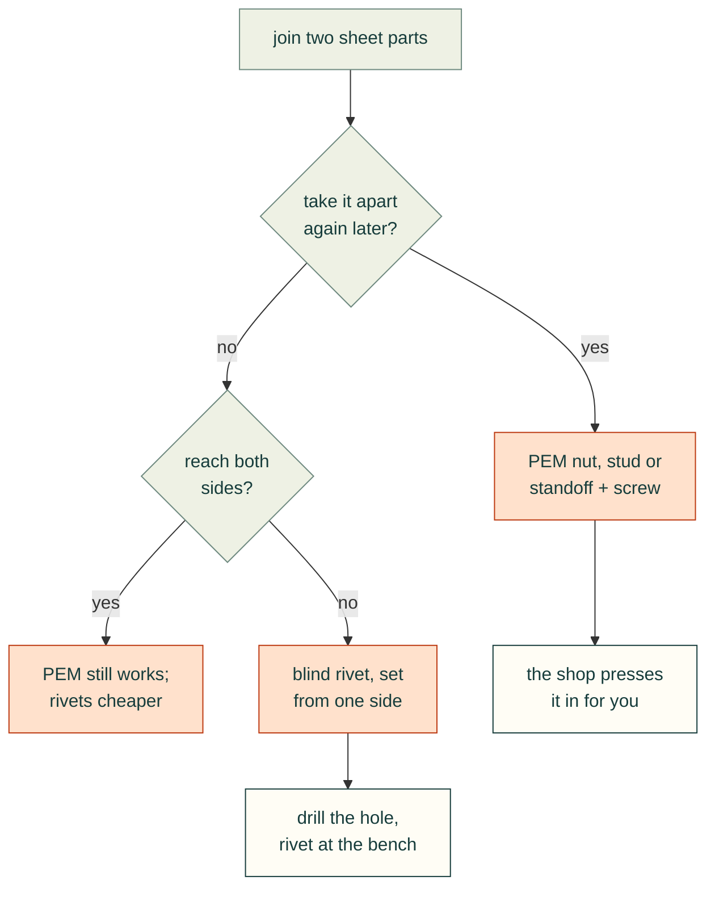

**How this was checked.**
- Every source was read on 2026-11-01. PEM's PDFs and the rivet catalogues were read as text, with table pages also
  rendered to check the columns.
- Numbers are given as printed, in the units printed.
- **[derived]** marks a number calculated here from cited data; the method is stated beside it.
- PEM's terms forbid republishing its material [ref:pem-terms-of-use]. This page therefore cites a small subset of
  values as facts with their source, and keeps no PEM table, figure or CAD model. The DIBt assessment for GESIPA
  allows partial reproduction only with written consent, so it is cited by annex.

## 1. Clinch hardware: how it holds

A self-clinching part has a knurled or hex shank and an undercut. A press pushes it into a plain round hole. The sheet
flows into the undercut and locks it [ref:pem-handbook]. So:

- the fastener must be **harder than the sheet**, by about 20 points on the Rockwell B scale;
- the hole must be exact: **+0.08 mm / −0** (+0.003 in), not chamfered or deburred, because deburring removes the
  metal that does the clinching;
- the shop needs **access to both faces** and a press throat deep enough to reach the hole.

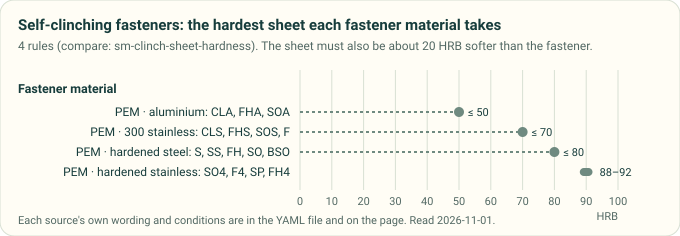

*Diagram drawn by `tools/process_profile_figures.py` from the `compare: sm-clinch-sheet-hardness` rules in
[`process-profiles.yaml`](process-profiles.yaml). A test redraws it and fails if the committed file differs.*

Read with PEM's table of typical sheet hardness [ref:pem-handbook], the chart says which parts go where:

| Sheet | Typical hardness | Parts that clinch into it |
|---|---|---|
| 5052-H32/H34 aluminium | HRB 15–30 | S, SS, CLS, FH, FHS, SO, and the aluminium CLA, FHA, SOA |
| Cold-rolled steel | HRB 40–75 | S, SS, FH, SO; CLS and FHS only up to HRB 70 |
| 6061-T6 aluminium | HRB 50–55 | S, CLS, FH, SO; **not** the aluminium parts, rated to HRB 50 |
| 304 stainless, annealed | HRB 80 and over | only the hardened-stainless SP, SMPP, FH4, FHP, SO4, F4 |

- PEM: "DON'T attempt to install any self-clinching nut other than types SP/SMPP … into a stainless steel sheet"
  [ref:pem-bulletin-cl].
- ASTM A240 lets 304 sheet reach HRB 92. SP and SMPP are rated to HRB 90 and SO4 and F4 to HRB 88, so a check should
  compare the sheet's specified hardness, not the alloy's name [ref:pem-tech-sheet-stainless].
- Processes that harden the sheet near the hole break the rule: punching 300-series stainless, laser cutting the
  hole, hard anodising and nitriding [ref:pem-handbook].

## 2. Clinch hardware: where it may go

Four distances place a part. PEM gives three of them; a shop adds its own.

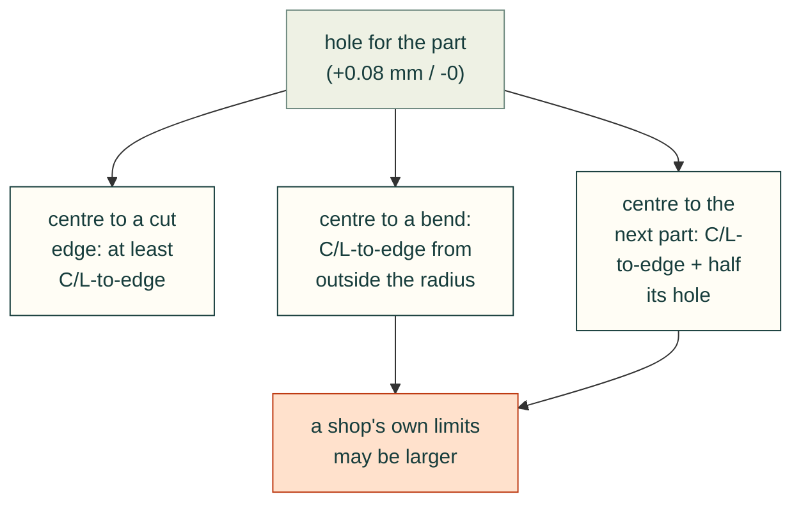

- **Edge** [ref:pem-tech-sheet-cl-to-edge]: each part's catalogue C/L-to-edge applies to **one edge only**. Near two
  edges the published strengths no longer hold, and "no sheet thickness is large enough" to restore them once the
  distance is broken.
- **Bend** [ref:pem-tech-sheet-cl-to-edge] [ref:pem-handbook]:
  - the part must sit outside the bend radius, on flat sheet;
  - the C/L-to-edge is then measured from the outside of the bend radius;
  - the press tooling may need more room still;
  - bend first, then make the hole and press the part in, so the hole stays round.
- **Spacing** [ref:pem-handbook]: centre to centre ≥ C/L-to-edge + half the second part's hole. For two CLS-M3-1 nuts:
  4.8 + 4.22 / 2 = **6.91 mm** [derived].
- **Side**: press the part in from the punch side of a punched hole, and always from the punch side at 2.29 mm
  (0.09 in) and thicker, where the die side's hole is too large [ref:pem-handbook].
- **Load**: a nut's load should pull it **into** the sheet. Never drive the screw in from the nut's head side
  [ref:pem-bulletin-cl]. SendCutSend states the same for its nuts, and the reverse for standoffs
  [ref:sendcutsend-hardware-service].
- **Finish order** [ref:pem-handbook] [ref:pem-tech-sheet-finish]:
  - press parts in **after** plating or anodising, and never through paint or powder coat;
  - do not put steel or stainless parts in aluminium before it is anodised;
  - stainless parts in an aluminium panel make a large galvanic couple.

**SendCutSend applies PEM's formulas with its own edge distance** [derived from the hardware feed
[ref:sendcutsend-catalog]]:
- for all 33 steel nuts and standoffs and 28 of 31 steel studs, its same-part spacing M equals its edge distance K
  plus half its hole, to 0.0035 in. For S-M3-0: 0.25 + 0.171 / 2 = 0.336 in, as listed;
- its worked example, a 1/4-20 nut in 0.063 in 5052, gives 0.340 in to the edge and 0.512 in centre to centre
  [ref:sendcutsend-pem-guide], which is PEM's 0.34 + 0.344 / 2;
- for small parts its K is larger than PEM's: M3 nuts get 0.25 in (6.35 mm) against PEM's 4.8 mm. The M3 nut's
  listed press tool is 0.51 in across, and K is about half of that, so the tooling, not the clinch, seems to set it.

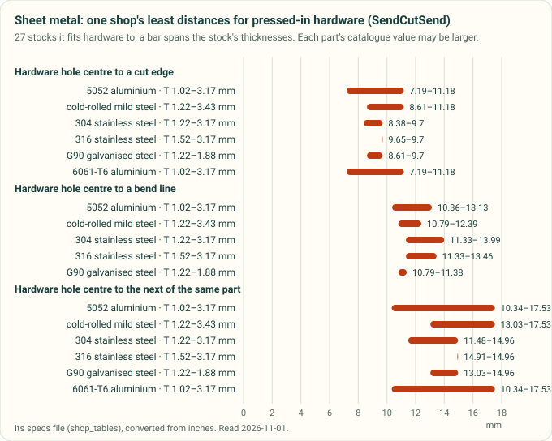

*Diagram drawn by `tools/process_profile_figures.py` from SendCutSend's `sendcutsend-cut-and-hardware-limits` table in
[`process-profiles.yaml`](process-profiles.yaml): the per-stock minimums of its specs feed, across 27 stocks. Each
part's own catalogue value may be larger. A test redraws it and fails if the committed file differs.*

**The check.** `cadagent.mechanical.clinch.check_placement` runs PEM's rules in this section on one part: the sheet's
hardness against the part's material (and no listed part in stainless sheet), the thickness for its shank, the hole
band, the edge, the bend (BA/2 + E from the bend centre line, with the bend allowance from
`cadagent.manufacturing.sheet_metal.bend` for 5052 and cold-rolled steel), each neighbour both ways round, and any
push-out, torque or pull-through load against PEM's averages. Its parts are the cited subset in §3, and `parts_for`
lists those that clinch into a given sheet, steel nuts first. A shop's per-part limits stay in that shop's profile.

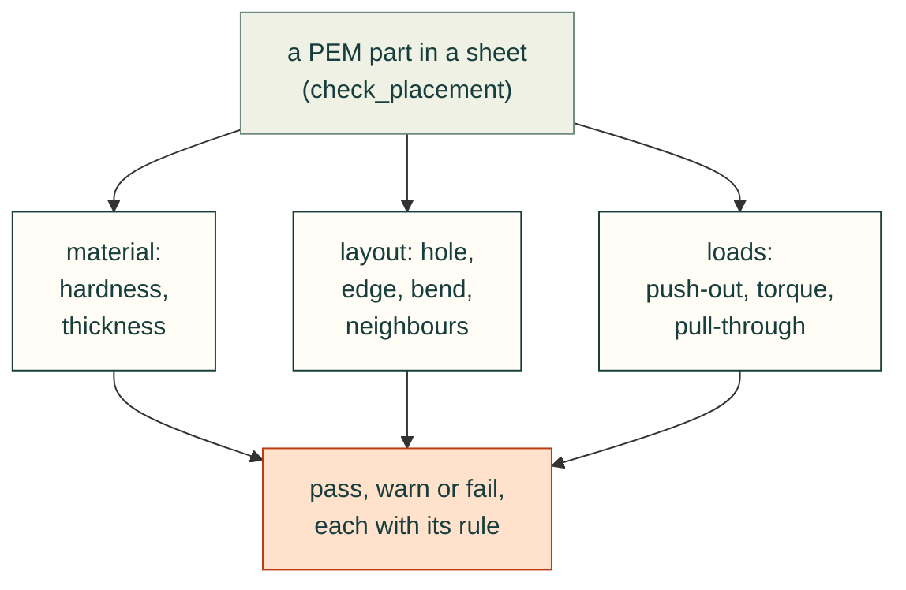

*What `check_placement` reads. The loads are optional; each check names the `sm-clinch-*` rule or the PEM bulletin row
it compares against.*

## 3. The common parts, by the numbers

These are a cited subset of PEM's bulletins for the sizes most enclosures use. Strengths are averages from PEM's own
tests; PEM recommends testing the joint in the real part [ref:pem-bulletin-cl].

**Nuts S (zinc-plated hardened steel) and CLS (300 stainless), shank code 1** [ref:pem-bulletin-cl]. M5 and #10 are
the SS and CLSS types. Push-out and torque-out are in 5052-H34 aluminium / cold-rolled steel; PEM does not print the
test sheet's thickness.

| Thread | Hole | Thinnest sheet | Centre to edge | Push-out | Torque-out |
|---|---|---|---|---|---|
| M3 | 4.22 mm | 1.0 mm | 4.8 mm | 400 / 550 N | 1.13 / 1.7 N·m |
| M4 | 5.41 mm | 1.0 mm | 6.9 mm | 470 / 645 N | 2.6 / 4.0 N·m |
| M5 | 6.35 mm | 1.0 mm | 7.1 mm | 480 / 800 N | 3.6 / 4.5 N·m |
| M6 | 8.75 mm | 1.4 mm | 8.6 mm | 1580 / 1760 N | 10.2 / 17 N·m |
| #4-40 | 0.166 in | 0.040 in | 0.19 in | 90 / 125 lbf | 10 / 15 in·lbf |
| #6-32 | 0.1875 in | 0.040 in | 0.22 in | 95 / 130 lbf | 17 / 20 in·lbf |
| #8-32 | 0.213 in | 0.040 in | 0.27 in | 105 / 145 lbf | 23 / 35 in·lbf |
| #10-32 | 0.250 in | 0.040 in | 0.28 in | 110 / 180 lbf | 32 / 40 in·lbf |
| 1/4-20 | 0.344 in | 0.056 in | 0.34 in | 360 / 400 lbf | 90 / 150 in·lbf |

- Shank code 0 fits sheet from 0.8 mm (0.030 in) but holds less; code 2 holds about twice as much
  [ref:pem-bulletin-cl].
- Push-out is roughly 5–10 % of the force used to press the part in [ref:pem-handbook].
- The screw usually fails before a steel S nut does. PEM's torque sheet gives the least axial strength with a 180 ksi
  screw, 1086 lbf for S-440-1ZI and 849 lbf for CLS-440-1, and a tightening torque by screw grade
  [ref:pem-mating-screw-torque].

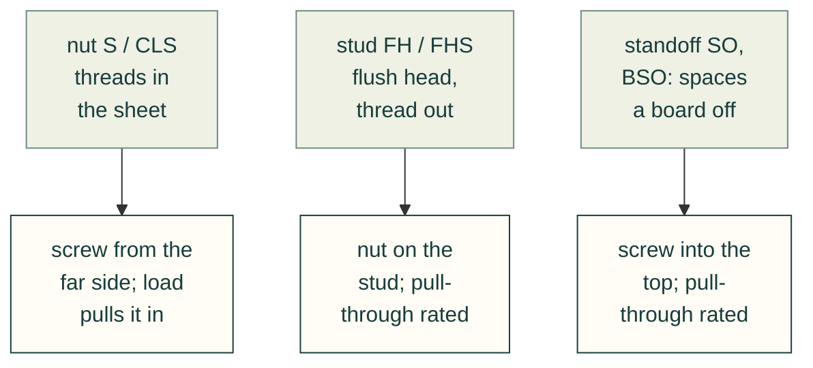

**Studs FH (hardened steel) and FHS (stainless)**, flush head, for sheet from 1 mm (0.040 in) [ref:pem-bulletin-fh].
Strengths are for FH in 1.6 mm aluminium (HRB 29) / 1.5 mm steel (HRB 59); M6 in 2.4 / 2.2 mm.

| Thread | Hole | Thinnest sheet | Centre to edge | Push-out | Pull-through |
|---|---|---|---|---|---|
| M3 | 3.0 mm | 1.0 mm | 5.6 mm | 600 / 820 N | 3150 / 3840 N |
| M4 | 4.0 mm | 1.0 mm | 7.2 mm | 975 / 1780 N | 4448 / 5650 N |
| M5 | 5.0 mm | 1.0 mm | 7.2 mm | 1070 / 2000 N | 5170 / 6270 N |
| M6 | 6.0 mm | 1.6 mm | 7.9 mm | 1660 / 2560 N | 10200 / 11300 N |

**Standoffs SO (through-threaded) and BSO (blind)** [ref:pem-bulletin-so]. Strengths are for steel SO parts in
1.5 mm 5052-H34 / cold-rolled steel. PEM notes that the screw, not the standoff, often fails first.

| Thread | Hole | Thinnest sheet | Centre to edge | Push-out | Pull-through | Screw torque, at most |
|---|---|---|---|---|---|---|
| M3 | 4.22 mm | 1.0 mm | 6.0 mm | 710 / 1000 N | 1245 / 1465 N | 0.55 N·m |
| M4 | 7.14 mm | 1.27 mm | 8.0 mm | 1780 / 2490 N | 2575 / 3110 N | 2.0 N·m |
| M5 | 7.14 mm | 1.27 mm | 8.0 mm | 1780 / 2490 N | 2575 / 3110 N | 3.6 N·m |

**Flush nuts F** (300 stainless) sit level with the sheet, from 1.5 mm (0.060 in) up [ref:pem-bulletin-f].

## 4. Which parts are common and cheap

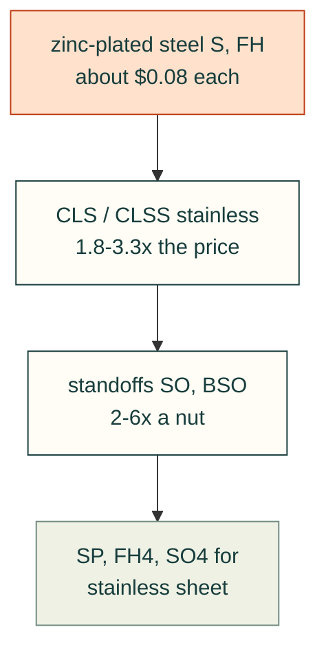

**Loose parts, from a distributor** [ref:bossard-pem-prices]. Bossard Americas' web shop, read 2026-11-01. US dollars
each at 1–249 / 1000–4999, and the stock count:

Nine common PEM parts at Bossard: price at 1–249 and 1000–4999, and stock

| Part | 1–249 | 1000–4999 | In stock |
|---|---|---|---|
| S-M3-1ZI (steel nut) | $0.0845 | $0.0672 | 421 261 |
| CLS-M3-1 (stainless nut) | $0.1527 | $0.1215 | 186 313 |
| S-M4-1ZI | $0.0915 | $0.0728 | 410 479 |
| S-632-1ZI | $0.0847 | $0.0674 | 1 037 941 |
| SS-032-1ZI | $0.1056 | $0.0840 | 294 688 |
| FH-M3-10ZI (steel stud) | $0.0739 | $0.0588 | 24 434 |
| FH-832-8ZI | $0.0867 | $0.0689 | 157 461 |
| SO-M3-6ZI (steel standoff) | $0.2134 | $0.1698 | 12 737 |
| BSO-M3-6ZI (blind standoff) | $0.5060 | $0.4025 | 19 801 |

From those 40 pages [derived]:
- zinc-plated steel S nuts and FH studs are the cheapest, about $0.07–0.09 for M3–M5 and #4–#10, and the most stocked;
- stainless CLS and CLSS cost 1.8–3.3 times the steel part;
- the shortest shank, CLS-M3-0, costs about twice CLS-M3-1;
- standoffs cost 2–6 times a nut.

**Pressed in by SendCutSend** [ref:sendcutsend-catalog]. Its ordering feed (generated 2026-04-29) lists 151 parts:

| Family | Parts | Price each (lowest / median / highest) |
|---|---|---|
| Steel nuts S, SS | 12 | $0.77 / $0.77 / $1.53 |
| Steel studs FH | 35 | $0.77 / $0.77 / $1.53 |
| Steel standoffs SO, BSO | 21 | $1.23 / $1.63 / $2.13 |
| Stainless flush nuts F | 22 | $1.14 / $1.53 / $3.23 |
| A286 nuts SP (stainless sheet) | 12 | $1.83 / $2.13 / $5.73 |
| 400-series studs FH4 | 32 | $0.77 / $1.13 / $1.80 |
| 400-series standoffs SO4, BSO4 | 17 | $1.53 / $2.43 / $3.33 |

The feed does not say whether the price includes pressing the part in. The loose part costs about a tenth of it.

**So the cheap, common choice** for a mounting plate in 5052 or mild steel is a zinc-plated steel S nut or FH stud,
M3–M5 or #4-40 to #10-32, shank code 1 [derived from the two tables]. Take stainless only for stainless sheet (SP, FH4,
SO4) or where the part must not rust.

## 5. SendCutSend's hardware data: what disagrees

The specs feed, the ordering feed, the hardware catalogue page [ref:sendcutsend-hardware-catalog] and PEM's bulletins
were compared part by part [derived]:

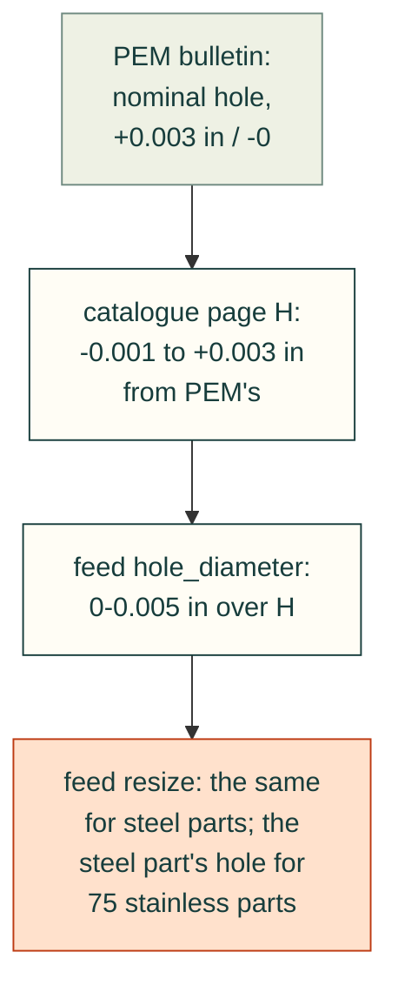

- **Hole sizes.** The ordering feed has two hole fields per part, `hole_diameter` and `additional_specs.resize`, and
  does not say which one SendCutSend cuts to.
  - Against the catalogue page's H, `hole_diameter` is equal for 24 parts, 0.001 in larger for 67, 0.003 in for 51
    and 0.005 in for 3.
  - For the 68 steel parts (S, SS, FH, SO) the two fields agree. The feed has 83 stainless parts (F, FH4, SO4, SP), 80
    with a `resize`; for 75 of those
    `resize` differs, and seems to repeat the steel part of the same thread. F-M4-1 lists `resize` 0.213 in, the S-M4
    nut's hole, though the flush nut needs 0.290 in (its `hole_diameter` and the page's H).
  - For 13 of 21 common steel nuts, studs and standoffs, the feed's hole is above PEM's band (nominal +0.003 in), by
    up to 0.006 in. Examples: S-M3-0 0.171 in against PEM's 4.22 mm (0.166 in), and FH-M3-10 0.124 in against 3.0 mm
    (0.118 in). The 21 parts are listed below.
  - The catalogue page's H sits within −0.001 / +0.003 in of PEM's hole: S-M4-0 is 0.001 in under PEM's band, and
    FH-M3-10 0.0029 in over its nominal. Until SendCutSend says which field it cuts to, draw PEM's own hole (the
    bulletin's nominal) and check the hole SendCutSend's quote shows. Do not rely on `resize` for stainless or flush
    parts.
  - **Which field is cut is not known.** cad-agent takes the conservative reading. `cadagent.mechanical.clinch`
    checks a drawn hole against PEM's band (nominal +0.08 mm / −0), never against either feed field, so a part
    drawn to the feed's larger hole fails there. Asking SendCutSend is left to the project's owner.

The 21 common parts compared: PEM's hole, the catalogue page's H and the feed's hole_diameter

| Part | PEM nominal (in) | Page H (in) | Feed (in) | Feed over PEM (in) |
|---|---|---|---|---|
| S-M3-0 | 0.1661 | 0.168 | 0.171 | 0.0049 |
| S-M4-0 | 0.2130 | 0.212 | 0.213 | 0.0000 |
| SS-M5-0 | 0.2500 | 0.251 | 0.254 | 0.0040 |
| S-M6-0 | 0.3445 | 0.345 | 0.348 | 0.0035 |
| S-440-1 | 0.166 | 0.166 | 0.169 | 0.003 |
| S-632-1 | 0.1875 | 0.187 | 0.190 | 0.0025 |
| S-832-1 | 0.213 | 0.213 | 0.216 | 0.003 |
| SS-032-1 | 0.250 | 0.250 | 0.253 | 0.003 |
| S-0420-1 | 0.344 | 0.344 | 0.347 | 0.003 |
| FH-M3-10 | 0.1181 | 0.121 | 0.124 | 0.0059 |
| FH-M4-10 | 0.1575 | 0.159 | 0.162 | 0.0045 |
| FH-M5-10 | 0.1969 | 0.198 | 0.201 | 0.0041 |
| FH-M6-12 | 0.2362 | 0.236 | 0.239 | 0.0028 |
| FH-440-6 | 0.111 | 0.113 | 0.116 | 0.005 |
| FH-632-8 | 0.137 | 0.139 | 0.142 | 0.005 |
| FH-832-8 | 0.163 | 0.165 | 0.168 | 0.005 |
| FH-032-8 | 0.189 | 0.191 | 0.194 | 0.005 |
| SO-M3-6 | 0.1661 | 0.166 | 0.171 | 0.0049 |
| SO-M4-6 | 0.2811 | 0.281 | 0.282 | 0.0009 |
| SO-440-12 | 0.166 | 0.168 | 0.171 | 0.005 |
| SO-632-8 | 0.213 | 0.215 | 0.218 | 0.005 |

PEM's metric holes are converted from mm (4.22 mm = 0.1661 in). Over 0.003 in: S-M3-0, SS-M5-0, S-M6-0, FH-M3-10,
FH-M4-10, FH-M5-10, the four inch FH studs, SO-M3-6, SO-440-12 and SO-632-8 [derived].

- **Thread codes.** Five feed entries carry the wrong thread code. For example, SP-440-1 is listed as 6-32 (its title
  says 4-40), and FH4-M3-12 as M4.
- **Spacing.**
  - For 47 of the 79 stainless parts, the same-part spacing M is not K plus half the hole; most are smaller, by up to
    0.064 in. They seem to reuse the steel part's value: SP-M3-0 lists 0.336 in, S-M3-0's spacing, though its own
    K + hole / 2 is 0.313 + 0.167 / 2 = 0.397 in.
  - Seven #10-32 studs (FH-032 and FH4-032) list 0.097 in, smaller than their own 0.194 in hole.
- **Names.** The catalogue page calls the SP nut's alloy "A236". PEM's is A286 [ref:pem-handbook].
- **Stainless parts in aluminium.** A 2025 SendCutSend post says stainless hardware cannot be pressed into aluminium
  [ref:sendcutsend-pem-guide]. Yet PEM tests CLS and FHS in 5052, and SendCutSend's own catalogue lists its stainless
  F nuts for aluminium. Treat it as this shop's policy, not a rule of the parts.

## 6. Blind rivets: the parts

A blind rivet is a hollow body on a mandrel. A hand tool pulls the mandrel, which swells the far end and snaps off, so
it is set from one side [ref:pop-rivet-catalog].

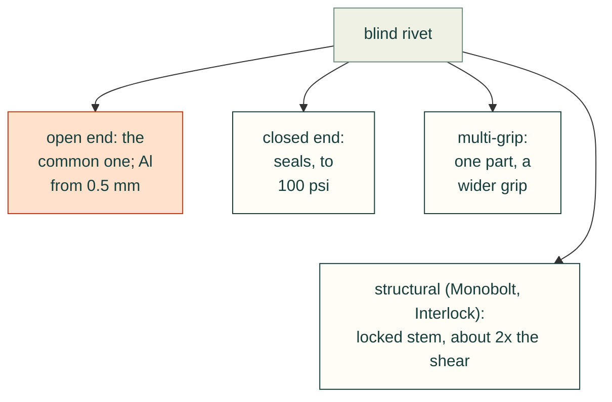

- Bodies come in aluminium (5052, 5056, 1100), steel, 300-series stainless, Monel and copper
  [ref:pop-rivet-catalog].
- The common part is a dome head, open end, aluminium body on a steel mandrel; aluminium on aluminium avoids the steel.
- POP says its rivets are not certified for structural aerospace use [ref:pop-rivet-catalog]. NASA and the FAA say
  the same for critical structure [ref:nasa-1228] [ref:faa-ac-43-13-1b]. For boxes and brackets that is fine, but a
  check should label its results as typical values, not design allowables.

**Strength per rivet: the sources disagree.** Shear / tensile in lbf for a 1/8 in (3.2 mm) dome-head open-end rivet:

| Body / mandrel | POP | Marson | Avdel Avex | McMaster-Carr | GESIPA (3.2 mm) |
|---|---|---|---|---|---|
| Aluminium / aluminium | 155 / 235 | 155 / 240 | | 120 / 150 | |
| Aluminium / steel | 210 / 325 (5056) | 225 / 315 (5056) | 165 / 230 (5052) | 170 / 220 | 162 / 214 (720 / 950 N) |
| Steel / steel | 295 / 425 | 305 / 410 | | 260 / 310 | |
| Stainless / stainless | 550 / 700 | 520 / 600 | | 420 / 530 | |

Sources: [ref:pop-rivet-catalog] pp. 14–23; [ref:marson-rivet-catalog]; [ref:avdel-breakstem-catalog] p. 77;
[ref:mcmaster-blind-rivets]; [ref:gesipa-eta-13-0255] and GESIPA's product pages.

- POP and Avdel print typical values. MIL-HDBK-5J and the GESIPA assessment use minimum or characteristic values
  [ref:mil-hdbk-5j] [ref:gesipa-eta-13-0255].
- McMaster-Carr's ratings run 12–24 % under POP's typical values.
- So a check should use the lowest value printed for the part actually bought.

## 7. Blind rivets: hole, grip and length

- **Hole.** Drill to the maker's range. For 1/8 in rivets, POP and Marson give 0.129–0.133 in (#30); MIL-HDBK-5J gives
  0.1285 in nominal [ref:pop-rivet-catalog] [ref:marson-rivet-catalog] [ref:mil-hdbk-5j]. An oversize hole loses
  strength [ref:avdel-breakstem-catalog]. Multi-grip rivets take a slightly larger hole, 0.129–0.142 in.
- **Grip.** The grip is the total thickness clamped. Each length code covers a band: for POP's 1/8 in aluminium dome
  rivet, AD42 covers 0.063–0.125 in and AD43 0.126–0.187 in [ref:pop-rivet-catalog].
- **Length.** GESIPA's rule is rivet length = grip + diameter [ref:gesipa-rivet-length].
- **Room behind and around.** The rivet sticks out behind the work by its protrusion less the grip. A setting tool's
  nose is 17–23 mm across for POP's power tools, and an offset head sets within 7 mm of a right-angled wall
  [ref:pop-rivet-catalog].

**Two 1.6 mm sheets fall on a grip boundary** [derived]. Two 0.063 in sheets make 0.126 in, the first value of
AD43. SendCutSend holds ALU-063 to ±0.004 in [ref:sendcutsend-specs], so the real grip runs 0.118–0.134 in, across
both bands. A multi-grip rivet (POP AD41-43, 0.039–0.187 in) covers the whole spread.

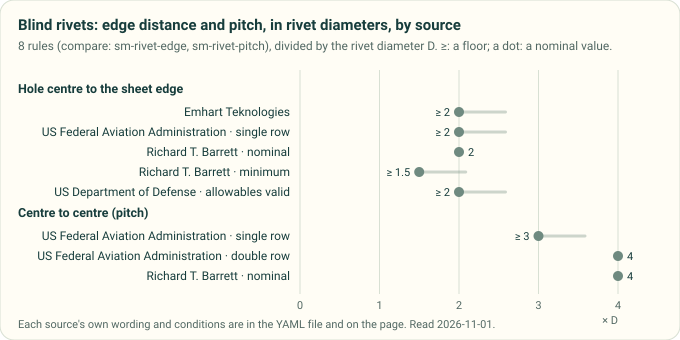

*Diagram drawn by `tools/process_profile_figures.py` from the `compare: sm-rivet-edge` and `compare: sm-rivet-pitch`
rules in [`process-profiles.yaml`](process-profiles.yaml), divided by the rivet diameter. A test redraws it and fails
if the committed file differs.*

## 8. Blind rivets: designing the joint

| Rule | Value | Source |
|---|---|---|
| Edge distance | ≥ 2D for full strength | [ref:pop-rivet-catalog] p. 11; [ref:faa-ac-43-13-1b] 4-57c |
| Edge distance | 2D nominal, 1.5D at least | [ref:nasa-1228] p. 21 |
| Pitch, one row | ≥ 3D | [ref:faa-ac-43-13-1b] 4-57c |
| Pitch, two rows | 4D, rows 4D apart | [ref:faa-ac-43-13-1b] Fig. 4-5 |
| Pitch, three or more rows | 6D in each row, staggered, rows 3D apart | [ref:faa-ac-43-13-1b] Fig. 4-5 (B) |
| Pitch, nominal | 4D | [ref:nasa-1228] pp. 21, 34 |
| Rivet size | D ≈ 3 × the thicker sheet | [ref:faa-ac-43-13-1b] 4-57c |
| Sheet for the bearing allowables | t ≥ 0.18D (solid rivets, 8.1.2.1); blind rivets: take care below 0.25D (8.1.3) | [ref:mil-hdbk-5j] |
| Allowables hold | only within the maker's grip and hole, and e/D ≥ 2 | [ref:mil-hdbk-5j] 8.1.3 |
| Loading | rivets in shear, not in tension | [ref:faa-ac-43-13-1b] 4-57g |
| Mixing | no bolts and rivets sharing one load | [ref:nasa-1228] p. 21 |

No source read gives a **largest** pitch. NASA notes only that thin sheet can buckle between fasteners
[ref:nasa-1228].

A joint fails in its weakest of four ways. The worked examples in the sources check them in this order:

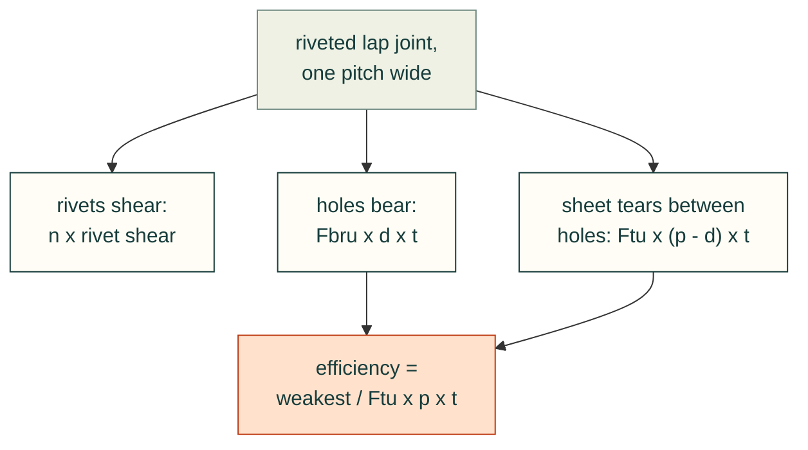

- MIL-HDBK-5J tabulates the bearing strength Fbru by edge distance (e/D 1.5 and 2.0, linear between, 1.4.7.1), so the
  bearing check also covers the sheet tearing out to the edge. Its D is the hole, not the rivet's nominal size
  (1.4.7), so a rivet at 2D of its nominal size sits a little under e/D 2.0 [ref:mil-hdbk-5j].
- Two of its values serve as test vectors [ref:mil-hdbk-5j]:
  - single shear of a 1/8 in 5056 **solid** rivet: 28 ksi × π/4 × 0.1285² = **363 lbf** (Table 8.1.2(b)). It tests
    the equation; a blind rivet's shear is its maker's rating;
  - bearing at 100 ksi, 1/8 in, t = 0.040 in: 100 ksi × 0.1285 × 0.040 = **514 lbf** (Table 8.1.2.1(a)).

**Worked example** [derived]: two 1.6 mm (0.063 in) 5052-H32 sheets in a single lap. One row of 1/8 in aluminium
POP rivets at 2D from the edge (6.35 mm) and 3D pitch (9.53 mm, 0.375 in). Hole 0.1285 in. MIL-HDBK-5J's 5052-H32
values: Ftu 31 ksi; Fbru 50 ksi at e/D 1.5 and 65 ksi at 2.0. On the hole, e/D = 0.25 / 0.1285 = 1.95, so Fbru is
63.4 ksi.

| Check | Per pitch |
|---|---|
| t/D = 0.063 / 0.1285 | 0.49, above 0.18 and 0.25 |
| Rivet shear, POP typical | 155 lbf (690 N) |
| Bearing, 63.4 ksi × 0.1285 × 0.063 | 513 lbf |
| Tear between holes, 31 ksi × (0.375 − 0.1285) × 0.063 | 481 lbf |
| Solid sheet, 31 ksi × 0.375 × 0.063 | 732 lbf |
| Efficiency, 155 / 732 | 0.21: the rivet shears first |

**The check.** `cadagent.mechanical.rivets.check_joint` runs every rule in this section on a stack, against the
`sm-rivet-*` rules, and computes the strength per pitch with `cadagent.formulas.lap_joint`. Its rivets are the POP
and McMaster-Carr parts above, and `rivets_for` finds the ones whose grip covers a stack with its tolerance. Its
limits: typical or listed rivet strengths, not allowables; rivets in shear only; MIL-HDBK-5J's sheet strengths for
the named tempers, with annealed AISI 1025 standing in for mild steel.

In thin aluminium the rivet, not the sheet, limits the joint, so more or larger rivets are the lever, not thicker
sheet. With McMaster-Carr's 120 lbf rating the efficiency falls to 0.16.

## 9. Which rivet for which sheet

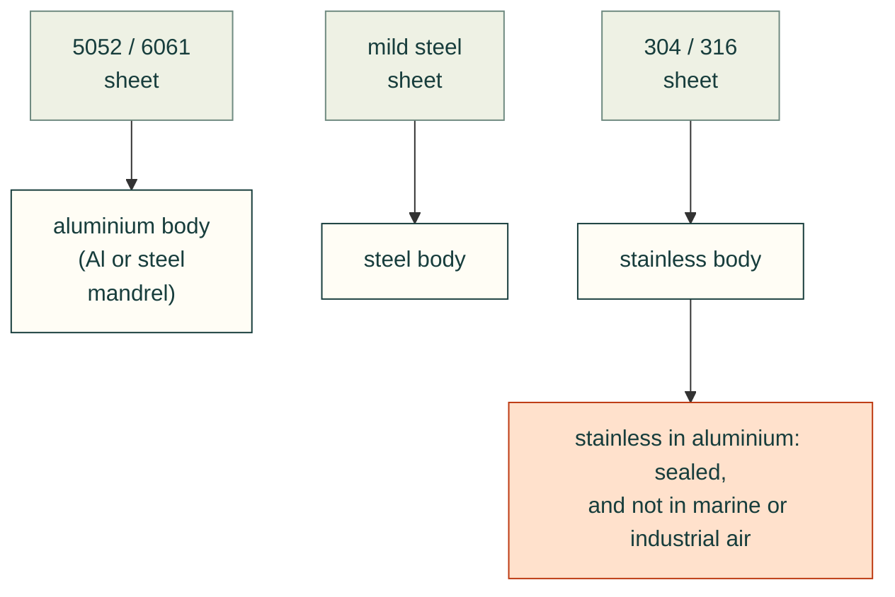

- Use the same metal as the sheet, or a more noble one for the small part [ref:mil-std-889c] 5.1.3. The rivet makers
  say the same [ref:avdel-breakstem-catalog] [ref:marson-rivet-catalog].
- Stainless fasteners in aluminium sheet are acceptable, but not the reverse, and the faying edges should be sealed
  [ref:mil-std-889c] 5.2a.
- MIL-STD-889C's Table I marks aluminium with austenitic stainless, and aluminium with carbon steel, as incompatible
  in marine and industrial air [ref:mil-std-889c].
- Carbon-steel fasteners in stainless are poor practice; stainless fasteners in carbon steel are acceptable
  [ref:nasa-1228] p. 5.
- SendCutSend's galvanic post gives the same advice without voltages: match the metals, isolate them, or coat them
  [ref:sendcutsend-galvanic].
- An anodic-index table in volts is in MIL-STD-889D (paid) and was not read.

**Rivet prices** [ref:mcmaster-blind-rivets], read 2026-11-01, dome head:

Five 1/8 in McMaster-Carr rivets: body, grip, pack and price each

| Part | Body / mandrel | Size and grip | Pack | Price | Each [derived] |
|---|---|---|---|---|---|
| 97447A015 | aluminium / aluminium | 1/8 in, 0.063–0.125 in | 250 | $10.78 | $0.043 |
| 97447A020 | aluminium / aluminium | 1/8 in, 0.126–0.187 in | 250 | $10.57 | $0.042 |
| 97517A015 | aluminium / steel | 1/8 in, 0.063–0.125 in | 250 | $11.13 | $0.045 |
| 97519A015 | steel / steel | 1/8 in | 250 | $13.83 | $0.055 |
| 97525A415 | 18-8 / 18-8 | 1/8 in, 0.063–0.125 in | 100 | $11.54 | $0.115 |

A riveted seam therefore costs a few cents a rivet, against about $0.77 for each part SendCutSend presses in.

## 10. Where the sources disagree

Eight rivet and clinch topics where the sources disagree, and what is kept

| Topic | Spread | Kept as |
|---|---|---|
| Rivet edge distance | 2D (POP, FAA, NASA nominal) to 1.5D (NASA minimum) | 2D, with 1.5D as the floor and a warning between |
| Rivet pitch | 3D (FAA, one row) to 4D (NASA nominal; FAA, two rows) | 3D floor, 4D nominal |
| 1/8 in Al/Al rivet shear | 120 (McMaster-Carr) to 155 lbf (POP, Marson) | the lowest value for the part bought |
| 5/32 in drill | #20 (Marson) or #21 (MIL-HDBK-5J) | the maker's range |
| HB for PEM's aluminium limit HRB 50 | HB 82 (bulletins CL, FH, SO) or HB 89 (handbook, CL table) | HRB 50 governs |
| HB for PEM's hardened-stainless limit HRB 92 | HB 195 (FH bulletin) or HB 202 (handbook) | HRB governs |
| Stainless clinch parts in aluminium | PEM tests them in 5052; a SendCutSend post says no | PEM for the rule; the shop's limit in its profile |
| Hole for a clinch part | PEM nominal +0.08 mm; SendCutSend's feed up to 0.15 mm over | PEM's hole (the catalogue page's H is within −0.001 / +0.003 in of it); confirm the feed's with the shop |

## 11. What this changes in cad-agent

- **Rules:** the `sm-clinch-*` and `sm-rivet-*` rules in [`process-profiles.yaml`](process-profiles.yaml) cite these
  sources. SendCutSend's limits are a shop profile, used only when a caller names it.
- **Next, the checks (#283, PR B):**
  - a clinch-hardware check: sheet hardness, hole, thickness by shank, and distances to edges, bends and other parts
    (`cadagent.mechanical.clinch`);
  - a rivet-joint check: grip band, hole, edge, pitch, shear, bearing and tear-out, with the vectors above as tests
    (`cadagent.mechanical.rivets`, the first of these).
- **Then the catalogue and skill (#283, PR C):**
  - a parts catalogue of PEM parts and rivets with prices, dates and where to buy;
  - a short skill for the bent-plate, PEM and rivet pattern.
- **Open questions:**
  - whether PEM's numbers may be stored in the MIT repo as data (PEM's terms forbid republishing its material; this
    page cites a subset as facts);
  - why SendCutSend's feed holes sit above PEM's band, which is a question for SendCutSend.
