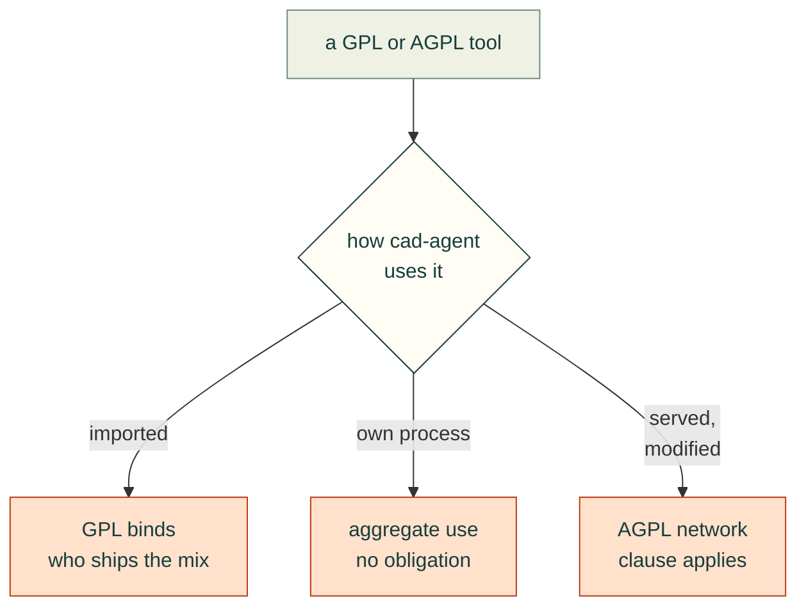

# FOSS simulation and optimisation survey for cad-agent (J501 / AGX Orin enclosure)

Survey date: 2026-10-26. Licences were checked against each repo's LICENSE/COPYING file (GitHub API or GitLab API) unless marked otherwise. "Last commit" means the newest commit on the default branch at survey time. Docker tags come from the Docker Hub API on the same day.

Licence rule used throughout:
- **Importing** a GPL/AGPL Python package from our MIT package does not change our source licence. But anyone who distributes the combined program must do so under the GPL, and the FSF treats an import as a combination. So GPL packages stay optional extras or run behind a process boundary.
- **Calling** a GPL/AGPL program as a separate process (subprocess or Docker), and exchanging files with it, is ordinary "aggregate" use. It puts no obligation on cad-agent's licence.
- AGPL's network clause applies only if we modify the AGPL program and offer it to users over a network.



> Existing exposure to flag: cad-agent already does `import gmsh`. Gmsh is GPL-2.0-or-later. Its exception covers combination with Netgen, METIS, OpenCASCADE and ParaView, but not with arbitrary MIT code ([gmsh.info/LICENSE.txt](https://gmsh.info/LICENSE.txt), [PyPI gmsh 4.15.2, "GPLv2+"](https://pypi.org/project/gmsh/)). This is the same situation as foamlib below. Document gmsh as an optional dependency, or call it via its CLI.

---

## 1. 3D topology optimisation from Python

| Candidate | Licence (verified) | Maintenance | Install | Fit |
|---|---|---|---|---|
| **pyMOTO** | MIT ([repo](https://github.com/aatmdelissen/pyMOTO)) | v2.0.1, 2026-05-07; last commit 2026-06-02 ([releases](https://github.com/aatmdelissen/pyMOTO/releases)) | `pip install pymoto[fast]` or `conda install -c aatmdelissen pymoto` ([README](https://github.com/aatmdelissen/pyMOTO#quick-start-installation)) | Best fit. Voxel `VoxelDomain` in 2D and 3D; density filter; robust (eroded/dilated) formulation for minimum length scale; **`OverhangFilter`** (Langelaar AM filter, [example](https://github.com/aatmdelissen/pyMOTO/blob/master/examples/topology_optimization/ex_compliance_overhang.py)); OC, MMA and GCMMA; multigrid-preconditioned CG for 3D; stress constraints; thermal and thermo-mechanical modules (`ex_showcase_thermal.py`, `ex_thermo_mech.py`); `WriteToVTI` to dump the density field every iteration ([io.py](https://github.com/aatmdelissen/pyMOTO/blob/master/pymoto/modules/io.py)). Modules carry their own sensitivities, so non-design regions are just a mask or mapping on the design vector. |
| PyTopo3D | MIT ([repo](https://github.com/jihoonkim888/PyTopo3D)) | v0.3.0, 2026-06-16 ([PyPI](https://pypi.org/project/pytopo3d/)) | `pip install pytopo3d` (`[gpu]` extra uses CuPy) | Simple 3D SIMP on voxels, with "obstacle" (non-design) regions from JSON and optional GPU. The README mentions no overhang or robust filter. A good, small fallback or reference. |
| dl4to | Apache-2.0 ([repo](https://github.com/dl4to/dl4to)) | Last commit 2024-11-19; not on PyPI | `pip install git+https://github.com/dl4to/dl4to` | PyTorch voxel SIMP plus deep-learning research tooling. Stale. |
| FEniTop | **GPL-3.0** ([repo](https://github.com/missionlab/fenitop)) | Last commit 2024-11-01; pinned to **dolfinx 0.7.3** | Manual on a FEniCSx env | Works on unstructured tets with a PDE filter, OC/MMA and MPI. Stale and pinned to an old dolfinx. GPL, so it can only run as a separate process. |
| dolfinx (roll our own) | LGPL-3.0 ([repo](https://github.com/FEniCS/dolfinx)) | v0.11.0, 2026-06; active | Docker `dolfinx/dolfinx:v0.11.0` ([hub](https://hub.docker.com/r/dolfinx/dolfinx)) or conda-forge | The right base if we later need tets and MPI scale. LGPL is fine to import. |
| jax-fem | **GPL-3.0** per the LICENSE file ([repo](https://github.com/deepmodeling/jax-fem)). The PyPI classifier wrongly says BSD ([PyPI](https://pypi.org/project/jax-fem/)). | v0.0.12, 2026-06; active | pip | Differentiable FE on GPU (JAX), with topopt examples. GPL, so it can only run as a separate process. |
| TopOpt_in_PETSc | **Unclear**. GitHub detects no licence; `main.cc` says "The authors reserves all rights" but the repo also ships `lesser.txt` (LGPL text) ([repo](https://github.com/topopt/TopOpt_in_PETSc)) | Last commit 2026-10-17 | Build against PETSc + MPI | Scales to very large structured grids in C++. Avoid until the licence is clarified. |
| beso (CalculiX) | LGPL-3.0 ([repo](https://github.com/calculix/beso)) | Last commit 2025-04-03 | Python scripts + CalculiX ≥2.17 + FreeCAD | BESO on tets via CalculiX `.inp` files. Works, but it's file-driven and needs FreeCAD. |
| scikit-fem topopt example | BSD-3 ([repo](https://github.com/kinnala/scikit-fem)) | Active (12.0.2, 2026-06) | Already installed | **None found**: docs/examples ex01–ex56 contain no topology-optimisation example. We would have to write SIMP + MMA ourselves on top of our existing P2-tet FEA. |
| OpenFOAM adjoint (ESI) | GPL-3 | v2606 | Docker (see §3) | `adjointOptimisationFoam` has `topologyOptimisation` tutorials for **fluid** topology ([tree](https://gitlab.com/openfoam/core/openfoam/-/tree/master/tutorials/incompressible/adjointOptimisationFoam)). This could later shape vents and ducts; it's not for structure. |
| SU2 | LGPL-2.1 | v8.5.0 | — | Has a `fea_topology` test case ([TestCases](https://github.com/su2code/SU2/tree/master/TestCases)). Niche. |

**Recommendation:** use **pyMOTO** (MIT, importable) as the structural and thermal topology engine on a voxel domain built from our CadQuery solids:
- **Non-design regions:** fix them to solid (bosses, insert pockets, port frames, the cooler seat) or to void (cooler, board, connector keep-outs, airflow paths).
- **Printability:** add robust/density filtering for minimum feature size and `OverhangFilter` with the build direction = enclosure Z.
- **Size:** the enclosure is 206×181×112 mm. That is about 4.2 M voxels at 1 mm and about 0.52 M at 2 mm, so optimise per part or per panel (floor, roof, ribs) at 1–2 mm with pyMOTO's multigrid CG.
- **Back to CAD:** convert the result with marching cubes (scikit-image or VTK). Then verify it with our existing scikit-fem P2-tet FEA and a real slice (§5).
- **Fallback:** keep PyTopo3D in reserve. If tets are ever needed, build on dolfinx (LGPL) rather than FEniTop.

## 2. Parametric shape/size optimisation drivers (expensive, multi-objective)

| Candidate | Licence | Latest | Notes |
|---|---|---|---|
| **Optuna** | MIT ([repo](https://github.com/optuna/optuna)) | v5.0.0, 2026-09-07 ([release notes](https://github.com/optuna/optuna/releases/tag/v5.0.0)) | v5 made `GPSampler` stable, with **qLogEHVI / qLogCEHVI**: batch multi-objective Bayesian optimisation with constraints. TPE is now the default multi-objective sampler. A new core `trial.set_constraint()` API was added. Storage is RDB or Journal, so runs are resumable and parallel, and it includes Pareto plots. |
| pymoo | Apache-2.0 ([repo](https://github.com/the-dual-space/pymoo)) | 0.6.2, 2026-06-28 | NSGA-II/III, MOEA/D, constraint handling, decision making. Better suited to cheap surrogates than to expensive CFD. |
| Ax / BoTorch | MIT ([Ax](https://github.com/meta/Ax), [BoTorch](https://github.com/meta-pytorch/botorch)) | Ax 1.3.1 (2026-06-09), BoTorch 0.18.1 (2026-06-08) | The most capable Bayesian optimisation (qNEHVI, multi-fidelity), but heavier (PyTorch). |
| OpenMDAO | Apache-2.0 ([LICENSE.txt](https://github.com/OpenMDAO/OpenMDAO/blob/master/LICENSE.txt)) | 3.45.1, 2026-09-10 | Gradient-based MDO framework. Worth it only once we have adjoint gradients, e.g. pyMOTO or DAFoam. |
| scipy.optimize | BSD-3 ([repo](https://github.com/scipy/scipy)) | — | Single-objective local optimisers (SLSQP, COBYQA, differential_evolution). Fine for 1–3 parameter refinements. |

**Recommendation:** use **Optuna 5 + GPSampler** as the outer driver over CadQuery parameters (wall thickness, rib count and height, vent area and position, infill). Run it with three objectives and a temperature constraint:
- **Objectives:** grams from the real slicer, compliance or max displacement from FEA, and max TTP temperature from the thermal model.
- **Constraint:** `trial.set_constraint` with T_wall < HDT − margin.
- **Multi-fidelity:** do the bulk of the search on the fast thermal model (§3B), then re-score Pareto candidates with full CHT. Add pymoo only to run NSGA-II on a fitted surrogate.

## 3. CFD + conjugate heat transfer

### OpenFOAM: ESI/OpenCFD vs Foundation

| | ESI / OpenCFD (openfoam.com) | Foundation (openfoam.org) |
|---|---|---|
| Licence | GPL-3 ([v2606 news](https://www.openfoam.com/news/main-news/openfoam-v2606)) | GPL-3 ([COPYING](https://github.com/OpenFOAM/OpenFOAM-dev/blob/master/COPYING)) |
| Current | **v2606** (June 2026); source moved to [gitlab.com/openfoam/core/openfoam](https://gitlab.com/openfoam/core/openfoam) | **v14**, 14 Jul 2026 ([download](https://openfoam.org/download/), [OpenFOAM-14](https://github.com/OpenFOAM/OpenFOAM-14)) |
| Steady CHT solver | `chtMultiRegionSimpleFoam` (tutorial dir `tutorials/heatTransfer/chtMultiRegionSimpleFoam`) | `foamMultiRun` with `fluid` + `solid` modules (e.g. [circuitBoardCooling Allrun](https://github.com/OpenFOAM/OpenFOAM-14/blob/master/tutorials/multiRegion/CHT/circuitBoardCooling/Allrun)); single-region buoyant flow is `foamRun -solver fluid` |
| Closest tutorial | **`cpuCabinet`** ([tree](https://gitlab.com/openfoam/core/openfoam/-/tree/master/tutorials/heatTransfer/chtMultiRegionSimpleFoam/cpuCabinet)): snappyHexMesh multi-region. Regions are `domain0` (air), `v_CPU` (solid with 100 W `scalarSemiImplicitSource` on `h`) and `v_fins` (heatsink). The fan is an **MRF zone** (`MRFProperties`, ω = 209.44 rad/s). This is almost exactly our problem. | `circuitBoardCooling` (baffles), `heatExchanger` (porous region + inter-region heat transfer), `heatedDuct`, `hotWire` (snappy) ([tree](https://github.com/OpenFOAM/OpenFOAM-14/tree/master/tutorials/multiRegion/CHT)) |
| Fan models | `fan` cyclic-baffle jump BC with modes velocity / uniformVelocity / **volumeFlowRate** / nonDimensional ([fanFvPatchField.H](https://gitlab.com/openfoam/core/openfoam/-/blob/master/src/finiteVolume/fields/fvPatchFields/derived/fan/fanFvPatchField.H)); `fanPressure`; `swirlFanVelocity`; **`fanMomentumSource`** fvOption: Δp(Q) fan curve applied in a cellZone ([header](https://gitlab.com/openfoam/core/openfoam/-/blob/master/src/fvOptions/sources/derived/fanMomentumSource/fanMomentumSource.H)); MRF; `actuationDiskSource`; `explicitPorositySource` | `fanPressureJump` and `fanPressure` BCs ([src](https://github.com/OpenFOAM/OpenFOAM-14/tree/master/src/finiteVolume/fields/fvPatchFields/derived)); fvModels `actuationDisk`, `radialActuationDisk`, `porosityForce`, `interRegionHeatTransfer`, `heatSource` ([src/fvModels](https://github.com/OpenFOAM/OpenFOAM-14/tree/master/src/fvModels)); MRF ([mixerVessel2DMRF](https://github.com/OpenFOAM/OpenFOAM-14/tree/master/tutorials/fluid/mixerVessel2DMRF)) |
| Docker | `opencfd/openfoam-run:2606` (runtime only, 2026-06-23). `opencfd/openfoam-default:2512` / `latest` has tutorials and source; **no 2606 tag yet** ([run](https://hub.docker.com/r/opencfd/openfoam-run/tags), [default](https://hub.docker.com/r/opencfd/openfoam-default/tags)). The `openfoam-docker` starter script that dl.openfoam.com served is gone (404, checked 2026-11-01); OpenCFD's Docker instructions are on [openfoam.com](https://www.openfoam.com/download/openfoam-installation-on-mac-using-docker). | **No official images after v11**: the newest on Docker Hub is `openfoam/openfoam11-paraview510`, last updated 2024-06 ([hub](https://hub.docker.com/u/openfoam)). v14 is shipped as Ubuntu apt packages (needs sudo) or source. |

### Other solvers

| Candidate | Licence (verified) | Status | CHT / fan fit |
|---|---|---|---|
| Elmer FEM | GPL-2.0+; ElmerSolver library and some modules LGPL-2.1, most solver modules GPL ([LICENSE.md](https://github.com/ElmerCSC/elmerfem/blob/devel/LICENSE.md), [licence policy](https://github.com/ElmerCSC/elmerfem/tree/devel/license_texts)) | release-26.2 (2026-04-28); active. Docker build repo [ElmerCSC/elmerfem-docker](https://github.com/ElmerCSC/elmerfem-docker) | Strong for conduction, thermal and multiphysics on gmsh tets. Fan-driven turbulent air needs more effort than OpenFOAM. A good **solid-side** thermal and thermo-mechanical solver. |
| SU2 | LGPL-2.1 ([LICENSE.md](https://github.com/su2code/SU2/blob/master/LICENSE.md)) | v8.5.0 (2026-04-27) | Has `coupled_cht` and `solid_heat_conduction` test cases ([TestCases](https://github.com/su2code/SU2/tree/master/TestCases)). Aero-oriented, with no snappy-style STL meshing. Not recommended here. |
| Code_Saturne | GPL-2.0 ([repo](https://github.com/code-saturne/code_saturne)) | v9.2.0; docker `simvia/code_saturne:9.2.0` (2026-07-13) ([hub](https://hub.docker.com/r/simvia/code_saturne)) | Industrial-grade finite-volume solver with CHT. Smaller ecosystem for STL → mesh. Second choice. |
| XLB (Autodesk) | Apache-2.0 ([LICENSE](https://github.com/Autodesk/XLB/blob/main/LICENSE)) | v0.3.1 (2026-01-12); `pip install "xlb[warp]"` | GPU LBM (Warp/JAX), differentiable. The README mentions **no thermal/CHT**, so it's isothermal airflow only. |
| lettuce | MIT ([repo](https://github.com/lettucecfd/lettuce)) | 0.3.0 (2026-10-06); `pip install lettucecfd` (the PyPI name `lettuce` is an unrelated package) | PyTorch GPU LBM; no thermal in the README. Research grade. |
| OpenLB | GPL-2.0 ([LICENSE](https://gitlab.com/openlb/release/-/blob/master/LICENSE)) | 1.9r0 (2025-12-18) ([download](https://www.openlb.net/download/)) | C++ GPU LBM with thermal examples (`examples/thermal`: Rayleigh–Bénard, porous plate) and a "Conjugate Heat Transfer" showcase listed on the site (not inspected). Works only as a separate process. |
| Palabos | **AGPL-3.0** ([COPYING](https://gitlab.com/unigespc/palabos/-/blob/master/COPYING)) | Active (2026-07) | Works only as a separate process. No advantage over OpenFOAM for our case. |
| FluidX3D | Non-commercial licence | — | **Rejected** per the brief. |
| DAFoam | GPL-3 ([LICENSE.md](https://github.com/mdolab/dafoam/blob/main/LICENSE.md)) | v5.1.1; docker `dafoam/opt-packages:v5.1.1` | Discrete adjoint of OpenFOAM + OpenMDAO. A future option for gradient-based vent shape optimisation. |
| CfdOF (FreeCAD) | LGPL-3 ([repo](https://github.com/jaheyns/CfdOF)) | Active | A GUI case generator for snappy and cfMesh, porous regions, buoyant flow. The README shows no multi-region CHT. A useful reference for writing snappy dictionaries. |

### Python case-generation helpers

- [foamlib](https://github.com/gerlero/foamlib): **GPL-3.0**, v1.9.0 (2026-10-19). A modern parser/writer with an async runner.
- [PyFoam](https://pypi.org/project/PyFoam/): **GPL**, 2026.6.
- [fluidfoam](https://pypi.org/project/fluidfoam/): GPL-3.0-or-later.
- `ofpp`: MIT, but stale (2023).

None of the good options is permissive. **Recommendation:**
- Generate the dictionaries ourselves from MIT Jinja/string templates. FoamFile syntax is simple, and the `cpuCabinet` case is a template.
- Read results with PyVista's `OpenFOAMReader` (MIT).
- Or confine foamlib to an optional GPL extra that runs as a separate process.

### Recommended primary path: steady CHT, a few M cells, 24 cores

**ESI OpenFOAM v2606 in Docker (`opencfd/openfoam-run:2606`; use `openfoam-default:2512` for tutorials), `chtMultiRegionSimpleFoam`, starting from `cpuCabinet`.** Rationale:
- It's a near-identical tutorial.
- It has the richest fan options: `fan` BC in `volumeFlowRate` mode, or `fanMomentumSource`, both driven by the datasheet P–Q curve; MRF if the blades are modelled.
- Official Docker images exist and don't need sudo. The Foundation route would need apt (sudo) or a source build.

Pipeline:
1. CadQuery exports one STL per region: fluid = enclosure interior minus solids; solids = TTP/module block with a volumetric heat source, heatsink fins + base, and heatpipes as high-k solids; optionally the PLA walls as a solid region so wall temperature is resolved.
2. `blockMesh` → `surfaceFeatureExtract` → `snappyHexMesh` → `splitMeshRegions -cellZones` → `decomposePar -allRegions` → `mpirun -np 24 chtMultiRegionSimpleFoam -parallel`. This is the cpuCabinet `Allrun` / `Allrun.pre` sequence.
3. Model heatpipes as anisotropic or effective high-conductivity solids. This is my engineering assumption and needs calibration; no source verified.
4. Run time for 2–5 M cells on 24 cores is unmeasured; plan on hours, not minutes.

### Fast low-fidelity path for optimisation loops

- **(a) Thermal resistance network + fan operating point (milliseconds).** Use the fan P–Q line from the datasheet (§6). Use system impedance from the heatsink and vent pressure-loss correlations in [`fluids`](https://github.com/CalebBell/fluids) (MIT) and fin convection from [`ht`](https://github.com/CalebBell/ht) (MIT). This gives T_TTP and outlet air temperature per design.
- **(b) scikit-fem steady conduction** in the printed walls (already in cad-agent), with Robin BCs (h, T_air) taken from (a) or from one calibration CHT run. This checks wall temperature against HDT.
- **(c) Coarse single-region OpenFOAM (~0.3–0.5 M cells, minutes; my estimate).** Model the heatsink as a porous zone (`explicitPorositySource`, Darcy–Forchheimer fitted to the fan/heatsink Δp) with a heat source, and the fan as `fanMomentumSource`. Use it to rank vent layouts.
- Calibrate (a)–(c) against 2–3 full CHT runs.
- XLB on the RTX 3080 is an option for isothermal vent-flow screening only.

## 4. Post-processing, visualisation, animation

- **PyVista**: MIT, v0.49.1 (2026-10-11) ([repo](https://github.com/pyvista/pyvista)). `Plotter` has `open_movie` / `open_gif` / `write_frame`, `orbit_on_path`, `export_html`, **`export_vtksz`** (vtk.js scene), **`export_gltf`** (three.js / model-viewer), `export_vrml`, `export_obj` and `save_graphic`. `DataSet.streamlines` / `streamlines_from_source` produce streamlines ([plotter.py](https://github.com/pyvista/pyvista/blob/main/pyvista/plotting/plotter.py)). It reads OpenFOAM cases directly. MP4/WebM encoding uses [imageio-ffmpeg](https://pypi.org/project/imageio-ffmpeg/) (BSD-2). Headless rendering uses EGL/OSMesa VTK; we have an RTX 3080 and the Docker nvidia runtime.
- **ParaView / pvpython**: BSD-3 ([conda-forge paraview 6.2.0](https://anaconda.org/conda-forge/paraview)). Since 6.0 there is **one Linux binary** that picks GLX, EGL or OSMesa at runtime (`--opengl-window-backend`, `VTK_DEFAULT_OPENGL_WINDOW`). There is no separate headless package ([6.0 release notes](https://www.kitware.com/paraview-6-0-0-release-notes/)). Get it as the tarball `ParaView-6.2.0-MPI-Linux-Python3.12-x86_64.tar.gz` ([files/v6.2](https://www.paraview.org/files/v6.2/)), which needs no sudo, or via conda-forge. `kitware/paraview` on Docker Hub has only CI tags, so there is **no official runtime image** ([hub](https://hub.docker.com/r/kitware/paraview/tags)).
- **trame**: Apache-2.0, v4.0.0 (2026-09-09) ([repo](https://github.com/Kitware/trame)). Base images are `kitware/trame` (e.g. `uv-cuda`, `conda-glvnd`) ([hub](https://hub.docker.com/r/kitware/trame/tags)). Use it for live interactive dashboards. For static, shareable web reports, PyVista's `export_vtksz` with [vtk.js](https://github.com/Kitware/vtk-js) (BSD-3) or `export_gltf` with three.js is lighter.

**Recommendation:**
- **PyVista** for all scripted images and animations: temperature slices, streamline tubes coloured by T or |U|, density-evolution flipbooks from pyMOTO `WriteToVTI` frames, written to MP4 (H.264) + WebM + GIF.
- **glTF/vtksz** for embedded 3D viewers in an HTML report. Keep the report standard: per run, a `report.html` + `summary.json` + PNG/SVG figures + MP4.
- **ParaView** tarball only for heavy, ad-hoc work.

## 5. Slicer CLIs for real grams and print time

All three slicers are **AGPL-3.0**, so we call them as subprocesses only ([BambuStudio](https://github.com/bambulab/BambuStudio), [OrcaSlicer](https://github.com/OrcaSlicer/OrcaSlicer), [PrusaSlicer](https://github.com/prusa3d/PrusaSlicer)). Latest: Bambu Studio GitHub release v02.08.02.61; the installed snap is **02.08.04.57 (beta channel)**. OrcaSlicer v2.4.2. PrusaSlicer 2.9.6.

### Bambu Studio (tested here, headless, works)

The working invocation:

```
bambu-studio --slice 0 --arrange 1 --orient 0 \
  --load-settings "machine.json;process.json" \
  --load-filaments "filament.json" \
  --outputdir OUT --export-3mf out.3mf  model.stl   # or a .3mf project
```

- Machine: `Bambu Lab P1S 0.4 nozzle`. Process: `0.20mm Standard @BBL X1C`, which lists P1S 0.4 in `compatible_printers`. Filament: `Bambu PLA Basic @BBL P1S 0.4 nozzle`. All are from `/snap/bambu-studio/current/opt/bambu-studio/resources/profiles/BBL/`.
- **Gotcha 1 (verified):** the system JSONs use `inherits`. Passed raw, they leave `filament_density` = 0, so the slicer reports **0.00 g**. You must flatten the inheritance chain (merge parent JSONs by `name`) before passing the files. After flattening, a 20 mm cube gave **3.75 g, 542 s** (PLA, 2 walls, 20 % infill).
- **Read grams from:**
  - `OUT/result.json` → `sliced_plates[i].filaments[j].total_used_g` and `total_predication` (s)
  - `out.3mf` → `Metadata/slice_info.config` → `<filament used_g=… used_m=…>` and `<metadata key="prediction"/"weight">`
  - `plate_1.gcode` header → `; total filament weight [g] : 3.75` and `; model printing time:`
- **Gotcha 2:** the gcode header's `total filament volume [cm^3]` actually printed mm³ (2974 for 2.97 cm³).
- **Gotcha 3:** a "Wayland: Failed to connect to display" error is logged and is harmless. `return_code` was 0.
- **Gotcha 4:** snap confinement. I ran in `~/snap/bambu-studio/common/`. Files in host `/tmp` are probably not visible to the snap (not tested).
- Other useful flags (from `--help`): `--export-slicedata`, `--mstpp`, `--no-check`, `--info`, `--export-png`, `--debug 0-5`, `--pipe`.

### OrcaSlicer

It's the same CLI lineage: `orca-slicer --slice 0 --load-settings "machine.json;process.json" --load-filaments f.json --outputdir OUT --export-3mf out.3mf model.stl`. Flags use hyphens, `--slice 0` means all plates, and the machine file comes before the process file ([Orca wiki CLI](https://www.orcaslicer.com/wiki/cli/cli_mode), [actions](https://www.orcaslicer.com/wiki/cli/cli_actions); third-party reference [printago](https://printago.io/blog/orca-slicer-cli-reference)). Install via the AppImage or flatpak (no sudo). Not tested here.

### PrusaSlicer

From the source option table ([PrintConfig.cpp](https://github.com/prusa3d/PrusaSlicer/blob/master/src/slic3r-shared/src/Slic3r/Biz/Config/Legacy/PrintConfig.cpp)):
- Options: `--export-gcode|-g`, `--load <ini>` (repeatable), `--output|-o`, `--info`, `--export-3mf`, `--datadir`, `--printer-profile`, `--print-profile`, `--material-profile`, `--query-printer-models`, `--query-print-filament-profiles`.
- Example: `prusa-slicer -g --load p.ini --load f.ini --load m.ini -o out.gcode model.stl`. Read `; filament used [g] = …` from the gcode footer (from memory, not re-verified).
- No P1S profile was verified.

**Recommendation:** use the installed Bambu Studio snap as the ground truth for filament grams and print time, with flattened P1S profiles cached in the repo. Use OrcaSlicer as a cross-check.

## 6. Thermal reference data

**Jetson AGX Orin module.** Sources: [datasheet DS-10662-001 v1.8, Sep 2025, mirror](https://static.generation-robots.com/media/Jetson-AGX-Orin-Data-Sheet.pdf) and [Jetson Linux r36.4 power/thermal page](https://docs.nvidia.com/jetson/archives/r36.4/DeveloperGuide/SD/PlatformPowerAndPerformance/JetsonOrinNanoSeriesJetsonOrinNxSeriesAndJetsonAgxOrinSeries.html).
- **Module power (datasheet):**
  - JAO 64GB: 15 W / 30 W / 50 W, "up to 60 W"
  - JAO 32GB: 15 W / 30 W / 40 W, "up to 40 W"
  - Industrial: 15 / 35 / 60, up to 75 W
- **nvpmodel modes (r36.4):**
  - 64GB: MAXN, 15 W, 30 W (default), 50 W
  - 32GB: MAXN, 15 W, 30 W (default), 40 W
- **TTP (datasheet):** operating range −25 to **80 °C max** for JAO; −40 to 85 °C for JAOi. Module is 100 × 87 × 16 mm.
- **SoC thresholds (r36.4):** SW throttle 99 °C, HW throttle 103 °C, SW shutdown 104.5 °C, HW shutdown 105 °C. The devkit fan "cool" profile tops out at 2900 RPM.
- **Thermal Design Guide (TDG-10943-001):** v1.1 is at [Mouser](https://www.mouser.com/pdfDocs/Jetson_AGX_Orin_Series_TDG-10943-001_v11.pdf), but it is **bot-protected and I could not read Table 2-1 or its figures**. Forum posts reference v1.2 and v1.3, and confirm that θ_jp is given for 32GB/64GB but "TBD" for Industrial ([forum](https://forums.developer.nvidia.com/t/agx-orin-industrial-missing-thermal-resistance-values-in-tdg/278394)). **Unverified:** a third-party claim of a 60 W "MAXN SUPER" mode for the 32GB module.

**Seeed J501 cooler.** The reference cooler in the repo README is [Seeed p-5970](https://www.seeedstudio.com/Aluminum-heatsink-with-Fan-for-Jetson-AGX-Orin-p-5970.html). The page publishes no numeric specs and it 403s to scripts. Seeed hosts a vendor datasheet under the J501 wiki ([WS-RDN-601, 100×87×34 mm](https://files.seeedstudio.com/wiki/reComputer-Jetson/J501/323011387Jetson_AGX_Orin_Heatsink_100x87x34mm-datasheet.pdf)); the repo has a saved copy:
- **Fan:** 8015 PWM fan (80×80×15 mm), ball bearing, 5 V, 0.16 A, 2300 RPM ±10 %, 27.4 dB(A).
- **Airflow:** **22.90 CFM** at zero static pressure. **Max static pressure 1.55 mmH₂O (≈15.2 Pa)**; the datasheet swaps the two row labels.
- **PWM curve:** 25/50/75/100 % → 700/1380/1920/2300 RPM.
- **Heat sink:** "copper pipe + aluminium radiator", rated **100–120 W**.
- **Heatpipe count is not stated.**
- **Height caveat:** the repo models the cooler top 50 mm above the seat (Z40.758 → Z90.758), but the datasheet says 34 mm. Possibly 34 mm of heatsink plus the 15 mm fan on top; measure it.
- **Other coolers:** the different Mini J501 heatsink is listed at 110×100×50 mm and 14.1–55.26 CFM ([openelab](https://openelab.io/products/seeed-studio-recomputer-mini-j501-heatsink)). It is not ours.

**Printed-material limits (Bambu TDS; third-party-hosted copies; values read with pdftotext):**

| Material | Tg (DSC) | HDT 0.45 MPa | HDT 1.8 MPa | Source |
|---|---|---|---|---|
| PLA Basic (TDS V2.0) | 60 °C | 57 °C | 54 °C | [TDS](https://www.additive-x.com/shop/mpattachments/file/viewonline/id/494/product_id/2236) |
| PETG Basic (V2.0) | 68 °C | 69 °C | 65 °C | [TDS](https://www.additive-x.com/shop/mpattachments/file/viewonline/id/580/product_id/2330) |
| PETG HF (V1.0) | 66 °C | 69 °C | 62 °C | [TDS](https://botland.com.pl/img/art/inne/25540_karta_produktu.pdf) |

With the TTP allowed up to 80 °C and the fan exhausting warm air, PLA within a few cm of the heatsink, the exhaust path or the cooler clamp is marginal. Use PETG (or better) for parts that carry the cooler, and treat **~50 °C PLA / ~60 °C PETG sustained wall temperature under load** as design limits. Those limits are my margin choice, not a datasheet value. Creep under clamp load is a separate, unmodelled risk.

## Existing projects combining CAD + TO + CFD for 3D printing

There is no single mature FOSS project that does CadQuery → topology optimisation → CHT CFD → slicer. The closest building blocks:
- **FreeCAD** (LGPL-2.1) + **CfdOF** (LGPL-3), plus FreeCAD FEM + **beso** (LGPL-3): a GUI-centric equivalent.
- **DAFoam** (GPL-3) + OpenMDAO: adjoint CFD shape optimisation.
- **ESI `adjointOptimisationFoam`**: fluid topology optimisation.
- **pyMOTO**: thermal and structural topology optimisation with an AM overhang filter.

Reuse the ESI `cpuCabinet` case, pyMOTO examples and Optuna as templates, rather than adopting a framework.

## Could not verify

- TDG Table 2-1 and figures (PDF blocked).
- Heatpipe count.
- The fan P–Q curve beyond its two endpoints.
- PrusaSlicer's gcode-footer key in the current version.
- OrcaSlicer flags on this machine (not installed).
- OpenLB's CHT showcase details.
- CHT run times.
- Whether ESI images include ParaView.
