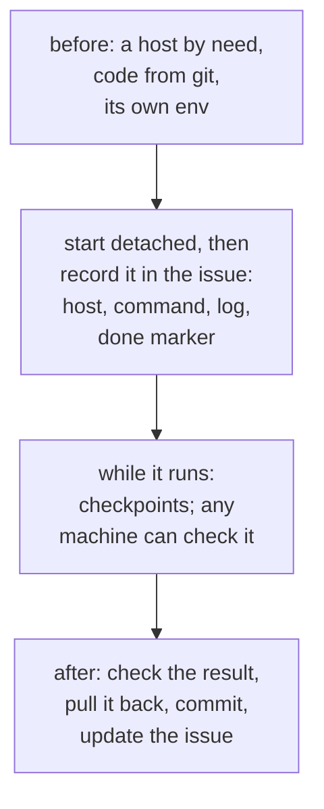

# Long runs on a compute host

Heavy runs (OpenFOAM CFD, FEA sweeps, topology optimisation, `cad-agent all`) on the workstation the agents share
can exhaust its memory and crash every session on it. Run them on a compute host, detached, and write them down
where another computer can find them.



## Before the run

- **Pick the host by need**: cores and memory for the solver, a GPU only if the tool uses one, Docker for OpenFOAM.
  Check its load first (`uptime`, `free -g`); other people's jobs may be running there.
- **Give it the code from git**, not a hand copy, where possible: clone the repo there and `git fetch && git checkout
  <sha>` of your pushed branch. If you must copy a working tree (uncommitted changes, large untracked references),
  use `rsync -a` with excludes for virtualenvs, caches and run folders. Pull back anything the host produced before
  you copy to it again. Use `--delete` only right after such a pull (it removes remote files that are not in your
  copy, including results newer than it); without it, files you deleted locally stay on the host.
- **Give it its own environment** (a virtualenv from the project's pinned requirements, `pip install -e` of the
  cad-agent checkout or version the project uses). Record which cad-agent commit it runs.

## Starting it

Detach it from the ssh session and the agent, and make the log say when it is done:

```bash
ssh <host> 'cd <repo> && mkdir -p build && (setsid nohup nice -n 5 bash -c "<command> > build/<run>.log 2>&1; echo RUN-DONE rc=\$? >> build/<run>.log" < /dev/null > /dev/null 2>&1 &)'
```

Then **record it in the issue** right away (see `cad-work-tracking`):
`<host role>: <command> (commit <sha>), log <path>, done when "RUN-DONE", results in <paths>, collect with <command>`.

## While it runs

- Watch it from the agent with a poll every few minutes (`ssh <host> 'tail -n 3 <log>'`) or the harness's monitor;
  match the failure markers too (`Traceback`, `Error`, `Killed`, `FAIL`, non-zero `rc=`), not only success.
- When watching processes over ssh, anchor patterns so they do not match the ssh command line itself
  (`ps -eo pid,args | grep "^ *[0-9]* <exact command>"`, or the `[x]` bracket trick). Stop jobs by PID or process
  group, never with a broad `pkill -f`.
- A finding that changes the inputs (a wrong assumption, a geometry fix) means stop the run, fix, push, restart, and
  note the stopped run in the issue so nobody collects its stale results.

## After it

- Check the result before trusting it: converged and steady, balances closed, the inputs it used are the committed
  ones (hashes or revision recorded in the result file).
- Pull the results back (`rsync -a <host>:<repo>/<result paths> <local paths>`), commit them with the command that
  made them in the message, push, and tick the issue.
- Leave the host clean: stop containers you started, delete large scratch case folders you no longer need.
