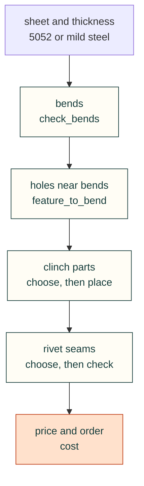

# Bent sheet with clinch hardware and rivets

A flat part with one or two bends and a few pressed-in nuts or studs makes a stiff, cheap mounting plate. Riveting
two such parts together makes a box that one bend cannot. Each step below is a check with cited rules. Run them in
order, because each one fixes a number the next one needs. The background is in
[the joining research](../../research/sheet-metal-joining.md) and [the sheet-metal research](../../research/sheet-metal.md).



## Steps

1. **Pick the sheet.** Use 5052-H32 aluminium or mild (cold-rolled) steel, 1.0 to 3.2 mm. Both take the cheap
   zinc-plated steel clinch parts. Stainless sheet takes none of the listed parts; it needs PEM's SP, FH4 or SO4 types.
2. **Check the bends** with `cadagent.manufacturing.sheet_metal.check_bends`. Give the flanges to the outside, the
   angles and the reliefs. Name the shop (`shop="sendcutsend"`) when you know it, so its angle, box and channel limits
   apply. `cadagent.manufacturing.sheet_metal.bend` gives the bend allowance the next steps need, and `flat_length`
   gives the blank.
3. **Check each hole near a bend** with `cadagent.manufacturing.sheet_metal.feature_to_bend`. Measure from the hole's
   edge to the bend's tangent line. A warning means it meets only the rules with a stated datum; move the hole if you
   can.
4. **Choose and place the clinch parts.**
   - `cadagent.mechanical.sheet_hardware.choose_clinch` lists the parts that fit the thread, sheet and thickness,
     cheapest first.
   - Then check each placement with `cadagent.mechanical.clinch.check_placement`: hole, edge, bend (with the bend
     allowance from step 2), the neighbours both ways, and the loads.
   - Press the parts in after plating or anodising and before paint.
5. **Choose and check each riveted seam.**
   - `cadagent.mechanical.sheet_hardware.choose_rivet` lists the rivets whose grip takes the stack.
   - Then check the seam with `cadagent.mechanical.rivets.check_joint`: grip, hole, edge, pitch, metals and
     strength per pitch.
   - Match the rivet's metal to the sheet: aluminium in aluminium, steel or stainless in steel.
6. **Price it** with `cadagent.mechanical.sheet_hardware.cost`. It gives loose parts, whole packs, and the shop's
   price to press the parts in, each from a dated public price. Re-read the seller's page before buying.

```python
from cadagent.manufacturing import sheet_metal as sm
from cadagent.mechanical import clinch, rivets, sheet_hardware as sh
sm.check_bends("5052", 1.6, [20, 20], relief_width_mm=1.6, shop="sendcutsend")["verdict"]
sh.choose_clinch("632", "5052-h32", 1.6)[0]["part"]["key"]               # "S-632-1", $0.0847 loose
clinch.check_placement("S-632-1", "5052-h32", 1.6, edge_mm=6.5, to_bend_mm=8.0,
                       bend_allowance_mm=sm.bend("5052", 1.6)["allowance_mm"])["verdict"]
rivets.check_joint("mcmaster-97447A015", [("5052-h32", 1.5), ("5052-h32", 1.5)], edge_mm=6.4, pitch_mm=25)
sh.cost({"S-632-1": 8, "mcmaster-97447A015": 24})
```

## Rules

- **Checks first, price second.** The choosers only rank parts that the checks already accept. Never pick a part by
  price and then look for a sheet it fits.
- **Report every verdict with its rule and source**, as the checks return them. A warning is not a pass: say which
  rule it misses.
- **A shop's own numbers count only when the shop is named.** Without one, the generic rules hold, and a value that
  clears only the shop's tooling row warns.
- **State the limits.** The strengths are the makers' test averages, not allowables, and the prices are dated. None of
  this proves a part holds or fits: test a sample part.
- **Do not contact a shop or buy anything** for the user. Questions for a shop go to the user.
