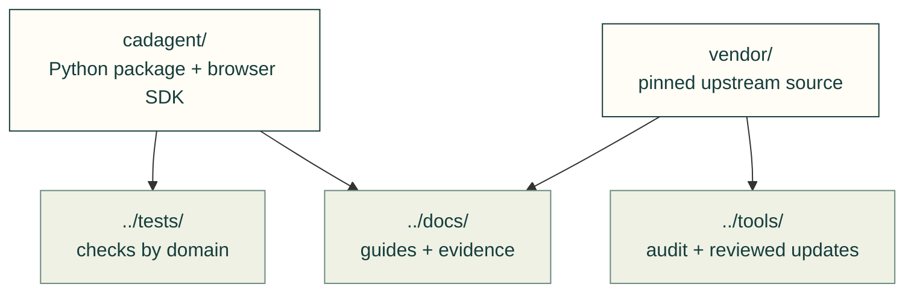

# Toolkit software

The installable Python toolkit and pinned third-party source live together here. Product CAD, firmware and application source stay in their product repository.

| Folder | Ownership |
|---|---|
| [cadagent/](cadagent/README.md) | First-party toolkit domains, CLI and packaged browser SDK; installed as `cadagent` |
| [vendor/](vendor/README.md) | Imported upstream trees, license notices, registry and reviewed scan records; excluded from the Python wheel |

Install from the repository root with `python -m pip install -e .`; invoke the same `cad-agent` commands. Generic project examples may use their own `src/` or `vendor/` folders; those names do not refer to this repository's software owner.
