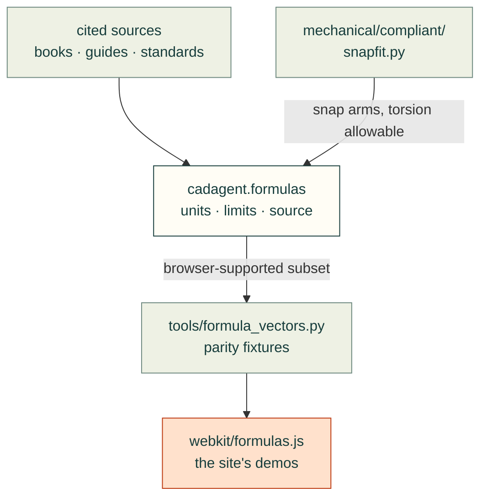
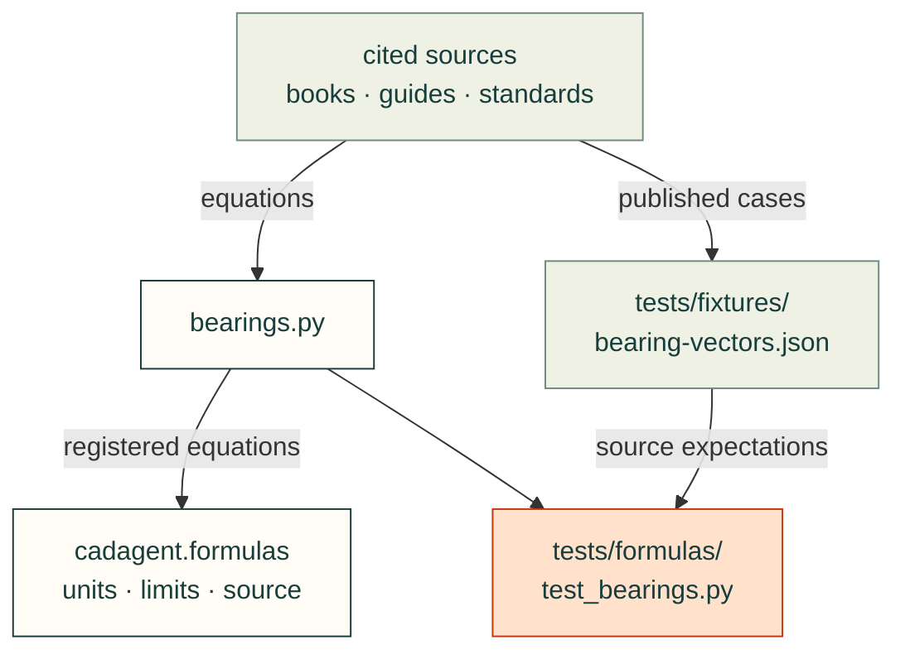

# cadagent.formulas

Closed-form engineering equations that every domain keeps needing. Each one gives its SI units, the limits where it
stops being valid, and its source by author, title, edition and section:
- beams, hollow rectangular and round tube sections, and snap arms;
- torsion bars;
- coil springs;
- screw preload and thread strip;
- heat-set inserts (pull-out, torque-out, the clamp path, the most to tighten) and compression limiters (proof load,
  stack, press fit, a clamped member's stiffness, the preload kept);
- riveted lap joints (shear, bearing, tearing, efficiency);
- fillet welds under static load (throat, a weld group as a line, weld-metal and base-metal strength);
- four-bar and five-bar linkages;
- rolling bearings: rating life, equivalent loads, static safety, duty cycles and oscillation limits;
- conduction, film resistance, fans in series and parallel, fan operating points and the stall region.

`from cadagent import formulas as fx`, then `fx.catalogue()` lists every formula. It sits in the shared core, beside
`geometry/`, because its users span mechanical and thermal design. See [docs/formulas.md](../../../docs/formulas.md).

Arrows follow the data and the imports:
- the books and standards give the equations, never copied text;
- `beams.py` calls `mechanical/compliant/snapfit.py`, so a snap arm here matches `cad-agent snapfit` exactly, and
  `torsion.py` takes its allowable shear strain from there too;
- `tools/formula_vectors.py` generates cross-language fixtures from the browser-supported Python subset, and
  `webkit/formulas.js` is tested against them (`--check` keeps the two in step). Generated parity fixtures alone
  do not independently validate an equation;
- [bearing-vectors.json](../../../tests/fixtures/bearing-vectors.json) records cited maker examples, tables and
  published cross-checks. [test_bearings.py](../../../tests/formulas/test_bearings.py) checks those expectations and
  states the model assumptions, separately from the browser port.

Shared formulas and browser parity

Bearing equations and their source cases

| Module | What it computes |
|---|---|
| `_registry.py` | The registry: every public function's units, limits and source; `catalogue()` lists them |
| `beams.py` | Second moment of a rectangle, second moment and section modulus of hollow rectangular and round tube sections, cantilever deflection and shape, strain profile, tapered arms, snap-arm strain and force |
| `torsion.py` | Torsion constants and shear stress of round and rectangular bars, torsion-bar twist and stiffness, the peak shear strain of a twisted rectangle and a torsion-bar snap against the Covestro allowable |
| `springs.py` | Coil-spring index, Bergsträsser factor, rate and shear stress |
| `screws.py` | Tensile stress area, nut factor (any flank angle), preload from torque and back, thread shear areas and strip force, the thread's radial push and the boss's hoop stress, and a thread-forming screw in a plastic boss against Covestro's torque window |
| `inserts.py` | A heat-set insert's displaced melt and the pocket below it, its pull-out and torque-out as a sheared knurl, where the screw's clamp goes (seat, through the insert, or jack-out) and the most to tighten it |
| `limiters.py` | Proof load, stress on an annulus, a limiter's stack against the plastic, the plastic's share when it is short, a clamped member's frustum stiffness, press-fit pressure and force, and the preload a joint keeps when its plastic relaxes |
| `rivets.py` | A riveted lap joint per pitch: rivet shear, bearing, tearing between holes, the solid sheet, and the joint's strength and efficiency |
| `welds.py` | A fillet weld's throat, area and direct stress; a weld group as a line (two parallel welds, a rectangle or a circle all round) under shear, axial load, bending and torque; AISC 360-16's weld-metal and base-metal strengths, checked apart; the least and largest leg |
| `linkages.py` | Grashof class and inversion, four-bar angles from the input angle, transmission angle, the input's limits; a five-bar's tip, crank angles and singularities |
| [`bearings.py`](bearings.py) | Rolling-bearing rating life, equivalent loads, static safety, duty cycles, oscillation factors and Hertz contact; source-worked examples above and [model limits](../../../docs/mechanical/bearings.md#limits) |
| `thermal.py` | Wall and film resistance, wall heat flow, straight-line fan curve, system coefficient, fans in series and parallel, fan operating point, stall flow |

A closed form is not proof of fit or strength. Each result holds only within the limits it states, and a printed part
is weaker across its layers than any isotropic formula assumes. Test the part.
Bearing life is a statistic for a group, not a promise for one bearing; lubrication/contamination life modification
and small-angle wear are not predicted by these models.
The weld functions are for static load on a sound weld: they leave out fatigue, weld quality, heat-affected-zone
softening, residual stress and burn-through, and a pass does not show that a hobbyist's weld is sound.

Related: [package map](../README.md) · [compliant features](../mechanical/README.md) ·
[formulas reference](../../../docs/formulas.md)

| File | Purpose |
|---|---|
| [__init__.py](__init__.py) | Package entry point; public imports and compatibility behavior are defined here. |
