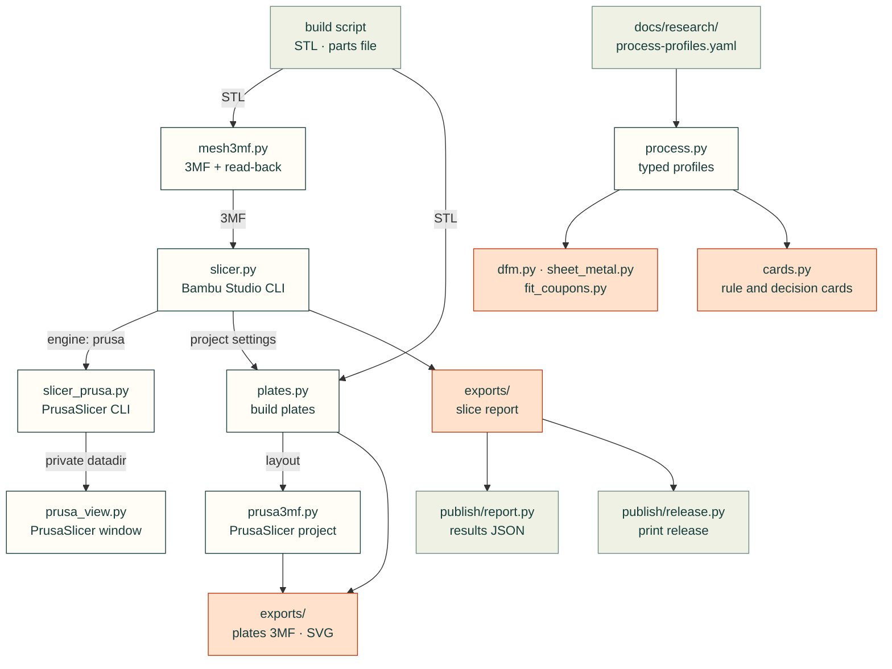

# cadagent.manufacturing

The manufacturing domain of the [topic tree](../../../docs/areas.yaml): getting from a checked model to print files and
real slicer numbers, and the process profiles that say what each process can make.

## Where machine automation belongs

Keep manufacturing organized by responsibility so printers, CNC machines and other equipment can share the
workflow without inheriting one vendor's protocol. The current package prepares artifacts and checks process rules;
the [Bambu connection investigation](../../../docs/research/manufacturing/bambu-cloud.md) is research, not a shipped
device adapter.

| Responsibility | Home and boundary |
|---|---|
| Process knowledge | `process.py`, `dfm.py` and process-specific calculators: materials, limits and cited checks. These do not connect to machines. |
| Artifact preparation | Existing slicer, plate and file-format modules: parts, quantities, settings and independently checked outputs. Preparing a file does not submit a job. |
| Machine integration, when implemented | `manufacturing/devices/<vendor>/`: vendor authentication, transports and capability-specific status, camera or command operations. A machine need not support every capability. |
| Job execution, when implemented | Shared manufacturing code consumes identified artifacts/settings and a selected device's capabilities. It records each attempt and actual result separately; vendor messages stay inside the adapter. |
| Evidence and learning | Reuse the [release manifest](../publish/README.md) for source/artifact identities; relate machine results and physical feedback to those identities without overwriting prior observations. |

Tests mirror implemented modules under `tests/manufacturing/`; sanitized fixtures live under `tests/fixtures/`.
Reusable procedures belong in `.agents/skills/` and findings in `docs/research/manufacturing/` or the existing lessons.
`tools/` remains repository maintenance. Account credentials and local device connection settings remain outside git;
shareable process/slicer settings stay with the project.

The device and execution rows define ownership for future implementation, not an existing API or a reason to create
empty folders now. Keep current public imports stable when the package grows. Build the first small adapter from
the verified behavior; introduce shared interfaces only for demonstrated needs. Test real consumers, timeout cleanup,
stale or misidentified replies and unsupported capabilities, and distinguish mock coverage from hardware evidence.
Keep observation separate from operations that change a machine; a lost acknowledgement leaves an attempt unknown
and must not automatically trigger a duplicate manufacturing job.

## Current modules

Arrows follow the files. `slicer.py` imports `publish/report.py`'s `load_parts` to find the parts it slices, and
`publish/report.py` and `publish/release.py` import `slicer.py` to read a current slice report; `slicer_prusa.py` runs
PrusaSlicer for `slicer.py` when `cad.slicer.engine` is `prusa`, and `prusa_view.py` uses its private profile folder
to open a model in PrusaSlicer's window. `mesh3mf.py` imports
nothing from cad-agent. `plates.py` uses `mesh3mf.py`'s 3MF parts, asks `slicer.py` for Bambu Studio's project
settings, and reads the release's parts and quantities from `publish/release.py`. `prusa3mf.py` uses `mesh3mf.py`'s
3MF parts and `plates.py`'s layout for PrusaSlicer projects. `process.py` loads the cited rules of
`docs/research/process-profiles.yaml` and the filaments' data sheets from `mechanical/compliant/allowables.py`; `dfm.py`,
`sheet_metal.py` and `fit_coupons.py` read their numbers from it. `cards.py` serves its rules as rule cards and its
decision tables as decision cards (`cad-agent rules`, `cad-agent choose`), with the registry's evidence.

| Module | What it does |
|---|---|
| `mesh3mf.py` | A minimal 3MF writer with an independent read-back check (`cad-agent export-3mf`) |
| `slicer.py` | Real filament grams and print time from Bambu Studio's command line, run as a separate program (`cad-agent slice`) |
| `slicer_prusa.py` | The same from PrusaSlicer's command line (`cad.slicer.engine: prusa`): vendor-bundle and user presets, grams and time from the G-code, and the warnings, errors and print stability issues from its log |
| `cards.py` | Rule cards (`cad-agent rules <feature>`) and decision cards (`cad-agent choose joining`) from the profile file and the reference registry: each rule's numbers, when it applies, how strict it is, its cost, confidence and enforcing function, in about 2 KB; uncited rules are refused |
| `experiments.py` | Write-once physical specimen UUIDs and collision-checked short stamps in a persistent registry, committed source/input hashes, immutable artifact binding and separate attempt/feedback observations; no printer transport or physical qualification |
| `fit_coupons.py` | A printable coupon per fit (pin, bushing, bearing, insert), holes swept round nominal + allowance + the process profile's undersize, with a measurement sheet: the first print calibrates the fits ([printed joints](../../../docs/mechanical/printed-joints.md#fit-coupons-let-the-first-print-calibrate-the-fits)) |
| `gcode.py` | The longest bridge and overhang-perimeter extrusions in sliced G-code (PrusaSlicer, Bambu Studio, OrcaSlicer), with height and position: where a "long bridging extrusions" warning points. Pure Python, imports nothing from cad-agent |
| `process.py` | The process profiles as typed values: rules, limits, tolerances, FDM layer factors by filament, a shop's bend table; each value with its rule id and source id, unverified rows marked `(u)` ([process checks](../../../docs/process-checks.md)) |
| `dfm.py` | Minimum features (walls, holes, pins, gaps, bridges, overhangs, flanges, hole-to-bend) against every cited source, and which way a printed feature's stress crosses the layers |
| `sheet_metal.py` | Bend allowance, deduction, flat length, K-factor, shortest flange and relief, from the shop's table first, then the generic rules; `feature_to_bend` (hole to bend on each rule's datum) and `check_bends` (flanges, relief, and a named shop's angle, box and channel limits) |
| `plates.py` | Every printed part at its quantity packed onto build plates (MaxRects), in one Bambu Studio project 3MF with a read-back check and a top-down picture (`cad-agent export-3mf`) |
| `prusa_view.py` | Opens a model in PrusaSlicer's window with a private profile folder and no start-up dialogs, screenshots it and stops only its own process (`cad-agent prusa-view`) |
| `prusa3mf.py` | PrusaSlicer project 3MFs: objects of several volumes, each on its own tool, the wipe tower's place, and build plates one 3MF per plate, with a read-back check |

`cad-agent overhangs` (in `cli.py`) screens the part STLs with `cadagent.geometry.overhang_regions`, the
geometry-side companion of `gcode.py` ([toolkit: overhangs and bridges](../../../docs/toolkit.md#overhangs-and-bridges-cad-agent-overhangs)).

Related: [package map](../README.md) · [publish](../publish/README.md) (the print release) ·
[toolkit: print files](../../../docs/toolkit.md#print-files) ·
[toolkit: build plates](../../../docs/toolkit.md#build-plates-cadagentmanufacturingplates)
