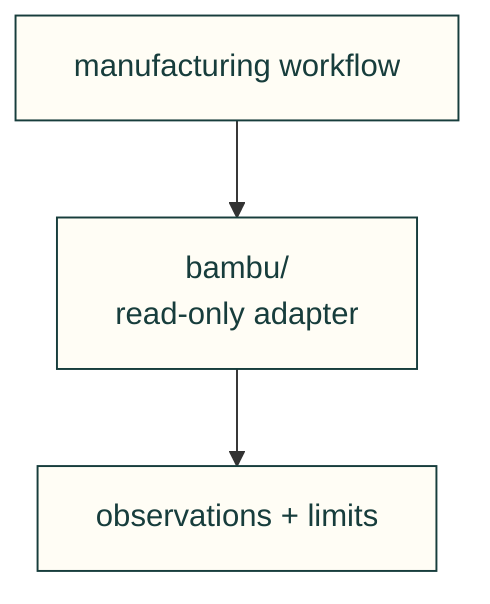

# Machine integrations

Adapters own their vendor's authentication and transport. They expose demonstrated capabilities;
artifact preparation and job execution stay in the [manufacturing domain](../README.md).

| File or folder | Purpose |
|---|---|
| [bambu/](bambu/README.md) | Read-only cloud account and printer observations. |
| [__init__.py](__init__.py) | Package namespace; no connection at import time. |
