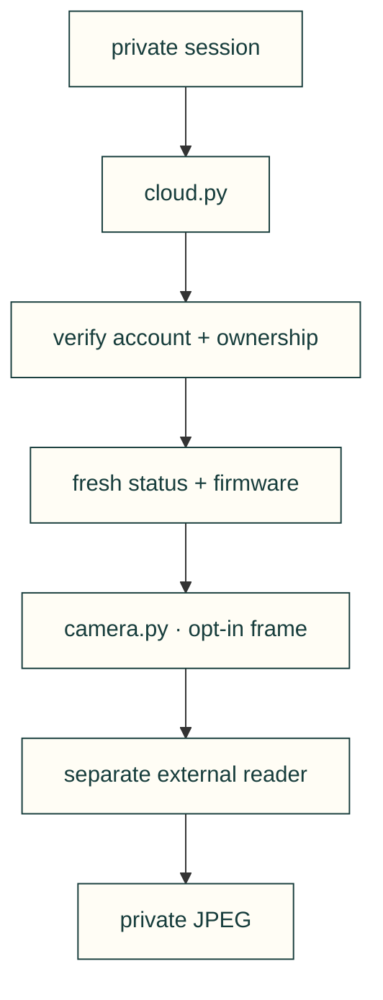

# Bambu observations

Reuse a normal account session to list owned printers, ask one printer for current status and firmware,
or explicitly capture one private P1S frame. No background service, login prompt, automatic refresh/retry
or physical control is started.



```bash
cad-agent bambu-status
cad-agent bambu-status --device DEVICE_ID
```

The first command makes two HTTPS GETs and prints local device identifiers. The second repeats the ownership
check, subscribes to the selected printer, then sends exactly one `pushall` and one `get_version` request. A
retained heartbeat or unmatched firmware reply cannot complete the observation. Output is local account data;
do not paste device identifiers into public issues.

The adapter reads the existing owner-only POSIX session at
`$XDG_STATE_HOME/cad-agent/manufacturing/bambu/session.json` (default `~/.local/state/...`), or `--session`.
It requires the `cad-agent.bambu-session/1` format with the genuine access-token expiry, global-cloud origin,
and account identity. The final parent and file must be private and owned by the current user; neither may be
a symlink. Earlier ancestors use normal OS path resolution, including symlinks. It never reads Bambu Studio's
profile. Missing or expired sessions need normal sign-in;
this command does not implement account login or Windows credential storage.

MQTT requires the optional `bambu` extra (Paho MQTT 2.1 or newer). HTTPS listing uses the standard library.
Imports do not connect, install dependencies, or load credentials. Both transports verify TLS. The default
MQTT response wait is 30 seconds after connection; socket connections/HTTP have separate timeouts and OS DNS
resolution is outside that wait. Use a supervising process if a hard overall deadline is required.

The [dated connection evidence](../../../../../docs/research/manufacturing/bambu-cloud.md) distinguishes
the earlier actual printer observations from this adapter's tests. State/firmware do not establish a clean
bed, usable camera or successful printing. Other regions and hardware controls are not implemented.

## One private frame — integration not yet working

`bambu-frame` uses the same cached session and fresh ownership/status/version observation, requests one
normal TUTK grant, and reads one JPEG. The [external reader](../../../../../tools/bambu-camera/README.md)
has its own AGPL license and process; it is not imported into the toolkit. Supply the existing media-library
path explicitly. Nothing is downloaded or installed by this command.

```bash
mkdir -m 700 ~/cad-agent-frames
cad-agent bambu-frame --device DEVICE_ID \
  --media-library /path/to/installed/libBambuSource.so \
  --media-reader ./tools/bambu-camera/capture.py \
  --output ~/cad-agent-frames/p1s.jpg
```

This draft integration requires Python 3.11+ on Linux x86_64, Pillow 13+ from the `bambu-camera` extra and the exact installed-library
digest declared in `camera.py`. An unsupported library fails before the account/device queries. Existing
output files and nonprivate output directories are refused. The image is fully decoded, checked against the
reader's dimensions/byte count, then published as a new mode-0600 file. Grant secrets travel on a private,
unlinked input file descriptor, not in the command line or logs. The external process group has a 45-second
deadline and is killed/reaped on completion, error or interruption; HTTP/MQTT have the separate bounds above.

The earlier prototype's P1S frame is not acceptance of this new implementation. Independent source review passed,
but both actual native trials in [PR494](https://github.com/Valpatel/cad-agent/pull/494) failed without a frame.
A separate P1S preparation observation matched the requested grant and received error `84033543` with disabled
TUTK telemetry; the exact cause is unknown. This remains an experimental draft, not a qualified camera path.
X1E camera support is also unresolved.
A frame reports `bed_clear: null` and `print_authorized: false`; the command makes neither decision.

| File | Purpose |
|---|---|
| [cloud.py](cloud.py) | Session loading, fresh ownership checks, and one selected printer's status/version query. |
| [camera.py](camera.py) | One normal grant, bounded external reader, full JPEG validation and private output. |
| [__init__.py](__init__.py) | Package namespace. |

[Machine integrations](../README.md)
