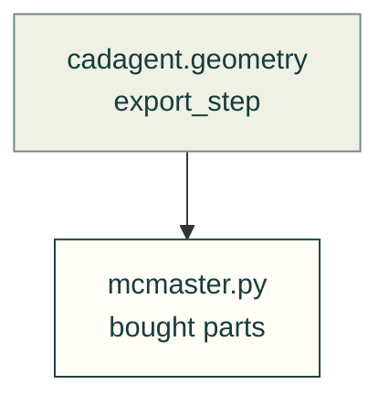
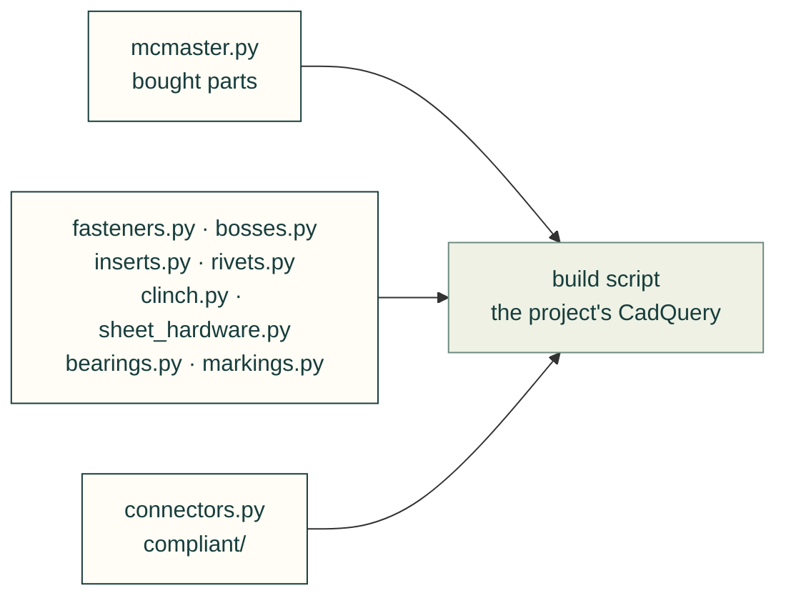
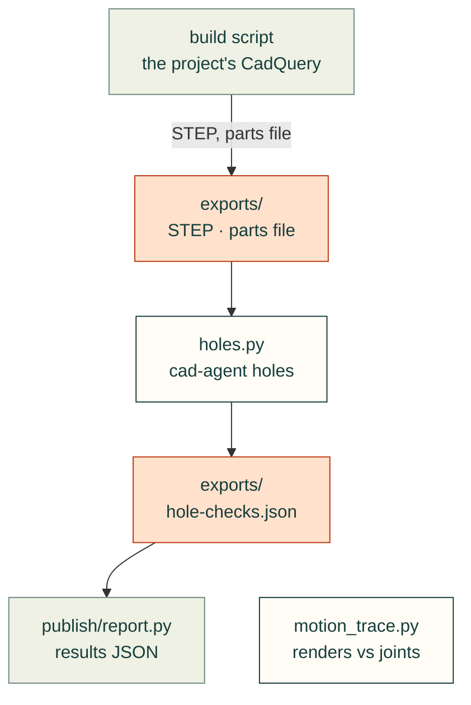
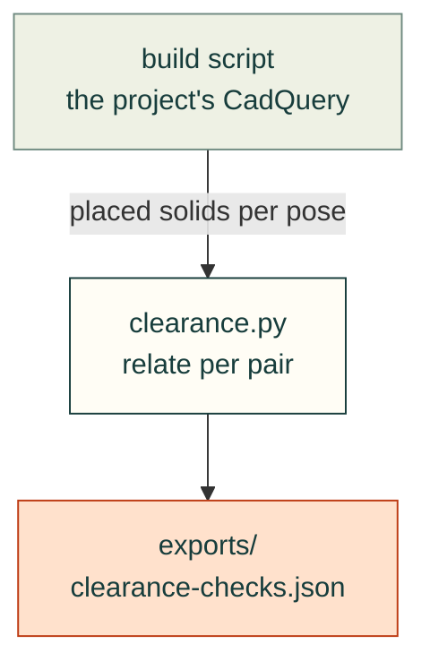

# cadagent.mechanical

The mechanical domain of the [topic tree](../../../docs/areas.yaml): the features a part is built from and the checks
that they work, from holes and fasteners to bought hardware, connector windows, markings and compliant features.

Arrows follow the data. A project's build script imports the modules in the second row to make its parts
(`cad-agent mcmaster`, `cad-agent snapfit`, `cad-agent inserts` and `cad-agent bearings` run some of them from
the command line too), and `mcmaster.py` imports
`export_step` from the shared [`geometry`](../geometry/README.md) helpers. `holes.py` reads the exported STEP files and
the parts file (through `publish/report.py`'s `load_parts`). `clearance.py` takes the build script's placed solids
at each pose and decides each pair with the relation gate (`review/gates/relations.py`). `motion_trace.py`
(`cad-agent motion-trace`) stands alone.

Geometry and purchased parts

Inputs to a project build

Hole checks and motion evidence

Clearance evidence

| Module | What it does |
|---|---|
| `holes.py` | Every hole in a part is empty of material (`cad-agent holes`); countersinks and drill points are probed as cones |
| `fasteners.py` | Dimension-driven fastener envelopes and axial stack checks |
| `bosses.py` | A thread-forming screw (DELTA PT sizes) in a printed boss: clamp, stripping force and torque, Covestro's torque window and the wall, from datasheet strengths ([screw bosses](../../../docs/mechanical/screw-bosses.md)); a starting point to test, not a rating |
| `clinch.py` | Self-clinching (PEM-type) nuts, studs and standoffs: a cited subset of PEM's S, SS, CLS, CLSS, FH, SO and BSO parts with hole, minimum sheet, edge distance and rated strengths, `parts_for` a sheet, and a placement check (hardness, thickness, hole, edge, bend BA/2 + E, spacing, loads) against the `sm-clinch-*` rules ([joining sheet metal](../../../docs/research/manufacturing/sheet-metal-joining.md)) |
| `rivets.py` | Blind rivets joining sheet parts: POP and McMaster-Carr rivets with hole, grip and rated strength, `rivets_for` a stack, and a lap-joint check (grip with tolerance, hole, edge 2D / 1.5D, pitch and row spacing for one, two or three or more rows (FAA Fig. 4-5), t/D on the hole with the blind-rivet 0.25 band, the 0.020 in floor under the formed head, metals, strength per pitch from MIL-HDBK-5J sheet values with e/D on the hole) against the `sm-rivet-*` rules ([joining sheet metal](../../../docs/research/manufacturing/sheet-metal-joining.md)); typical values, not allowables |
| `sheet_hardware.py` | The bought clinch parts and rivets: dated prices, stock and sellers from `docs/research/sheet-hardware.yaml` (the part-catalogue layout), joined to the parts `clinch` and `rivets` check; `choose_clinch` and `choose_rivet` rank the parts the checks accept by price, `cost` totals pieces, packs and a shop's price to press them in ([page](../../../docs/sheet-metal-hardware.md)) |
| `inserts.py` | Heat-set inserts and compression limiters in printed parts: the makers' hole and boss, where the screw's clamp goes, pull-out, torque-out and the insert's thread calibrated to published tests, the plastic under the head, limiters (catalogue or your own) and the preload kept; `cad-agent inserts` checks a file of joints, and the coupon plan says what to print and measure ([threaded inserts](../../../docs/mechanical/inserts.md)); a starting point to test, not a rating |
| `bearings.py` | Rolling bearings: SKF and Koyo catalogue bearings with their sources, and one check of a bearing's ISO 281 life (turning or oscillating, under a load or a duty cycle), ISO 76 static safety against SKF's guideline s0, axial load, load range, minimum load and speed; for a swinging joint, the critical amplitude and the false-brinelling risk; `cad-agent bearings` checks a file of bearings ([rolling bearings](../../../docs/mechanical/bearings.md)); a basic rating life, not a promise |
| `mcmaster.py` | McMaster-Carr parts: the manufacturer's STEP and product data for a part number, normalised into a known frame |
| `connectors.py` | Mating-connector envelopes: panel windows from the plug, then proof that the plug fits and that its cable can bend behind it at the data sheet's radius |
| `markings.py` | One XY drawing for engraved markings and a matching SVG proof |
| `printed_joints.py` | Load-bearing joints in printed parts, checked before printing ([printed joints](../../../docs/mechanical/printed-joints.md)): a pin through an eye (bearing, shear-out, net tension against the layers, with or without a bushing), the root of a boss or rib under a side load and the through-bolt preload that keeps its layers closed, and a screw that backs out under vibration |
| [`compliant/`](compliant/README.md) | Compliant features that replace parts: snap fits now, hinges and flexures next |
| `linkages.py` | Four-bars and five-bars swept over their inputs: joint angles, locks, edges of reach, branch flips; the dyad solver for linkages measured from CAD |
| `motion_trace.py` | Compares rendered landmarks with CAD joint intent, without a CAD kernel |
| `clearance.py` | Range-of-motion collision check: placed parts related pairwise (the relation gate's `relate`) at each sampled pose, proven clear between poses given the travel, and revolved swept-volume cutters with slopes capped at 45° ([toolkit](../../../docs/toolkit.md#range-of-motion-clearance-cadagentmechanicalclearance)) |

Related: [package map](../README.md) · [mcmaster-parts skill](../../../.agents/skills/mcmaster-parts/SKILL.md) ·
[compliant mechanisms](../../../docs/mechanical/compliant.md) · [common issues](../../../docs/practice/common-issues.md) (the mistakes
these catch)

| File | Purpose |
|---|---|
| [__init__.py](__init__.py) | Package entry point; public imports and compatibility behavior are defined here. |
