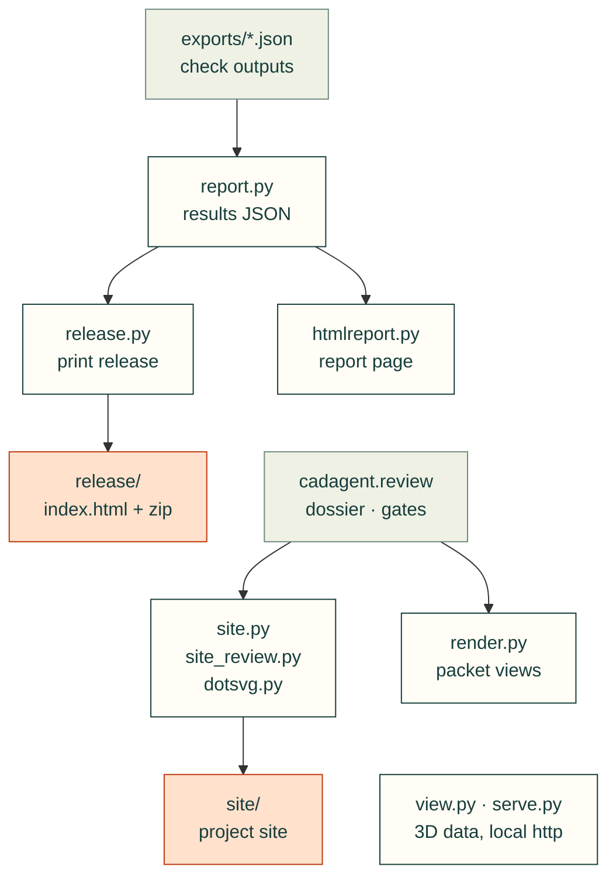

# cadagent.publish

The practice domain's publishing area of the [topic tree](../../../docs/areas.yaml): results files, reports, renders,
3D views, the project site and the print release. Every page states what was checked and what was not (CAD never
proves physical fit).

Reports collect check outputs; print releases package those results with model files and browser dependencies.
Project sites read the [`review`](../review/README.md) package's dossier, verdicts and workbench. Arrows follow
data; arrows between modules represent imports.



<details>
<summary>Module and folder map</summary>

| Module or folder | What it does |
|---|---|
| [__init__.py](__init__.py) | Publishing package entry point. |
| [anim/](anim/README.md) | Shared animated evidence scene and rendering modules. |
| [runtime.py](runtime.py) | Validates and captures explicit browser runtime dependency profiles |
| [runtime-profiles.json](runtime-profiles.json) | Reviewed runtime paths, dependency edges and source hashes |
| `report.py` | Collects a project's check outputs into results JSON (schema 1.0) |
| `htmlreport.py` | A standalone HTML page for a results file |
| `render.py` | Off-screen VTK renders of CadQuery shapes and STL meshes, captioned |
| `view.py` | Every part in assembly position, for the browser viewer (`webkit/model/viewer.html`) |
| `dotsvg.py` | Graphviz DOT to SVG without Graphviz: a small parser and a layered layout |
| `site.py`, `site_review.py` | The project site: progress, designs, decisions, documents; review pages, requirements, gates |
| `release.py` | The print release: a browsable page of printed parts with their CAD files and the source that builds them |
| [guides.py](guides.py) | Preflight a source-bound assembly guide and freeze its model, mesh and poster dependencies for the print release |
| `serve.py` | Serves a project over http so pages can hand 3MF files to a slicer |

</details>

Related: [package map](../README.md) · [review](../review/README.md) · [web kit](../webkit/README.md) ·
[review packet docs](../../../docs/practice/review-packet.md)

## Checked browser runtime profiles

[runtime.py](runtime.py) captures a versioned, explicit dependency closure from
[runtime-profiles.json](runtime-profiles.json). The assembly-reader profile includes
its modules, styles, fonts and licence notices. Unrelated viewers, parsers and galleries
stay outside the release. Reviewed dependency edges and SHA-256 hashes bind each node
to its bytes; the resolver checks reachability and rejects missing, changed or symlinked
files before publication.

```sh
python -m cadagent.publish.runtime
# After reviewing imports, styles, dynamic resources and notices in a source change:
python -m cadagent.publish.runtime --refresh
```

When imports or resources change, update the graph, review its hashes and run the
packaged browser consumer. Commit the manifest with its source; publication never
refreshes stale records. Release manifests include file hashes and the selected
profile's schema, name and canonical hash.

The `cad-agent webkit` command copies the complete kit. Release profiles select smaller
dependency closures. New runtime folders require explicit package-data admission and
an installed-wheel test. [Runtime tests](../../../tests/publish/test_runtime.py) check
membership and rejection; portable guide/browser tests check actual loading in
Chromium and WebKit.
