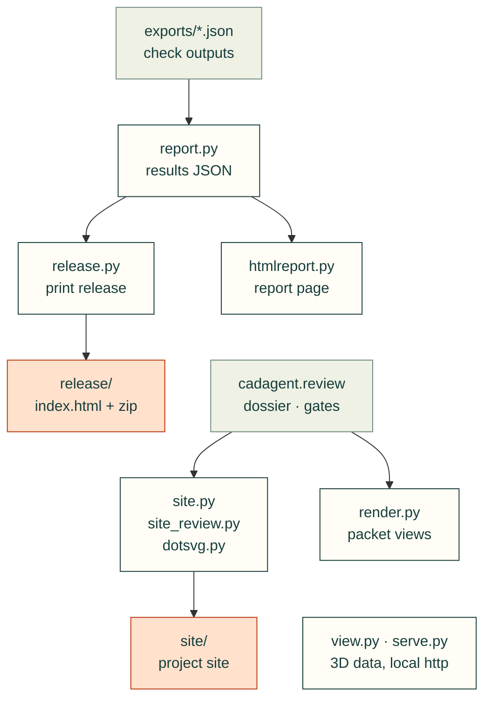

# cadagent.publish

The practice domain's publishing area of the [topic tree](../../../docs/areas.yaml): results files, reports, renders,
3D views, the project site and the print release. Every page states what was checked and what was not (CAD never
proves physical fit).

Arrows follow the data, and each one between modules is an import. `report.py` collects what the checks wrote,
`release.py` imports it and `manufacturing/slicer.py` for the print release, and `site.py` and `site_review.py` read
the [`review`](../review/README.md) package's dossier, gate verdicts and workbench. `render.py` draws the review
packets' views. `view.py` (STEP files to the 3D viewer's data) and `serve.py` (the project over http, so pages can
hand 3MF files to a slicer) stand alone.



| Module | What it does |
|---|---|
| [runtime.py](runtime.py) | Validates and captures explicit browser runtime dependency profiles |
| [runtime-profiles.json](runtime-profiles.json) | Reviewed runtime paths, dependency edges and source hashes |
| `report.py` | Collects a project's check outputs into results JSON (schema 1.0) |
| `htmlreport.py` | A standalone HTML page for a results file |
| `render.py` | Off-screen VTK renders of CadQuery shapes and STL meshes, captioned |
| `view.py` | Every part in assembly position, for the browser viewer (`webkit/viewer.html`) |
| `dotsvg.py` | Graphviz DOT to SVG without Graphviz: a small parser and a layered layout |
| `site.py`, `site_review.py` | The project site: progress, designs, decisions, documents; review pages, requirements, gates |
| `release.py` | The print release: a browsable page of printed parts with their CAD files and the source that builds them |
| [guides.py](guides.py) | Preflight a source-bound assembly guide and freeze its model, mesh and poster dependencies for the print release |
| `serve.py` | Serves a project over http so pages can hand 3MF files to a slicer |

Related: [package map](../README.md) · [review](../review/README.md) · [web kit](../webkit/README.md) ·
[review packet docs](../../../docs/practice/review-packet.md)

## File and child ownership

| File or folder | Purpose |
|---|---|
| [anim/](anim/README.md) | Shared animated evidence scene/rendering modules. |


| File | Purpose |
|---|---|
| [__init__.py](__init__.py) | Package entry point; public imports and compatibility behavior are defined here. |

## Checked browser runtime profiles

[runtime.py](runtime.py) captures a versioned, explicit dependency closure from
[runtime-profiles.json](runtime-profiles.json). The assembly-reader profile keeps
legacy viewer paths while excluding unrelated viewers, parsers and galleries.
Dependencies include literal/dynamic modules, styles, fonts and license notices;
the graph is reviewed source data, not automatic dependency discovery. SHA-256
binds each reviewed node to its bytes. The resolver checks the whole schema and
reachability, refuses missing/changed/symlinked files, and captures immutable bytes
before the publisher replaces an existing release.

```sh
python -m cadagent.publish.runtime
# After reviewing imports, styles, dynamic resources and notices in a source change:
python -m cadagent.publish.runtime --refresh
```

Refreshing hashes is an explicit source-maintenance action. Add/remove dependency
graph edges when behavior changes, run the actual packaged browser consumer, and
commit the manifest with its source. Publication never refreshes a stale manifest.
The normal release manifest retains its file hash inventory and adds the profile
schema, name and canonical profile hash. Other profiles cannot change that identity.

The initial source baseline at `33c3f51b574bdfa9171da62c4573beaf840daa95` copied
104 files / 13,674,991 uncompressed runtime bytes. The checked assembly closure
contains 21 files / 903,365 bytes; these are runtime membership measurements,
not a full ZIP size or browser-performance benchmark. Full-copy `cad-agent webkit`
behavior is unchanged. Future nested runtime folders need explicit package-data
admission and an installed-wheel test; gallery ownership does not imply inclusion.
Rollback restores the prior producer in a new release; existing archives stay
immutable. [Runtime tests](../../../tests/publish/test_runtime.py) exercise the
closure and rejection behavior; portable guide/browser tests prove actual loading.


For the same three-snapshot synthetic guide fixture, the baseline full-kit archive
contained 131 ZIP entries / 4,864,573 compressed bytes; the profiled archive contains
48 entries / 319,902 compressed bytes. Project source and original release folders
were removed before the actual Chromium reader ran: eight cases passed with no
page errors or foreign requests. This is fixture portability evidence, not a
measurement of all project archives. The source-free installed-wheel check also
passed, including nested ESM import and missing-profile rejection. Required CI
retains both Chromium and WebKit coverage.
