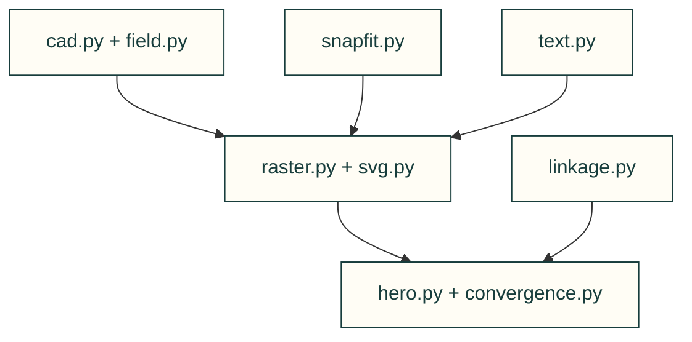

# Animated evidence figures

Draw deterministic figures from recorded CAD, field results or calculator inputs; animation does not establish physical performance.

| File or folder | Purpose |
|---|---|
| [cad.py](cad.py) | STEP hidden-line edges, silhouettes and surface triangles. |
| [convergence.py](convergence.py) | Recorded FEA mesh convergence scene and chart. |
| [field.py](field.py) | Decode nodal surface fields for drawing. |
| [hero.py](hero.py) | Assembly hero extraction and SVG rendering. |
| [linkage.py](linkage.py) | Compatibility import of the mechanical linkage solver. |
| [raster.py](raster.py) | Triangle z-buffer and silhouette simplification. |
| [snapfit.py](snapfit.py) | Calculated cantilever engagement scene. |
| [svg.py](svg.py) | Shared SVG timeline, paths and light/dark wrapper. |
| [text.py](text.py) | Outline licensed TrueType glyphs without browser fonts. |

[Parent map](../README.md)

| File | Purpose |
|---|---|
| [__init__.py](__init__.py) | Package entry point; public imports and compatibility behavior are defined here. |
