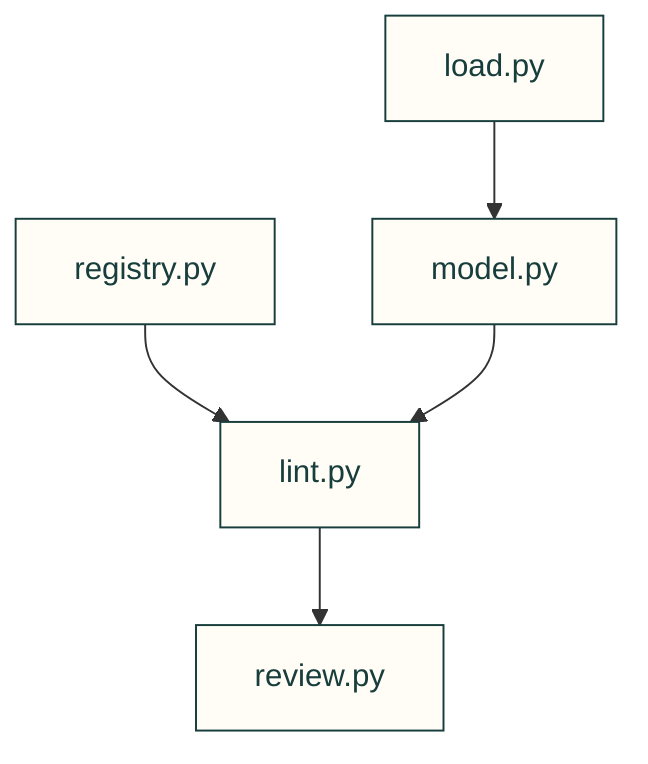

# Design dossier

Load declared design intent, register geometric facts and check independent review sign-off; declarations do not prove a physical assembly.

| File or folder | Purpose |
|---|---|
| [load.py](load.py) | YAML loading, item locations and identifier resolution. |
| [model.py](model.py) | Plain dossier dataclasses and serialisation. |
| [registry.py](registry.py) | CAD-side parts, cavities, axes, joints and assembly declarations. |
| [lint.py](lint.py) | Non-geometric dossier lint and status transitions. |
| [review.py](review.py) | Reviewer packets and hash-bound section sign-off. |

[Parent map](../README.md)

| File | Purpose |
|---|---|
| [__init__.py](__init__.py) | Package entry point; public imports and compatibility behavior are defined here. |
