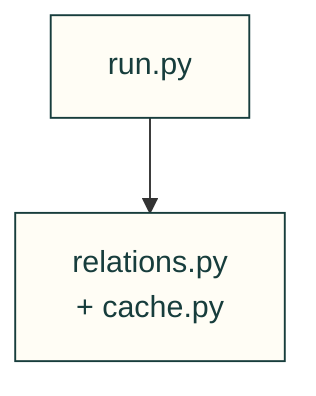
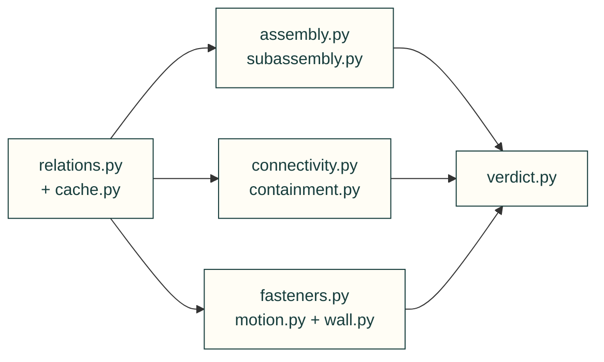

# Integrity gates

Evaluate declared assembly relationships and emit assumption-bearing verdicts. Sampled geometry and access checks do not prove strength or physical fit.

Prepare shared relations

Evaluate relations and collect verdicts

| File or folder | Purpose |
|---|---|
| [assembly.py](assembly.py) | Declared sequence and insertion/tool access. |
| [playback.py](playback.py) | Finite ordered guide paths, bound to captured mesh and BREP bytes. |
| [subassembly.py](subassembly.py) | Internal scopes and rigid module insertion adapter. |
| [symmetry.py](symmetry.py) | Measured rotational symmetry of a solid about a joint axis. |
| [cache.py](cache.py) | Content-and-placement-keyed pairwise cache. |
| [connectivity.py](connectivity.py) | Contact graph and declared connection evidence. |
| [containment.py](containment.py) | Registered contents versus cavity geometry. |
| [fasteners.py](fasteners.py) | Screw stack, material engagement and tool reach. |
| [motion.py](motion.py) | Sample declared joint ranges and interference. |
| [relations.py](relations.py) | Assembly container and pairwise relation states. |
| [run.py](run.py) | Plan and isolate the project gate runs. |
| [verdict.py](verdict.py) | Shared pass/warn/fail record format. |
| [wall.py](wall.py) | Mesh/B-rep inward-ray minimum-wall sampling. |

[Parent map](../README.md)

| File | Purpose |
|---|---|
| [__init__.py](__init__.py) | Package entry point; public imports and compatibility behavior are defined here. |
