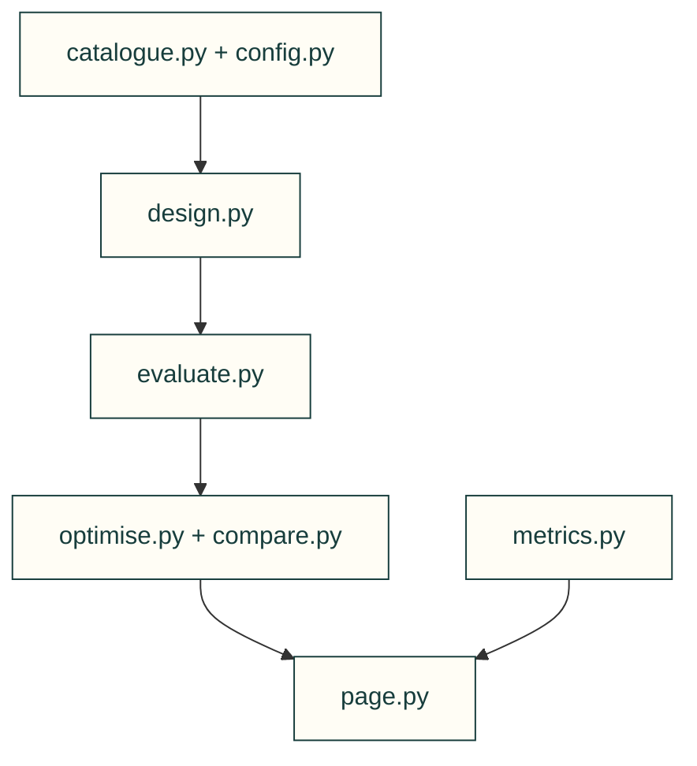

# Design exploration

Compare catalogue choices using project-owned evaluators. Estimated prices and textbook metrics remain estimates, not measured robot performance.

| File or folder | Purpose |
|---|---|
| [catalogue.py](catalogue.py) | JSON/YAML catalogue records and confidence flags. |
| [config.py](config.py) | Project exploration settings and objectives. |
| [design.py](design.py) | Candidate part slots, parameters and inheritance. |
| [evaluate.py](evaluate.py) | Generic BOM/cost/mass plus project evaluator dispatch. |
| [metrics.py](metrics.py) | Metric units, formatting and incompleteness flags. |
| [compare.py](compare.py) | Pareto ranking, leaderboard and one-part swaps. |
| [optimise.py](optimise.py) | Generate candidates and rank search trials. |
| [page.py](page.py) | Standalone comparison page and readable tables. |

[Parent map](../README.md)

| File | Purpose |
|---|---|
| [__init__.py](__init__.py) | Package entry point; public imports and compatibility behavior are defined here. |
