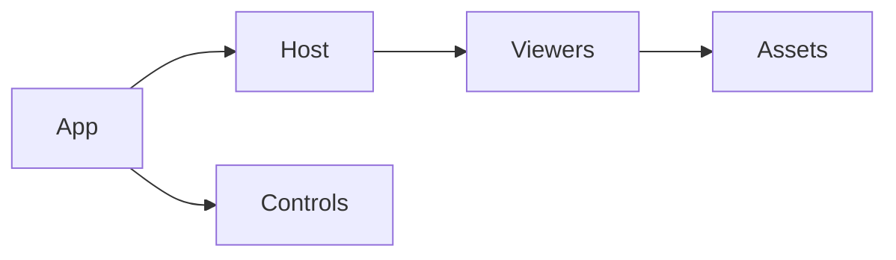

# Browser toolkit

Reusable viewers, controls and document enhancements for CAD, assembly instructions,
analysis and engineering calculations. Plain ES modules run in an application or
standalone page and work with the kit's pinned local dependencies.

| Owner | Responsibility |
| --- | --- |
| [host/](host/README.md) | Renderer-independent frame, accessible controls, mount/dispose and two real 3D adapters. |
| [scada/](scada/README.md) | Process symbols, shared diagram views, headless models, equation providers and owned galleries/examples |
| [model/](model/README.md) | Ordinary assembly/STL viewer, inline packed model element and shared 3D stage. |
| [files/](files/README.md) | Original CAD file viewer, parsers, workers and themes. |
| [simulation/](simulation/README.md) | Recorded rigid-body pose playback and solver-bound examples. |
| [assembly/](assembly/README.md) | Build instructions, playback, part tracking and part tables. |
| [fea/](fea/README.md) | Analysis result viewing and deformed-shape playback. |
| [ui/](ui/README.md) | HUD, panel controls, app navigation and reusable galleries. |
| [documents/](documents/README.md) | Page navigation, copy/review enhancements and Mermaid diagrams. |
| [calculators/](calculators/README.md) | Formula-backed engineering elements and static drawing APIs. |
| [vendor/](vendor/README.md) | Pinned renderer, parsers, fonts, receipts and third-party notices. |
| [package.json](package.json) | ES-module package metadata. |

## Use the toolkit

`cad-agent webkit designer/kit` copies the installed toolkit into a project.
Use `model/viewer.html` for assembly/STL documents, `files/file-viewer.html` for
original files, or `fea/fea.html` for analysis results. Import reusable modules
from their owner folders. Each standalone page has its own document contract.

For multiple viewers in one page, load `host/viewer-host.css`, provide explicit
container heights and the Three.js import map, then use the
[contained adapters](host/README.md). Each instance owns its camera and inspector;
the application owns document identity, simulation clocks and command authority.
Camera surfaces use orbit/pan/zoom and a visible Zoom to fit control.

Runtime profiles select the exact assets needed by a frozen reader. A complete
copied kit and an installed wheel include the admitted owner folders; publication
must validate every imported module, stylesheet, worker and decoder asset.

Extend an owner

Keep model equations, document/controller state and rendering responsibilities
separate. Reuse a shared control only when real consumers need the same behavior.
Add the new file to its owner's README, repair direct imports and distribution
membership, and test actual mount, failure, resize and disposal behavior. No
placeholder owner folders or universal renderer are needed to add a domain.

The stage and HUD are adapted from the MIT [Moxie simulator](https://github.com/mvalancy/moxie-robot-saver).
Pinned browser dependencies include `three@0.160.0`, `mermaid@11.17.2` and
`fflate@0.8.3`; their source receipts, authorship and licenses remain under
[vendor/](vendor/README.md). Host-example geometry fixtures are original
illustrative blocks.

[Package map](../README.md)
