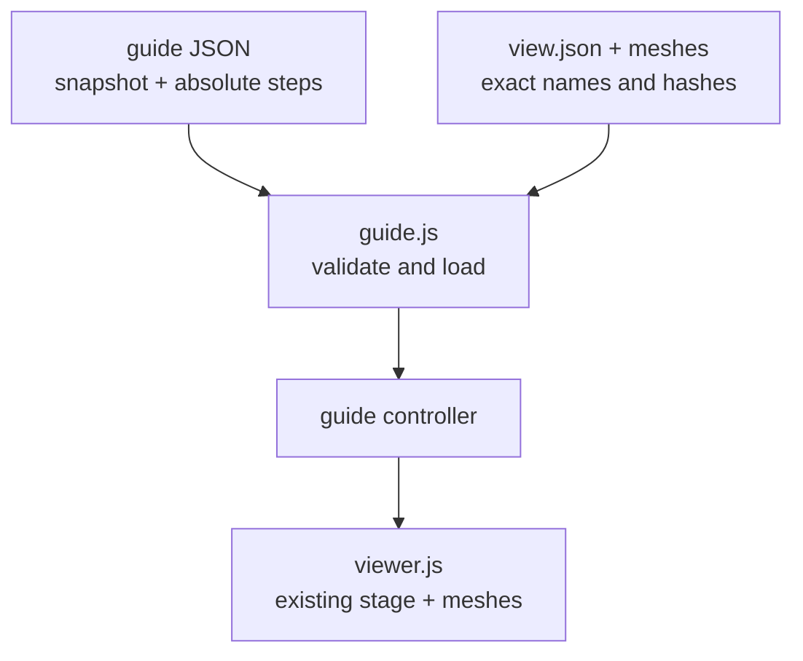

# Assembly instructions

Optional instruction data and controls for the existing [assembly viewer](../viewer.js).
Meshes have their assembled placement baked in: CAD millimetres, z up. Guide offsets are presentation only;
they do not prove an insertion path, physical fit or an assembly's qualification.

| File | Responsibility |
|---|---|
| `guide.js` | Strict guide/view validation, bounded asset reads and absolute step controller |

The contract is `cad-agent.assembly-guide/1`. A guide binds one model manifest by relative file and SHA-256;
its snapshot names an ID, revision, `released` or `wip` status and exact source commit. Part names are exact mesh
instance identities, not catalogue keys. Steps list complete visible membership and highlighted new instances,
authored `offsets_mm`, plain instruction `text`, an optional hash-bound poster and CAD camera direction. A step
may require earlier step IDs. Subassemblies are named visibility sets, not geometric rigid-body declarations.

This optional interface supports the first versioned pilot in Gyropup #266, under
cad-agent #302. The wider build-package feature remains separate.

[Web kit](../README.md)
