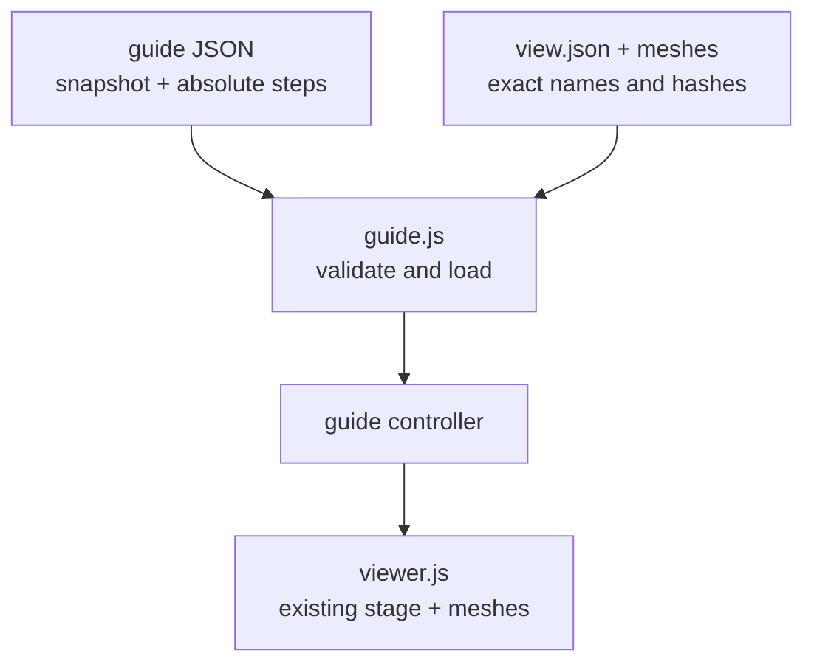

# Assembly instructions

Optional instruction data and controls for the existing [assembly viewer](../model/viewer.js).
Meshes have their assembled placement baked in: CAD millimetres, z up. Guide offsets are presentation only;
they do not prove an insertion path, physical fit or an assembly's qualification.

| File | Responsibility |
|---|---|
| [NOTICE.txt](NOTICE.txt) | Existing toolkit and adapted stage/HUD license terms carried by portable reader exports |
| `guide.js` | Strict guide/view validation, bounded asset reads and absolute step controller |
| `playback.js` | Canonical plan validation, absolute piecewise pose/parent adapter and reversible serial evaluation; legacy explicit instance order and absolute installation timing; caller supplies stage ticks |
| [examples/](examples/README.md) | Example guides with their meshes, receipts and licences; the featured one is Gyropup's turret |

The contract is `cad-agent.assembly-guide/1`. A guide binds one model manifest by relative file and SHA-256;
its snapshot names an ID, revision, `released` or `wip` status and exact source commit. Part names are exact mesh
instance identities, not catalogue keys. Steps list complete visible membership and highlighted new instances,
authored `offsets_mm`, plain instruction `text`, an optional hash-bound poster and CAD camera direction. A step
may require earlier step IDs. Subassemblies are named visibility sets, not geometric rigid-body declarations.
The bound model may instead be a packed `cad-agent-model/1` from `cadagent.publish.view.pack_view`: one
hash-bound binary carries every mesh (an assembly plan still needs per-part STL hashes).
A packed model is welded, quantised display geometry, not dimensions: each axis is stored in steps of its box
size / 65535 (about 0.004 mm for a 250 mm assembly, 0.03 mm for a 2 m one).
An optional plain-text `source.qualification` states what the guide is and is not; the reader shows it under the
version line.

This optional interface supports the first versioned pilot in Gyropup #266, under
cad-agent #302. The wider build-package feature remains separate.

[Web kit](../README.md)

## Part state and tables

| File | Responsibility |
| --- | --- |
| [part-tracker.js](part-tracker.js) | Local part progress state and persistence. |
| [part-table.js](part-table.js) | Part-table enhancement and progress controls. |
| [part-table.css](part-table.css) | Part-table presentation and states. |
