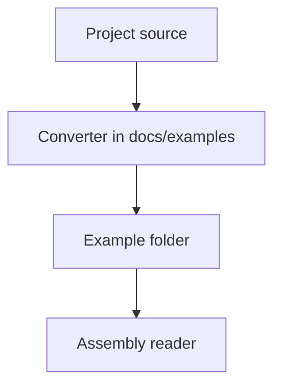

# Assembly guide examples

Example guides for the assembly reader, each with its meshes, a receipt of where it came from and its licence.
Product data stays in these folders; the reader's code above stays generic.

| Folder | Example |
| --- | --- |
| [gyropup-turret/](gyropup-turret/README.md) | Gyropup's turret, twelve authored steps over 55 parts, from its MIT-licensed repository; the toolkit's featured build guide. |

The reader's own tests use the synthetic [rail bench fixture](https://github.com/Valpatel/cad-agent/tree/main/tests/fixtures/assembly-plan).

[Assembly reader](../README.md)
