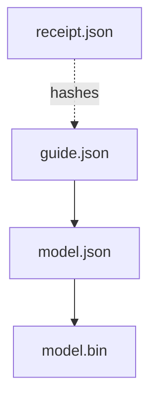

# Gyropup turret build guide

Gyropup's turret in twelve steps, in the order Gyropup's own recipe gives for building it, for the
[assembly reader](../../../model/viewer.html?guide=../assembly/examples/gyropup-turret/guide.json). Each step
highlights the parts it adds and draws them back along the way they go in; earlier parts can be ghosted.

| File | Contents |
| --- | --- |
| [guide.json](guide.json) | Twelve steps: Gyropup's titles and instruction text, parts added, insertion offsets, camera directions; the guide's qualification. |
| [model.json](model.json) | The packed model (`cad-agent-model/1`): 55 parts, millimetres, z up, bounds, colours and where each mesh lives in the binary, with the binary's SHA-256. |
| [model.bin](model.bin) | Every mesh, welded and quantised by cad-agent's `pack_view`, gzip-compressed (306 KB). Display geometry, not dimensions. |
| [receipt.json](receipt.json) | Gyropup revision, every source file's SHA-256, each translated mesh's SHA-256, the converter's hash, the text rules and every edit they made, left-out parts and limits. |
| [LICENSE.txt](LICENSE.txt) | Gyropup's MIT licence, which these meshes and texts carry. |

Generated by the [converter](https://github.com/Valpatel/cad-agent/tree/main/docs/examples/build-guide) from Gyropup's committed recipe
(`hardware/cad/turret/turret_assembly.py`) and turret scene (`hardware/exports/sim/turret_box/`); edit Gyropup, not
these files. The bought parts are Gyropup's own envelope meshes; no vendor source CAD is included. The instruction
text is Gyropup's, with its design-log codes (such as D42) and version tags (v1) dropped by stated rules; the
receipt lists every edit, so the original text can be restored and checked against its recorded hash.

An example sequence from a work-in-progress prototype, not a verified build procedure. A CAD step order does not
prove the parts can physically be assembled in that order, that they fit, or that a tool can reach each fastener.

[Examples](../README.md)
