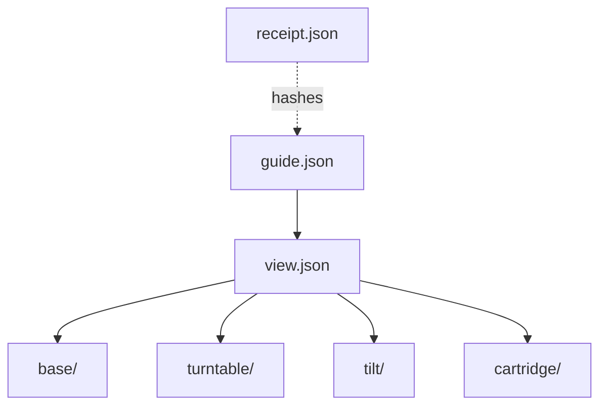

# Gyropup turret build guide

Gyropup's turret in twelve steps, in the order Gyropup's own recipe gives for building it, for the
[assembly reader](../../../model/viewer.html?guide=../assembly/examples/gyropup-turret/guide.json). Each step
highlights the parts it adds and draws them back along the way they go in; earlier parts can be ghosted.

| File or folder | Contents |
| --- | --- |
| [guide.json](guide.json) | Twelve steps: Gyropup's titles and instruction text, parts added, insertion offsets, camera directions; the guide's qualification. |
| [view.json](view.json) | The 55 parts, millimetres, z up, each mesh's SHA-256 and bounds. |
| [base/](base/README.md) | Meshes of steps 1 to 3: pan base, pan servo and pinion, DT12 socket, base-board module. |
| [turntable/](turntable/README.md) | Meshes of steps 4 to 6: pan bearing and clamp, turntable, slip ring. |
| [tilt/](tilt/README.md) | Meshes of steps 7 to 9: tilt yoke and board bay, tilt servo and cradle, laser. |
| [cartridge/](cartridge/README.md) | Meshes of steps 10 to 12: cartridge, barrel and hopper, thumbscrew. |
| [receipt.json](receipt.json) | Gyropup revision, every source file's SHA-256, the converter's hash, the method, left-out parts and limits. |
| [LICENSE.txt](LICENSE.txt) | Gyropup's MIT licence, which these meshes and texts carry. |

Generated by the [converter](https://github.com/Valpatel/cad-agent/tree/main/docs/examples/build-guide) from Gyropup's committed recipe
(`hardware/cad/turret/turret_assembly.py`) and turret scene (`hardware/exports/sim/turret_box/`); edit Gyropup, not
these files. The bought parts are Gyropup's own envelope meshes; no vendor source CAD is included.

An example sequence from a work-in-progress prototype, not a verified build procedure. A CAD step order does not
prove the parts can physically be assembled in that order, that they fit, or that a tool can reach each fastener.

[Examples](../README.md)
