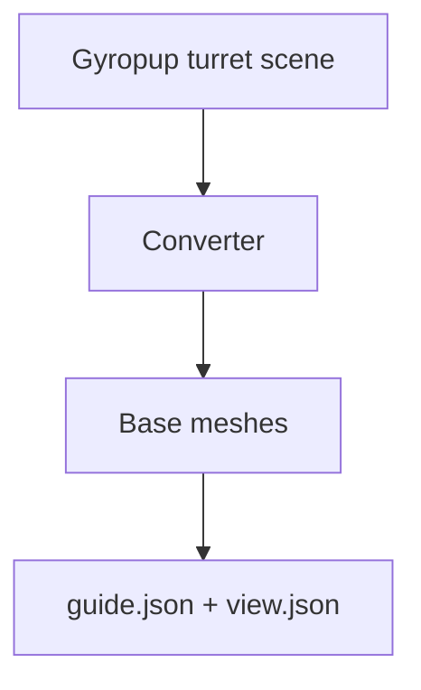

# Base meshes

The meshes of steps 1 to 3 of the Gyropup turret guide: the pan base, its servo and pinion, the DT12 socket and the base-board module. Generated by the
[converter](../../../../../../../docs/examples/build-guide/README.md); edit Gyropup's source, not these files.

Each mesh is Gyropup's own, translated into the turret's neutral pose; triangles and normals are unchanged. Their hashes
are in [view.json](../view.json) and [receipt.json](../receipt.json).

| File | Part | Step |
| --- | --- | --- |
| [pan_base.stl](pan_base.stl) | Pan base | 1 |
| [pan_servo.stl](pan_servo.stl) | Pan servo | 2 |
| [pan_pinion.stl](pan_pinion.stl) | Pan pinion (21 T) | 2 |
| [dt_receptacle.stl](dt_receptacle.stl) | DT12 socket | 2 |
| [base_board_carrier.stl](base_board_carrier.stl) | base board carrier | 3 |
| [base_board.stl](base_board.stl) | base board | 3 |
| [base_board_inserts.stl](base_board_inserts.stl) | base board inserts | 3 |
| [base_board_screws.stl](base_board_screws.stl) | base board screws | 3 |
| [base_carrier_inserts.stl](base_carrier_inserts.stl) | base carrier inserts | 3 |
| [base_carrier_screws.stl](base_carrier_screws.stl) | base carrier screws | 3 |
| [index_magnet.stl](index_magnet.stl) | index magnet | 3 |

[Turret guide](../README.md)
