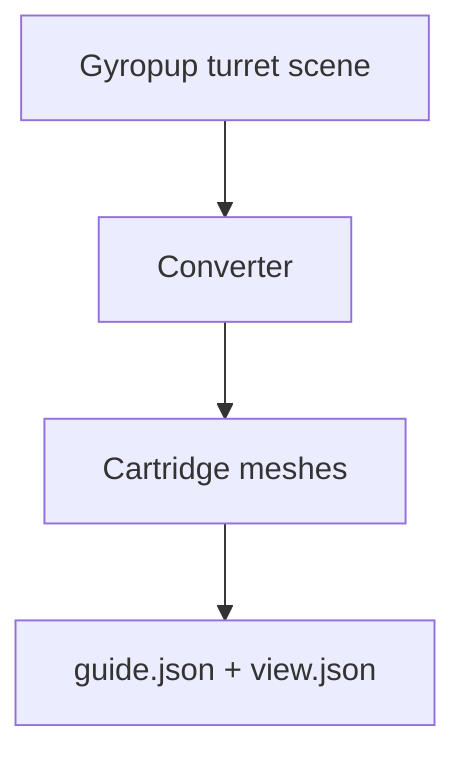

# Cartridge meshes

The meshes of steps 10 to 12 of the Gyropup turret guide: the launcher cartridge, the barrel and hopper, and its thumbscrew. Generated by the
[converter](https://github.com/Valpatel/cad-agent/tree/main/docs/examples/build-guide); edit Gyropup's source, not these files.

Each mesh is Gyropup's own, translated into the turret's neutral pose; triangles and normals are unchanged. Their hashes
are in [view.json](../view.json) and [receipt.json](../receipt.json).

| File | Part | Step |
| --- | --- | --- |
| [cartridge_body.stl](cartridge_body.stl) | Ball cartridge | 10 |
| [feed_motor.stl](feed_motor.stl) | Feed servo (STS3215) | 10 |
| [dial.stl](dial.stl) | Feed dial | 10 |
| [flywheel_motor_l.stl](flywheel_motor_l.stl) | Flywheel motor L | 10 |
| [flywheel_motor_r.stl](flywheel_motor_r.stl) | Flywheel motor R | 10 |
| [flywheel.stl](flywheel.stl) | Flywheel hub | 10 |
| [flywheel_m.stl](flywheel_m.stl) | Flywheel hub | 10 |
| [flywheel_tyre.stl](flywheel_tyre.stl) | Flywheel tyre | 10 |
| [flywheel_tyre_m.stl](flywheel_tyre_m.stl) | Flywheel tyre | 10 |
| [cartridge_board.stl](cartridge_board.stl) | Cartridge board | 10 |
| [esc_l.stl](esc_l.stl) | ESC L | 10 |
| [esc_r.stl](esc_r.stl) | ESC R | 10 |
| [barrel.stl](barrel.stl) | Barrel | 11 |
| [hopper.stl](hopper.stl) | Hopper | 11 |
| [hopper_lid.stl](hopper_lid.stl) | Hopper lid | 11 |
| [ct_thumbscrew.stl](ct_thumbscrew.stl) | ct thumbscrew | 12 |

[Turret guide](../README.md)
