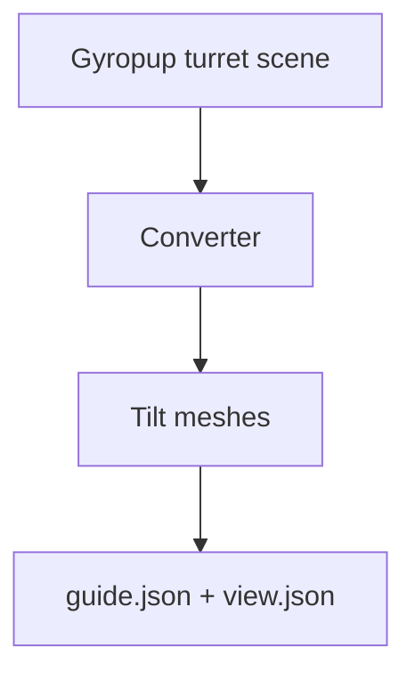

# Tilt meshes

The meshes of steps 7 to 9 of the Gyropup turret guide: the tilt yoke and board bay, the tilt servo and cradle, and the laser. Generated by the
[converter](../../../../../../../docs/examples/build-guide/README.md); edit Gyropup's source, not these files.

Each mesh is Gyropup's own, translated into the turret's neutral pose; triangles and normals are unchanged. Their hashes
are in [view.json](../view.json) and [receipt.json](../receipt.json).

| File | Part | Step |
| --- | --- | --- |
| [tilt_yoke.stl](tilt_yoke.stl) | Tilt yoke | 7 |
| [ring_leads_rotor.stl](ring_leads_rotor.stl) | ring leads rotor | 7 |
| [board_bay.stl](board_bay.stl) | Board bay | 7 |
| [turret_board.stl](turret_board.stl) | turret board | 7 |
| [tilt_servo.stl](tilt_servo.stl) | Tilt servo | 8 |
| [tilt_bearing.stl](tilt_bearing.stl) | Tilt bearing | 8 |
| [tilt_bearing_inner.stl](tilt_bearing_inner.stl) | tilt bearing inner | 8 |
| [cradle.stl](cradle.stl) | Cradle | 8 |
| [cradle_plate_l.stl](cradle_plate_l.stl) | cradle plate l | 8 |
| [cradle_plate_r.stl](cradle_plate_r.stl) | cradle plate r | 8 |
| [stop_lug.stl](stop_lug.stl) | stop lug | 8 |
| [horn_boss.stl](horn_boss.stl) | horn boss | 8 |
| [pivot_spacer.stl](pivot_spacer.stl) | pivot spacer | 8 |
| [shoulder_screw.stl](shoulder_screw.stl) | shoulder screw | 8 |
| [laser_mount.stl](laser_mount.stl) | Laser mount | 9 |
| [laser.stl](laser.stl) | Aiming laser | 9 |

[Turret guide](../README.md)
