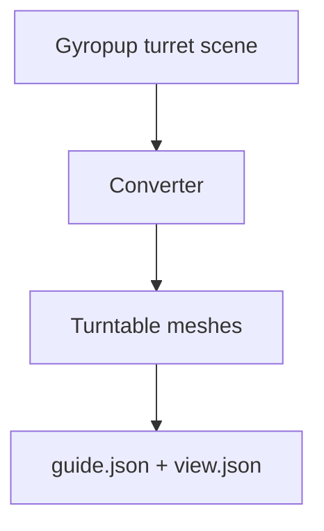

# Turntable meshes

The meshes of steps 4 to 6 of the Gyropup turret guide: the pan bearing and clamp, the turntable and the slip ring. Generated by the
[converter](../../../../../../../docs/examples/build-guide/README.md); edit Gyropup's source, not these files.

Each mesh is Gyropup's own, translated into the turret's neutral pose; triangles and normals are unchanged. Their hashes
are in [view.json](../view.json) and [receipt.json](../receipt.json).

| File | Part | Step |
| --- | --- | --- |
| [pan_bearing.stl](pan_bearing.stl) | Pan bearing | 4 |
| [pan_bearing_inner.stl](pan_bearing_inner.stl) | pan bearing inner | 4 |
| [pan_clamp.stl](pan_clamp.stl) | Bearing clamp | 4 |
| [pan_ring.stl](pan_ring.stl) | Pan ring (63 T) | 5 |
| [hall_switch.stl](hall_switch.stl) | hall switch | 5 |
| [pan_spacer.stl](pan_spacer.stl) | pan spacer | 5 |
| [circlip_50.stl](circlip_50.stl) | circlip 50 | 5 |
| [ring_driver.stl](ring_driver.stl) | ring driver | 6 |
| [slip_ring.stl](slip_ring.stl) | slip ring | 6 |
| [slip_ring_rotor.stl](slip_ring_rotor.stl) | slip ring rotor | 6 |
| [ring_coupling.stl](ring_coupling.stl) | ring coupling | 6 |
| [ring_carrier.stl](ring_carrier.stl) | ring carrier | 6 |

[Turret guide](../README.md)
