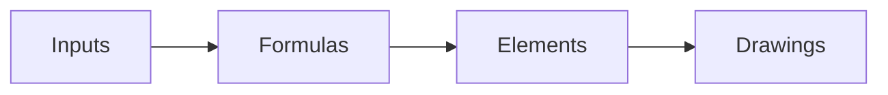

# Engineering calculators

Interactive browser calculators backed by the toolkit formula definitions. Each element owns its controls and drawing; assumptions and units remain explicit in the corresponding engineering guide.

| File | Responsibility |
| --- | --- |
| [formulas.js](formulas.js) | Browser formula implementations checked against Python golden vectors. |
| [formulas-data.js](formulas-data.js) | Generated materials and published component data; regenerate with the formula tools. |
| [cantilever.js](cantilever.js) | Snap-arm beam element and static drawing API. |
| [cantilever.css](cantilever.css) | Snap-arm element styles. |
| [fourbar.js](fourbar.js) | Four-bar linkage element, kinematics and static drawing API. |
| [fourbar.css](fourbar.css) | Four-bar element styles. |
| [fan-curve.js](fan-curve.js) | Fan/system curve element and operating-point visualization. |
| [fan-curve.css](fan-curve.css) | Fan-curve element styles. |
| [torsion-snap.js](torsion-snap.js) | Torsion snap element and static drawing API. |
| [torsion-snap.css](torsion-snap.css) | Torsion snap element styles. |
| [printed-boss.js](printed-boss.js) | Printed screw-boss element and static drawing API. |
| [printed-boss.css](printed-boss.css) | Printed screw-boss element styles. |

[Web kit](../README.md)
