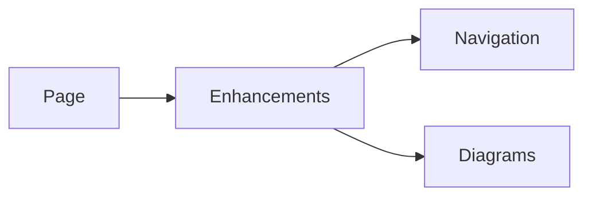

# Document enhancements

Progressive enhancements for authored pages: navigation, copy controls, review markers and Mermaid diagrams. These are page tools; engineering camera hosts remain in the viewer domains.

| File | Responsibility |
| --- | --- |
| [nav.js](nav.js) | Document navigation enhancement. |
| [nav.css](nav.css) | Document navigation styles. |
| [copy.js](copy.js) | Code and command copy controls. |
| [review.js](review.js) | Document review annotations. |
| [diagrams.js](diagrams.js) | Mermaid rendering and diagram enhancement lifecycle. |
| [diagrams.css](diagrams.css) | Diagram presentation, fallback and theme styles. |

[Web kit](../README.md)
