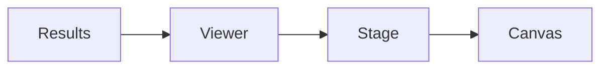

# Analysis result viewer

Read and inspect finite-element result artifacts. The viewer presents results and animation; it does not replace the solver or establish physical validity.

| File | Responsibility |
| --- | --- |
| [fea-viewer.js](fea-viewer.js) | Result loading, field coloring and deformed-shape playback. |
| [fea.html](fea.html) | Standalone analysis result page with project navigation. |

[Web kit](../README.md)

## Integration boundary

Use `fea.html` as the standalone result reader. It loads the domain viewer and shared stage;
it is not yet a `createViewerHost` adapter. The implementation still has window-relative
layout/tooltip calculations and a document-wide style identifier, so multiple contained
instances do not have the same isolation contract as the model, file and recorded-replay adapters.
Shared hosting and durable review identity remain tracked in
[#682](https://github.com/Valpatel/cad-agent/issues/682).

A rendered stress/deformation field is a visualization of supplied results, not a new solve
or physical qualification. Preserve the input artifact, source model and units with the result.
See the [contained-host contract](../host/README.md) and [toolkit map](../README.md)
when choosing an integration surface.
