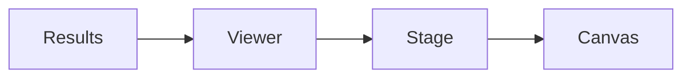

# Analysis result viewer

Read and inspect finite-element result artifacts. The viewer presents results and animation; it does not replace the solver or establish physical validity.

| File | Responsibility |
| --- | --- |
| [fea-viewer.js](fea-viewer.js) | Result loading, field coloring and deformed-shape playback. |
| [fea.html](fea.html) | Standalone analysis result page with project navigation. |

[Web kit](../README.md)
