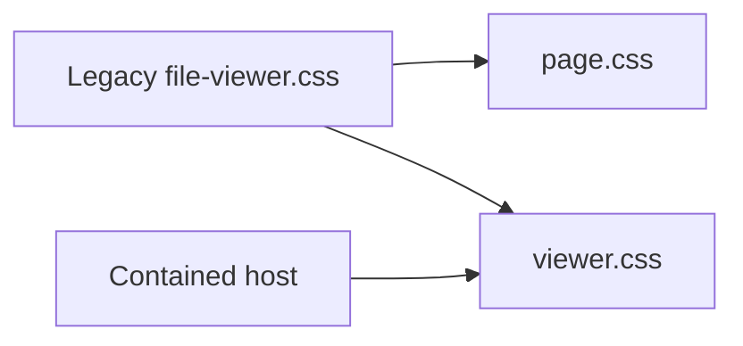

# Original-file presentation styles

Scoped styles for the existing STL/STEP/3MF viewer. The standalone page adds its
own page layout; contained viewers import only `viewer.css`.

| File | Responsibility |
| --- | --- |
| `viewer.css` | Original-file component tokens, controls and canvas layout |
| `page.css` | Standalone page dimensions and initial fallback palette |

The existing JavaScript entrypoints remain in the parent kit pending their
compatibility-aware domain move. [Web kit](../README.md) · [Host](../host/README.md)
