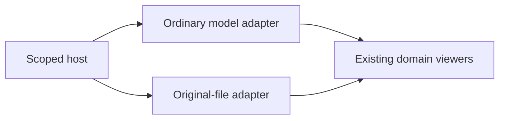

# Contained viewer host

A small, renderer-independent shell for mounting engineering viewers in a page.
Each instance owns its toolbar, loading state, inspector, keyboard focus and lifetime.
The ordinary assembly/STL and original-file adapters prove the same contract.

| Source | Responsibility |
| --- | --- |
| `viewer-host.js` | Lifecycle and scoped DOM; no Three.js dependency |
| `viewer-host.css` | Container layout, accessible toolbar and inspector styles |
| `adapters.js` | Ordinary-model and original-file composition |
| `stage-controls.js` | Shared 3D keyboard and camera-state support |

These modules are being integrated under issue #691. Standalone viewer entrypoints
remain supported; the host does not own simulation clocks or infer cross-artifact
identity. A source instance belongs only to the current loaded document.

[Web kit](../README.md) · [Browser tests](../../../../../tests/webkit/host/README.md)
